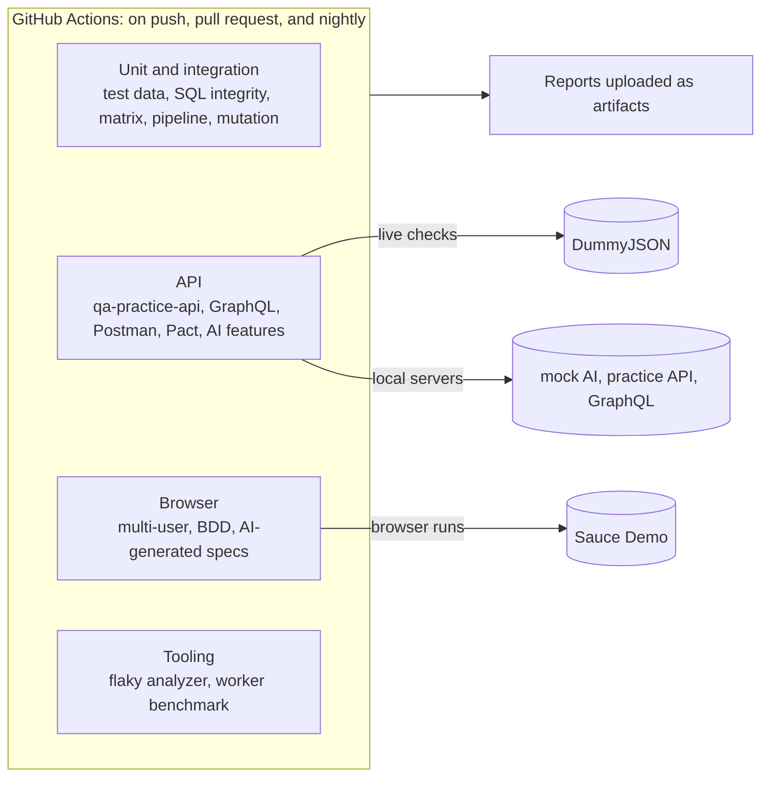

# QA Automation Platform

One repository of test automation work, run by one CI pipeline: browser tests, API tests, contract tests, AI-assisted test generation, test data, SQL data-integrity checks, and the tooling that keeps a suite trustworthy.

**For non-technical readers:** each folder under `packages/` is a small project that tests something, or helps testers do their job. The table below says what each one does in plain English. Every project runs automatically on each change and every night, and the green or red result is visible on the Actions tab.

---

## Packages

Strongest first.

| Package | In plain English | Checks |
|---|---|---:|
| [ai-test-generator](packages/ai-test-generator) | Uses Claude to write browser tests from a feature description, reviews the output for weak tests, and measures how often generated tests are usable as-is (first run: 42 of 43 passed). The reviewed tests now run as a regression suite split across 3 CI runners, with a check that no test was lost or run twice | 85 |
| [qa-for-ai-features](packages/qa-for-ai-features) | Tests an AI feature's response format, response time, and safety refusals | 12 |
| [ci-dashboard](packages/ci-dashboard) | A live web page of this repo's CI health: pass rate, run time and flaky jobs per package ([open it](https://rizvihiqrar.github.io/qa-automation-platform/)) | 12 |
| [flaky-test-analyzer](packages/flaky-test-analyzer) | Reads results from many test runs and points out the tests that only pass after a retry. After every CI run on main it checks the last 14 runs and keeps one GitHub issue per flaky test, opened and closed automatically | 23 |
| [worker-scaling-benchmark](packages/worker-scaling-benchmark) | Measures whether running tests in parallel actually makes a suite faster | 10 |
| [webhook-harness](packages/webhook-harness) | Proves a webhook receiver rejects forged or replayed messages, processes each one only once, and that the sender retries failures correctly | 20 |
| [api-drift-checker](packages/api-drift-checker) | Checks a live API against its written contract; its first run found two real bugs in the practice API, now fixed | 16 + 20-step live check |
| [k6-performance](packages/k6-performance) | Load and spike tests with per-endpoint limits; found that each login froze every other request for ~70 ms, now fixed (browsing p95 67 ms → 1 ms) | 5 + 3 k6 tests |
| [contract-testing-demo](packages/contract-testing-demo) | Checks that a live API still returns what the app that uses it expects | 4 |
| [qa-practice-api](packages/qa-practice-api) | A small REST API built to be tested, with its own API test suite | 36 |
| [a11y-aoda-audit](packages/a11y-aoda-audit) | Audits a demo store against the WCAG 2.0 AA standard Ontario's AODA requires, before and after fixes; also catches two issues axe misses | 16 |
| [multi-user-flow-patterns](packages/multi-user-flow-patterns) | Runs several users at once to catch bugs that only appear when people share a system | 9 |
| [bdd-playwright-demo](packages/bdd-playwright-demo) | Tests written as plain-language scenarios that a product owner can read | 9 scenarios |
| [sql-data-integrity](packages/sql-data-integrity) | Runs 15 SQL rules over an orders database and lists the exact rows that break them: orphans, duplicates, wrong totals, mismatched payments | 35 |
| [exploratory-session-tracker](packages/exploratory-session-tracker) | Structures exploratory testing (charters, timeboxes, tagged notes) and turns sessions into a team debrief | 10 |
| [log-signature-grouper](packages/log-signature-grouper) | Groups thousands of log errors into a few patterns and flags error patterns that are new since the last release | 15 |
| [defect-report-linter](packages/defect-report-linter) | Checks bug reports for missing steps, results, severity and evidence, and scores whether a developer could act on them | 20 |
| [test-data-factory](packages/test-data-factory) | Generates realistic, repeatable test data as JSON, CSV, or SQL | 25 |
| [mutation-testing-demo](packages/mutation-testing-demo) | Deliberately breaks the code to prove the tests would notice (89.1% caught) | 89 |
| [postman-api-collection](packages/postman-api-collection) | API checks in Postman, runnable from the command line | 25 |
| [graphql-test-suite](packages/graphql-test-suite) | Tests a GraphQL API: queries, errors, and partial results | 33 |
| [release-gate](packages/release-gate) | Reads smoke, contract and performance results, applies a policy, and blocks a deployment with clear reasons when a rule is broken | 15 |
| [pipeline-templates-demo](packages/pipeline-templates-demo) | One reusable CI/CD pipeline written for GitHub Actions, GitLab CI, and Azure DevOps | 28 |
| [matrix-build-demo](packages/matrix-build-demo) | Runs the same tests across several Node versions and operating systems | 99 |

24 packages, about 650 automated tests and checks in total. Live CI health: **[CI dashboard](https://rizvihiqrar.github.io/qa-automation-platform/)**.

---

## Architecture



Each package keeps its own `package.json`, so it can be read, installed, and run on its own. The root workflow (`.github/workflows/ci.yml`) runs every package as a separate job, so one failure doesn't hide the others.

The Sauce Demo regression suite (43 tests) is split across 3 runners with Playwright's `--shard`, and a `regression report` job merges the shards into one HTML report. It also checks that every test ran exactly once, because a lost or doubled shard still produces a green merged report. Sharding only pays when it removes more test time than the ~25 seconds of setup each runner repeats; the measurements are in the [ai-test-generator README](packages/ai-test-generator/README.md#does-sharding-pay-off-here).

Pull requests and main run different amounts of the live-site browser tests. A pull request runs only the `@smoke` tests of each browser suite (16 of 65 tests), unless it changes that suite, changes how CI picks tests, or has the `full-regression` label. Pushes to main, the nightly run and manual runs always run everything. `scripts/test-scope.mjs` makes the call and writes the reason in the job summary; when in doubt it runs everything.

Measured on the two Day 24 pull requests: the smoke run made 16 live-site test runs instead of 65 and used 181 instead of 278 runner-seconds for the browser jobs. It did not shorten the wait, because the slowest job is the k6 performance test (about 60 seconds) either way. What smoke buys is fewer runs against a public site that can be slow or flaky, not a faster green.

After each CI run on main, the **Flaky tests** workflow reads the merged regression results of the last 14 runs with flaky-test-analyzer and keeps one issue per flaky test, labelled [`flaky-test`](https://github.com/rizvihiqrar/qa-automation-platform/issues?q=label%3Aflaky-test). Retries keep a flaky test green in any single run; across runs, it shows up.

The `.github/workflows` folders inside `matrix-build-demo` and `pipeline-templates-demo` are example content for those demos. GitHub only runs the root workflow.

---

## Running Locally

```bash
cd packages/<package>
npm ci
npx playwright install chromium   # browser packages only
npm test
```

Requires Node 20 or later.

---

## Type-Checking

The packages are JavaScript today. A shared `tsconfig.base.json` type-checks them (`checkJs`, no build step), and the CI `typecheck` job runs it on every push:

```bash
npm ci
npm run typecheck   # the list of packages is in scripts/typecheck.mjs
```

Packages moving to TypeScript run directly on Node 24, which strips types at load time, so there's still no build step. They use `tsconfig.ts.json`: strict mode, unchecked index access, and only syntax Node can strip (no enums or namespaces). In TypeScript: test-data-factory, flaky-test-analyzer, worker-scaling-benchmark, ai-test-generator, qa-for-ai-features, qa-practice-api, multi-user-flow-patterns, bdd-playwright-demo, sql-data-integrity. Every other package with code is JavaScript checked by the same type-checker (`checkJs`), so all 23 run through `npm run typecheck` in CI. The CI demos stay JavaScript on purpose: they exist to show pipeline patterns.

What it does and doesn't catch: it catches wrong use of anything typed, such as Node's APIs (`fs.readFilSync` fails with "Did you mean readFileSync?") and functions with JSDoc types. In plain JavaScript, TypeScript treats every parameter as optional, so a call missing an argument to an untyped function passes. That gap is why the roadmap moves packages to TypeScript next, one per day.

The first pass found 19 errors. Two were real: code assumed `server.address()` always returns an object, but it returns a string for pipe and socket listeners. Both are fixed (webhook-harness, api-drift-checker), along with the same pattern in two packages not yet type-checked (k6-performance, a11y-aoda-audit). The rest were types that only needed writing down (JSDoc), and one test that passes bad input on purpose is marked `@ts-expect-error`.

---

## Bugs Found and Fixed While Building This

Bringing these projects together surfaced real defects. Each fix is described in the package README.

| Package | Problem | Fix |
|---|---|---|
| bdd-playwright-demo | All 9 scenarios failed: the ESM config was nested one level too deep, so Cucumber ignored it and never loaded the browser setup | Flattened the config |
| bdd-playwright-demo | The product count sometimes read 0 before the page rendered | Wait for the first product, then count |
| contract-testing-demo | Provider check could run before the contract existed; then failed to parse brotli-compressed responses | Run consumer first; request uncompressed responses |
| qa-for-ai-features | Parallel workers fought over the mock server's port | Start the server once for the whole run |
| postman-api-collection | "No token" request was still authenticated through a cookie | Disable cookies for that request |
| test-data-factory | Orders shipped before they were placed; bad `--count` values produced empty files | Fixed the date rules; validate input |
| ai-test-generator | No tests at all | Added 18 unit tests and a review step for generated output |
| qa-practice-api | Accepted a text price (saved as `null`) and negative stock, found by api-drift-checker | Validate both; two new API tests |
| webhook-harness | Two copies of one delivery arriving together were both processed | Track deliveries in progress; answer the second with `409` |
| qa-practice-api | Password hashing blocked the event loop: browsing p95 went from ~1 ms to 67–84 ms whenever users logged in, found by k6 | Hash with `crypto.scrypt` in the thread pool; browsing p95 back to 1 ms |

---

## Roadmap

See [ROADMAP.md](ROADMAP.md): one module a day for 30 days, each through its own pull request.

---

## Notes

- Live checks run against public demo services (DummyJSON, Sauce Demo). When those services change, tests can fail for reasons outside this repo. Several fixes above came from exactly that.
- No employer code or data is included. Everything here targets public demo apps or local mock services.
