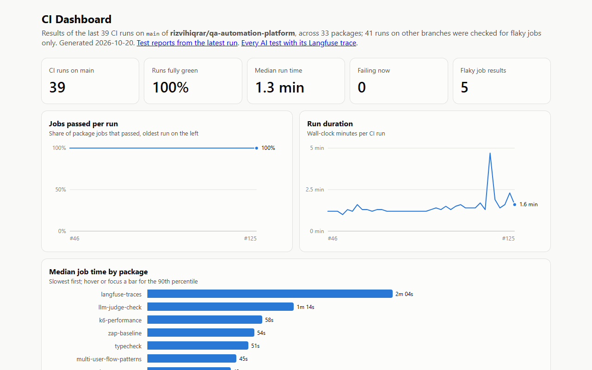
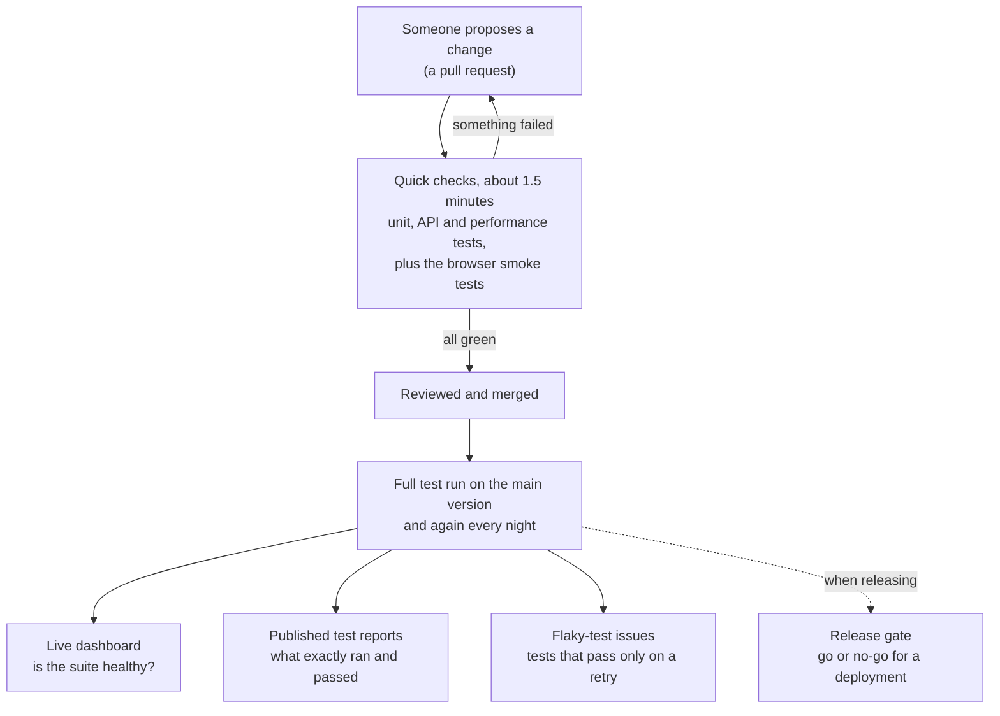
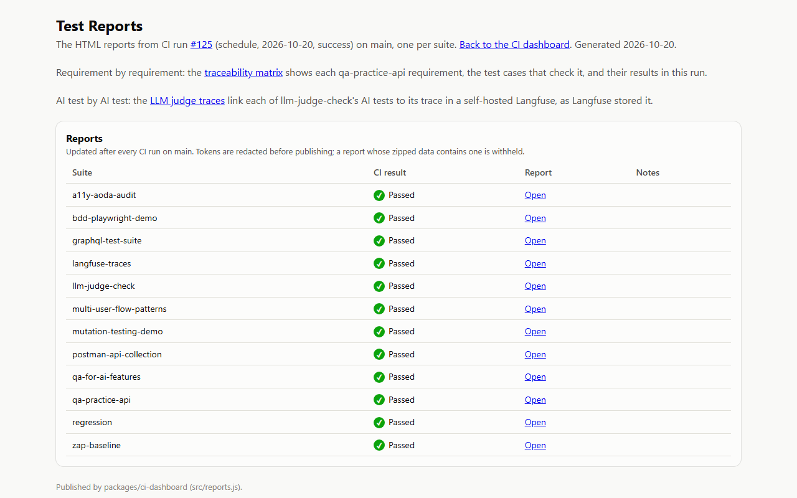
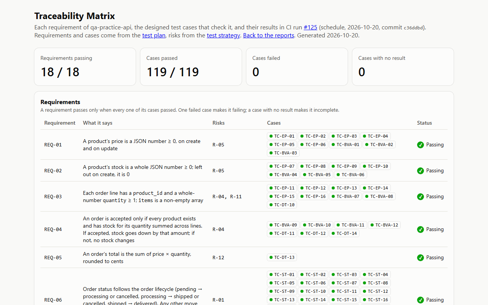
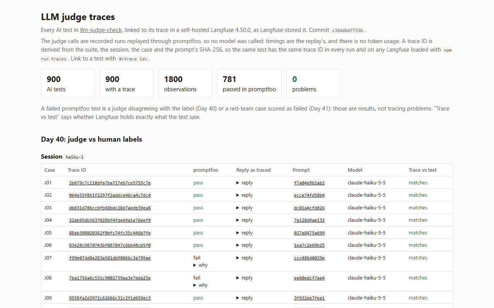

# QA Automation Platform

One repository of test automation work, run by one CI pipeline: browser tests, API tests, contract tests, AI-assisted test generation, test data, SQL data-integrity checks, and the tooling that keeps a suite trustworthy. It is a working example of how a team catches broken changes automatically, and it has found real bugs in the code it tests (see [Results](#results)).

**[Technical guide →](TECHNICAL.md)**

## In plain English

Software teams change their product every day, and each change can break something that used to work. This project is a working example of how a team catches those breaks automatically, before customers do.

Each folder under `packages/` is a small project that either tests something (a website, an API, a database, an AI feature) or helps testers do their job (finding unreliable tests, checking bug reports, generating test data). [The packages](#the-packages) says what each one does.

<a href="docs/assets/dashboard.png">
  <picture>
    <source media="(prefers-color-scheme: dark)" srcset="docs/assets/dashboard-dark.png">
    
  </picture>
</a>

*The live [CI dashboard](https://rizvihiqrar.github.io/qa-automation-platform/): pass rate, run time and flaky jobs, rebuilt after every run on main. Shown in the viewer's light or dark theme.*

## At a glance

- 29 packages, about 1,570 automated tests and checks, all run by one CI workflow
- One CI job per package, so one failure never hides another
- A live [CI dashboard](https://rizvihiqrar.github.io/qa-automation-platform/) of pass rate, run time and flaky jobs, rebuilt after every run on main
- [Published test reports](https://rizvihiqrar.github.io/qa-automation-platform/reports/) for every suite, with tokens redacted before publishing
- A [traceability matrix](https://rizvihiqrar.github.io/qa-automation-platform/reports/traceability/): each API requirement, the test cases that check it, and their latest results
- Flaky tests tracked across the last 14 runs, with one GitHub issue per flaky test, opened and closed automatically
- Pull requests run a quick smoke set; main and the nightly run do everything
- Load testing that found a real performance bug, now fixed
- AI-written tests reviewed before they count, and an AI grader checked against a person's answers
- Every AI test linked to the record of what the AI was asked and answered, in a self-hosted Langfuse
- Mutation testing that deliberately breaks code to prove the tests would notice
- Playwright and Cypress both: a banking UI tested by Cypress in Chrome and Firefox, where a double click or a lost reply still moves money once
- A release gate that blocks a deployment, with reasons, when a rule is broken
- A daily CI health check, and an automatic one-time re-run when CI fails on main
- Strict TypeScript in ten packages, type-checked in CI with no build step

## The packages

Strongest first within each area. Counts are automated checks. The [full descriptions](TECHNICAL.md#package-reference) are in the technical guide.

### UI

| Package | What it does | Checks |
|---|---|---:|
| [multi-user-flow-patterns](packages/multi-user-flow-patterns) | Runs several users at once to catch bugs that only appear when people share a system | 9 |
| [visual-regression-demo](packages/visual-regression-demo) | Compares screenshots of the banking UI with baselines in light, dark and phone width, in two browsers, and proves it by planting visual bugs | 46 |
| [bdd-playwright-demo](packages/bdd-playwright-demo) | Tests written as plain-language scenarios that a product owner can read | 9 scenarios + 4 |
| [a11y-aoda-audit](packages/a11y-aoda-audit) | Audits a demo store against the WCAG 2.0 AA standard Ontario's AODA requires, before and after fixes | 16 |

### API

| Package | What it does | Checks |
|---|---|---:|
| [qa-practice-api](packages/qa-practice-api) | A small REST API built to be tested, with 119 cases designed from a written [test strategy](docs/test-strategy/README.md) and a passive OWASP ZAP scan in CI | 292 + 17 properties + ZAP scan |
| [banking-api](packages/banking-api) | A small banking API where every cent is exact: accounts in four currencies and transfers on a double-entry ledger, with no floating-point maths. Retried requests move money once, requests at the same time can't overdraw an account, and 14 SQL checks prove every transfer balances. A small banking UI on top is tested by Cypress in Chrome and Firefox | 236 + 8 properties + 69 Cypress |
| [api-drift-checker](packages/api-drift-checker) | Checks a live API against its written contract; its first run found two real bugs | 17 + 39-step live check |
| [api-pytest](packages/api-pytest) | The same designed cases as the Playwright API suite, written again in Python with pytest and requests, under the same case IDs. A fixture starts the API, so one command runs it | 40 |
| [webhook-harness](packages/webhook-harness) | Proves a webhook receiver rejects forged or replayed messages and processes each one only once | 21 |
| [graphql-test-suite](packages/graphql-test-suite) | Tests a GraphQL API: queries, errors, and partial results | 33 |
| [postman-api-collection](packages/postman-api-collection) | API checks in Postman, runnable from the command line | 25 |
| [contract-testing-demo](packages/contract-testing-demo) | Checks that a live API still returns what the app that uses it expects | 5 |
| [sql-data-integrity](packages/sql-data-integrity) | Runs 15 SQL rules over an orders database and lists the exact rows that break them | 35 |
| [test-data-factory](packages/test-data-factory) | Generates realistic, repeatable test data as JSON, CSV, or SQL | 25 |

### Performance

| Package | What it does | Checks |
|---|---|---:|
| [k6-performance](packages/k6-performance) | Load and spike tests with per-endpoint limits; found that each login froze every other request for about 70 ms | 5 + 3 k6 tests |
| [worker-scaling-benchmark](packages/worker-scaling-benchmark) | Measures whether running tests in parallel actually makes a suite faster | 12 |

### AI quality

| Package | What it does | Checks |
|---|---|---:|
| [ai-test-generator](packages/ai-test-generator) | Uses Claude to write browser tests from a feature description, reviews them for weak tests, and measures how many are usable as they are | 127 |
| [llm-judge-check](packages/llm-judge-check) | Checks an AI grader against a person's answers before trusting it, and traces every AI test result | 81 |
| [qa-for-ai-features](packages/qa-for-ai-features) | Tests an AI feature's response format, response time, and safety refusals | 12 |

### CI tooling and helpers

| Package | What it does | Checks |
|---|---|---:|
| [ci-dashboard](packages/ci-dashboard) | The live web page of this repo's CI health, plus the published reports and the traceability matrix | 41 |
| [flaky-test-analyzer](packages/flaky-test-analyzer) | Points out the tests that only pass after a retry, and keeps one GitHub issue per flaky test | 37 |
| [release-gate](packages/release-gate) | Reads smoke, contract and performance results, applies a policy, and blocks a deployment with clear reasons | 15 |
| [mutation-testing-demo](packages/mutation-testing-demo) | Deliberately breaks the code to prove the tests would notice (89.2% caught) | 89 |
| [pipeline-templates-demo](packages/pipeline-templates-demo) | One reusable CI/CD pipeline written for GitHub Actions, GitLab CI, and Azure DevOps | 28 |
| [matrix-build-demo](packages/matrix-build-demo) | Runs the same tests across several Node versions and operating systems | 99 |
| [defect-report-linter](packages/defect-report-linter) | Checks bug reports for missing steps, results, severity and evidence | 20 |
| [log-signature-grouper](packages/log-signature-grouper) | Groups thousands of log errors into a few patterns and flags patterns that are new since the last release | 15 |
| [exploratory-session-tracker](packages/exploratory-session-tracker) | Structures exploratory testing (charters, timeboxes, tagged notes) and turns sessions into a team debrief | 10 |

### Learning

| Package | What it does | Checks |
|---|---|---:|
| [money-course](packages/money-course) | A short course, Testing money in software, built on the banking API: six objectives, a quiz for each, and an ungraded practical with six planted bugs and a model answer. Being run as a pilot | 30 |

## How a change gets tested

*The [test reports](https://rizvihiqrar.github.io/qa-automation-platform/reports/) page: one report per suite, from the latest full run.*

*The [traceability matrix](https://rizvihiqrar.github.io/qa-automation-platform/reports/traceability/): each API requirement, the test cases that check it, and their latest results.*

*[Every AI test](https://rizvihiqrar.github.io/qa-automation-platform/reports/langfuse-traces/) linked to the record of what the AI was asked and answered, from a self-hosted Langfuse.*

Flaky-test issues are opened and closed automatically: see [the `flaky-test` label](https://github.com/rizvihiqrar/qa-automation-platform/issues?q=label%3Aflaky-test).

## Results

Each number links to where it comes from. Figures are as of 2026-10-20.

| Result | Number | Source |
|---|---|---|
| CI jobs passing on main | 35 of 35 | [CI dashboard](https://rizvihiqrar.github.io/qa-automation-platform/) |
| CI runs fully green on main | 100% of the last 39 | [CI dashboard](https://rizvihiqrar.github.io/qa-automation-platform/) |
| Mutation score, shopping cart module | 89.2% (198 of 222 changes caught) | [mutation-testing-demo](packages/mutation-testing-demo/README.md) |
| Mutation score, AI-written discount code | 93.9% of 412 changes caught by designed cases and properties together | [scoreboard](docs/ai-written-code/scoreboard.md#and-mutation-testing) |
| Flaky-test tracking | Last 14 runs on main; catches a test failing 1 run in 5 about 96% of the time, 1 in 100 only 13% | [flaky-test-analyzer](packages/flaky-test-analyzer#how-sure-are-we-run-to-run-variance) |
| Money, race, ledger-check and UI mistakes put back on purpose and caught, banking API | 78 of 78 | [banking-api](packages/banking-api/TECHNICAL.md#deliberate-breaks) |
| Visual bugs planted in the banking UI and caught by the screenshot comparison (a button a few shades off, a 4 px shift, a missing button, a clipped amount, unreadable dark mode, a wrapped column) | 6 of 6 | [visual-regression-demo](packages/visual-regression-demo/TECHNICAL.md#planted-visual-bugs) |
| Planted bugs in the course practical caught by the model answer, each by its own check only | 6 of 6 | [money-course](packages/money-course/TECHNICAL.md#the-model-answer-is-proven-against-each-bug) |
| Requirements traced to passing tests | 18 of 18, 119 of 119 cases | [traceability matrix](https://rizvihiqrar.github.io/qa-automation-platform/reports/traceability/) |
| AI tests with a matching trace | 900 of 900 | [Langfuse traces](https://rizvihiqrar.github.io/qa-automation-platform/reports/langfuse-traces/) |
| Bugs found and fixed | Real ones, each with its fix | [full list](TECHNICAL.md#bugs-found-and-fixed-while-building-this) |

**What it has found so far:** real bugs, not just green ticks. A login that froze every other user for 70 milliseconds, an API that sold more stock than it had and let delivered orders go back to pending, an API anyone could sign admin tokens for with a secret printed in this repository, a webhook processed twice, a tool that rejected every rule on Windows, and test reports that would have published live access tokens. Five have full [root-cause write-ups](docs/rca/README.md).

**Two results in numbers**

- **A performance bug found by load testing** ([k6-performance](packages/k6-performance)): browsing slowed to 67–84 ms (p95) whenever users logged in, because password hashing blocked Node's main thread. Moving the hashing to a thread pool brought p95 down to 1 ms and logins from 72 to 40 ms. The first threshold (250 ms) had passed the bug, so the limits are now set from measurements.
- **AI-written tests, reviewed before they count** ([ai-test-generator](packages/ai-test-generator)): 10 of 10 generated specs passed the automated review and 42 of 43 tests passed on their first run. The review caught a test with no assertion that Playwright reported as passing. The 43 tests now run as a regression suite split across 3 CI runners, with a check that no test was lost or run twice.

## Words used on this page

| Term | Meaning |
|---|---|
| CI (continuous integration) | A service (here, GitHub Actions) that runs every test automatically whenever the code changes |
| Pull request | A proposed change, checked and reviewed before it becomes part of the main version |
| Smoke test | A short check of the most important paths, run first because it's fast |
| Regression test | A test that makes sure something that used to work still works |
| Flaky test | A test that sometimes passes and sometimes fails without any code change; it erodes trust in the whole suite |
| Shard | One slice of a test suite; slices run on separate machines at the same time |
| API | The way programs talk to each other, without a screen |

## Roadmap

See [ROADMAP.md](ROADMAP.md): one module a day for 30 days, each through its own pull request. The plan is complete and released as [v1.0.0](https://github.com/rizvihiqrar/qa-automation-platform/releases/tag/v1.0.0); [RETROSPECTIVE.md](RETROSPECTIVE.md) covers what worked, what didn't, and what v1.0 doesn't prove. Phase 2 (Days 31–60) is planned in the same file.

No employer code or data is included. Everything here targets public demo apps or local mock services. See the [technical guide](TECHNICAL.md#notes) for the notes on live services.
