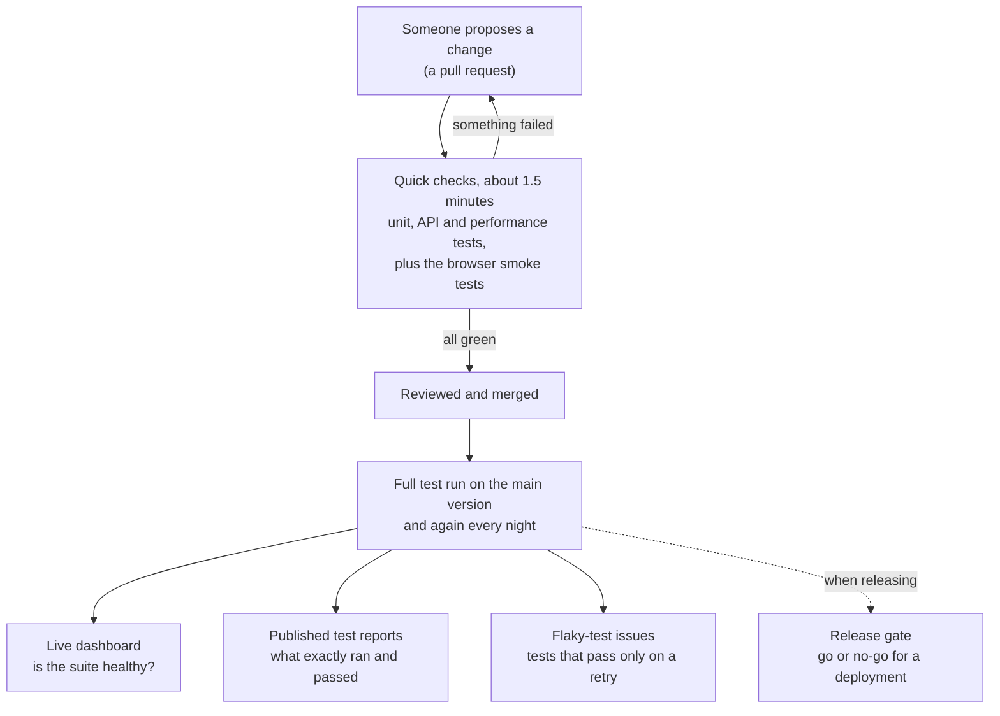
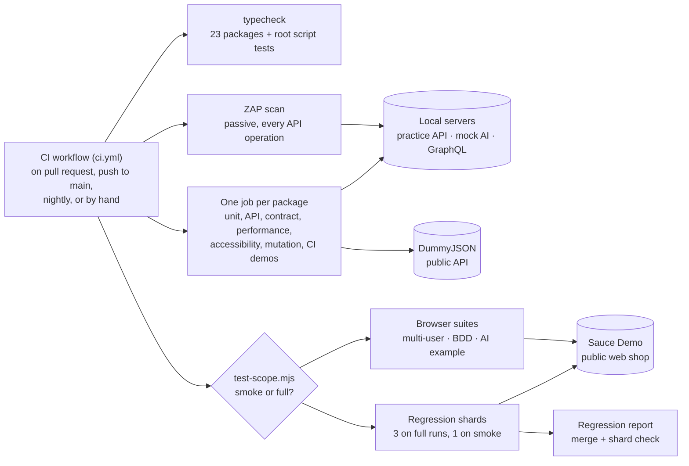
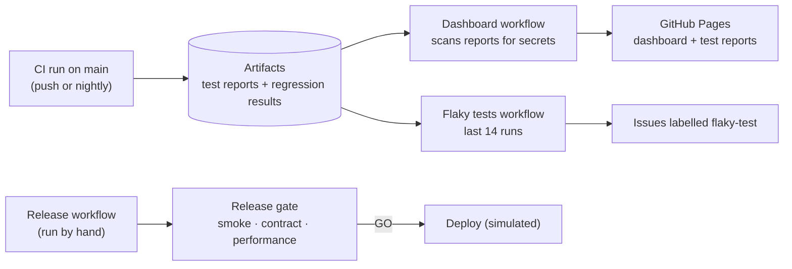

# QA Automation Platform

One repository of test automation work, run by one CI pipeline: browser tests, API tests, contract tests, AI-assisted test generation, test data, SQL data-integrity checks, and the tooling that keeps a suite trustworthy.

## In Plain English

Software teams change their product every day, and each change can break something that used to work. This project is a working example of how a team catches those breaks automatically, before customers do.

Each folder under `packages/` is a small project that either tests something (a website, an API, a database, an AI feature) or helps testers do their job (finding unreliable tests, checking bug reports, generating test data). The [table below](#packages) says what each one does.

**What it has found so far:** real bugs, not just green ticks. A login that froze every other user for 70 milliseconds, an API that sold more stock than it had and let delivered orders go back to pending, an API anyone could sign admin tokens for with a secret printed in this repository, a webhook processed twice, a tool that rejected every rule on Windows, and test reports that would have published live access tokens. Each one is listed in [Bugs Found](#bugs-found-and-fixed-while-building-this) with its fix.

### Two results in numbers

- **A performance bug found by load testing** ([k6-performance](packages/k6-performance)): browsing slowed to 67–84 ms (p95) whenever users logged in, because password hashing blocked Node's main thread. Moving the hashing to a thread pool brought p95 down to 1 ms and logins from 72 to 40 ms. The first threshold (250 ms) had passed the bug, so the limits are now set from measurements.
- **AI-written tests, reviewed before they count** ([ai-test-generator](packages/ai-test-generator)): 10 of 10 generated specs passed the automated review and 42 of 43 tests passed on their first run. The review caught a test with no assertion that Playwright reported as passing. The 43 tests now run as a regression suite split across 3 CI runners, with a check that no test was lost or run twice.

### How a change gets tested



- **[CI dashboard](https://rizvihiqrar.github.io/qa-automation-platform/):** pass rate, run time and unreliable jobs for every package.
- **[Test reports](https://rizvihiqrar.github.io/qa-automation-platform/reports/):** the detailed results of the latest full run, one report per suite.
- **[Flaky-test issues](https://github.com/rizvihiqrar/qa-automation-platform/issues?q=label%3Aflaky-test):** opened and closed automatically.

### Words used on this page

| Term | Meaning |
|---|---|
| CI (continuous integration) | A service (here, GitHub Actions) that runs every test automatically whenever the code changes |
| Pull request | A proposed change, checked and reviewed before it becomes part of the main version |
| Smoke test | A short check of the most important paths, run first because it's fast |
| Regression test | A test that makes sure something that used to work still works |
| Flaky test | A test that sometimes passes and sometimes fails without any code change; it erodes trust in the whole suite |
| Shard | One slice of a test suite; slices run on separate machines at the same time |
| API | The way programs talk to each other, without a screen |

---

## Packages

Strongest first.

| Package | In plain English | Checks |
|---|---|---:|
| [ai-test-generator](packages/ai-test-generator) | Uses Claude to write browser tests from a feature description, reviews the output for weak tests, and measures how often generated tests are usable as-is (first run: 42 of 43 passed). The reviewed tests now run as a regression suite split across 3 CI runners, with a check that no test was lost or run twice. A written [requirement review](docs/requirement-review/README.md) of the ten feature files it started from found 29 gaps (8 of them defects in the demo shop, such as an item total printed as `$119.94999999999999`), each followed to a test or a question | 127 |
| [qa-for-ai-features](packages/qa-for-ai-features) | Tests an AI feature's response format, response time, and safety refusals | 12 |
| [ci-dashboard](packages/ci-dashboard) | A live web page of this repo's CI health: pass rate, run time and flaky jobs per package ([open it](https://rizvihiqrar.github.io/qa-automation-platform/)), plus the latest test reports ([open them](https://rizvihiqrar.github.io/qa-automation-platform/reports/)), checked for leaked tokens before publishing, and a traceability matrix ([open it](https://rizvihiqrar.github.io/qa-automation-platform/reports/traceability/)) showing each API requirement, the test cases that check it, and their latest results | 33 |
| [flaky-test-analyzer](packages/flaky-test-analyzer) | Reads results from many test runs and points out the tests that only pass after a retry. After every CI run on main it checks the last 14 runs and keeps one GitHub issue per flaky test, opened and closed automatically. Also puts a confidence interval on each pass rate and works out how many runs it takes to catch a rare flake | 37 |
| [worker-scaling-benchmark](packages/worker-scaling-benchmark) | Measures whether running tests in parallel actually makes a suite faster | 10 |
| [webhook-harness](packages/webhook-harness) | Proves a webhook receiver rejects forged or replayed messages, processes each one only once, and that the sender retries failures correctly | 21 |
| [api-drift-checker](packages/api-drift-checker) | Checks a live API against its written contract; its first run found two real bugs in the practice API, now fixed | 17 + 27-step live check |
| [k6-performance](packages/k6-performance) | Load and spike tests with per-endpoint limits; found that each login froze every other request for ~70 ms, now fixed (browsing p95 67 ms → 1 ms) | 5 + 3 k6 tests |
| [contract-testing-demo](packages/contract-testing-demo) | Checks that a live API still returns what the app that uses it expects | 4 |
| [qa-practice-api](packages/qa-practice-api) | A small REST API built to be tested, with its own API test suite and 119 cases designed from a written [test strategy](docs/test-strategy/README.md) (equivalence classes, boundaries, decision tables, state transitions, an access-control matrix), plus a passive [OWASP ZAP scan](packages/qa-practice-api/README.md#security-scan) of every operation in CI | 165 + ZAP scan |
| [a11y-aoda-audit](packages/a11y-aoda-audit) | Audits a demo store against the WCAG 2.0 AA standard Ontario's AODA requires, before and after fixes; also catches two issues axe misses | 16 |
| [multi-user-flow-patterns](packages/multi-user-flow-patterns) | Runs several users at once to catch bugs that only appear when people share a system | 9 |
| [bdd-playwright-demo](packages/bdd-playwright-demo) | Tests written as plain-language scenarios that a product owner can read | 9 scenarios + 4 |
| [sql-data-integrity](packages/sql-data-integrity) | Runs 15 SQL rules over an orders database and lists the exact rows that break them: orphans, duplicates, wrong totals, mismatched payments | 35 |
| [exploratory-session-tracker](packages/exploratory-session-tracker) | Structures exploratory testing (charters, timeboxes, tagged notes) and turns sessions into a team debrief | 10 |
| [log-signature-grouper](packages/log-signature-grouper) | Groups thousands of log errors into a few patterns and flags error patterns that are new since the last release | 15 |
| [defect-report-linter](packages/defect-report-linter) | Checks bug reports for missing steps, results, severity and evidence, and scores whether a developer could act on them | 20 |
| [test-data-factory](packages/test-data-factory) | Generates realistic, repeatable test data as JSON, CSV, or SQL | 25 |
| [mutation-testing-demo](packages/mutation-testing-demo) | Deliberately breaks the code to prove the tests would notice (89.1% caught) | 89 |
| [postman-api-collection](packages/postman-api-collection) | API checks in Postman, runnable from the command line | 25 |
| [graphql-test-suite](packages/graphql-test-suite) | Tests a GraphQL API: queries, errors, and partial results | 33 |
| [release-gate](packages/release-gate) | Reads smoke, contract and performance results, applies a policy, and blocks a deployment with clear reasons when a rule is broken | 15 |
| [pipeline-templates-demo](packages/pipeline-templates-demo) | One reusable CI/CD pipeline written for GitHub Actions, GitLab CI, and Azure DevOps | 28 |
| [matrix-build-demo](packages/matrix-build-demo) | Runs the same tests across several Node versions and operating systems | 99 |

24 packages, about 900 automated tests and checks in total. Live CI health: **[CI dashboard](https://rizvihiqrar.github.io/qa-automation-platform/)**. Latest test reports: **[reports](https://rizvihiqrar.github.io/qa-automation-platform/reports/)**. Requirement by requirement: **[traceability matrix](https://rizvihiqrar.github.io/qa-automation-platform/reports/traceability/)**.

---

## Architecture

**What CI runs, and what the tests talk to**



**What happens after a run on main**



Each package keeps its own `package.json`, so it can be read, installed, and run on its own. The root workflow (`.github/workflows/ci.yml`) runs every package as a separate job, so one failure doesn't hide the others.

The Sauce Demo regression suite (43 tests) is split across 3 runners with Playwright's `--shard`, and a `regression report` job merges the shards into one HTML report. It also checks that every test ran exactly once, because a lost or doubled shard still produces a green merged report. Sharding only pays when it removes more test time than the ~25 seconds of setup each runner repeats; the measurements are in the [ai-test-generator README](packages/ai-test-generator/README.md#does-sharding-pay-off-here).

Pull requests and main run different amounts of the live-site browser tests. A pull request runs only the `@smoke` tests of each browser suite (16 of 65 tests), unless it changes that suite, changes how CI picks tests, or has the `full-regression` label. Pushes to main, the nightly run and manual runs always run everything. `scripts/test-scope.mjs` makes the call and writes the reason in the job summary; when in doubt it runs everything. Measured: a smoke run makes 75% fewer live-site test runs but isn't faster to go green, because the k6 performance job (about 60 seconds) is the slowest either way. What smoke buys is fewer runs against a public site that can be slow or flaky.

After each CI run on main, two workflows read its artifacts. **Dashboard** rebuilds the [CI dashboard](https://rizvihiqrar.github.io/qa-automation-platform/) and publishes that run's [test reports](https://rizvihiqrar.github.io/qa-automation-platform/reports/), after redacting tokens and withholding any report it can't clean. **Flaky tests** reads the regression results of the last 14 runs and keeps one issue per flaky test, labelled [`flaky-test`](https://github.com/rizvihiqrar/qa-automation-platform/issues?q=label%3Aflaky-test). Retries keep a flaky test green in any single run; across runs, it shows up. How far 14 runs can see is measured, not assumed: they catch a test that fails 1 run in 5 about 96% of the time, but one that fails 1 run in 100 only 13% of the time ([the numbers](packages/flaky-test-analyzer#how-sure-are-we-run-to-run-variance)). The manual **Variance** workflow repeats the regression suite many times on GitHub's runners when a quicker, sharper answer is needed.

The `zap-baseline` job scans the practice API with OWASP ZAP's passive rules on every run: every operation in its OpenAPI spec is requested once, and a finding nobody has triaged fails the job. The triage, and why it uses ZAP's API scan rather than the plain baseline, is in the [practice API README](packages/qa-practice-api/README.md#security-scan).

The `.github/workflows` folders inside `matrix-build-demo` and `pipeline-templates-demo` are example content for those demos. GitHub only runs the root workflow.

---

## Running Locally

```bash
cd packages/<package>
npm ci
npx playwright install chromium   # browser packages only
npm test
```

Requires Node 24, the version CI uses: the TypeScript packages run their `.ts` files directly, with no build step.

To run only the quick set CI uses on pull requests: `npm run smoke` in multi-user-flow-patterns and bdd-playwright-demo, or add `--grep @smoke` to a Playwright command (for example `npm run test:regression -- --grep @smoke` in ai-test-generator).

---

## Type-Checking

Every package with code is type-checked in CI (23 of 23; the Postman collection has no code). The CI `typecheck` job runs it on every push:

```bash
npm ci
npm run typecheck   # the list of packages is in scripts/typecheck.mjs
```

Nine packages are strict TypeScript, run directly by Node 24, which strips types at load time, so there's no build step: test-data-factory, flaky-test-analyzer, worker-scaling-benchmark, ai-test-generator, qa-for-ai-features, qa-practice-api, multi-user-flow-patterns, bdd-playwright-demo, sql-data-integrity. They use `tsconfig.ts.json`: strict mode, unchecked index access, and only syntax Node can strip (no enums or namespaces). The other packages are JavaScript checked by the same type-checker (`checkJs`, shared `tsconfig.base.json`). The CI demos stay JavaScript on purpose: they exist to show pipeline patterns.

What `checkJs` does and doesn't catch: it catches wrong use of anything typed, such as Node's APIs (`fs.readFilSync` fails with "Did you mean readFileSync?") and functions with JSDoc types. In plain JavaScript, TypeScript treats every parameter as optional, so a call missing an argument to an untyped function passes. That gap is why the main packages moved to strict TypeScript (Days 16–21), and the move found bugs of its own, listed below.

The first `checkJs` pass found 19 errors. Two were real: code assumed `server.address()` always returns an object, but it returns a string for pipe and socket listeners. Both are fixed (webhook-harness, api-drift-checker), along with the same pattern in two packages not yet type-checked (k6-performance, a11y-aoda-audit). The rest were types that only needed writing down (JSDoc), and one test that passes bad input on purpose is marked `@ts-expect-error`.

---

## Bugs Found and Fixed While Building This

Bringing these projects together surfaced real defects. Each fix is described in the package README; five have full [root-cause write-ups](docs/rca/README.md) (symptom, cause in the code, fix, regression tests, prevention). Of the last nine rows, five came from designing cases for the practice API with named techniques, described in its [test strategy](docs/test-strategy/README.md), and four from testing who may do what in it and scanning it with OWASP ZAP.

| Package | Problem | Fix |
|---|---|---|
| bdd-playwright-demo | All 9 scenarios failed: the ESM config was nested one level too deep, so Cucumber ignored it and never loaded the browser setup | Flattened the config |
| bdd-playwright-demo | The product count sometimes read 0 before the page rendered | Wait for the first product, then count |
| contract-testing-demo | Provider check could run before the contract existed; then failed to parse brotli-compressed responses | Run consumer first; request uncompressed responses |
| qa-for-ai-features | Parallel workers fought over the mock server's port | Start the server once for the whole run |
| postman-api-collection | "No token" request was still authenticated through a cookie | Disable cookies for that request |
| test-data-factory | Orders shipped before they were placed; bad `--count` values produced empty files | Fixed the date rules; validate input |
| ai-test-generator | No tests at all | Added unit tests and a review step for generated output (now 38 unit tests) |
| qa-practice-api | Accepted a text price (saved as `null`) and negative stock, found by api-drift-checker | Validate both; two new API tests |
| webhook-harness | Two copies of one delivery arriving together were both processed | Track deliveries in progress; answer the second with `409` |
| qa-practice-api | Password hashing blocked the event loop: browsing p95 went from ~1 ms to 67–84 ms whenever users logged in, found by k6 | Hash with `crypto.scrypt` in the thread pool; browsing p95 back to 1 ms |
| webhook-harness, api-drift-checker | Code assumed `server.address()` always returns an object; it returns a string for pipe and socket listeners, found by the first type-check | Check the type before reading the port |
| qa-practice-api | Updating a product skipped the checks that creating one had (a text price was stored as `null`, negative stock accepted); an order with the same product on two lines could oversell (two lines of 6 against stock of 10 left -2), found moving to TypeScript | Same validation on update; stock checked against the combined quantity |
| qa-for-ai-features | The mock AI server crashed on malformed JSON; a test passed its timeout as an argument Playwright doesn't have, so it was silently ignored | Answer `400` on bad JSON; `test.setTimeout(15_000)` |
| multi-user-flow-patterns | A logout check (`toHaveURL(/$/)`) matched every URL, so it could never fail; a sort check only compared two users' first items | Check the login button is visible and the page left the inventory; assert each user's exact first item |
| sql-data-integrity | On Windows, CRLF line endings made the tool reject every SQL check file; CI on Linux never saw it | Split headers on `\r?\n`; a test covers CRLF input |
| CI (regression shards) | A lost or doubled shard still produced a green merged report (29 or 58 "passed" instead of 43) | Shard check: every listed test must run exactly once |
| bdd-playwright-demo | `cucumber-js --tags` passes when a tag matches nothing, so a mistyped smoke tag would test nothing and stay green | Fail first when a tag selects no scenarios |
| ci-dashboard (published reports) | The Postman report contained live access tokens from the demo API, about to be published on a public page | Redact tokens before publishing; withhold any report that can't be cleaned |
| postman-api-collection | The raw CI artifact still held those 19 tokens after the publish scan was added, found writing the root-cause analysis | The report leaves out the auth and cookie headers and the login response body |
| webhook-harness | The sender gave up on `409 in-progress`, so a slow first attempt that then failed meant the event was never processed, found writing the root-cause analysis | Retry `409` like `408` and `429`; an end-to-end test reproduces the sequence |
| flaky-test-analyzer | Test names left out the `describe` block, so two tests with the same title in different blocks would have been counted as one test (no suite here has such a pair yet), found adding per-test statistics | Names include the `describe` titles, as Playwright shows them; a test with three same-named tests |
| qa-practice-api | Any order status could be set from any other (a delivered order went back to pending, a cancelled one shipped), and cancelling kept the stock, found by state-transition testing | Allowed moves only, otherwise `409`; cancelling returns the stock; all 25 status pairs tested |
| qa-practice-api | Updating a user accepted an email another account already had, so two accounts shared one and sign-in picked the older, found by a decision table | `409` for a taken email, `400` for an empty name or email |
| qa-practice-api | Values were converted instead of checked: price `""` saved as 0, `true` as 1; quantity 1.5 left stock at 8.5; quantities sent as text were joined, so `"2"` + `"3"` was checked as 23, found by equivalence partitioning | Prices, stock and quantities must be JSON numbers (whole numbers where it matters) |
| qa-practice-api | A `null` order line crashed the route, a malformed body got an HTML error page, and a numeric password at sign-up got a `500`, found by equivalence partitioning | JSON `{ error }` for every failure; `400` for wrong field types |
| qa-practice-api | `limit=0` gave 10 items per page while `limit=-1` gave 1, found by boundary value analysis | Only a missing or non-numeric limit takes the default |
| qa-practice-api | Any signed-in customer could create, reprice or delete any product, read every account's email, and mark their own order delivered, found by an access-control matrix | Admin-only routes answer `403` to customers; a customer may only cancel |
| qa-practice-api | With no `JWT_SECRET` set (and none ever was), tokens were signed with a fallback secret written in this public repository, so anyone could sign an admin token; a deleted account's token kept working for its hour | A random secret per start; every request checks that the account still exists |
| qa-practice-api | Sign-in had no limit on attempts. A limit that counts only finished failures would still let a burst through: put in as a check, it let all 20 simultaneous guesses have their password checked | 5 attempts per email and client in 15 minutes, counted as they start; `429` with `Retry-After` |
| qa-practice-api, api-drift-checker | The ZAP scan found responses without `nosniff` or `Cross-Origin-Resource-Policy`, and showed it had reached only 5 of the 13 operations: the OpenAPI spec had no request bodies or path parameters | Both headers on every response; bodies and parameters in the spec; the drift checker no longer counts `parameters` as an operation |

---

## Roadmap

See [ROADMAP.md](ROADMAP.md): one module a day for 30 days, each through its own pull request. The plan is complete and released as [v1.0.0](https://github.com/rizvihiqrar/qa-automation-platform/releases/tag/v1.0.0); [RETROSPECTIVE.md](RETROSPECTIVE.md) covers what worked, what didn't, and what v1.0 doesn't prove. Phase 2 (Days 31–60) is planned in the same file: test design and root-cause analysis, testing AI-written code, a banking API, mobile, and backend infrastructure.

---

## Notes

- Live checks run against public demo services (DummyJSON, Sauce Demo). When those services change, tests can fail for reasons outside this repo. Several fixes above came from exactly that.
- No employer code or data is included. Everything here targets public demo apps or local mock services.
