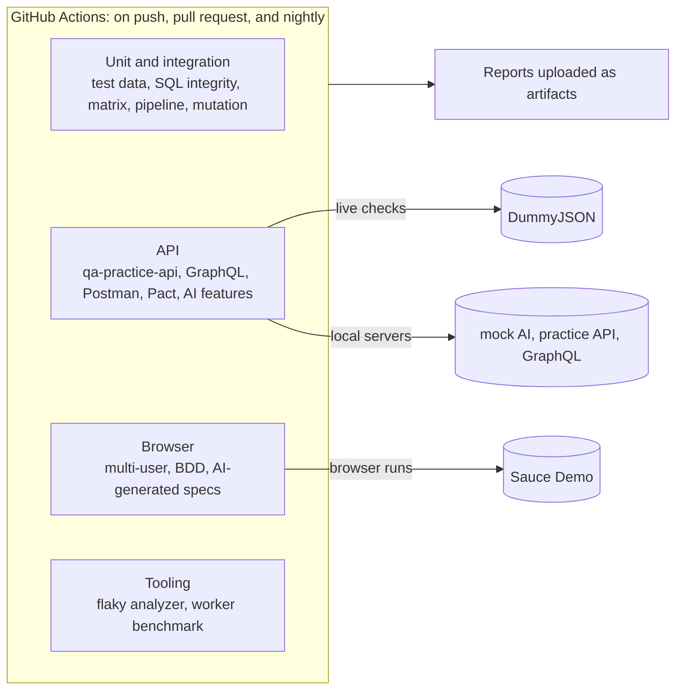

# QA Automation Platform

One repository of test automation work, run by one CI pipeline: browser tests, API tests, contract tests, AI-assisted test generation, test data, SQL data-integrity checks, and the tooling that keeps a suite trustworthy.

**For non-technical readers:** each folder under `packages/` is a small project that tests something, or helps testers do their job. The table below says what each one does in plain English. Every project runs automatically on each change and every night, and the green or red result is visible on the Actions tab.

---

## Packages

Strongest first.

| Package | In plain English | Checks |
|---|---|---:|
| [ai-test-generator](packages/ai-test-generator) | Uses Claude to write browser tests from a feature description, reviews the output for weak tests, and measures how often generated tests are usable as-is (first run: 42 of 43 passed) | 32 |
| [qa-for-ai-features](packages/qa-for-ai-features) | Tests an AI feature's response format, response time, and safety refusals | 11 |
| [flaky-test-analyzer](packages/flaky-test-analyzer) | Reads results from many test runs and points out the tests that only pass after a retry | 8 |
| [worker-scaling-benchmark](packages/worker-scaling-benchmark) | Measures whether running tests in parallel actually makes a suite faster | 10 |
| [contract-testing-demo](packages/contract-testing-demo) | Checks that a live API still returns what the app that uses it expects | 4 |
| [qa-practice-api](packages/qa-practice-api) | A small REST API built to be tested, with its own API test suite | 32 |
| [multi-user-flow-patterns](packages/multi-user-flow-patterns) | Runs several users at once to catch bugs that only appear when people share a system | 9 |
| [bdd-playwright-demo](packages/bdd-playwright-demo) | Tests written as plain-language scenarios that a product owner can read | 9 scenarios |
| [sql-data-integrity](packages/sql-data-integrity) | Runs 15 SQL rules over an orders database and lists the exact rows that break them: orphans, duplicates, wrong totals, mismatched payments | 33 |
| [test-data-factory](packages/test-data-factory) | Generates realistic, repeatable test data as JSON, CSV, or SQL | 25 |
| [mutation-testing-demo](packages/mutation-testing-demo) | Deliberately breaks the code to prove the tests would notice (89.1% caught) | 89 |
| [postman-api-collection](packages/postman-api-collection) | API checks in Postman, runnable from the command line | 25 |
| [graphql-test-suite](packages/graphql-test-suite) | Tests a GraphQL API: queries, errors, and partial results | 33 |
| [pipeline-templates-demo](packages/pipeline-templates-demo) | One reusable CI/CD pipeline written for GitHub Actions, GitLab CI, and Azure DevOps | 28 |
| [matrix-build-demo](packages/matrix-build-demo) | Runs the same tests across several Node versions and operating systems | 99 |

15 packages, about 440 automated tests and checks in total.

---

## Architecture



Each package keeps its own `package.json`, so it can be read, installed, and run on its own. The root workflow (`.github/workflows/ci.yml`) runs every package as a separate job, so one failure doesn't hide the others.

The `.github/workflows` folders inside `matrix-build-demo` and `pipeline-templates-demo` are example content for those demos. GitHub only runs the root workflow.

---

## Running Locally

```bash
cd packages/<package>
npm ci
npx playwright install chromium   # browser packages only
npm test
```

Requires Node 20 or later.

---

## Bugs Found and Fixed While Building This

Bringing these projects together surfaced real defects. Each fix is described in the package README.

| Package | Problem | Fix |
|---|---|---|
| bdd-playwright-demo | All 9 scenarios failed: the ESM config was nested one level too deep, so Cucumber ignored it and never loaded the browser setup | Flattened the config |
| bdd-playwright-demo | The product count sometimes read 0 before the page rendered | Wait for the first product, then count |
| contract-testing-demo | Provider check could run before the contract existed; then failed to parse brotli-compressed responses | Run consumer first; request uncompressed responses |
| qa-for-ai-features | Parallel workers fought over the mock server's port | Start the server once for the whole run |
| postman-api-collection | "No token" request was still authenticated through a cookie | Disable cookies for that request |
| test-data-factory | Orders shipped before they were placed; bad `--count` values produced empty files | Fixed the date rules; validate input |
| ai-test-generator | No tests at all | Added 18 unit tests and a review step for generated output |

---

## Roadmap

See [ROADMAP.md](ROADMAP.md): one module a day for 30 days, each through its own pull request.

---

## Notes

- Live checks run against public demo services (DummyJSON, Sauce Demo). When those services change, tests can fail for reasons outside this repo. Several fixes above came from exactly that.
- No employer code or data is included. Everything here targets public demo apps or local mock services.
