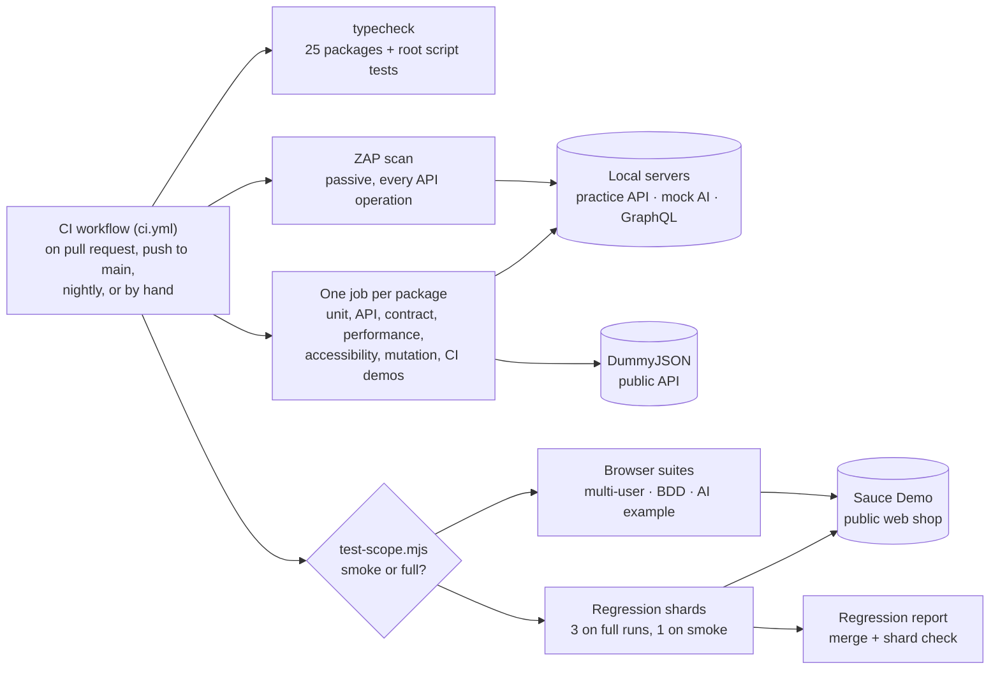
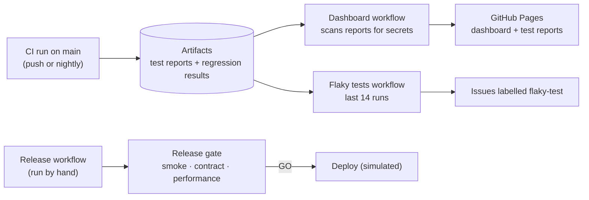
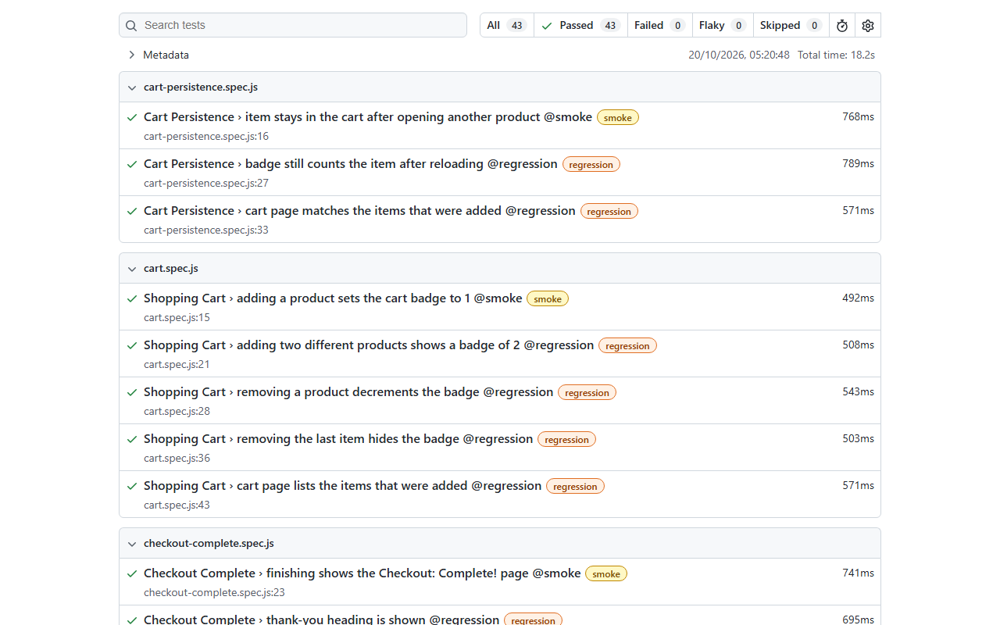
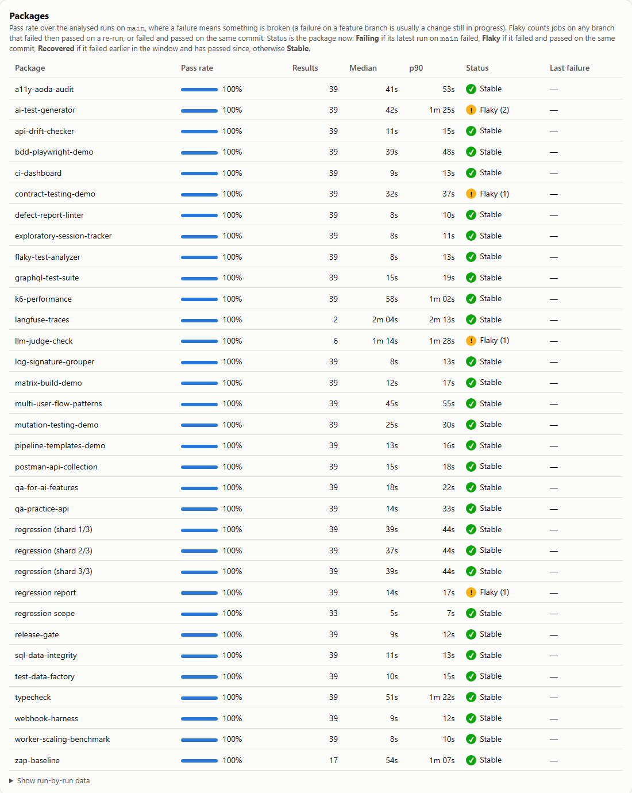

# QA Automation Platform: technical guide

[← Back to overview](README.md)

How the platform is built and run: the CI design, every workflow, how to run a package locally, the configuration that exists, and the problems seen so far. For what it is and what it has found, start with the [overview](README.md).

## Contents

- [Architecture](#architecture)
- [CI workflows](#ci-workflows)
- [Flaky test rules](#flaky-test-rules)
- [Package reference](#package-reference)
- [Running locally](#running-locally)
- [Configuration](#configuration)
- [Type-checking](#type-checking)
- [Bugs found and fixed while building this](#bugs-found-and-fixed-while-building-this)
- [FAQ](#faq)
- [Troubleshooting](#troubleshooting)
- [Development](#development)
- [Roadmap](#roadmap)
- [Notes](#notes)

## Architecture

**What CI runs, and what the tests talk to**



**What happens after a run on main**



Each package keeps its own `package.json`, so it can be read, installed, and run on its own. The root workflow (`.github/workflows/ci.yml`) runs every package as a separate job, so one failure doesn't hide the others.

The Sauce Demo regression suite (43 tests) is split across 3 runners with Playwright's `--shard`, and a `regression report` job merges the shards into one HTML report. It also checks that every test ran exactly once, because a lost or doubled shard still produces a green merged report. Sharding only pays when it removes more test time than the ~25 seconds of setup each runner repeats; the measurements are in the [ai-test-generator README](packages/ai-test-generator/README.md#does-sharding-pay-off-here).

Pull requests and main run different amounts of the live-site browser tests. A pull request runs only the `@smoke` tests of each browser suite (16 of 65 tests), unless it changes that suite, changes how CI picks tests, or has the `full-regression` label. Pushes to main, the nightly run and manual runs always run everything. `scripts/test-scope.mjs` makes the call and writes the reason in the job summary; when in doubt it runs everything. Measured: a smoke run makes 75% fewer live-site test runs but isn't faster to go green, because the k6 performance job (about 60 seconds) is the slowest either way. What smoke buys is fewer runs against a public site that can be slow or flaky.

After each CI run on main, two workflows read its artifacts. **Dashboard** rebuilds the [CI dashboard](https://rizvihiqrar.github.io/qa-automation-platform/) and publishes that run's [test reports](https://rizvihiqrar.github.io/qa-automation-platform/reports/), after redacting tokens and withholding any report it can't clean. **Flaky tests** reads the regression results of the last 14 runs and keeps one issue per flaky test, labelled [`flaky-test`](https://github.com/rizvihiqrar/qa-automation-platform/issues?q=label%3Aflaky-test). Retries still run, so a flaky test's report shows both tries, but in CI a pass on retry fails the job (see the prevention list below); across runs, the issues show which tests keep doing it. How far 14 runs can see is measured, not assumed: they catch a test that fails 1 run in 5 about 96% of the time, but one that fails 1 run in 100 only 13% of the time ([the numbers](packages/flaky-test-analyzer#how-sure-are-we-run-to-run-variance)). The manual **Variance** workflow repeats the regression suite many times on GitHub's runners when a quicker, sharper answer is needed.

The `zap-baseline` job scans the practice API with OWASP ZAP's passive rules on every run: every operation in its OpenAPI spec is requested once, and a finding nobody has triaged fails the job. The triage, and why it uses ZAP's API scan rather than the plain baseline, is in the [practice API README](packages/qa-practice-api/README.md#security-scan).

The `langfuse-traces` job starts a self-hosted Langfuse (its own compose stack, pinned) on every run, replays the AI judge tests into it with no model calls, and fails unless each of the 900 AI tests has exactly one trace holding its prompt, its reply and its result. Each test's trace ID is derived from the test, so a report can link to it without asking Langfuse. Details: [llm-judge-check](packages/llm-judge-check/README.md#tracing-day-42).

Every package job also audits its dependencies ([`scripts/audit.mjs`](scripts/audit.mjs)): a high or critical advisory fails the job unless it is triaged in [`scripts/audit-allowlist.json`](scripts/audit-allowlist.json) with the reason it can't reach anything here and a date to look again. When the gate was added, eight packages had 3 critical and about 150 high advisories, all in test tooling or reached through express. Upgrades (Jest 30, Stryker 10, Faker 10) and same-major overrides fixed all but three, inside Newman and its HTML reporter, which have no fixed release; those three are on the allowlist, with three more inside promptfoo (llm-judge-check) that nothing here can reach.

A daily [CI health check](.github/workflows/ci-health.yml) runs after the nightly regression: it reads the latest run of every workflow on `main` in this repo, cicd-pipeline-demo and the profile repo ([`scripts/ci-health.mjs`](scripts/ci-health.mjs)), and keeps one `ci-health` issue open, with a new comment each day, while any of them is failing a scheduled workflow hasn't run on time, or a run on main needed a re-run (GitHub switches schedules off in a quiet repo without failing anything). A workflow that only runs when started by hand (`workflow_dispatch` alone in its file, such as the AI generator eval) shows as `manual` until its first run, not as a problem. The issue's body always holds the latest report. The check also runs after every CI run on `main`, where it only refreshes the body or closes the issue (comments stay daily, so no extra email), so a merged fix clears it within minutes. The daily report also goes to the "Daily CI status" issue, which stays closed on purpose: GitHub still emails each comment to anyone watching the repo, and the repo shows no open issues while everything is green.

When CI fails on `main`, a [recheck](.github/workflows/ci-recheck.yml) re-runs the failed jobs once. If they pass, nothing is reported as broken, and the dashboard counts the job as flaky rather than hiding it. If they fail again, [`scripts/ci-diagnose.mjs`](scripts/ci-diagnose.mjs) posts the failing jobs, their error lines, the commits since the last green run and a prompt to paste into a Claude Code session on the `ci-health` issue. A person makes and reviews the fix; nothing is re-run more than once, since re-running until green would hide real failures.

Flaky tests are stopped before they merge, not only counted after. Each check below was added after a real flake and is proven by a deliberately flaky or broken test that it catches:

- **Unawaited Playwright calls** (`playwright lint` job, [`tools/playwright-lint`](tools/playwright-lint)): `eslint-plugin-playwright`'s `missing-playwright-await` runs on every package that depends on Playwright. An unawaited `expect` races the end of the test, so it can fail a correct page with "Test ended." (the llm-judge-check H01 flake, 4 CI runs in 80). Its tests lint a deliberately unawaited fixture, check the rule is on in every Playwright package, and fail if a new Playwright package isn't in the list. The two deliberate unawaited expects in the H01 evidence are marked with a reason.
- **Passing only on a retry** (`failOnFlakyTests` in every Playwright config): in CI, a test that fails and then passes on its retry fails the job instead of going green. The retry still runs, so the report has a trace of both tries. ai-test-generator RV-17 passed on retry 3 times before anyone looked. [`scripts/fail-on-flaky.test.mjs`](scripts/fail-on-flaky.test.mjs) runs a deliberately flaky test (fails on the first try, passes on the retry) through each of the 9 Playwright configs: with `CI` set the run must be red, without it green. The Cypress suite already runs with no retries, and Cucumber (bdd-playwright-demo) has none configured.
- **A job on main that needed a re-run** ([CI health](.github/workflows/ci-health.yml)): CI recheck re-runs a failed job on main once, and a pass on that second attempt keeps main green, so a flaky job used to show up only as a count on the dashboard. The daily check now flags any run on main that took more than one attempt in the last 25 hours as a problem, naming the jobs that failed on attempt 1, so the ci-health issue opens. Its first live run found 4, including the H01 flake from 03:02 that morning. A re-run stops counting once a PR merged after it names the run's ID in its description or a comment, and the row then reads "fixed in #N". So every flake needs a fix PR to clear, and the fix prompt CI recheck posts asks for the run ID.
- **New or changed specs, run 3 times before merge** (`burn-in` job, pull requests only, [`scripts/burn-in.mjs`](scripts/burn-in.mjs)): every Playwright spec the PR adds or changes runs with `--repeat-each=3 --retries=0` through its own config, and every Cypress spec runs 3 times in Chrome and 3 times in Firefox. A flaky test usually passes once; three clean runs in a row catch a 1-in-3 flake 70% of the time. The Day 46 two-tabs race merged after a single green run. Proven on its own PR: two deliberately flaky specs that pass a single run (one fails only on its third repeat, one only on Cypress run 2) left every package job green, and burn-in failed on both. A test fails if a Playwright config isn't in its table.
- **A pooled connection closed under a test** ([`tests/keep-alive.spec.ts`](packages/qa-practice-api/tests/keep-alive.spec.ts)): Playwright's request pool keeps idle keep-alive sockets with no time limit, and Node closed them on the server after 6 s. A burst of parallel requests that reused one at that moment failed with "socket hang up" (qa-practice-api DC-ST-06, once in CI, never on Windows). A temporary sweep reproduced it on the Linux runner: every burst after 5980–5992 ms idle hit it, in all 3 burn-in repeats. qa-practice-api now keeps idle sockets for 65 s, longer than any test. The check holds a raw socket idle for 7 s and expects it to stay open. It failed on the unfixed server, both locally and on Linux.

The `.github/workflows` folders inside `matrix-build-demo` and `pipeline-templates-demo` are example content for those demos. GitHub only runs the root workflow.

## CI workflows

Nine workflows live in [`.github/workflows`](.github/workflows). Only `ci.yml` runs the tests; the others read its results.

| Workflow | Runs when | What it does |
|---|---|---|
| [CI](.github/workflows/ci.yml) | Pull request, push to main, nightly at 09:00 UTC, by hand | Type-check, one job per package, ZAP scan, Langfuse traces, regression shards and their merged report |
| [Dashboard](.github/workflows/dashboard.yml) | After every CI run on main | Rebuilds the [CI dashboard](https://rizvihiqrar.github.io/qa-automation-platform/), the [test reports](https://rizvihiqrar.github.io/qa-automation-platform/reports/) and the [traceability matrix](https://rizvihiqrar.github.io/qa-automation-platform/reports/traceability/), then publishes to GitHub Pages |
| [Flaky tests](.github/workflows/flaky.yml) | After every CI run on main | Reads the regression results of the last 14 runs; opens, refreshes and closes one `flaky-test` issue per flaky test |
| [Mutation](.github/workflows/mutation.yml) | Mondays 06:00 UTC, by hand | Stryker on the AI-written discount code in qa-practice-api, with the Playwright set and the property set run separately and then combined (a full first run takes about 50 minutes; later runs reuse results) |
| [CI health](.github/workflows/ci-health.yml) | Daily at 09:45 UTC, after CI on main, by hand | Reads the latest run of every workflow on main in three repos; keeps one `ci-health` issue open while anything fails, is overdue, or needed a re-run no merged fix names |
| [CI recheck](.github/workflows/ci-recheck.yml) | When CI, Dashboard, Flaky tests, Mutation or CI health fails on main | Re-runs the failed jobs once; if they fail again, posts a diagnosis on the `ci-health` issue |
| [Release](.github/workflows/release.yml) | By hand | Verifies a release candidate, lets the release gate decide, deploys (simulated) only on GO |
| [Variance](.github/workflows/variance.yml) | By hand | Repeats the regression suite many times with no retries and reports each test's first-try pass rate with a 95% confidence interval |
| [AI generator eval](.github/workflows/ai-eval.yml) | By hand only | Runs ai-test-generator against the real Claude API (10 paid calls per run); needs the `ANTHROPIC_API_KEY` repository secret |

### CI triggers

```yaml
on:
  push:
    branches: [main]
  pull_request:
    # labeled: adding the full-regression label reruns CI with the full suites
    types: [opened, synchronize, reopened, labeled]
  schedule:
    - cron: '0 9 * * *'   # nightly regression, 09:00 UTC
  workflow_dispatch:
```

### What a run produces

The regression suite writes one Playwright HTML report, merged from the three shards. The latest one is [on the reports page](https://rizvihiqrar.github.io/qa-automation-platform/reports/regression/index.html).

[](docs/assets/playwright-report.png)

*The merged Playwright report for the Sauce Demo regression suite: every test grouped by spec file and tagged `@smoke` or `@regression`.*

### Dashboard and flaky-job tracking

[](docs/assets/dashboard-packages.png)

*The dashboard's per-package table. Flaky counts jobs that failed and then passed on a re-run, or failed and passed on the same commit.*

## Flaky test rules

Eight rules keep a test from passing or failing at random. Rules 2 and 4 fail a pull request when broken. Rules 1, 7 and 8 are covered in part by a check. Rules 3, 5 and 6 are practice, with no check; the table says which is which.

| Rule | Enforced by |
|---|---|
| 1. Wait for state, not time | The test generator's review rules flag `waitForTimeout` and `setTimeout` in generated tests ([`review.ts`](packages/ai-test-generator/src/review.ts)). Hand-written tests rely on review: the last fixed wait (two discount specs) now waits on the server's clock. |
| 2. Use retrying assertions | [playwright-lint](tools/playwright-lint/README.md) fails an unawaited `expect` and a bare `count()` read, on every Playwright package. |
| 3. Isolate test data | Practice: each test makes its own account, product or code. `burn-in` and `fullyParallel` runs expose a test that shares data. |
| 4. Retries are not a fix | `failOnFlakyTests: !!process.env.CI` in every Playwright config fails a test that passes only on a retry. [`playwright-config.test.mjs`](scripts/playwright-config.test.mjs) fails if a config drops it. |
| 5. Mock what you do not own | Practice: the AI-feature tests run against one local mock server ([`qa-for-ai-features`](packages/qa-for-ai-features)), not a paid service. |
| 6. Control time and randomness | Practice: the data factory takes `--seed`, and expiry tests wait for the server's clock instead of guessing. |
| 7. Do not race the loader | Rule 2's lint covers the common case (a check still running when the test ends). Playwright's own auto-waiting does the rest. |
| 8. Reproduce before you fix | `burn-in` repeats every new or changed spec 3 times with no retries. The manual [variance workflow](.github/workflows/variance.yml) gives a pass rate with a 95% confidence interval, and the [flaky-test-analyzer](packages/flaky-test-analyzer/README.md) tracks repeats across runs. |

Every Playwright config also keeps a trace on failure (`trace: 'retain-on-failure'`), and CI uploads each package's `test-results/` with its reports, so a flake that fails once in CI can be opened in the trace viewer instead of guessed at. [`playwright-config.test.mjs`](scripts/playwright-config.test.mjs) fails if a config lacks it.

## Package reference

The full description of each package, with its check count. The [overview](README.md#the-packages) has the short version.

| Package | In plain English | Checks |
|---|---|---:|
| [ai-test-generator](packages/ai-test-generator) | Uses Claude to write browser tests from a feature description, reviews the output for weak tests, and measures how often generated tests are usable as-is (first run: 42 of 43 passed). The reviewed tests now run as a regression suite split across 3 CI runners, with a check that no test was lost or run twice. A written [requirement review](docs/requirement-review/README.md) of the ten feature files it started from found 29 gaps (8 of them defects in the demo shop, such as an item total printed as `$119.94999999999999`), each followed to a test or a question | 127 |
| [llm-judge-check](packages/llm-judge-check) | Checks an AI grader against a person's answers before trusting it: Claude Haiku and Sonnet judged whether 67 AI-written tests really check their acceptance criteria. The first grading instructions made them agree with whoever wrote the instructions (1 of 6 weak real tests caught); rewritten from the reviewer's rules, agreement rose from 84% to 91%, and one disagreement turned out to be a mistake in the human labels. A red team then wrote instructions, fake answers and misleading comments into the tests it reads: 0 of 40 tries moved a verdict, but the same prompt got a different verdict once the judge stopped seeing a neighbouring case. Replayed through promptfoo in CI, no model calls, and every one of the 900 AI test results is traced to a self-hosted Langfuse, which CI checks holds exactly one matching trace per test ([open them](https://rizvihiqrar.github.io/qa-automation-platform/reports/langfuse-traces/)) | 81 |
| [qa-for-ai-features](packages/qa-for-ai-features) | Tests an AI feature's response format, response time, and safety refusals | 12 |
| [ci-dashboard](packages/ci-dashboard) | A live web page of this repo's CI health: pass rate, run time and flaky jobs per package ([open it](https://rizvihiqrar.github.io/qa-automation-platform/)), plus the latest test reports ([open them](https://rizvihiqrar.github.io/qa-automation-platform/reports/)), checked for leaked tokens before publishing, and a traceability matrix ([open it](https://rizvihiqrar.github.io/qa-automation-platform/reports/traceability/)) showing each API requirement, the test cases that check it, and their latest results | 41 |
| [flaky-test-analyzer](packages/flaky-test-analyzer) | Reads results from many test runs and points out the tests that only pass after a retry. After every CI run on main it checks the last 14 runs and keeps one GitHub issue per flaky test, opened and closed automatically. Also puts a confidence interval on each pass rate and works out how many runs it takes to catch a rare flake | 37 |
| [worker-scaling-benchmark](packages/worker-scaling-benchmark) | Measures whether running tests in parallel actually makes a suite faster | 12 |
| [webhook-harness](packages/webhook-harness) | Proves a webhook receiver rejects forged or replayed messages, processes each one only once, and that the sender retries failures correctly | 21 |
| [api-drift-checker](packages/api-drift-checker) | Checks a live API against its written contract; its first run found two real bugs in the practice API, now fixed | 17 + 39-step live check |
| [api-pytest](packages/api-pytest) | The same designed cases as the Playwright API suite, written again in Python with pytest and requests, under the same case IDs. A fixture starts the API, so one command runs it | 40 |
| [k6-performance](packages/k6-performance) | Load and spike tests with per-endpoint limits; found that each login froze every other request for ~70 ms, now fixed (browsing p95 67 ms → 1 ms) | 5 + 3 k6 tests |
| [contract-testing-demo](packages/contract-testing-demo) | Checks that a live API still returns what the app that uses it expects | 5 |
| [qa-practice-api](packages/qa-practice-api) | A small REST API built to be tested, with its own API test suite and 119 cases designed from a written [test strategy](docs/test-strategy/README.md) (equivalence classes, boundaries, decision tables, state transitions, an access-control matrix), plus a passive [OWASP ZAP scan](packages/qa-practice-api/README.md#security-scan) of every operation in CI. Its discount codes were written by an AI from a reviewed spec, then reviewed and tested like code from an unknown author: 126 designed cases found 4 defects that passed every check the AI was given, and property-based tests found 2 more nobody had picked a value for; mutation testing then showed which checks the tests didn't really make, and a [scoreboard](docs/ai-written-code/scoreboard.md) shows which technique caught each mistake ([validating AI-written code](docs/ai-written-code/README.md)) | 292 + 17 properties + ZAP scan |
| [banking-api](packages/banking-api) | A small banking API built to be tested: accounts in CAD, USD, JPY and KWD (2, 2, 0 and 3 decimals), deposits, withdrawals and transfers on a double-entry SQLite ledger (`node:sqlite`, no runtime dependencies). Amounts travel as strings and are held as BigInt minor units, exact above 2^53. Day 44 added `Idempotency-Key` on every movement (replay, `422` on a reused key, `409` while in flight, 24-hour expiry, the key linked to its transfer in the same transaction) and real races: two server processes on one SQLite file, and a slow screening step awaited before each movement. Day 45 added 14 SQL ledger checks, one `.sql` file each, run by `npm run check` (exit 1 on a broken ledger): every transfer has two entries that match it and sum to zero, currencies match and sum to zero, no balance is negative now or at any point in its history, the limit holds, and no row is an orphan. Each check is proven by a defect put into the database past the API with foreign keys off, and all of them pass on a clean sample, on the files real races leave, after every random model run, and in CI on a freshly raced file; a test keeps the SQL portable to Postgres. 30 written [rules](packages/banking-api/SPEC.md) are checked by 216 designed cases and 8 fast-check properties, one a model of the bank over random sequences of moves; 56 deliberate mistakes were each caught. Putting them back showed the model missed an off-by-one in the funds check and a disabled limit until it generated boundary amounts, that only an injected database failure proves the transaction is there, that a deferred `BEGIN` deadlocks in SQLite where Postgres would overdraw, and that entries or a transfer written in the wrong currency were caught by no designed case, since the API never reads that column. Day 46 added a banking UI served by the same server (plain HTML and JavaScript, no framework or build, a `default-src 'self'` policy) and 69 Cypress tests run in Chrome and Firefox, each run on a fresh `ui.db` and ending with the SQL checks on it: money typed as text in each currency, refusals shown on the right field, one `Idempotency-Key` per filled form so a double click, a second Enter or a reply lost after the money moved still moves it once (retries on no answer, `409`, `502` to `504`, shown with `cy.intercept`), a second tab spending the money while the page is open, and axe-core in light and dark and at phone width. 22 more deliberate mistakes (78) were each caught. The base for Day 49's Postgres | 236 + 8 properties + 69 Cypress |
| [a11y-aoda-audit](packages/a11y-aoda-audit) | Audits a demo store against the WCAG 2.0 AA standard Ontario's AODA requires, before and after fixes; also catches two issues axe misses | 16 |
| [multi-user-flow-patterns](packages/multi-user-flow-patterns) | Runs several users at once to catch bugs that only appear when people share a system | 9 |
| [bdd-playwright-demo](packages/bdd-playwright-demo) | Tests written as plain-language scenarios that a product owner can read | 9 scenarios + 4 |
| [sql-data-integrity](packages/sql-data-integrity) | Runs 15 SQL rules over an orders database and lists the exact rows that break them: orphans, duplicates, wrong totals, mismatched payments | 35 |
| [exploratory-session-tracker](packages/exploratory-session-tracker) | Structures exploratory testing (charters, timeboxes, tagged notes) and turns sessions into a team debrief | 10 |
| [log-signature-grouper](packages/log-signature-grouper) | Groups thousands of log errors into a few patterns and flags error patterns that are new since the last release | 15 |
| [defect-report-linter](packages/defect-report-linter) | Checks bug reports for missing steps, results, severity and evidence, and scores whether a developer could act on them | 20 |
| [test-data-factory](packages/test-data-factory) | Generates realistic, repeatable test data as JSON, CSV, or SQL | 25 |
| [mutation-testing-demo](packages/mutation-testing-demo) | Deliberately breaks the code to prove the tests would notice (89.2% caught) | 89 |
| [postman-api-collection](packages/postman-api-collection) | API checks in Postman, runnable from the command line | 25 |
| [graphql-test-suite](packages/graphql-test-suite) | Tests a GraphQL API: queries, errors, and partial results | 33 |
| [release-gate](packages/release-gate) | Reads smoke, contract and performance results, applies a policy, and blocks a deployment with clear reasons when a rule is broken | 15 |
| [pipeline-templates-demo](packages/pipeline-templates-demo) | One reusable CI/CD pipeline written for GitHub Actions, GitLab CI, and Azure DevOps | 28 |
| [matrix-build-demo](packages/matrix-build-demo) | Runs the same tests across several Node versions and operating systems | 99 |
| [money-course](packages/money-course) | A short course, Testing money in software, built on the banking API: six objectives, a quiz for each, and an ungraded practical with six planted bugs and a model answer. Being run as a pilot | 30 |

28 packages, about 1,520 automated tests and checks in total. Live CI health: **[CI dashboard](https://rizvihiqrar.github.io/qa-automation-platform/)**. Latest test reports: **[reports](https://rizvihiqrar.github.io/qa-automation-platform/reports/)**. Requirement by requirement: **[traceability matrix](https://rizvihiqrar.github.io/qa-automation-platform/reports/traceability/)**. AI test by AI test: **[Langfuse traces](https://rizvihiqrar.github.io/qa-automation-platform/reports/langfuse-traces/)**.

## Running locally

```bash
cd packages/<package>
npm ci
npx playwright install chromium   # browser packages only
npm test
```

Requires Node 24, the version CI uses: the TypeScript packages run their `.ts` files directly, with no build step.

To run only the quick set CI uses on pull requests: `npm run smoke` in multi-user-flow-patterns and bdd-playwright-demo, or add `--grep @smoke` to a Playwright command (for example `npm run test:regression -- --grep @smoke` in ai-test-generator).

## Configuration

There is no central config file: each package keeps its own `package.json`. These are the settings that exist, and where they are read.

| Setting | Default | What it does |
|---|---|---|
| `BASE_URL` | `https://www.saucedemo.com` (browser suites); the local server (qa-practice-api) | Where the browser or API tests point |
| `PORT` | `4000` (qa-practice-api), `4100` (banking-api), `3002` (pipeline-templates-demo) | Port a local server listens on |
| `DATABASE_PATH` | none: the ledger is in memory | A SQLite file for banking-api to keep its ledger in; several servers can share one |
| `SCREENING_DELAY_MS` | `0` | banking-api: how long the screening before each movement takes, so requests overlap (the race tests use it) |
| `JWT_SECRET` | A random secret per start | Signs qa-practice-api tokens; set it only to keep tokens valid across restarts |
| `AI_MODEL` | `mock-model-1.0` (qa-for-ai-features); the generator's default model (ai-test-generator) | Model name sent to the AI client |
| `ANTHROPIC_API_KEY` | none | Repository secret; only the manual [AI generator eval](.github/workflows/ai-eval.yml) uses it |
| `MUTATION_CONCURRENCY` | 4 for the properties set, 1 for the Playwright set | Parallel Stryker workers in qa-practice-api |
| `full-regression` label | none | On a pull request, runs the full browser suites instead of `@smoke` ([`scripts/test-scope.mjs`](scripts/test-scope.mjs)) |
| [`scripts/audit-allowlist.json`](scripts/audit-allowlist.json) | the triaged advisories | Dependency advisories allowed through the audit gate, each with a reason and a `review_by` date |
| `WATCH` in [`scripts/ci-health.mjs`](scripts/ci-health.mjs) | three repos | Which repos the CI health check reads, and how late a scheduled workflow may be |

## Type-checking

Every package with code is type-checked in CI (25 of 25; the Postman collection has no code). The CI `typecheck` job runs it on every push:

```bash
npm ci
npm run typecheck   # the list of packages is in scripts/typecheck.mjs
```

Eleven packages are strict TypeScript, run directly by Node 24, which strips types at load time, so there's no build step: test-data-factory, flaky-test-analyzer, worker-scaling-benchmark, ai-test-generator, qa-for-ai-features, qa-practice-api, multi-user-flow-patterns, bdd-playwright-demo, sql-data-integrity, llm-judge-check, banking-api. They use `tsconfig.ts.json`: strict mode, unchecked index access, and only syntax Node can strip (no enums or namespaces). The other packages are JavaScript checked by the same type-checker (`checkJs`, shared `tsconfig.base.json`). The CI demos stay JavaScript on purpose: they exist to show pipeline patterns.

What `checkJs` does and doesn't catch: it catches wrong use of anything typed, such as Node's APIs (`fs.readFilSync` fails with "Did you mean readFileSync?") and functions with JSDoc types. In plain JavaScript, TypeScript treats every parameter as optional, so a call missing an argument to an untyped function passes. That gap is why the main packages moved to strict TypeScript (Days 16–21), and the move found bugs of its own, listed below.

The first `checkJs` pass found 19 errors. Two were real: code assumed `server.address()` always returns an object, but it returns a string for pipe and socket listeners. Both are fixed (webhook-harness, api-drift-checker), along with the same pattern in two packages not yet type-checked (k6-performance, a11y-aoda-audit). The rest were types that only needed writing down (JSDoc), and one test that passes bad input on purpose is marked `@ts-expect-error`.

## Bugs found and fixed while building this

Bringing these projects together surfaced real defects. Each fix is described in the package README; five have full [root-cause write-ups](docs/rca/README.md) (symptom, cause in the code, fix, regression tests, prevention). Nine of the qa-practice-api rows came from it being tested on purpose: five from designing cases for the practice API with named techniques, described in its [test strategy](docs/test-strategy/README.md), and four from testing who may do what in it and scanning it with OWASP ZAP.

| Package | Problem | Fix |
|---|---|---|
| bdd-playwright-demo | All 9 scenarios failed: the ESM config was nested one level too deep, so Cucumber ignored it and never loaded the browser setup | Flattened the config |
| bdd-playwright-demo | The product count sometimes read 0 before the page rendered | Wait for the first product, then count |
| contract-testing-demo | Provider check could run before the contract existed; then failed to parse brotli-compressed responses | Run consumer first; request uncompressed responses |
| contract-testing-demo | Provider check failed about 1 CI run in 80: Node gave the first IPv4 connect only 250 ms, then tried an IPv6 address the runner cannot reach (`AggregateError [ETIMEDOUT, ENETUNREACH]`), and the verifier hung for 30 s | Give each address 5 s; a test checks the setting; a repro script shows the failure on any machine |
| qa-for-ai-features | Parallel workers fought over the mock server's port | Start the server once for the whole run |
| postman-api-collection | "No token" request was still authenticated through a cookie | Disable cookies for that request |
| test-data-factory | Orders shipped before they were placed; bad `--count` values produced empty files | Fixed the date rules; validate input |
| ai-test-generator | No tests at all | Added unit tests and a review step for generated output (now 38 unit tests) |
| qa-practice-api | Accepted a text price (saved as `null`) and negative stock, found by api-drift-checker | Validate both; two new API tests |
| webhook-harness | Two copies of one delivery arriving together were both processed | Track deliveries in progress; answer the second with `409` |
| qa-practice-api | Password hashing blocked the event loop: browsing p95 went from ~1 ms to 67–84 ms whenever users logged in, found by k6 | Hash with `crypto.scrypt` in the thread pool; browsing p95 back to 1 ms |
| webhook-harness, api-drift-checker | Code assumed `server.address()` always returns an object; it returns a string for pipe and socket listeners, found by the first type-check | Check the type before reading the port |
| qa-practice-api | Updating a product skipped the checks that creating one had (a text price was stored as `null`, negative stock accepted); an order with the same product on two lines could oversell (two lines of 6 against stock of 10 left -2), found moving to TypeScript | Same validation on update; stock checked against the combined quantity |
| qa-for-ai-features | The mock AI server crashed on malformed JSON; a test passed its timeout as an argument Playwright doesn't have, so it was silently ignored | Answer `400` on bad JSON; `test.setTimeout(15_000)` |
| multi-user-flow-patterns | A logout check (`toHaveURL(/$/)`) matched every URL, so it could never fail; a sort check only compared two users' first items | Check the login button is visible and the page left the inventory; assert each user's exact first item |
| sql-data-integrity | On Windows, CRLF line endings made the tool reject every SQL check file; CI on Linux never saw it | Split headers on `\r?\n`; a test covers CRLF input |
| CI (regression shards) | A lost or doubled shard still produced a green merged report (29 or 58 "passed" instead of 43) | Shard check: every listed test must run exactly once |
| bdd-playwright-demo | `cucumber-js --tags` passes when a tag matches nothing, so a mistyped smoke tag would test nothing and stay green | Fail first when a tag selects no scenarios |
| ci-dashboard (published reports) | The Postman report contained live access tokens from the demo API, about to be published on a public page | Redact tokens before publishing; withhold any report that can't be cleaned |
| postman-api-collection | The raw CI artifact still held those 19 tokens after the publish scan was added, found writing the root-cause analysis | The report leaves out the auth and cookie headers and the login response body |
| webhook-harness | The sender gave up on `409 in-progress`, so a slow first attempt that then failed meant the event was never processed, found writing the root-cause analysis | Retry `409` like `408` and `429`; an end-to-end test reproduces the sequence |
| flaky-test-analyzer | Test names left out the `describe` block, so two tests with the same title in different blocks would have been counted as one test (no suite here has such a pair yet), found adding per-test statistics | Names include the `describe` titles, as Playwright shows them; a test with three same-named tests |
| qa-practice-api | Any order status could be set from any other (a delivered order went back to pending, a cancelled one shipped), and cancelling kept the stock, found by state-transition testing | Allowed moves only, otherwise `409`; cancelling returns the stock; all 25 status pairs tested |
| qa-practice-api | Updating a user accepted an email another account already had, so two accounts shared one and sign-in picked the older, found by a decision table | `409` for a taken email, `400` for an empty name or email |
| qa-practice-api | Values were converted instead of checked: price `""` saved as 0, `true` as 1; quantity 1.5 left stock at 8.5; quantities sent as text were joined, so `"2"` + `"3"` was checked as 23, found by equivalence partitioning | Prices, stock and quantities must be JSON numbers (whole numbers where it matters) |
| qa-practice-api | A `null` order line crashed the route, a malformed body got an HTML error page, and a numeric password at sign-up got a `500`, found by equivalence partitioning | JSON `{ error }` for every failure; `400` for wrong field types |
| qa-practice-api | `limit=0` gave 10 items per page while `limit=-1` gave 1, found by boundary value analysis | Only a missing or non-numeric limit takes the default |
| qa-practice-api | Any signed-in customer could create, reprice or delete any product, read every account's email, and mark their own order delivered, found by an access-control matrix | Admin-only routes answer `403` to customers; a customer may only cancel |
| qa-practice-api | With no `JWT_SECRET` set (and none ever was), tokens were signed with a fallback secret written in this public repository, so anyone could sign an admin token; a deleted account's token kept working for its hour | A random secret per start; every request checks that the account still exists |
| qa-practice-api | Sign-in had no limit on attempts. A limit that counts only finished failures would still let a burst through: put in as a check, it let all 20 simultaneous guesses have their password checked | 5 attempts per email and client in 15 minutes, counted as they start; `429` with `Retry-After` |
| qa-practice-api, api-drift-checker | The ZAP scan found responses without `nosniff` or `Cross-Origin-Resource-Policy`, and showed it had reached only 5 of the 13 operations: the OpenAPI spec had no request bodies or path parameters | Both headers on every response; bodies and parameters in the spec; the drift checker no longer counts `parameters` as an operation |
| qa-practice-api (discount codes written by an AI) | Impossible dates such as 30 February accepted as an expiry; amounts like `10.000000000001` passed a two-decimal check, so a minimum shown as 49.999999999999 was enforced as 50.00; a bad `discount_code` replaced an unknown product's `404`; a list sent as a PATCH body answered `200`. All four passed typecheck, the 165 earlier tests and the drift check; found by a [code review](docs/ai-written-code/code-review.md) and confirmed by boundary-value, decision-table and equivalence cases | Real calendar dates only; an exact whole-cents check; item errors first; a JSON object or `400`. Product prices must now be whole cents too: the AI's cents arithmetic had quietly changed the total for three items at 0.333 from 1.00 to 0.99 |
| banking-api | Two server processes on one database file: 1 to 4 of 60 simultaneous withdrawals answered `500 database is locked`, because SQLite's default busy timeout is zero, found by the first real race test | A 5 second busy timeout on every connection; `503 busy` with `Retry-After` if it runs out |
| banking-api | The UI's statement table scrolls sideways at phone width but couldn't be reached by keyboard, so keyboard users couldn't scroll it, found by axe-core in the Cypress run at 375 px | The scrolling wrapper takes focus (`tabindex="0"`) and is a labelled region |

## FAQ

### Why does a live-site test sometimes fail without a code change?

The browser suites run against public demo services (DummyJSON, Sauce Demo). When those change or are slow, a test can fail for reasons outside this repo. Several fixes in the table above came from exactly that.

### Why does a pull request run fewer browser tests than main?

A pull request runs only the `@smoke` tests (16 of 65) unless it changes that suite, changes how CI picks tests, or carries the `full-regression` label. Main, the nightly run and manual runs always run everything. A smoke run makes 75% fewer live-site test runs, though it isn't faster to go green.

### Why is a failed job re-run only once?

Re-running until green would hide real failures. A pass on the re-run is counted as flaky on the dashboard, never hidden; a second failure is reported with a diagnosis.

### The dashboard says 34 packages, but the repo has 26. Which is right?

Both. There are 28 packages. The dashboard counts CI jobs, which also include the type-check, the ZAP scan, the Langfuse traces job, the regression report and similar.

### Does running the tests call a paid AI service?

No. The AI judge tests replay recorded runs, with no model calls. Only the manual AI generator eval calls the Claude API.

## Troubleshooting

| Problem | Cause | Fix |
|---|---|---|
| A `.ts` file fails to run directly | Node older than 24; the packages rely on Node stripping types | Use Node 24, the version CI uses |
| Playwright says the browser executable doesn't exist | Chromium isn't installed | `npx playwright install chromium` |
| A browser test fails on the live shop | The public demo site was slow or changed | Re-run; if it keeps failing, check the site by hand |
| A pull request didn't run a test you expected | It ran the `@smoke` set | Add the `full-regression` label |
| A report is missing from the published reports | It contained a token and was withheld | See the Notes column on the [reports page](https://rizvihiqrar.github.io/qa-automation-platform/reports/) |
| The AI generator eval fails at once | The `ANTHROPIC_API_KEY` secret isn't set | Add it under the repository's Actions secrets |
| Port 4000 is already in use when starting qa-practice-api | Another process holds the port | Set `PORT` to a free one |

## Development

Root scripts (the CI scripts and their tests):

```bash
npm ci
npm test            # node --test scripts/*.test.mjs
npm run typecheck   # every package; the list is in scripts/typecheck.mjs
```

A single package:

```bash
cd packages/<package>
npm ci
npm test
```

Refresh the screenshots used in the docs from the live pages:

```bash
cd scripts/screenshots
npm ci
npx playwright install chromium
npm run capture            # or: npm run capture -- dashboard reports-index
npm run terminal           # real terminal output as images (banking-api's README)
npm run ui                 # the banking UI, light and dark, from a real server
```

## Roadmap

See [ROADMAP.md](ROADMAP.md): one module a day for 30 days, each through its own pull request. The plan is complete and released as [v1.0.0](https://github.com/rizvihiqrar/qa-automation-platform/releases/tag/v1.0.0); [RETROSPECTIVE.md](RETROSPECTIVE.md) covers what worked, what didn't, and what v1.0 doesn't prove. Phase 2 (Days 31–60) is planned in the same file: test design and root-cause analysis, testing AI-written code, a banking API, mobile, and backend infrastructure.

## Notes

- Live checks run against public demo services (DummyJSON, Sauce Demo). When those services change, tests can fail for reasons outside this repo. Several fixes above came from exactly that.
- No employer code or data is included. Everything here targets public demo apps or local mock services.
