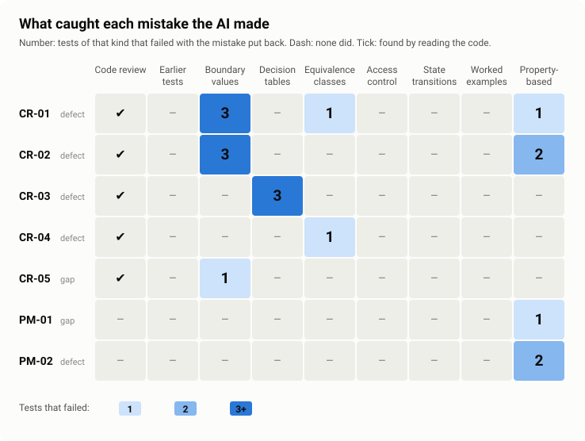

# Scoreboard: what the AI got wrong, and what caught it

The end of the [case study](README.md). Every mistake found in the AI's discount code (`d775d20`) over Days 38 and 39, and which techniques' tests catch it.

**In plain English:** each mistake was put back into today's fixed code, one at a time, and every test was run. A number is how many tests of that kind failed, so caught it. A dash means none did. No single technique caught everything, and the tests that were already there caught nothing.

<picture>
  <source media="(prefers-color-scheme: dark)" srcset="../assets/scoreboard-heatmap-dark.svg">
  
</picture>

*The table below as a heatmap. Drawn by `scripts/charts.mjs` from that table.*

## How it was measured

[`packages/qa-practice-api/scoreboard/run.mjs`](../../packages/qa-practice-api/scoreboard/run.mjs) (`npm run scoreboard`, about five minutes) runs all 308 tests on the unchanged code first (all must pass), then for each mistake in [`put-backs.mjs`](../../packages/qa-practice-api/scoreboard/put-backs.mjs) changes the code back to the AI's version, runs everything again, records which tests failed, and restores the code. The result is [`scoreboard.json`](scoreboard.json); the table below is checked against it by the root tests, row for row.

"Code review" is different: it is not a test that runs. It is ticked when the [code review](code-review.md) found the mistake by reading, before any test existed.

## The scoreboard

| Mistake | Kind | Code review | Earlier tests (165) | Boundary values | Decision tables | Equivalence classes | Access control | State transitions | Worked examples | Property-based |
|---|---|:-:|:-:|:-:|:-:|:-:|:-:|:-:|:-:|:-:|
| CR-01 | defect | ✔ | – | 3 | – | 1 | – | – | – | 1 |
| CR-02 | defect | ✔ | – | 3 | – | – | – | – | – | 2 |
| CR-03 | defect | ✔ | – | – | 3 | – | – | – | – | – |
| CR-04 | defect | ✔ | – | – | – | 1 | – | – | – | – |
| CR-05 | spec gap | ✔ | – | 1 | – | – | – | – | – | – |
| PM-01 | spec gap | – | – | – | – | – | – | – | – | 1 |
| PM-02 | defect | – | – | – | – | – | – | – | – | 2 |

What each one was:

- **CR-01** impossible dates such as 30 February accepted as an expiry
- **CR-02** a tolerance in the two-decimal check let in `10.000000000001`
- **CR-03** a bad `discount_code` was checked first and hid an unknown product's `404`
- **CR-04** a list as a PATCH body passed as "no changes" with `200`
- **CR-05** product prices could be fractions of a cent, and three at 0.333 came to 0.99
- **PM-01** no limit on an order, so a subtotal past 2^53 cents lost cents
- **PM-02** the same tolerance as CR-02 also refused about 9% of valid amounts from 131,072.02 up

## What it shows

- **The tests that existed caught nothing.** The 165 earlier tests passed with every mistake in place, as they did on the AI's first commit. Green on existing tests means "broke nothing that was already checked".
- **Reading found the most.** The code review found five of the seven, each later confirmed by a test. It missed the two where the problem only appears at values far from any boundary in the spec.
- **Designed cases and properties catch different things.** Boundary values, decision tables and equivalence classes caught all five reviewed mistakes; properties caught two of those and missed three (CR-03 to CR-05): the properties generate valid requests and whole-cent prices, so they never send a bad code with bad items, a list as a body, or a price of 0.333. Properties alone caught PM-01 and PM-02, at values (a trillion-dollar order, a minimum of 131,072.02) that no designed case would pick.
- **No technique caught everything.** Among the tests, CR-03 was caught only by decision tables, CR-04 only by equivalence classes, CR-05 only by boundary values, and PM-01 and PM-02 only by properties. Catching all seven with tests takes those four techniques together.

## And mutation testing

Mutation testing isn't a column above, because it doesn't find mistakes in the code: it finds tests that would miss one. Stryker made 412 small changes to the AI's code and ran every test against each ([details](properties-and-mutation.md#mutation-testing)). The designed cases noticed 85.0% of them and the properties 77.9%; together, 93.9%. The 25 changes nothing notices are 21 that can't alter behaviour, 2 at the exact millisecond of expiry (PM-03, untestable while the code reads the clock itself) and 2 in an error message's wording. Before the last properties were added, it also found refusals whose message no test checked, a value wrapped in a list that would crash the API, and a use count that would stop at 10 without any test noticing.
