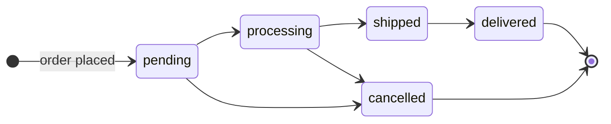

# Test plan: qa-practice-api

**In plain English:** the rules the shop API must follow, written down with an ID each, and the test cases that check them. Every case says which technique produced it and which rule it checks, so a failing test points straight at the rule that broke.

The strategy behind it (risks, scope, exit criteria) is in [README.md](README.md). Each case below is a test in [packages/qa-practice-api/tests/design](../../packages/qa-practice-api/tests/design) whose title starts with its ID. [scripts/test-plan.test.mjs](../../scripts/test-plan.test.mjs) fails if a case is in this plan but not in the tests, or the reverse. The [traceability matrix](https://rizvihiqrar.github.io/qa-automation-platform/reports/traceability/) is generated from this file and shows each requirement's cases with their latest CI results.

## Requirements

| ID | Requirement | Risk |
|---|---|---|
| REQ-01 | A product's price is a JSON number ≥ 0, on create and on update | R-05 |
| REQ-02 | A product's stock is a whole JSON number ≥ 0; left out on create, it is 0 | R-05 |
| REQ-03 | Each order line has a `product_id` and a whole-number `quantity` ≥ 1; `items` is a non-empty array | R-04, R-11 |
| REQ-04 | An order is accepted only if every product exists and has stock for its quantity summed across lines. If accepted, stock goes down by that amount; if not, no stock changes | R-04 |
| REQ-05 | An order's total is the sum of price × quantity, rounded to cents | R-12 |
| REQ-06 | Order status follows the order lifecycle (pending → processing or cancelled, processing → shipped or cancelled, shipped → delivered). Any other move returns `409` and leaves the status as it was | R-01 |
| REQ-07 | Cancelling an order returns its stock to the products that still exist | R-01 |
| REQ-08 | Lists use page ≥ 1 and limit 1–50; values outside are clamped to the nearest edge, a missing or non-numeric value means page 1 or limit 10, and a page past the end is empty | R-17 |
| REQ-09 | `PUT /users/:id` changes only the caller's own account (admins: any). Another account gets `403` before its existence is checked; `name` and `email` must be non-empty strings; an email used by another account gets `409`; a deleted or unknown account gets `404` to an admin | R-02 |
| REQ-10 | Every error response is JSON `{ error }`, including for a malformed request body | R-11 |
| REQ-11 | Sign-up and sign-in fields must be non-empty strings; anything else gets `400`, not `500` | R-11 |
| REQ-12 | Placing an order needs a signed-in user | R-06 |
| REQ-13 | Only an admin creates, changes or deletes products; a customer gets `403` and nothing changes | R-03 |
| REQ-14 | A customer reads, lists and cancels only their own orders; another customer's order answers `404`, as if it didn't exist. An admin reads and lists every order | R-08 |
| REQ-15 | Only an admin moves an order to processing, shipped or delivered; a customer asking for any of these gets `403`. A customer may cancel their own order (the lifecycle rules of REQ-06 still apply) | R-07 |
| REQ-16 | Only an admin lists accounts or reads or deletes another user's account; a customer gets `403` for any account but their own | R-19 |
| REQ-17 | A token works only while its account exists and only if this server signed it; the role comes from the account, never from the request | R-06, R-20, R-21 |
| REQ-18 | Sign-in allows 5 attempts per email and client in 15 minutes without a success. Further attempts get `429` with `Retry-After`, even with the right password, until the window ends; a success clears the count; other emails are unaffected; concurrent attempts are counted as they start | R-09 |

## Equivalence partitioning

JSON lets a client send any type in any field, so each field's inputs are split into classes the API should treat the same way. One value stands for each class.

| Field | Valid classes | Invalid classes |
|---|---|---|
| `price` | number ≥ 0 | numeric string, empty string, boolean, non-numeric string, array (negative numbers: see boundaries) |
| `stock` | whole number ≥ 0, left out | empty string, numeric string, fraction |
| order line | `{ product_id, quantity: whole number }` | quantity as a string, fractional quantity, no quantity, `null` line; `items` not an array |
| request body | valid JSON | malformed JSON |
| sign-up and sign-in fields | non-empty strings | number, object |

| ID | Requirement | Input | Expected |
|---|---|---|---|
| TC-EP-01 | REQ-01 | price `12.5` | 201, price 12.5 |
| TC-EP-02 | REQ-01 | price `"12.5"` | 400 |
| TC-EP-03 | REQ-01 | price `""` | 400 |
| TC-EP-04 | REQ-01 | price `true` | 400 |
| TC-EP-05 | REQ-01 | price `"abc"` | 400 |
| TC-EP-06 | REQ-01 | price `[5]` | 400 |
| TC-EP-07 | REQ-02 | no stock | 201, stock 0 |
| TC-EP-08 | REQ-02 | stock `""` | 400 |
| TC-EP-09 | REQ-02 | stock `"5"` | 400 |
| TC-EP-10 | REQ-02 | stock `2.5` | 400 |
| TC-EP-11 | REQ-03 | quantity `2` (stock 10) | 201, stock 8 |
| TC-EP-12 | REQ-03 | quantity `"2"` | 400, stock unchanged |
| TC-EP-13 | REQ-03 | quantity `1.5` | 400, stock unchanged |
| TC-EP-14 | REQ-03 | line with no quantity | 400, stock unchanged |
| TC-EP-15 | REQ-03 | `items: [null]` | 400 JSON, stock unchanged |
| TC-EP-16 | REQ-03 | `items: "two widgets"` | 400 |
| TC-EP-17 | REQ-10 | body `{"name": "Widget",` | 400, JSON `{ error }` |
| TC-EP-18 | REQ-11 | sign-up with password `12345` (a number) | 400 |
| TC-EP-19 | REQ-11 | sign-up with email `{ "$ne": "" }` | 400 |
| TC-EP-20 | REQ-11 | sign-in with password `12345` (a number) | 400 |

## Boundary value analysis

For each range: the edge value, and one step inside and outside it. The step is 0.01 for prices (cents) and 1 for counts.

| Range | Below | On the edge | Inside |
|---|---|---|---|
| price ≥ 0 | −0.01 | 0 | 0.01 |
| stock ≥ 0 | −1 | 0 | 1 |
| quantity ≥ 1 | 0 | 1 | |
| quantity ≤ stock (5) | | 5 | 6 is above |
| combined lines ≤ stock (5) | | 2 + 3 | 3 + 3 is above |
| 1 ≤ limit ≤ 50 | −1, 0 | 1, 50 | 51 is above; missing and `abc` take the default |
| 1 ≤ page ≤ last (3 items, limit 2) | 0 | 2 (last) | 3 is past the end |
| sign-in attempts ≤ 5 (per email and client) | | 5th | 6th is above; 20 at once |

| ID | Requirement | Input | Expected |
|---|---|---|---|
| TC-BVA-01 | REQ-01 | price −0.01 | 400 |
| TC-BVA-02 | REQ-01 | price 0 | 201 |
| TC-BVA-03 | REQ-01 | price 0.01 | 201 |
| TC-BVA-04 | REQ-02 | stock −1 | 400 |
| TC-BVA-05 | REQ-02 | stock 0 | 201 |
| TC-BVA-06 | REQ-02 | stock 1 | 201 |
| TC-BVA-07 | REQ-03 | quantity 0, stock 5 | 400, stock 5 |
| TC-BVA-08 | REQ-03 | quantity 1, stock 5 | 201, stock 4 |
| TC-BVA-09 | REQ-04 | quantity 5, stock 5 | 201, stock 0 |
| TC-BVA-10 | REQ-04 | quantity 6, stock 5 | 400, stock 5 |
| TC-BVA-11 | REQ-04 | two lines, 2 + 3, stock 5 | 201, stock 0 |
| TC-BVA-12 | REQ-04 | two lines, 3 + 3, stock 5 | 400, stock 5 |
| TC-BVA-13 | REQ-08 | `limit=-1` | limit 1 |
| TC-BVA-14 | REQ-08 | `limit=0` | limit 1 |
| TC-BVA-15 | REQ-08 | `limit=1` | limit 1 |
| TC-BVA-16 | REQ-08 | `limit=50` | limit 50 |
| TC-BVA-17 | REQ-08 | `limit=51` | limit 50 |
| TC-BVA-18 | REQ-08 | no limit | limit 10 |
| TC-BVA-19 | REQ-08 | `limit=abc` | limit 10 |
| TC-BVA-20 | REQ-08 | `page=0`, 3 items, limit 2 | page 1, 2 items |
| TC-BVA-21 | REQ-08 | `page=2` (last) | 1 item, pages 2 |
| TC-BVA-22 | REQ-08 | `page=3` (past the end) | 0 items, pages 2 |
| TC-BVA-23 | REQ-18 | 5th wrong password | 401 |
| TC-BVA-24 | REQ-18 | 6th wrong password | 429 |
| TC-BVA-25 | REQ-18 | 20 wrong passwords sent at once | exactly 5 × 401, 15 × 429 |

The last case is the same edge under concurrency. Checking a password takes tens of milliseconds, so a limit that counts only finished failures lets a burst of guesses all start before the first one is counted: with that version put back, all 20 guesses were checked.

## Decision tables

### Updating a user: `PUT /users/:id`

Conditions are checked in this order, and the first one that fails decides the answer. A dash means the condition isn't reached.

| Rule | Caller | Own account | Account exists | name/email valid | Email free | Outcome | Case |
|---|---|---|---|---|---|---|---|
| 1 | Customer | No | yes | – | – | 403 | TC-DT-01 |
| 2 | Customer | No | no | – | – | 403 (doesn't reveal whether it exists) | TC-DT-07 |
| 3 | Customer | Yes | no (deleted) | – | – | 401: the token stopped working with the account | TC-AC-17 |
| 4 | Customer | Yes | yes | no (empty name) | – | 400 | TC-DT-05 |
| 5 | Customer | Yes | yes | no (numeric email) | – | 400 | TC-DT-06 |
| 6 | Customer | Yes | yes | yes | no, another account has it | 409, nothing changed | TC-DT-04 |
| 7 | Customer | Yes | yes | yes | yes, it's their own | 200 | TC-DT-03 |
| 8 | Customer | Yes | yes | yes | yes | 200 | TC-DT-02 |
| 9 | Admin | – | no (deleted) | – | – | 404 | TC-DT-08 |
| 10 | Admin | – | no (never existed) | – | – | 404 | TC-DT-16 |
| 11 | Admin | – | yes | yes | no, a third account has it | 409 | TC-DT-17 |
| 12 | Admin | – | yes | yes | yes | 200 | TC-DT-15 |

Rules 9 to 12 became testable on Day 36, when the server could be seeded with an admin (`ADMIN_EMAIL` and `ADMIN_PASSWORD`); before that, sign-up was the only way to get an account and it always makes a customer. Rule 3 changed the same day. It used to answer 404, because a deleted account's token still worked; the token is now refused before the route runs, so TC-DT-08 sends the admin's token instead of the deleted account's. An admin sending invalid fields hits the same check as rules 4 and 5, so it isn't repeated.

### Placing an order: `POST /orders`

| Rule | Signed in | Lines valid | Products exist | Stock enough | Outcome | Case |
|---|---|---|---|---|---|---|
| 1 | No | – | – | – | 401 | TC-DT-09 |
| 2 | Yes | no | – | – | 400 | TC-DT-10 |
| 3 | Yes | yes | no | – | 404 | TC-DT-11 |
| 4 | Yes | yes | yes | no | 400 | TC-DT-12 |
| 5 | Yes | yes | yes | yes | 201, total rounded to cents | TC-DT-13 |
| 6 | Yes | yes | one of two missing | – | 404, no stock taken from the other line | TC-DT-14 |

### Signing in: `POST /auth/login`

"At the limit" means 5 attempts for this email from this client in the last 15 minutes, none of them a success.

| Rule | At the limit | Password right | Outcome | Case |
|---|---|---|---|---|
| 1 | No | yes | 200, and the count starts again | TC-DT-18 |
| 2 | No | no | 401 | TC-DT-19 |
| 3 | Yes | yes | 429 with `Retry-After` (the right password doesn't get through) | TC-DT-20 |
| 4 | Yes | no | 429 | TC-DT-21 |
| 5 | Yes, for another email | yes | 200: each email is counted apart | TC-DT-22 |
| 6 | Yes, for an email with no account | – | 429, the same as for a real account | TC-DT-23 |

| ID | Requirement | Input | Expected |
|---|---|---|---|
| TC-DT-01 | REQ-09 | update another user's name | 403 |
| TC-DT-02 | REQ-09 | update own name and email to an unused email | 200 |
| TC-DT-03 | REQ-09 | update own email to the same email | 200 |
| TC-DT-04 | REQ-09 | update own email to another user's | 409, account unchanged |
| TC-DT-05 | REQ-09 | update own name to `"  "` | 400 |
| TC-DT-06 | REQ-09 | update own email to `42` | 400 |
| TC-DT-07 | REQ-09 | update user 999999 | 403 |
| TC-DT-08 | REQ-09 | admin updates an account after it was deleted | 404 |
| TC-DT-09 | REQ-12 | order with no token | 401 |
| TC-DT-10 | REQ-03 | order with quantity 0 | 400 |
| TC-DT-11 | REQ-04 | order product 999999 | 404 |
| TC-DT-12 | REQ-04 | order 2 of a product with stock 1 | 400 |
| TC-DT-13 | REQ-05 | order 3 at price 0.1 | 201, total 0.3 |
| TC-DT-14 | REQ-04 | lines for a real product and product 999999 | 404, real product's stock unchanged |
| TC-DT-15 | REQ-09 | admin updates another user's name | 200 |
| TC-DT-16 | REQ-09 | admin updates user 999999 | 404 |
| TC-DT-17 | REQ-09 | admin gives a user another account's email | 409 |
| TC-DT-18 | REQ-18 | 4 wrong passwords, the right one, 4 wrong, the right one | 200 both times |
| TC-DT-19 | REQ-18 | 1 wrong password | 401 |
| TC-DT-20 | REQ-18 | 5 wrong passwords, then the right one | 429, `Retry-After` 1–900 s |
| TC-DT-21 | REQ-18 | 5 wrong passwords, then a 6th | 429 |
| TC-DT-22 | REQ-18 | 5 wrong for one email, then the right password for another | 200 |
| TC-DT-23 | REQ-18 | 5 attempts for an email with no account, then a 6th | 429 |

## State transitions: the order lifecycle

Every (from, to) pair of the five statuses is one case: 5 allowed moves (200) and 20 forbidden ones (409), including moving to the status the order already has. Rows are the current status, columns the requested one.

| from \ to | pending | processing | shipped | delivered | cancelled |
|---|---|---|---|---|---|
| **pending** | ST-01 ✗ | ST-02 ✓ | ST-03 ✗ | ST-04 ✗ | ST-05 ✓ |
| **processing** | ST-06 ✗ | ST-07 ✗ | ST-08 ✓ | ST-09 ✗ | ST-10 ✓ |
| **shipped** | ST-11 ✗ | ST-12 ✗ | ST-13 ✗ | ST-14 ✓ | ST-15 ✗ |
| **delivered** | ST-16 ✗ | ST-17 ✗ | ST-18 ✗ | ST-19 ✗ | ST-20 ✗ |
| **cancelled** | ST-21 ✗ | ST-22 ✗ | ST-23 ✗ | ST-24 ✗ | ST-25 ✗ |

Each case reaches its starting status through allowed moves only, then tries the move and checks both the response and the stored status.

| ID | Requirement | Input | Expected |
|---|---|---|---|
| TC-ST-01 | REQ-06 | pending → pending | 409 |
| TC-ST-02 | REQ-06 | pending → processing | 200 |
| TC-ST-03 | REQ-06 | pending → shipped | 409 |
| TC-ST-04 | REQ-06 | pending → delivered | 409 |
| TC-ST-05 | REQ-06 | pending → cancelled | 200 |
| TC-ST-06 | REQ-06 | processing → pending | 409 |
| TC-ST-07 | REQ-06 | processing → processing | 409 |
| TC-ST-08 | REQ-06 | processing → shipped | 200 |
| TC-ST-09 | REQ-06 | processing → delivered | 409 |
| TC-ST-10 | REQ-06 | processing → cancelled | 200 |
| TC-ST-11 | REQ-06 | shipped → pending | 409 |
| TC-ST-12 | REQ-06 | shipped → processing | 409 |
| TC-ST-13 | REQ-06 | shipped → shipped | 409 |
| TC-ST-14 | REQ-06 | shipped → delivered | 200 |
| TC-ST-15 | REQ-06 | shipped → cancelled | 409 |
| TC-ST-16 | REQ-06 | delivered → pending | 409 |
| TC-ST-17 | REQ-06 | delivered → processing | 409 |
| TC-ST-18 | REQ-06 | delivered → shipped | 409 |
| TC-ST-19 | REQ-06 | delivered → delivered | 409 |
| TC-ST-20 | REQ-06 | delivered → cancelled | 409 |
| TC-ST-21 | REQ-06 | cancelled → pending | 409 |
| TC-ST-22 | REQ-06 | cancelled → processing | 409 |
| TC-ST-23 | REQ-06 | cancelled → shipped | 409 |
| TC-ST-24 | REQ-06 | cancelled → delivered | 409 |
| TC-ST-25 | REQ-06 | cancelled → cancelled | 409 |
| TC-ST-26 | REQ-07 | cancel a pending order of 4 (stock 10 → 6) | 200, stock 10 |
| TC-ST-27 | REQ-07 | cancel a processing order of 4 | 200, stock 10 |
| TC-ST-28 | REQ-07 | cancel a shipped order of 4 | 409, stock stays 6 |
| TC-ST-29 | REQ-07 | cancel after the product was deleted | 200 |

## Access control

Every protected action against every kind of caller: no token, a customer on their own data, a customer on someone else's, the admin, and the token of an account that was deleted. Each cell is what the API must answer; the case that checks it is named in the cell. The cases that checked "who" in the earlier sections only ever used one customer, because there was no way to create an admin until the server could be seeded with one (`ADMIN_EMAIL`, `ADMIN_PASSWORD`).

| Action | No token | Customer, own | Customer, someone else's | Admin | Deleted account's token |
|---|---|---|---|---|---|
| Create, change or delete a product | 401 | 403: AC-01, AC-02, AC-03 | | allowed: AC-04 | 401 |
| Read one order | 401 | allowed | 404: AC-05 | allowed: AC-08 | 401 |
| List orders | 401 | own only: AC-06 | | all: AC-08 | 401 |
| Cancel an order | 401 | allowed: AC-11 | 404: AC-07 | allowed | 401 |
| Move to processing, shipped or delivered | 401 | 403: AC-09, AC-10 | 404 | allowed: AC-12 | 401 |
| List accounts | 401 | 403: AC-13 | | allowed | 401 |
| Read an account | 401 | allowed: AC-15 | 403: AC-14 | allowed | 401: AC-17 |
| Delete an account | 401 | allowed | 403 | allowed: AC-16 | 401 |
| Place an order | 401 | allowed | | allowed | 401: AC-18 |

Two choices behind the cells. Another customer's order answers 404 rather than 403, so a customer can't learn which order ids exist; accounts answer 403 before the lookup, for the same reason, as `PUT /users/:id` already did (TC-DT-07). A customer may only cancel: shipping and delivery are the shop's to record, and a customer who could mark an order delivered could claim it was never delivered later.

Tokens and roles are checked apart from the matrix: a token stops working when its account is deleted, a token not signed by this server is refused, and a role sent in a request body is ignored.

| ID | Requirement | Input | Expected |
|---|---|---|---|
| TC-AC-01 | REQ-13 | customer creates a product | 403 |
| TC-AC-02 | REQ-13 | customer sets a product's price to 0.01 | 403, price unchanged |
| TC-AC-03 | REQ-13 | customer deletes a product | 403, product still there |
| TC-AC-04 | REQ-13 | admin creates, updates and deletes a product | 201, 200, 204 |
| TC-AC-05 | REQ-14 | customer reads another customer's order | 404 |
| TC-AC-06 | REQ-14 | customer lists orders while another customer has one | only their own |
| TC-AC-07 | REQ-14 | customer cancels another customer's order | 404, still pending |
| TC-AC-08 | REQ-14 | admin reads and lists a customer's order | 200, in the list |
| TC-AC-09 | REQ-15 | customer moves their own pending order to processing | 403, still pending |
| TC-AC-10 | REQ-15 | customer marks their own shipped order delivered | 403, still shipped |
| TC-AC-11 | REQ-15 | customer cancels their own pending order | 200, stock returned |
| TC-AC-12 | REQ-15 | admin moves a customer's order to processing | 200 |
| TC-AC-13 | REQ-16 | customer lists all users | 403, no emails in the body |
| TC-AC-14 | REQ-16 | customer reads another user's account | 403, no email in the body |
| TC-AC-15 | REQ-16 | customer reads their own account | 200 |
| TC-AC-16 | REQ-16 | admin deletes a customer's account | 204, then 404 |
| TC-AC-17 | REQ-17 | deleted account's token on `GET /auth/me` | 401 |
| TC-AC-18 | REQ-17 | deleted account's token places an order | 401, stock unchanged |
| TC-AC-19 | REQ-17 | admin token signed with the secret that used to be built in | 401 |
| TC-AC-20 | REQ-17 | unsigned token (`alg: none`) claiming admin | 401 |
| TC-AC-21 | REQ-17 | sign-up with `role: "admin"` in the body | 201, role user, admin routes 403 |
| TC-AC-22 | REQ-17 | `PUT` own account with `role: "admin"` | 200, role still user |

Three of these guard against a regression rather than a defect found. TC-AC-20 passed on the old code, because the JWT library already refuses `alg: none` when it is given a secret. TC-AC-21 and TC-AC-22 failed on it, but only at their last step (a customer could list every user, R-19): the role in the body was already ignored. Putting back a route that copies the role from the body fails exactly these two.

## Coverage

| Requirement | Cases |
|---|---:|
| REQ-01 | 9 |
| REQ-02 | 7 |
| REQ-03 | 9 |
| REQ-04 | 7 |
| REQ-05 | 1 |
| REQ-06 | 25 |
| REQ-07 | 4 |
| REQ-08 | 10 |
| REQ-09 | 11 |
| REQ-10 | 1 |
| REQ-11 | 3 |
| REQ-12 | 1 |
| REQ-13 | 4 |
| REQ-14 | 4 |
| REQ-15 | 4 |
| REQ-16 | 4 |
| REQ-17 | 6 |
| REQ-18 | 9 |
| **Total** | **119** |
