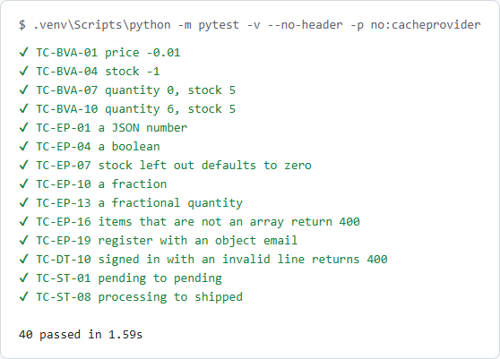

[](docs/banner.svg)

# api-pytest

A Python test suite (pytest and requests) for [qa-practice-api](../qa-practice-api). It runs 40 of the designed cases from the [test plan](../../docs/test-strategy/test-plan.md) with the same case IDs as the Playwright suite, so the same case can be read, and run, in two languages. One command starts the API, runs every case and stops the API again.

**In plain English:** a test plan says what to check, not which tool checks it. Here the same checks, such as "a negative price is refused" and "an order for more than the stock is refused and takes nothing", are written a second time in Python. If the API breaks, both suites should notice. Many QA roles ask for Python, and this shows the same test design in it.

**[Technical guide →](TECHNICAL.md)**

[](docs/pytest.png)

*`pytest -v` against the real API. Every case is named by its test plan ID (TC-BVA-01, TC-EP-13 and so on). Fourteen of the 40 are shown. ([dark version](docs/pytest-dark.png))*

## Installation

```bash
cd packages/api-pytest
python -m venv .venv
.venv/bin/pip install -r requirements.txt      # Windows: .venv\Scripts\pip
npm ci --prefix ../qa-practice-api             # the API's own dependencies
```

Python 3.12 and Node 24 (the API runs on Node).

## Quick start

```bash
.venv/bin/python -m pytest        # Windows: .venv\Scripts\python -m pytest
```

A pytest fixture starts `qa-practice-api` on a free port, signs in as its seeded admin once, runs the cases and stops the server. To test an API that is already running, set `BASE_URL`.

## At a glance

- 40 cases: 20 equivalence classes, 12 boundary values, 4 decision-table rules for placing an order, 4 order status moves
- The IDs match the [test plan](../../docs/test-strategy/test-plan.md) and the [Playwright suite](../qa-practice-api/tests/design), so one case can be compared across both
- One command works on a laptop and in CI: the API is started by a fixture, not by hand
- Every request has a timeout, because `requests` waits forever by default
- JUnit XML is written to `reports/junit.xml` and kept as a CI report
- A dependency audit (`pip-audit`) runs in CI. Its first run found advisories in the versions first pinned, so both were bumped
- Each kind of bug it should catch was put back into the API once, and the right case failed (see [Results](#results))

## Results

| Put back into the API | Cases that failed |
|---|---|
| A negative price is accepted | TC-BVA-01 |
| Order lines for one product are not added up | TC-BVA-11, TC-BVA-12 |
| Any order status move is allowed | TC-ST-01 |

The suite passed 10 runs in a row, then 3 more after the dependency bump, with no retries.

## License

MIT, see the [root LICENSE](../../LICENSE).
