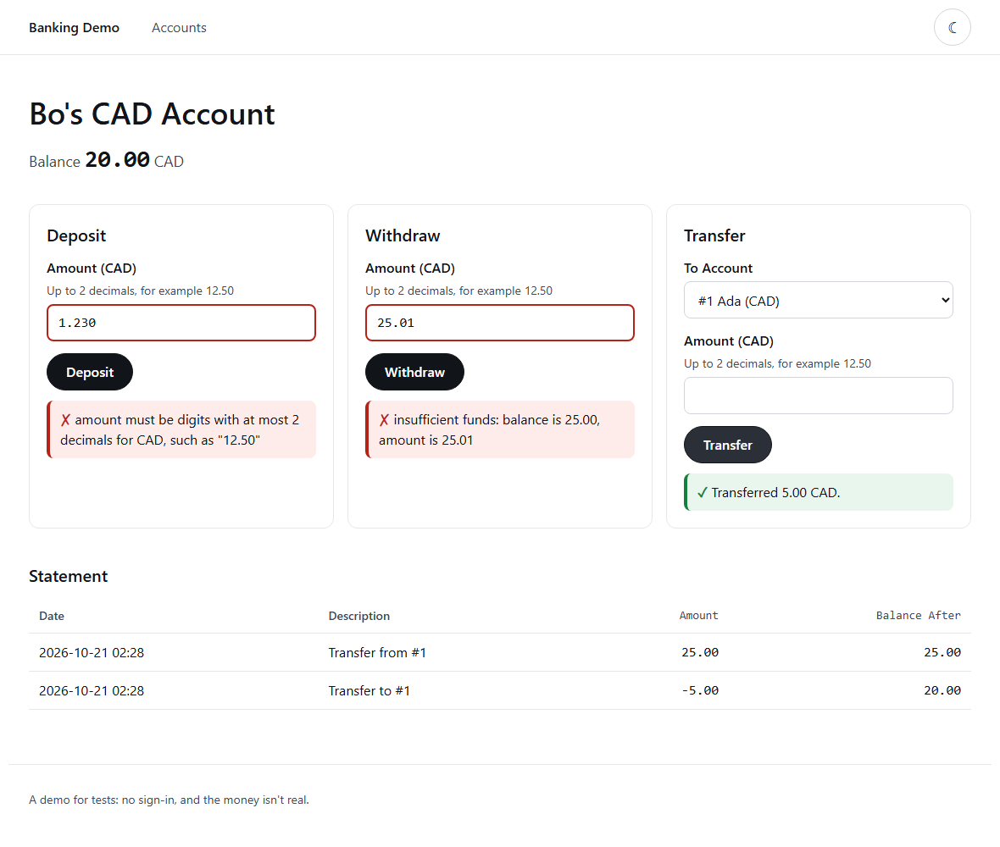

[](docs/banner.svg)

# banking-api

A small banking API and UI built to be tested: accounts in four currencies, deposits, withdrawals and transfers, on a double-entry ledger in SQLite. Money never touches floating point. Amounts arrive and leave as decimal strings and are held as whole minor units (cents, yen, fils) in BigInt and SQL integers, so amounts no JavaScript number can hold stay exact. A retried request moves money once (idempotency keys), and requests sent at the same time, even through two server processes on one database file, can't overdraw an account. 14 SQL checks then read the database itself and prove that every transfer balances, whatever wrote to it. A small UI served by the same server keeps those rules on screen, and 69 Cypress tests drive it in Chrome and Firefox: money typed as text, double clicks and lost replies that move money once, a second tab spending the same money, and accessibility. 37 written [rules](SPEC.md) are checked by 233 designed cases, 8 property-based tests and the Cypress tests, and 78 mistakes were put back on purpose to prove the tests catch each one. It is the base for Day 49's Postgres.

**In plain English:** computers store most numbers in a way that can't hold 0.10 exactly, so adding ten cents three times gives 0.30000000000000004. A bank can't round its way out of that. This API counts whole cents instead, and every movement of money is written twice, once out of one account and once into another, so the books always balance. When a phone on a bad connection sends "pay rent" twice, or two payments leave the same account in the same instant, the rent is paid once and the account never goes below zero. A set of checks reads the books directly, the way an auditor would. And the web page on top does the same: click Pay twice, or lose the connection just after paying, and the money still moves once.

**[Technical guide →](TECHNICAL.md)**

[](docs/ui-account.png)

*The banking UI: a withdrawal one cent over the balance and a deposit with three decimals are refused, each message next to its field, and a transfer is confirmed. The statement shows the balance after each entry, exactly as the API returns it. ([dark version](docs/ui-account-dark.png))*

## Installation

```bash
cd packages/banking-api && npm ci
```

Node 24 or later. No runtime dependencies: the server is `node:http`, the database is `node:sqlite`, and Node runs the TypeScript directly. Cypress and axe-core are for the UI tests only.

## Quick start

Start the server, then open the UI or move money with plain JSON. Amounts are strings.

```bash
npm start   # http://localhost:4100: the UI in a browser, the API for curl
curl -s -X POST localhost:4100/accounts -H 'Content-Type: application/json' -d '{"owner":"Ada","currency":"CAD"}'
curl -s -X POST localhost:4100/accounts/1/deposits -H 'Content-Type: application/json' -d '{"amount":"25.00","currency":"CAD"}'
```

[](docs/demo.png)

*`npm run demo` against the real API: three 0.10 deposits make 0.30, a deposit above 2^53 cents keeps its last cent, a JSON number and an overdraft are refused, and the statement shows the balance after each entry. Then a transfer sent twice with the same `Idempotency-Key` is replayed, not repeated, and the same key with another amount is refused. Last, three withdrawals of the whole balance are sent at once: one passes. The last line shows what doubles would have answered. ([dark version](docs/demo-dark.png))*

## At a glance

- Money as whole minor units in BigInt and SQL `INTEGER`; no amount is ever a JavaScript number, in the API or the UI
- Amounts sent and returned as strings: `"12.34"` is accepted, `12.34` is refused with `400`
- Four currencies with different decimals: CAD and USD 2, JPY 0, KWD 3
- Exact above 2^53 minor units, up to 99,999,999,999,999,999 per currency
- Double-entry ledger: every movement is one debit and one credit of the same amount, in one transaction
- `Idempotency-Key` on every money movement: a retry replays the first answer
- Real races: two server processes on one SQLite file can't overdraw an account, and a busy database answers `503`, never `500`
- 14 SQL ledger checks, each proven by a defect put in past the API; CI runs them on a freshly raced file
- A banking UI in plain HTML and JavaScript, served by the API itself, with a strict content policy
- One `Idempotency-Key` per filled form: a double click, a second Enter or a lost reply moves money once
- Balances on screen are always re-read from the API, so a second tab can't leave the page showing stale money
- 69 Cypress tests in Chrome and Firefox, each run ending with the SQL checks on the database it left
- axe-core finds no WCAG 2.2 AA issue on any screen, in light and dark, or at phone width
- 37 numbered [rules](SPEC.md); a test fails if any rule has no test
- 78 deliberate mistakes, each caught

## Results

| Result | Number | Source |
|---|---|---|
| API tests (Node) | 244 in about three seconds: 233 designed cases, 8 properties, 3 spec checks | [Results](TECHNICAL.md#results) |
| UI tests (Cypress) | 69, in Chrome and in Firefox, about a minute each | [The banking UI](TECHNICAL.md#the-banking-ui-tested-with-cypress) |
| SQL ledger checks | 14 of 14 pass on clean, raced, random and UI-made ledgers; each fires on its own planted defect | [SQL ledger checks](TECHNICAL.md#sql-ledger-checks) |
| Races | 20 transfers of 10.00 at once from 100.00: 10 pass, balance 0.00 (without the fix: 20 pass, −100.00) | [Requests at the same time](TECHNICAL.md#requests-at-the-same-time) |
| Deliberate mistakes caught | 78 of 78 | [Deliberate breaks](TECHNICAL.md#deliberate-breaks) |
| Accessibility | 0 axe-core violations (WCAG 2.2 A and AA) on every screen and state | [a11y.cy.ts](cypress/e2e/a11y.cy.ts) |

## License

MIT
