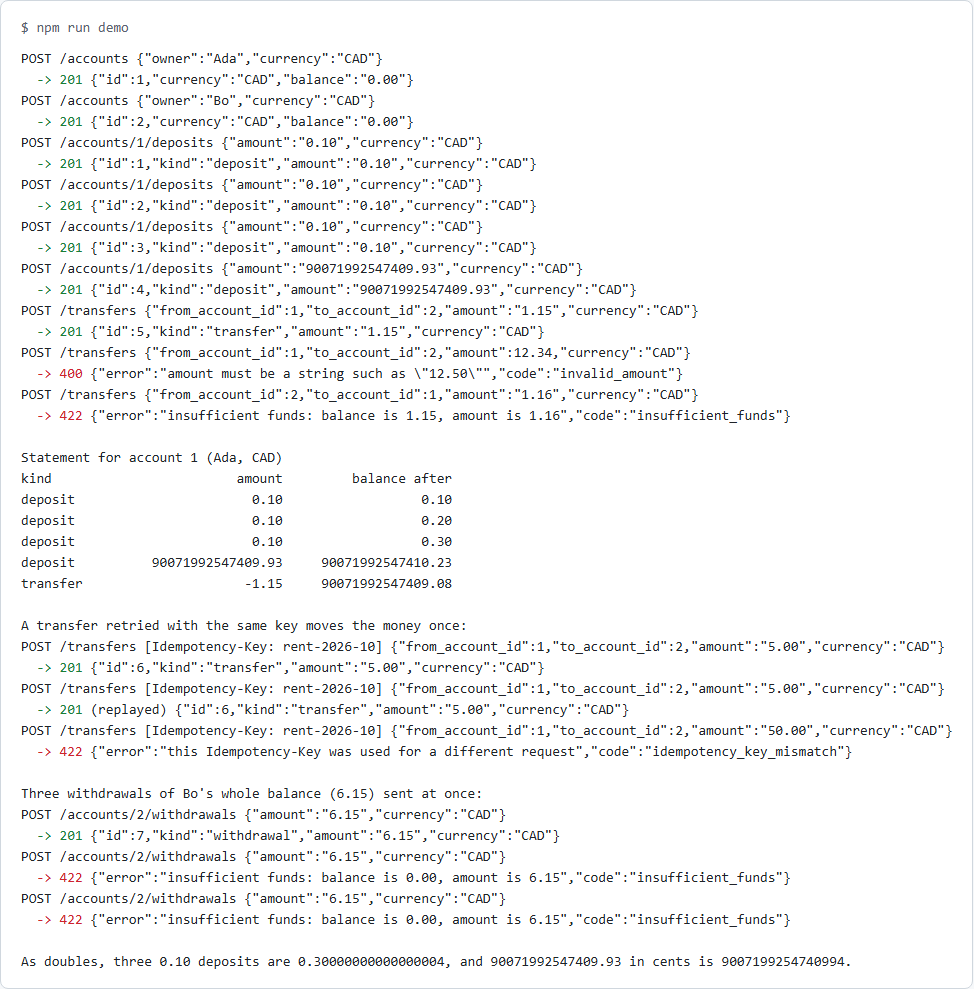
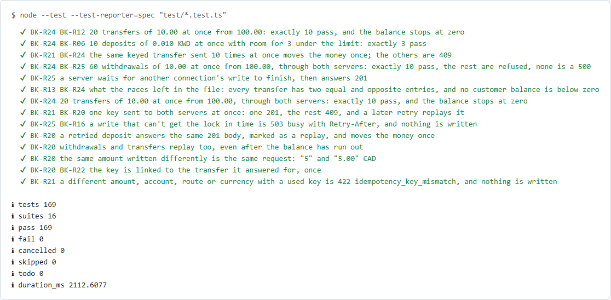

[](docs/banner.svg)

# banking-api

A small banking API built to be tested: accounts in four currencies, deposits, withdrawals and transfers, on a double-entry ledger in SQLite. Money never touches floating point. Amounts arrive and leave as decimal strings and are held as whole minor units (cents, yen, fils) in BigInt and SQL integers, so amounts no JavaScript number can hold stay exact. A retried request moves money once (idempotency keys), and requests sent at the same time, even through two server processes on one database file, can't overdraw an account. 25 written [rules](SPEC.md) are checked by 158 designed cases and 8 property-based tests, and 34 mistakes were put back on purpose to prove the tests catch each one. It is the base for Days 45 and 46: SQL ledger checks and a UI.

**In plain English:** computers store most numbers in a way that can't hold 0.10 exactly, so adding ten cents three times gives 0.30000000000000004. A bank can't round its way out of that. This API counts whole cents instead, and every movement of money is written twice, once out of one account and once into another, so the books always balance. And when a phone on a bad connection sends "pay rent" twice, or two payments leave the same account in the same instant, the rent is paid once and the account never goes below zero.

[](docs/demo.png)

*`npm run demo` against the real API: three 0.10 deposits make 0.30, a deposit above 2^53 cents keeps its last cent, a JSON number and an overdraft are refused, and the statement shows the balance after each entry. Then a transfer sent twice with the same `Idempotency-Key` is replayed, not repeated, and the same key with another amount is refused. Last, three withdrawals of the whole balance are sent at once: one passes. The last line shows what doubles would have answered. ([dark version](docs/demo-dark.png))*

## Installation

```bash
cd packages/banking-api && npm ci
```

Node 24 or later. No runtime dependencies: the server is `node:http`, the database is `node:sqlite`, and Node runs the TypeScript directly.

## Quick start

Start the API, then move money with plain JSON. Amounts are strings.

```bash
npm start   # http://localhost:4100, ledger in memory
curl -s -X POST localhost:4100/accounts -H 'Content-Type: application/json' -d '{"owner":"Ada","currency":"CAD"}'
curl -s -X POST localhost:4100/accounts/1/deposits -H 'Content-Type: application/json' -d '{"amount":"25.00","currency":"CAD"}'
curl -s localhost:4100/accounts/1/entries
```

## At a glance

- Money as whole minor units in BigInt and SQL `INTEGER`; no amount is ever a JavaScript number
- Amounts sent and returned as strings: `"12.34"` is accepted, `12.34` is refused with `400`
- Four currencies with different decimals: CAD and USD 2, JPY 0, KWD 3
- Exact above 2^53 minor units, up to 99,999,999,999,999,999 per currency
- Double-entry ledger: every movement is one debit and one credit of the same amount, in one transaction
- Balances are the sum of ledger entries, never a stored number that could drift
- Overdrafts, transfers between currencies and transfers to the same account are refused with `422`, and nothing is written
- Statements with the balance after each entry, worked out in SQL
- `Idempotency-Key` on every money movement: a retry replays the first answer, a reused key with another request is `422`, a key still running is `409`
- Real races, not simulated ones: two server processes on one SQLite file, and a slow screening step during which requests overlap
- No overdraft and no `500` under load: the funds check runs again inside the write, and a busy database waits, then answers `503`
- 25 numbered [rules](SPEC.md); a test fails if any rule has no test
- 169 tests in about two seconds: 158 designed cases, 8 property-based tests, 3 spec checks
- 34 deliberate mistakes, each caught

## Features

### Money as strings and minor units

An amount is read digit by digit from a JSON string, never through `Number` or `parseFloat`, and kept as a BigInt count of minor units. Day 39 showed why the string matters: a JSON number has already lost digits before any code sees it (`537704868.1699999` arrives as `537704868.17`), so no server can refuse what it was never sent.

| Sent | CAD | JPY | KWD |
|---|---|---|---|
| `"12.34"` | 1234 cents | refused: no decimals | 12340 fils |
| `"12"` | 1200 cents | 12 yen | 12000 fils |
| `"1.230"` | refused: 3 decimals | refused | 1230 fils |
| `12.34` (a number) | refused | refused | refused |
| `"-1"`, `"1e3"`, `"007"`, `" 1"` | refused | refused | refused |

Responses always carry the currency's decimals: a deposit of `"5"` comes back as `"5.00"` in CAD and `"5.000"` in KWD. The limit, 10^17 − 1 minor units per currency, keeps every sum inside SQLite's 64-bit integers while staying above 2^53, so the amounts that break doubles are inside the range tested.

### A double-entry ledger

```sql
-- sql/schema.sql (abridged)
CREATE TABLE transfers      (id, kind, from_account_id, to_account_id, amount INTEGER CHECK (amount > 0), currency, created_at);
CREATE TABLE ledger_entries (id, transfer_id, account_id, amount INTEGER CHECK (amount <> 0), currency);
```

Each deposit, withdrawal or transfer writes one `transfers` row and two `ledger_entries` rows, `-amount` and `+amount`, inside `BEGIN IMMEDIATE … COMMIT`. Deposits come from, and withdrawals go to, an internal funding account per currency, so the entries in each currency always sum to zero. The API never shows a funding account; it shows `null` where one would appear. A balance is `SUM(amount)` over the account's entries, and a statement's running balance is a window function over the same rows.

### Retried requests: idempotency keys

A client that times out can't tell whether its transfer went through. With an `Idempotency-Key` header it can send the same request again safely:

```bash
curl -s -X POST localhost:4100/transfers -H 'Content-Type: application/json' \
  -H 'Idempotency-Key: rent-2026-10' -d '{"from_account_id":1,"to_account_id":2,"amount":"5.00","currency":"CAD"}'
```

| The same key again, with | Answer | Written |
|---|---|---|
| the same request (`"5"` and `"5.00"` count as the same) | `201`, the first answer's body, `Idempotent-Replayed: true` | nothing |
| a different amount, account, route or currency | `422 idempotency_key_mismatch` | nothing |
| the first request still running, here or on another server | `409 idempotency_key_in_use` | nothing |
| after a refusal (`404`, `422`) or a failure | treated as new: refused requests keep no key | the movement, once |
| 24 hours or more after first use | treated as new: the key has expired | the movement |

```sql
-- sql/schema.sql
CREATE TABLE idempotency_keys (
  key         TEXT    PRIMARY KEY,
  fingerprint TEXT    NOT NULL,                        -- route, accounts, amount, currency
  transfer_id INTEGER UNIQUE REFERENCES transfers (id), -- NULL while in flight
  created_at  TEXT    NOT NULL
);
```

A keyed request claims its key first, and the key is linked to its transfer in the same transaction that writes the transfer. A test makes that link fail on purpose: the transfer is rolled back with it, so no movement exists without its key.

### Requests at the same time

Each movement awaits a screening step first, standing in for an outside fraud or limits check (`SCREENING_DELAY_MS` makes it slow). Other requests run during that wait, so the balance read before it may be stale by the time the money moves. The fix is to check again where it can't go stale:

```ts
// src/ledger.ts: the bank's rules run again inside the write transaction
apply(m: Movement, key?: string): Result<Transfer> {
  return this.#write(() => {          // BEGIN IMMEDIATE ... COMMIT
    const refusal = this.check(m);    // funds and the limit, read under the write lock
    if (refusal) return refusal;
    // insert the transfer, the two entries, and link the key
  });
}
```

What the tests measured, sending requests together and letting the database decide the order:

| Race | Without the fix | With it |
|---|---|---|
| 20 transfers of 10.00 at once from 100.00, one process | 20 pass, balance −100.00 | 10 pass, balance 0.00 |
| 10 deposits at once, room for 3 under the KWD limit | 10 pass, limit passed | 3 pass |
| 60 withdrawals of 10.00 from 100.00 through two processes on one file | 37 pass, balance −270.00 | 10 pass, 50 refused |
| The same, on the code before today (check already inside the transaction) | 1 to 4 of 60 answered `500 database is locked` | no `500`: a busy connection waits up to 5 s |
| One key sent 10 times at once to two servers | (no keys before today) | one `201`, nine `409`, a later retry replayed |

### Refusals

Every refusal is `{ "error", "code" }`, checked in a fixed order: the request first, then the idempotency key, then whether the accounts exist, then the bank's rules.

| Status | Codes |
|---|---|
| `400` | `invalid_json`, `invalid_body`, `invalid_currency`, `invalid_amount`, `invalid_owner`, `invalid_account_id`, `invalid_idempotency_key` |
| `404` | `not_found` (account, transfer or route; funding accounts too) |
| `405` | `method_not_allowed`, with `Allow` |
| `409` | `idempotency_key_in_use` (the first request with this key is still running) |
| `413` | `body_too_large` (over 16 KB) |
| `415` | `unsupported_media_type` (a POST that isn't `application/json`) |
| `422` | `idempotency_key_mismatch`, `same_account`, `currency_mismatch`, `insufficient_funds`, `limit_exceeded` |
| `503` | `busy`, with `Retry-After: 1` (another process held the database for over 5 seconds) |

### Endpoints

| Method | Path | Body | Answer |
|---|---|---|---|
| `POST` | `/accounts` | `owner`, `currency` | `201` the account, balance zero |
| `GET` | `/accounts/:id` | | the account and its balance |
| `GET` | `/accounts/:id/entries` | | the account and its entries, oldest first, each with `balance_after` |
| `POST` | `/accounts/:id/deposits` | `amount`, `currency` | `201` the transfer |
| `POST` | `/accounts/:id/withdrawals` | `amount`, `currency` | `201` the transfer, or `422 insufficient_funds` |
| `POST` | `/transfers` | `from_account_id`, `to_account_id`, `amount`, `currency` | `201` the transfer |
| `GET` | `/transfers/:id` | | the transfer and its two entries |
| `GET` | `/health` | | `{ "status": "ok" }` |

The three `POST` routes that move money take an optional `Idempotency-Key` header (1 to 255 visible ASCII characters).

## Configuration

| Variable | Default | What it does |
|---|---|---|
| `PORT` | `4100` | Port the API listens on (qa-practice-api uses 4000) |
| `DATABASE_PATH` | none: in memory | A SQLite file to keep the ledger in across restarts; several servers can share one |
| `SCREENING_DELAY_MS` | `0` | Makes the screening before each movement take this long, as a slow outside check would; the race tests use it |

## CI integration

The package runs as its own job in the root [CI workflow](../../.github/workflows/ci.yml), and its TypeScript is type-checked in the `typecheck` job.

```yaml
- { package: banking-api, browsers: false, command: npm test && npm run demo }
```

## Results

[](docs/tests.png)

*Part of `npm test`: the race tests and some of the idempotency tests, then the totals. ([dark version](docs/tests-dark.png))*

| Tests | Count | What they check |
|---|---:|---|
| [`money.test.ts`](test/money.test.ts) | 60 | Reading and writing amounts: boundary values, equivalence classes and inputs that break float or loose parsing, each tagged with its technique |
| [`api.test.ts`](test/api.test.ts) | 67 | Every endpoint and refusal over HTTP, including a database failure injected between the debit and the credit |
| [`idempotency.test.ts`](test/idempotency.test.ts) | 22 | Keys over HTTP: format boundaries, replays of all three movements, mismatches, a request held in its screening to show `409`, refused and failed requests keeping no key, a failure injected into the key link, and expiry at exactly 24 hours on an injected clock |
| [`concurrency.test.ts`](test/concurrency.test.ts) | 9 | Real races: overlapping requests in one process during a 20 ms screening, and two `node src/server.ts` processes on one SQLite file, with and without a slow screening. Checks the counts of `201` and `422`, that nothing is a `500`, a lock held from outside, `503` when it's held too long, and what the races left in the database file |
| [`money.property.test.ts`](test/money.property.test.ts) | 7 | fast-check: any amount round-trips, no JSON number is accepted, any accepted text is plain digits, neighbours above 2^53 stay apart |
| [`ledger.property.test.ts`](test/ledger.property.test.ts) | 1 | A model of the bank: 300 random sequences of up to 40 moves across six accounts in three currencies. After every move each balance matches the model; at the end, every transfer has two equal and opposite entries and every currency sums to zero |
| [`spec.test.ts`](test/spec.test.ts) | 3 | Every rule in [SPEC.md](SPEC.md) has a test, and every rule a test names exists |

### Deliberate breaks

Each mistake was put into the code, the tests run, and the code restored. All 34 were caught. The three that depend on timing between processes (B21 to B23) were run five times each and caught every time.

| # | Mistake | Caught by |
|---|---|---:|
| B01 | Amounts read through a double (`Math.round(Number(value) * 100)`) | 10 tests |
| B02 | JSON numbers accepted | 6 |
| B03 | One decimal too many accepted (`"1.005"` read as 1005 cents) | 6 |
| B04 | Zero accepted as an amount | 6 |
| B05 | The limit not applied to a single amount | 3 |
| B06 | The leading zero dropped when writing (`".01"`) | 18 |
| B07 | `<=` for `<` in the funds check: the whole balance can't be spent | 3 |
| B08 | No funds check | 4 |
| B09 | No transaction around the two entries | 1 |
| B10 | The receiving account's currency not checked | 3 |
| B11 | No same-account check (the database refuses it, as a `500`) | 3 |
| B12 | The currency limit not enforced | 2 |
| B13 | Integers read from SQLite as JavaScript numbers (the driver's default) | 15 |
| B14 | Funding accounts visible through `GET /accounts/:id` | 1 |
| B15 | Every statement row shows the final balance | 1 |
| B16 | Statement newest first | 2 |
| B17 | The database's error message shown to the client | 1 |
| B18 | `Cache-Control: no-store` missing | 2 |
| B19 | No body size limit | 1 |
| B20 | Any content type read as JSON | 1 |
| B21 | No busy timeout: a second process fails at once | 3 to 4 |
| B22 | Funds checked only before the screening, not again when writing | 6 |
| B23 | `BEGIN` (deferred) for `BEGIN IMMEDIATE` | 2 |
| B24 | A busy database answered with `500`, not `503` | 1 |
| B25 | The `Idempotency-Key` ignored | 13 |
| B26 | The amount left out of the key's fingerprint | 2 |
| B27 | No `Idempotent-Replayed` header on a replay | 7 |
| B28 | A refused request keeps its key | 4 |
| B29 | The key linked after the transfer commits, not in its transaction | 1 |
| B30 | No in-flight check: a running key counts as free | 3 |
| B31 | `<` for `<=` in the expiry: a key lives 1 ms too long | 2 |
| B32 | Keys never expire | 2 |
| B33 | Key length not checked | 1 |
| B34 | Accounts and funds checked before the key (a replay after the balance ran out is refused) | 2 |

### What building it found

- **Random amounts don't find boundaries.** The first version of the ledger model generated random amounts, and with it B07 (`<=` for `<`) and B12 (the limit switched off) passed the property test; only designed cases caught them. Random amounts almost never equal a balance exactly, and fast-check's default size kept sequences too short to reach the limit. The model now also generates "the whole balance", "what's left under the limit", and one more than each, worked out when the move runs, and longer sequences. It catches both.
- **A break can be caught for the wrong reason.** The first "no transaction" break removed `BEGIN` and `COMMIT` but not `ROLLBACK`, so refusals crashed and six tests failed, none of them about atomicity. With every transaction statement removed, exactly one test fails: the one that makes the database refuse the credit after the debit is written. No ordinary request can show a half-written transfer, because nothing fails between the two inserts; only an injected failure proves the transaction is there.
- **SQLite drivers hand back integers as JavaScript numbers by default.** Without `setReadBigInts(true)` (B13), every balance passes through a double on its way out of the database. Fifteen tests catch it, including the deposit above 2^53.
- **A test depended on the order tests ran in.** The funding-account test expected the first KWD deposit to create the funding account, but an earlier test had already made one. It now has its own server.
- **The race on day one wasn't an overdraft, it was a `500`.** Day 43's code already checked funds inside `BEGIN IMMEDIATE`, and that lock holds across processes, so two servers on one file never overdrew. But SQLite's default busy timeout is zero: a second process that found the lock taken failed at once with `database is locked`, and 1 to 4 requests in 60 answered `500`. The fix is a 5 second busy timeout, and `503` with `Retry-After` if even that runs out.
- **The overdraft needs a wait between the check and the write.** It appeared as soon as a slow step (the screening) sat between reading the balance and writing: 20 transfers of 10.00 from 100.00 all passed. Checking again inside the write transaction fixed it, and the early check stays only so the screening isn't asked about requests that would be refused anyway.
- **`BEGIN` instead of `BEGIN IMMEDIATE` doesn't overdraw in SQLite; it deadlocks.** Two deferred transactions both read, then both try to write, and SQLite refuses one at once without waiting, so the race tests saw `503`s, not a negative balance. On Postgres the same mistake under `READ COMMITTED` would overdraw: both transactions sum the old entries. Day 49 needs `SELECT … FOR UPDATE` on the account row for the same guarantee.
- **A COMMIT can be busy too.** The test that holds the lock from outside failed one run in six: its `COMMIT` had to wait for a reader in the server process, and it had no busy timeout. Every connection, the tests' included, now sets one.
- **Two breaks were first caught by a hang, not a failure.** With the key ignored, the request meant to get `409` went into the held screening and never came back, so the test run timed out. The test now races that request against a one-second timer and fails with a reason.

## FAQ

### Why strings and not JSON numbers?

JSON numbers are read as doubles. `0.29` is fine, but `537704868.1699999` and `537704868.17` are the same double, and digits past about 16 are gone before any code runs. A string arrives exactly as it was sent. Day 39 found this in the [AI-written discount code](../../docs/ai-written-code/properties-and-mutation.md).

### Why not a decimal library?

Whole minor units in BigInt need no library and map straight onto SQL `INTEGER` (`BIGINT` on Postgres). The ledger sums integers, and integers add exactly.

### Can two requests at once overdraw an account?

No, and the tests show it for real rather than by interleaving calls by hand. Requests overlap during the screening wait in one process, and across two server processes on one SQLite file. The funds check runs again inside the `BEGIN IMMEDIATE` transaction that writes, so the outcome is the same as running the requests one after another. Taking that second check out (B22) lets 20 of 20 transfers through where 10 should pass.

### Why not store the balance with a `CHECK (balance >= 0)`?

`UPDATE accounts SET balance = balance - ? WHERE id = ? AND balance >= ?` is safe on both SQLite and Postgres. But it brings back a stored number that can drift from the ledger, which BK-R09 rules out, and Day 45's SQL checks would then have to reconcile the two. Locking and checking inside the transaction keeps one source of truth.

### What changes on Postgres (Day 49)?

`BEGIN IMMEDIATE` locks the whole SQLite database, so checking inside the transaction is enough. Postgres locks rows, and under `READ COMMITTED` two transactions can both sum the old entries. The same guarantee there needs `SELECT … FROM accounts WHERE id = $1 FOR UPDATE` before the sum, taken in a fixed order (lowest id first) so two opposite transfers can't deadlock. The race tests here are written against HTTP, so they can run unchanged against that version.

### Why does a key whose first request crashed stay `409`?

The claim is a row with no transfer yet. If the server stops before it finishes, nothing removes the row, so the key stays in flight until it expires after 24 hours. Taking over an abandoned key sooner needs a lease with a token, which this demo leaves out (see [SPEC.md](SPEC.md#out-of-scope-today)).

### Is there any sign-in?

No: anyone can move money between any accounts. Access control is tested on [qa-practice-api](../qa-practice-api/README.md); here the subject is the money. [SPEC.md](SPEC.md#out-of-scope-today) lists what is out of scope.

## Troubleshooting

| Problem | Cause | Fix |
|---|---|---|
| `400 invalid_amount: amount must be a string` | The amount was sent as a JSON number | Quote it: `"amount": "12.34"` |
| `400 invalid_amount: at most 2 decimals for CAD` | More decimals than the currency has, even a trailing zero | Send `"1.23"`, not `"1.230"` |
| `415 unsupported_media_type` | The POST has no `Content-Type: application/json` | Add the header |
| `ERR_UNKNOWN_BUILTIN_MODULE: node:sqlite` | Node older than 22.5 | Use Node 24, as CI does |
| The balance is gone after a restart | The ledger is in memory by default | Set `DATABASE_PATH=banking.db` |
| `422 idempotency_key_mismatch` | The key was used for another amount, account or route in the last 24 hours | Use a new key for a new request |
| `409 idempotency_key_in_use` | The first request with this key hasn't finished | Wait and retry with the same key: it replays once done |
| `503 busy` | Another process held the database file for over 5 seconds | Retry after `Retry-After` seconds |

## Development

```bash
npm ci
npm test          # 169 tests, about two seconds
npm run demo      # the requests in the screenshot above
npm start         # the API on PORT (4100)
```

The README images are real output, captured with `npm run terminal` in [`scripts/screenshots`](../../scripts/screenshots/terminal.mjs).

## License

MIT
