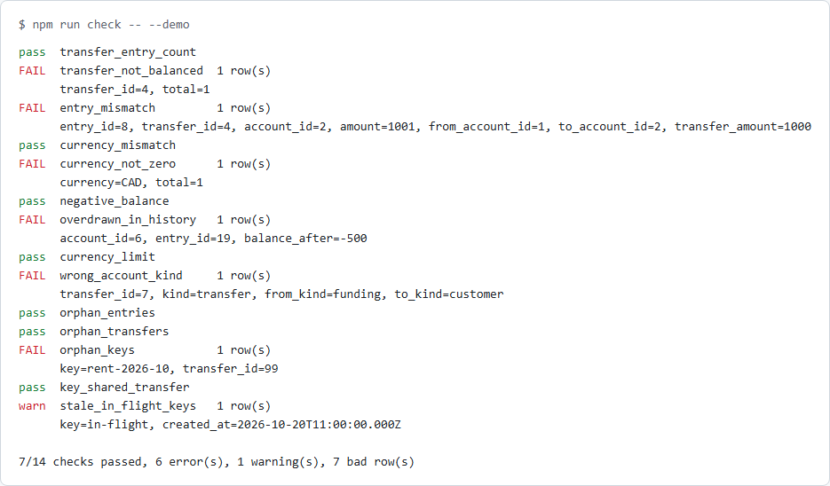
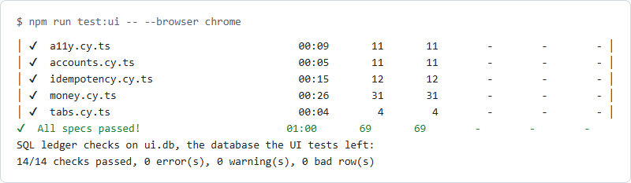

# banking-api: technical guide

[← Back to overview](README.md)

**Contents:** [Features](#features) · [Configuration](#configuration) · [CI integration](#ci-integration) · [Results](#results) · [FAQ](#faq) · [Troubleshooting](#troubleshooting) · [Development](#development)

## Features

### Money as strings and minor units

An amount is read digit by digit from a JSON string, never through `Number` or `parseFloat`, and kept as a BigInt count of minor units. Day 39 showed why the string matters: a JSON number has already lost digits before any code sees it (`537704868.1699999` arrives as `537704868.17`), so no server can refuse what it was never sent.

| Sent | CAD | JPY | KWD |
|---|---|---|---|
| `"12.34"` | 1234 cents | refused: no decimals | 12340 fils |
| `"12"` | 1200 cents | 12 yen | 12000 fils |
| `"1.230"` | refused: 3 decimals | refused | 1230 fils |
| `12.34` (a number) | refused | refused | refused |
| `"-1"`, `"1e3"`, `"007"`, `" 1"` | refused | refused | refused |

Responses always carry the currency's decimals: a deposit of `"5"` comes back as `"5.00"` in CAD and `"5.000"` in KWD. The limit, 10^17 − 1 minor units per currency, keeps every sum inside SQLite's 64-bit integers while staying above 2^53, so the amounts that break doubles are inside the range tested.

### A double-entry ledger

```sql
-- sql/schema.sql (abridged)
CREATE TABLE transfers      (id, kind, from_account_id, to_account_id, amount INTEGER CHECK (amount > 0), currency, created_at);
CREATE TABLE ledger_entries (id, transfer_id, account_id, amount INTEGER CHECK (amount <> 0), currency);
```

Each deposit, withdrawal or transfer writes one `transfers` row and two `ledger_entries` rows, `-amount` and `+amount`, inside `BEGIN IMMEDIATE … COMMIT`. Deposits come from, and withdrawals go to, an internal funding account per currency, so the entries in each currency always sum to zero. The API never shows a funding account; it shows `null` where one would appear. A balance is `SUM(amount)` over the account's entries, and a statement's running balance is a window function over the same rows.

### Retried requests: idempotency keys

A client that times out can't tell whether its transfer went through. With an `Idempotency-Key` header it can send the same request again safely:

```bash
curl -s -X POST localhost:4100/transfers -H 'Content-Type: application/json' \
  -H 'Idempotency-Key: rent-2026-10' -d '{"from_account_id":1,"to_account_id":2,"amount":"5.00","currency":"CAD"}'
```

| The same key again, with | Answer | Written |
|---|---|---|
| the same request (`"5"` and `"5.00"` count as the same) | `201`, the first answer's body, `Idempotent-Replayed: true` | nothing |
| a different amount, account, route or currency | `422 idempotency_key_mismatch` | nothing |
| the first request still running, here or on another server | `409 idempotency_key_in_use` | nothing |
| after a refusal (`404`, `422`) or a failure | treated as new: refused requests keep no key | the movement, once |
| 24 hours or more after first use | treated as new: the key has expired | the movement |

```sql
-- sql/schema.sql
CREATE TABLE idempotency_keys (
  key         TEXT    PRIMARY KEY,
  fingerprint TEXT    NOT NULL,                        -- route, accounts, amount, currency
  transfer_id INTEGER UNIQUE REFERENCES transfers (id), -- NULL while in flight
  created_at  TEXT    NOT NULL
);
```

A keyed request claims its key first, and the key is linked to its transfer in the same transaction that writes the transfer. A test makes that link fail on purpose: the transfer is rolled back with it, so no movement exists without its key.

### Requests at the same time

Each movement awaits a screening step first, standing in for an outside fraud or limits check (`SCREENING_DELAY_MS` makes it slow). Other requests run during that wait, so the balance read before it may be stale by the time the money moves. The fix is to check again where it can't go stale:

```ts
// src/ledger.ts: the bank's rules run again inside the write transaction
apply(m: Movement, key?: string): Result<Transfer> {
  return this.#write(() => {          // BEGIN IMMEDIATE ... COMMIT
    const refusal = this.check(m);    // funds and the limit, read under the write lock
    if (refusal) return refusal;
    // insert the transfer, the two entries, and link the key
  });
}
```

What the tests measured, sending requests together and letting the database decide the order:

| Race | Without the fix | With it |
|---|---|---|
| 20 transfers of 10.00 at once from 100.00, one process | 20 pass, balance −100.00 | 10 pass, balance 0.00 |
| 10 deposits at once, room for 3 under the KWD limit | 10 pass, limit passed | 3 pass |
| 60 withdrawals of 10.00 from 100.00 through two processes on one file | 37 pass, balance −270.00 | 10 pass, 50 refused |
| The same, on the code before today (check already inside the transaction) | 1 to 4 of 60 answered `500 database is locked` | no `500`: a busy connection waits up to 5 s |
| One key sent 10 times at once to two servers | (no keys before today) | one `201`, nine `409`, a later retry replayed |

### SQL ledger checks

The tests above go through the API. These checks go straight to the database and ask whether the books still balance, however the rows got there: through the API, a manual fix, a migration, or a script with foreign keys off (SQLite's default for any connection that doesn't turn them on). Each check is a `.sql` file in [`sql/checks`](sql/checks) whose query returns the rows that break one rule.

[](docs/checks.png)

*`npm run check -- --demo`: the sample ledger with five defects put in by hand. A credit raised by one cent fails three checks. An overdraft refilled a second later fails only the history check, since the balance now is fine. Every failing row is printed, and the run exits 1. ([dark version](docs/checks-dark.png))*

| # | Check | Rule | Finds |
|---:|---|---|---|
| 1 | `transfer_entry_count` | BK-R26 | A transfer without exactly two entries |
| 2 | `transfer_not_balanced` | BK-R26 | A transfer whose entries don't sum to zero |
| 3 | `entry_mismatch` | BK-R26 | An entry that isn't the transfer's debit (−amount, from account) or credit (+amount, to account) |
| 4 | `currency_mismatch` | BK-R26 | An entry whose currency differs from its transfer's or its account's |
| 5 | `currency_not_zero` | BK-R26 | A currency whose entries don't sum to zero |
| 6 | `negative_balance` | BK-R27 | A customer balance below zero |
| 7 | `overdrawn_in_history` | BK-R27 | A customer whose running balance went below zero at any entry, even if refilled later |
| 8 | `currency_limit` | BK-R27 | A currency holding more than 10^17 − 1 minor units |
| 9 | `wrong_account_kind` | BK-R27 | A deposit not from the funding account, a withdrawal not to it, a transfer not between customers |
| 10 | `orphan_entries` | BK-R28 | An entry for a transfer or account that doesn't exist |
| 11 | `orphan_transfers` | BK-R28 | A transfer for an account that doesn't exist |
| 12 | `orphan_keys` | BK-R28 | An idempotency key pointing at a transfer that doesn't exist |
| 13 | `key_shared_transfer` | BK-R28 | One transfer answering for two keys (if the `UNIQUE` constraint was lost) |
| 14 | `stale_in_flight_keys` | BK-R29 | A key in flight for over 10 minutes: a request that stopped (a warning, not an error) |

Two entries that sum to zero can still be wrong, so one check compares each entry with its transfer row:

```sql
-- sql/checks/03-entry-mismatch.sql
SELECT e.id AS entry_id, e.transfer_id, e.account_id, e.amount,
       t.from_account_id, t.to_account_id, t.amount AS transfer_amount
FROM ledger_entries e
JOIN transfers t ON t.id = e.transfer_id
WHERE NOT ((e.account_id = t.from_account_id AND e.amount = -t.amount)
        OR (e.account_id = t.to_account_id AND e.amount = t.amount));
```

**How each check is proven.** A clean sample ledger is built through the `Ledger` itself: every currency, every kind of movement, a whole balance spent, KWD filled to its limit exactly, a keyed transfer, refusals that write nothing, and a key still in flight. All 14 checks pass on it. Then 22 defects are put into copies of it with plain SQL, past the API and with foreign keys off. Each test asserts the exact set of checks that fires:

| Defect put in | Checks that fire |
|---|---|
| A credit one cent too high | `transfer_not_balanced`, `entry_mismatch`, `currency_not_zero` |
| Two extra entries that cancel out | `transfer_entry_count`, `entry_mismatch` |
| The debit and the credit swapped | `entry_mismatch`, `negative_balance`, `overdrawn_in_history` |
| A transfer row in the wrong currency | `currency_mismatch` |
| An overdraft refilled a second later | `overdrawn_in_history` |
| One fils past the KWD limit | `currency_limit` |
| An account deleted with its history | `orphan_entries`, `orphan_transfers` |
| A migration dropped `UNIQUE`, and a second key points at a transfer | `key_shared_transfer` |
| A key in flight for 10 minutes and 1 ms / for exactly 10 minutes | `stale_in_flight_keys` / nothing |

A test fails if any check has no defect that fires it. Seven checks never fire alone, and a test names them and why: a transfer missing an entry is also unbalanced, and a negative balance is also a negative running balance.

**Where they run.**

| Ledger | How it's made | Where |
|---|---|---|
| Clean sample | Built through the `Ledger`, fixed clock | [`checks.test.ts`](test/checks.test.ts) |
| Raced files | Two `node src/server.ts` processes on one SQLite file, with and without a slow screening | [`concurrency.test.ts`](test/concurrency.test.ts), read-only while the servers still run |
| Random runs | The end of each of 300 random sequences of up to 40 moves | [`ledger.property.test.ts`](test/ledger.property.test.ts) |
| A fresh race in CI | `npm run race -- raced.db`: five races, 220 requests in all, at two servers, in three currencies | The CI job, then `npm run check -- --db raced.db` |

**Postgres.** The checks are plain SQL (`LEFT JOIN`, `GROUP BY … HAVING`, a window function), and a test fails if one uses something only SQLite accepts: `IFNULL`, `GLOB`, `strftime`, double-quoted strings, `==`, `rowid`, or a placeholder other than `:name`. Day 49 runs the same files on Postgres.

### The banking UI, tested with Cypress

The server also serves a small banking UI at `/`: plain HTML, CSS and JavaScript in [`public/`](public), with no framework and no build. It's served from the same origin as the API, so it needs no CORS, and its policy (`default-src 'self'`) allows no inline code and nothing from another site. Two screens: the accounts list with an Open an Account form, and an account page with its balance, Deposit, Withdraw and Transfer forms, and the statement.

[](docs/ui-account.png)

*The account page, driven through the page by [`scripts/screenshots/ui.mjs`](../../scripts/screenshots/ui.mjs): a withdrawal one cent over the balance and a deposit with three decimals are refused, each message next to its field, and a transfer is confirmed. ([dark version](docs/ui-account-dark.png), [accounts list](docs/ui-accounts.png))*

The UI keeps the API's rules all the way to the screen:

- **Money stays text.** An amount is sent as typed, minus the spaces around it, as a JSON string, and every amount shown is the API's string. The page never turns an amount into a number and never adds one up; a Node test fails if `app.js` uses `parseFloat`, `toFixed`, `Math.`, `toLocaleString` or `Number(` on anything but ids. The amount field is `type="text"` with `inputmode="decimal"` (or `numeric` for JPY), because `type="number"` accepts `1e3` and rounds.
- **One movement per filled form.** The page makes one `Idempotency-Key` when a form is first sent and keeps it until the API gives a final answer. A double click, a second Enter, or a retry after a lost reply all use the same key, so the API replays instead of moving the money again:

```js
// public/app.js: the key lives with the form until a final answer
async function sendMovement(form, path, body) {
  const key = keyFor(form, [path, body]);          // same form, same values: same key
  for (let attempt = 0; attempt <= RETRIES; attempt++) {
    try { reply = await api('POST', path, body, { 'Idempotency-Key': key }); } catch { reply = null; }
    if (reply && !RETRYABLE.has(reply.status)) break;   // 201 or a refusal: final
    if (attempt < RETRIES) await wait(retryDelay(reply, attempt));
  }
  if (reply && !RETRYABLE.has(reply.status)) keys.delete(form);  // next send is a new movement
  return reply;
}
```

- **Balances are always the API's.** After every answer, success or refusal, the page reads the account again. A page left open while another tab spends the money shows the refusal and the real balance, not the one it loaded.
- **Refusals are shown where they happened.** The API's message appears in the form, in a `role="alert"` element tied to the field by `aria-describedby`, and the field is marked `aria-invalid`.

**What the Cypress tests check.** 69 tests in five specs ([`cypress/e2e`](cypress/e2e)), run in Chrome and Firefox. Each run starts a real `node src/server.ts` on a fresh `ui.db`; tests open their own accounts through the API, so none depends on another's money. Every spec ends by running the 14 SQL ledger checks on the file, and `npm run test:ui` runs them once more at the end.

| Spec | Tests | What it checks |
|---|---:|---|
| [`money.cy.ts`](cypress/e2e/money.cy.ts) | 31 | Typed amounts in each currency (`"12.5"` CAD is 12.50, `"3"` KWD is 3.000), three 0.10 deposits making exactly 0.30, 90071992547409.93 + 0.01 staying exact, the amount sent as a JSON string, 14 refused amounts (`"1.230"`, `"1,000.00"`, `"1e3"`, `"１２"`, `"12.5"` JPY…), overdraft, currency mismatch and limit refusals shown on the right field |
| [`idempotency.cy.ts`](cypress/e2e/idempotency.cy.ts) | 12 | A double click and a double Enter move money once; a reply lost after the money moved is retried with the same key and replayed; `409`, `502`, `503`, `504` and a network error are retried; four lost replies, then the user's second click, still one movement; the same amount twice on purpose is two |
| [`tabs.cy.ts`](cypress/e2e/tabs.cy.ts) | 4 | Another tab (another client of the API) spends or adds money while the page is open, including while the page's own withdrawal is on its way: the page shows the refusal and the real balance, and the balance never goes below zero |
| [`a11y.cy.ts`](cypress/e2e/a11y.cy.ts) | 11 | axe-core (WCAG 2.2 A and AA) on every screen and state, in light and dark, and at 375 px; a deposit done with the keyboard only; the skip link; focus on the heading when a page opens; refusals announced and tied to their field |
| [`accounts.cy.ts`](cypress/e2e/accounts.cy.ts) | 11 | The list, opening an account in each currency through the form, a blank owner refused, an owner name made of HTML shown as text, unknown accounts and pages |

[](docs/cypress.png)

*`npm run test:ui -- --browser chrome`: the five specs, then the SQL ledger checks on `ui.db`, the database the run left. ([dark version](docs/cypress-dark.png))*

**Two tabs in a tool that drives one.** Cypress controls a single tab, so the second tab is another client of the same API, which is all a second tab is to the server. In the hardest case, the page's withdrawal is held at the proxy while the other tab withdraws the same money, then sent on:

```ts
// cypress/e2e/tabs.cy.ts: the other tab gets there first
cy.intercept('POST', `/accounts/${id}/withdrawals`, async (req) => {
  if (req.headers['x-other-tab']) return;                 // the other tab's own request
  await fetch(`/accounts/${id}/withdrawals`, { method: 'POST', headers: { 'Content-Type': 'application/json', 'X-Other-Tab': '1' },
    body: JSON.stringify({ amount: '10.00', currency: 'USD' }) });
  req.continue();                                         // now the page's, against 0.00
});
```

Two real browser contexts at once are shown with Playwright in [multi-user-flow-patterns](../multi-user-flow-patterns/README.md).

### Refusals

Every refusal is `{ "error", "code" }`, checked in a fixed order: the request first, then the idempotency key, then whether the accounts exist, then the bank's rules.

| Status | Codes |
|---|---|
| `400` | `invalid_json`, `invalid_body`, `invalid_currency`, `invalid_amount`, `invalid_owner`, `invalid_account_id`, `invalid_idempotency_key` |
| `404` | `not_found` (account, transfer or route; funding accounts too) |
| `405` | `method_not_allowed`, with `Allow` |
| `409` | `idempotency_key_in_use` (the first request with this key is still running) |
| `413` | `body_too_large` (over 16 KB) |
| `415` | `unsupported_media_type` (a POST that isn't `application/json`) |
| `422` | `idempotency_key_mismatch`, `same_account`, `currency_mismatch`, `insufficient_funds`, `limit_exceeded` |
| `503` | `busy`, with `Retry-After: 1` (another process held the database for over 5 seconds) |

### Endpoints

| Method | Path | Body | Answer |
|---|---|---|---|
| `GET` | `/accounts` | | `{ "accounts": [...] }`, customer accounts oldest first, each with its balance |
| `POST` | `/accounts` | `owner`, `currency` | `201` the account, balance zero |
| `GET` | `/accounts/:id` | | the account and its balance |
| `GET` | `/accounts/:id/entries` | | the account and its entries, oldest first, each with `balance_after` |
| `POST` | `/accounts/:id/deposits` | `amount`, `currency` | `201` the transfer |
| `POST` | `/accounts/:id/withdrawals` | `amount`, `currency` | `201` the transfer, or `422 insufficient_funds` |
| `POST` | `/transfers` | `from_account_id`, `to_account_id`, `amount`, `currency` | `201` the transfer |
| `GET` | `/transfers/:id` | | the transfer and its two entries |
| `GET` | `/health` | | `{ "status": "ok" }` |
| `GET` | `/`, `/app.js`, `/app.css` | | The banking UI's three files, with the page policy |

The three `POST` routes that move money take an optional `Idempotency-Key` header (1 to 255 visible ASCII characters).

## Configuration

| Variable | Default | What it does |
|---|---|---|
| `PORT` | `4100` | Port the API listens on (qa-practice-api uses 4000) |
| `DATABASE_PATH` | none: in memory | A SQLite file to keep the ledger in across restarts; several servers can share one |
| `SCREENING_DELAY_MS` | `0` | Makes the screening before each movement take this long, as a slow outside check would; the race tests use it |

## CI integration

The package runs as its own job in the root [CI workflow](../../.github/workflows/ci.yml), and its TypeScript is type-checked in the `typecheck` job.

```yaml
- { package: banking-api, browsers: false, command: npm test && npm run demo && npm run race -- raced.db && npm run check -- --db raced.db }
```

After the tests and the demo, the job races requests at two server processes on one file and runs the SQL checks on what they left. `npm run check` exits 1 if any check fails, so a race bug that slips past every test still fails the job.

The UI has a job of its own, `banking-api-ui`, so a UI failure never reads as an API failure:

```yaml
- { package: banking-api, name: banking-api-ui, browsers: false, cypress: true, command: npm run test:ui -- --browser chrome && npm run test:ui -- --browser firefox }
```

Chrome and Firefox are already on GitHub's Ubuntu runners. `npm ci` skips the Cypress binary (`CYPRESS_INSTALL_BINARY=0`) in every job, so the other jobs and the type-check don't download it; this job restores it from a cache keyed on the lockfile, or installs it. Each browser's run starts its own fresh `ui.db` and ends with the SQL checks on it. Screenshots of failing tests, and videos of failing specs only, go to `reports/cypress/` and are uploaded as the job's artifact. No retries: a flaky UI test should fail, not pass on a second try. The tests reach the server only over HTTP, so Day 49 can put Postgres behind it without changing them.

## Results

[](docs/tests.png)

*Part of `npm test`: the first of the defect tests, each naming the exact checks its defect must fire, then the totals. ([dark version](docs/tests-dark.png))*

| Tests | Count | What they check |
|---|---:|---|
| [`money.test.ts`](test/money.test.ts) | 60 | Reading and writing amounts: boundary values, equivalence classes and inputs that break float or loose parsing, each tagged with its technique |
| [`api.test.ts`](test/api.test.ts) | 67 | Every endpoint and refusal over HTTP, including a database failure injected between the debit and the credit |
| [`idempotency.test.ts`](test/idempotency.test.ts) | 22 | Keys over HTTP: format boundaries, replays of all three movements, mismatches, a request held in its screening to show `409`, refused and failed requests keeping no key, a failure injected into the key link, and expiry at exactly 24 hours on an injected clock |
| [`concurrency.test.ts`](test/concurrency.test.ts) | 10 | Real races: overlapping requests in one process during a 20 ms screening, and two `node src/server.ts` processes on one SQLite file, with and without a slow screening. Checks the counts of `201` and `422`, that nothing is a `500`, a lock held from outside, `503` when it's held too long, and runs the SQL ledger checks on both files the races left |
| [`checks.test.ts`](test/checks.test.ts) | 57 | The SQL ledger checks: the clean sample passes, 22 defects put in past the API each fire exactly the checks they should, the SQL is portable to Postgres (one test per file, and a test that the guard itself catches SQLite-only SQL), the runner reports a check that can't run, and the CLI's exit codes |
| [`money.property.test.ts`](test/money.property.test.ts) | 7 | fast-check: any amount round-trips, no JSON number is accepted, any accepted text is plain digits, neighbours above 2^53 stay apart |
| [`ledger.property.test.ts`](test/ledger.property.test.ts) | 1 | A model of the bank: 300 random sequences of up to 40 moves across six accounts in three currencies. After every move each balance matches the model; at the end, all 14 SQL ledger checks pass |
| [`ui.test.ts`](test/ui.test.ts) | 17 | The UI files as served (types, the page policy, `405` and `404`), what a browser test can't see in the code (no inline script, no HTML strings, no amount turned into a number or added up, text fields for amounts), and `GET /accounts` |
| [`spec.test.ts`](test/spec.test.ts) | 3 | Every rule in [SPEC.md](SPEC.md) has a test (Node or Cypress), and every rule a test names exists |
| [`cypress/e2e`](cypress/e2e) | 69 per browser | The UI in Chrome and Firefox: see [the banking UI](#the-banking-ui-tested-with-cypress) |

### Deliberate breaks

Each mistake was put into the code, the tests run, and the code restored. All 78 were caught. B57 to B78 break the UI (and the two server changes it needed); each ran the Cypress specs aimed at it in Chrome, and the Node tests where they apply, and the count adds both. The three that depend on timing between processes (B21 to B23) were run five times each and caught every time. B35 to B40 write bad rows; their counts include the defect tests, which fail because the sample ledger is built with the broken code. B41 to B56 break the checks, the runner and the CLI themselves.

| # | Mistake | Caught by |
|---|---|---:|
| B01 | Amounts read through a double (`Math.round(Number(value) * 100)`) | 10 tests |
| B02 | JSON numbers accepted | 6 |
| B03 | One decimal too many accepted (`"1.005"` read as 1005 cents) | 6 |
| B04 | Zero accepted as an amount | 6 |
| B05 | The limit not applied to a single amount | 3 |
| B06 | The leading zero dropped when writing (`".01"`) | 18 |
| B07 | `<=` for `<` in the funds check: the whole balance can't be spent | 3 |
| B08 | No funds check | 4 |
| B09 | No transaction around the two entries | 1 |
| B10 | The receiving account's currency not checked | 3 |
| B11 | No same-account check (the database refuses it, as a `500`) | 3 |
| B12 | The currency limit not enforced | 2 |
| B13 | Integers read from SQLite as JavaScript numbers (the driver's default) | 15 |
| B14 | Funding accounts visible through `GET /accounts/:id` | 1 |
| B15 | Every statement row shows the final balance | 1 |
| B16 | Statement newest first | 2 |
| B17 | The database's error message shown to the client | 1 |
| B18 | `Cache-Control: no-store` missing | 2 |
| B19 | No body size limit | 1 |
| B20 | Any content type read as JSON | 1 |
| B21 | No busy timeout: a second process fails at once | 3 to 4 |
| B22 | Funds checked only before the screening, not again when writing | 6 |
| B23 | `BEGIN` (deferred) for `BEGIN IMMEDIATE` | 2 |
| B24 | A busy database answered with `500`, not `503` | 1 |
| B25 | The `Idempotency-Key` ignored | 13 |
| B26 | The amount left out of the key's fingerprint | 2 |
| B27 | No `Idempotent-Replayed` header on a replay | 7 |
| B28 | A refused request keeps its key | 4 |
| B29 | The key linked after the transfer commits, not in its transaction | 1 |
| B30 | No in-flight check: a running key counts as free | 3 |
| B31 | `<` for `<=` in the expiry: a key lives 1 ms too long | 2 |
| B32 | Keys never expire | 2 |
| B33 | Key length not checked | 1 |
| B34 | Accounts and funds checked before the key (a replay after the balance ran out is refused) | 2 |
| B35 | Both entries written in CAD, whatever the currency | 23 |
| B36 | The transfer row records from and to swapped (the entries are right) | 34 |
| B37 | Every transfer row recorded as kind `transfer` | 32 |
| B38 | The transfer row written in CAD, whatever the currency | 24 |
| B39 | The debit one minor unit short of the credit | 46 |
| B40 | No funds or limit check inside the write transaction; `npm run race` + `npm run check` also exits 1 | 37 |
| B41 | `transfer_entry_count`: `> 2` for `<> 2` (a missing entry passes) | 1 |
| B42 | `entry_mismatch` compares amounts, not accounts | 3 |
| B43 | `currency_mismatch` ignores the account's currency | 2 |
| B44 | `negative_balance` counts funding accounts too | 27 |
| B45 | `overdrawn_in_history` runs one balance across all accounts (no `PARTITION BY`) | 4 |
| B46 | `currency_limit`: `>=` for `>` (the limit itself fails) | 27 |
| B47 | `wrong_account_kind` accepts any transfer | 2 |
| B48 | `orphan_entries` ignores a missing account | 2 |
| B49 | `orphan_keys` reports keys still in flight | 24 |
| B50 | `stale_in_flight_keys`: `<=` for `<` (exactly 10 minutes is stale) | 1 |
| B51 | The runner drops a check that can't run instead of reporting it | 1 |
| B52 | The runner reads sums as JavaScript numbers | 1 |
| B53 | The CLI exits 0 on a broken ledger | 2 |
| B54 | The CLI fails on a warning | 1 |
| B55 | The CLI opens the file read-write | 1 |
| B56 | Defects put in with foreign keys on (the orphan defects can't be made) | 5 |
| B57 | The page sends the amount as a JavaScript number | 29 |
| B58 | A new `Idempotency-Key` for every retry | 6 |
| B59 | No retries after a lost reply | 7 |
| B60 | No guard against a second click or Enter while a request runs | 1 |
| B61 | The key kept after a confirmed movement (the same amount twice on purpose is replayed) | 1 |
| B62 | The account not read again after an answer | 16 |
| B63 | The balance worked out on the page (old balance plus the deposit, as numbers) | 7 |
| B64 | A generic message instead of the API's refusal | 17 |
| B65 | The refused field not marked `aria-invalid` | 18 |
| B66 | The refusal not announced (`role="alert"` missing) | 1 |
| B67 | The amount label not tied to its field | 4 |
| B68 | Faint grey text in the dark theme | 4 |
| B69 | The scrolling statement not reachable by keyboard | 1 |
| B70 | The page title put in as HTML (an owner's name runs as markup) | 2 |
| B71 | No `Content-Security-Policy` on the UI's files | 3 |
| B72 | Funding accounts listed by `GET /accounts` | 1 |
| B73 | Spaces around the amount not removed | 1 |
| B74 | A `422` refusal retried as if no answer came | 3 |
| B75 | The account itself offered as a transfer target | 1 |
| B76 | Focus left behind when a page opens | 2 |
| B77 | The key kept after a refusal | 1 |
| B78 | The amount field as `type="number"` | 6 |

### What building it found

- **Random amounts don't find boundaries.** The first version of the ledger model generated random amounts, and with it B07 (`<=` for `<`) and B12 (the limit switched off) passed the property test; only designed cases caught them. Random amounts almost never equal a balance exactly, and fast-check's default size kept sequences too short to reach the limit. The model now also generates "the whole balance", "what's left under the limit", and one more than each, worked out when the move runs, and longer sequences. It catches both.
- **A break can be caught for the wrong reason.** The first "no transaction" break removed `BEGIN` and `COMMIT` but not `ROLLBACK`, so refusals crashed and six tests failed, none of them about atomicity. With every transaction statement removed, exactly one test fails: the one that makes the database refuse the credit after the debit is written. No ordinary request can show a half-written transfer, because nothing fails between the two inserts; only an injected failure proves the transaction is there.
- **SQLite drivers hand back integers as JavaScript numbers by default.** Without `setReadBigInts(true)` (B13), every balance passes through a double on its way out of the database. Fifteen tests catch it, including the deposit above 2^53.
- **A test depended on the order tests ran in.** The funding-account test expected the first KWD deposit to create the funding account, but an earlier test had already made one. It now has its own server.
- **The race on day one wasn't an overdraft, it was a `500`.** Day 43's code already checked funds inside `BEGIN IMMEDIATE`, and that lock holds across processes, so two servers on one file never overdrew. But SQLite's default busy timeout is zero: a second process that found the lock taken failed at once with `database is locked`, and 1 to 4 requests in 60 answered `500`. The fix is a 5 second busy timeout, and `503` with `Retry-After` if even that runs out.
- **The overdraft needs a wait between the check and the write.** It appeared as soon as a slow step (the screening) sat between reading the balance and writing: 20 transfers of 10.00 from 100.00 all passed. Checking again inside the write transaction fixed it, and the early check stays only so the screening isn't asked about requests that would be refused anyway.
- **`BEGIN` instead of `BEGIN IMMEDIATE` doesn't overdraw in SQLite; it deadlocks.** Two deferred transactions both read, then both try to write, and SQLite refuses one at once without waiting, so the race tests saw `503`s, not a negative balance. On Postgres the same mistake under `READ COMMITTED` would overdraw: both transactions sum the old entries. Day 49 needs `SELECT … FOR UPDATE` on the account row for the same guarantee.
- **A COMMIT can be busy too.** The test that holds the lock from outside failed one run in six: its `COMMIT` had to wait for a reader in the server process, and it had no busy timeout. Every connection, the tests' included, now sets one.
- **Two breaks were first caught by a hang, not a failure.** With the key ignored, the request meant to get `409` went into the held screening and never came back, so the test run timed out. The test now races that request against a one-second timer and fails with a reason.
- **The API never reads the currency column on entries.** Balances are summed per account, so entries written in the wrong currency (B35), or a transfer row in the wrong currency (B38), change nothing a client sees. Before today, no designed case caught either; only the model test's inline SQL did. That inline SQL is now the checks, which catch both on the clean sample and after every random run.
- **A balance of zero can hide an overdraft.** Day 44's check on the raced file looked only at final balances. An overdraft refilled a second later leaves a final balance that looks fine, and only the running balance shows it (`overdrawn_in_history`). Removing `PARTITION BY` from that check (B45) mixes all accounts into one running balance, and four tests catch it.
- **A race bug fails CI even without a race assertion.** With the funds check taken out of the transaction (B40), `npm run race` followed by `npm run check` exits 1: `negative_balance`, `overdrawn_in_history` and `currency_limit` fire on the raced file. The CI job would fail even if no race test counted the `201`s.
- **Foreign keys are off for everyone else.** SQLite enforces them only on connections that ask, and the `Ledger` asks. The `sqlite3` shell, a migration script or a reporting tool doesn't, so an orphan row needs no bug in the API. A test shows the `Ledger`'s connection refusing the same orphan that the defect tests put in with foreign keys off. Leaving them on in the defect helper (B56) makes four orphan defects impossible to create.
- **Read-write would turn a typo into a database.** Opening the file without `readOnly` (B55) didn't change an existing file. It was caught because a mistyped path created a new, empty database, and the CLI then reported 14 missing tables instead of "unable to open database file".
- **axe found a real accessibility bug in the first run.** At 375 px the statement table scrolls sideways, but its wrapper couldn't take focus, so a keyboard user couldn't scroll it (`scrollable-region-focusable`). The wrapper is now a focusable, labelled region; B69 takes that out again and the phone-width test fails.
- **The key protects more than the guard does.** With the guard against a second submit removed (B60), a double click sent two requests, but both carried the same key, so the second was a replay and the money moved once. Only the test that counts requests caught it. That's the design working: the guard saves a request, the key keeps the money right.
- **Two of the first failures were the tests' own.** One looked up the statement amount by `data-cy=amount`, which the amount field also has, and read the empty field. The other pressed Enter on a focused button with `cy.press`, which moves focus with a real Tab but doesn't press a button. Both were fixed in the tests, not the page.
- **A second tab inside an intercept intercepts itself.** The first version of the two-tabs race called `fetch` from inside the route handler, and that request matched the same route, so the handler waited on itself. The other tab's request now carries a header the handler lets through.
- **CI found what the laptop hid.** The first CI run failed every spec before a test ran: Cypress compiles TypeScript specs with the project's own `typescript`, and locally it had found the copy at the repo root, which a CI job never installs. `typescript` is now a dev dependency of the package, and the specs were run again with the root copy moved away to prove it.
- **The two-tabs race flaked on its first CI run.** It waited for the alias twice and expected the other tab's `201` first, but `cy.wait` gives requests in the order they were intercepted, and the page's request is intercepted first (its handler is what sends the other one). It passed locally and failed in CI. It now waits for both and tells them apart by the `X-Other-Tab` header, and passed three runs in each browser before it was pushed again.
- **Cypress wouldn't start from VS Code's terminal.** It sets `ELECTRON_RUN_AS_NODE=1`, so Cypress's Electron ran as plain Node and refused its own options (`bad option: --smoke-test`). `npm run test:ui` unsets it.
- **No `cypress-axe` for Cypress 16 yet.** Its peer range stops at 15. Loading axe-core into the page and calling `axe.run` is all it does, so the support file does that directly, with the WCAG 2.2 A and AA tags.
- **Some checks can't fire alone, and that's correct.** A transfer missing its credit is also unbalanced, and so is its currency. A test lists the seven checks that only ever fire with others, with the reason, so a check that quietly copies another can't hide among them.

## FAQ

### Why strings and not JSON numbers?

JSON numbers are read as doubles. `0.29` is fine, but `537704868.1699999` and `537704868.17` are the same double, and digits past about 16 are gone before any code runs. A string arrives exactly as it was sent. Day 39 found this in the [AI-written discount code](../../docs/ai-written-code/properties-and-mutation.md).

### Why not a decimal library?

Whole minor units in BigInt need no library and map straight onto SQL `INTEGER` (`BIGINT` on Postgres). The ledger sums integers, and integers add exactly.

### Can two requests at once overdraw an account?

No, and the tests show it for real rather than by interleaving calls by hand. Requests overlap during the screening wait in one process, and across two server processes on one SQLite file. The funds check runs again inside the `BEGIN IMMEDIATE` transaction that writes, so the outcome is the same as running the requests one after another. Taking that second check out (B22) lets 20 of 20 transfers through where 10 should pass.

### Why not store the balance with a `CHECK (balance >= 0)`?

`UPDATE accounts SET balance = balance - ? WHERE id = ? AND balance >= ?` is safe on both SQLite and Postgres. But it brings back a stored number that can drift from the ledger, which BK-R09 rules out, and the SQL checks would then have to reconcile the two. Locking and checking inside the transaction keeps one source of truth.

### Why SQL checks when the schema has constraints?

Constraints guard the rows the database is told about, one row at a time: a `CHECK (amount > 0)`, a foreign key. They can't say that a transfer's two entries sum to zero, or that a balance never dipped below zero last Tuesday, and foreign keys only apply on connections that turn them on. The checks look at the whole ledger at once, whatever wrote to it, and the tests show both sides: the `Ledger`'s connection refuses an orphan, and the checks catch the same orphan when another connection writes it.

### How do I check my own ledger file?

`npm run check -- --db path/to/ledger.db`. The file is opened read-only, with a 5 second busy timeout, so it can be checked while servers are using it. The exit code is 0 for clean (warnings allowed), 1 for a failing check, and 2 for a file that can't be opened. To see what failures look like, `npm run check -- --demo` runs the checks on the sample ledger with defects put in.

### Will the checks run on Postgres?

They are written to, and a test fails if one uses SQL only SQLite accepts. The one parameter, `:stale_before`, becomes `$1` there. The history check orders entries by id, which matches the order they were written because each write holds the lock: the whole database in SQLite, and on Postgres the account rows taken `FOR UPDATE` before the entries get their ids. Day 49 runs them there.

### What changes on Postgres (Day 49)?

`BEGIN IMMEDIATE` locks the whole SQLite database, so checking inside the transaction is enough. Postgres locks rows, and under `READ COMMITTED` two transactions can both sum the old entries. The same guarantee there needs `SELECT … FROM accounts WHERE id = $1 FOR UPDATE` before the sum, taken in a fixed order (lowest id first) so two opposite transfers can't deadlock. The race tests here are written against HTTP, so they can run unchanged against that version.

### Why does a key whose first request crashed stay `409`?

The claim is a row with no transfer yet. If the server stops before it finishes, nothing removes the row, so the key stays in flight until it expires after 24 hours. Taking over an abandoned key sooner needs a lease with a token, which this demo leaves out (see [SPEC.md](SPEC.md#out-of-scope-today)).

### Why Cypress here, when the rest of the repo uses Playwright?

To show both. Cypress runs inside the browser next to the page, so `cy.intercept` can hold, change or drop a request on its way: that is how the tests lose a reply after the money moved, or let another tab in first. Its limits are real too, and the tests work within them: one tab only (the second tab is another client of the API), no `cypress-axe` release for Cypress 16 yet (axe-core is loaded directly, the same thing `cypress-axe` does), and `cy.press` moves focus with a real Tab but doesn't press a focused button with Enter.

### Why does the UI check nothing before sending?

The API is the one place the rules live. If the page also checked amounts, the two copies could drift, and a page that refuses `"1.230"` itself would hide whether the API refuses it. The page sends what was typed and shows the API's answer, and the hint under each amount field says what the currency allows.

### Is there any sign-in?

No: anyone can move money between any accounts. Access control is tested on [qa-practice-api](../qa-practice-api/README.md); here the subject is the money. [SPEC.md](SPEC.md#out-of-scope-today) lists what is out of scope.

## Troubleshooting

| Problem | Cause | Fix |
|---|---|---|
| `400 invalid_amount: amount must be a string` | The amount was sent as a JSON number | Quote it: `"amount": "12.34"` |
| `400 invalid_amount: at most 2 decimals for CAD` | More decimals than the currency has, even a trailing zero | Send `"1.23"`, not `"1.230"` |
| `415 unsupported_media_type` | The POST has no `Content-Type: application/json` | Add the header |
| `ERR_UNKNOWN_BUILTIN_MODULE: node:sqlite` | Node older than 22.5 | Use Node 24, as CI does |
| The balance is gone after a restart | The ledger is in memory by default | Set `DATABASE_PATH=banking.db` |
| `422 idempotency_key_mismatch` | The key was used for another amount, account or route in the last 24 hours | Use a new key for a new request |
| `409 idempotency_key_in_use` | The first request with this key hasn't finished | Wait and retry with the same key: it replays once done |
| `503 busy` | Another process held the database file for over 5 seconds | Retry after `Retry-After` seconds |
| `npm run check` exits 2: `unable to open database file` | The path is wrong; the CLI never creates a file | Check the path to the `.db` file |
| `warn stale_in_flight_keys` | A keyed request stopped more than 10 minutes ago and left its key in flight | Nothing is wrong with the money; the key frees itself 24 hours after first use |
| Every check says `could not run: no such table` | The file isn't a banking-api ledger | Point `--db` at the file in `DATABASE_PATH` |
| `npx cypress run` fails at once: `Cypress.exe: bad option: --smoke-test` | `ELECTRON_RUN_AS_NODE=1` is set (VS Code's terminal sets it), so Cypress's Electron starts as plain Node | Use `npm run test:ui`, which unsets it, or `env -u ELECTRON_RUN_AS_NODE npx cypress run` |
| `Browser: firefox was not found` | Firefox isn't installed | Install it, or run `npm run test:ui -- --browser chrome` |
| The Cypress binary is missing after `npm ci` | `CYPRESS_INSTALL_BINARY=0` was set, as CI does for jobs that don't need it | `npx cypress install` |

## Development

```bash
npm ci
npm test                          # 244 tests, about three seconds
npm run demo                      # the requests in the screenshot above
npm run check -- --demo           # the SQL ledger checks on a ledger with defects put in
npm run race -- raced.db          # race two servers on one file, then:
npm run check -- --db raced.db    # check what they left
npm start                         # the API and the UI on PORT: http://localhost:4100
npm run test:ui                   # the Cypress tests (Electron), then the SQL checks on ui.db
npm run test:ui -- --browser firefox
npm run cy:open                   # Cypress's own window, to watch or debug a spec
```

The README images are real output: terminal shots with `npm run terminal` ([`terminal.mjs`](../../scripts/screenshots/terminal.mjs)) and the UI with `npm run ui` ([`ui.mjs`](../../scripts/screenshots/ui.mjs)), both in `scripts/screenshots`.
