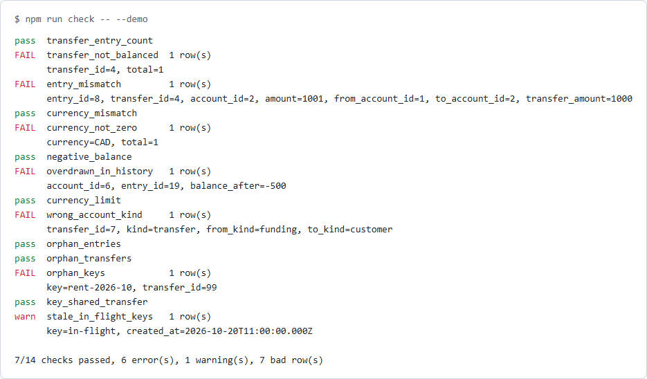
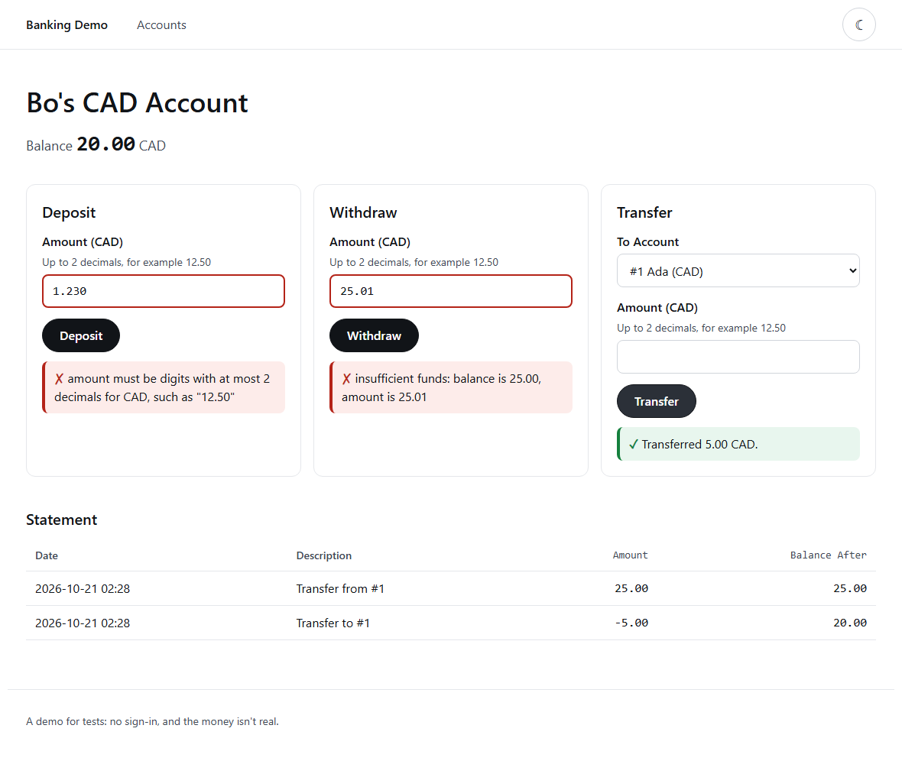
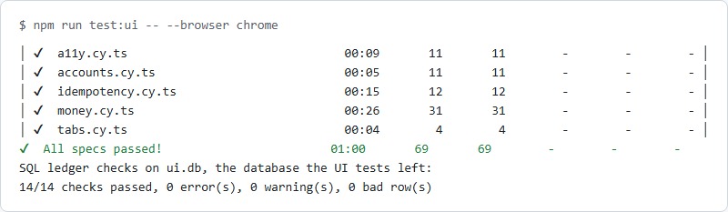
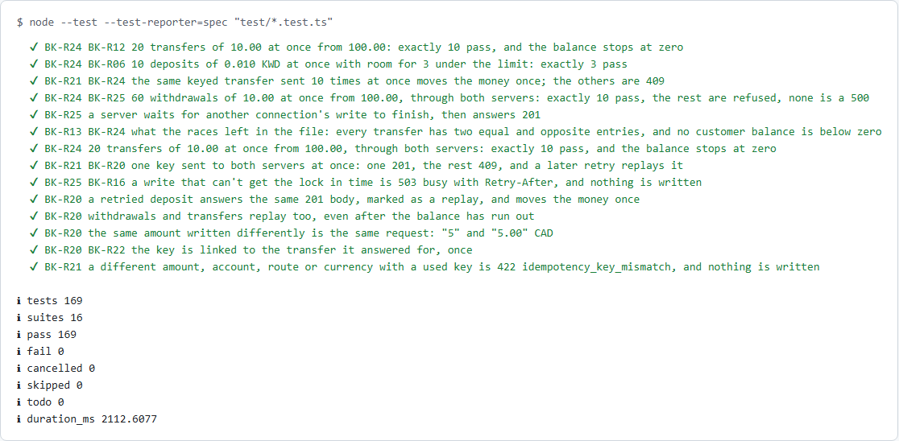

# banking-api: technical guide

[← Back to overview](README.md)

**Contents:** [Features](#features) · [Configuration](#configuration) · [CI integration](#ci-integration) · [Results](#results) · [FAQ](#faq) · [Troubleshooting](#troubleshooting) · [Development](#development)

## Features

### Money as strings and minor units

An amount is read digit by digit from a JSON string, never through `Number` or `parseFloat`, and kept as a BigInt count of minor units. Day 39 showed why the string matters: a JSON number has already lost digits before any code sees it (`537704868.1699999` arrives as `537704868.17`), so no server can refuse what it was never sent.

| Sent | CAD | JPY | KWD |
|---|---|---|---|
| `"12.34"` | 1234 cents | refused: no decimals | 12340 fils |
| `"12"` | 1200 cents | 12 yen | 12000 fils |
| `"1.230"` | refused: 3 decimals | refused | 1230 fils |
| `12.34` (a number) | refused | refused | refused |
| `"-1"`, `"1e3"`, `"007"`, `" 1"` | refused | refused | refused |

Responses always carry the currency's decimals: a deposit of `"5"` comes back as `"5.00"` in CAD and `"5.000"` in KWD. The limit, 10^17 − 1 minor units per currency, keeps every sum inside SQLite's 64-bit integers while staying above 2^53, so the amounts that break doubles are inside the range tested.

### A double-entry ledger

```sql
-- sql/schema.sql (abridged)
CREATE TABLE transfers      (id, kind, from_account_id, to_account_id, amount INTEGER CHECK (amount > 0), currency, created_at);
CREATE TABLE ledger_entries (id, transfer_id, account_id, amount INTEGER CHECK (amount <> 0), currency);
```

Each deposit, withdrawal or transfer writes one `transfers` row and two `ledger_entries` rows, `-amount` and `+amount`, inside `BEGIN IMMEDIATE … COMMIT`. Deposits come from, and withdrawals go to, an internal funding account per currency, so the entries in each currency always sum to zero. The API never shows a funding account; it shows `null` where one would appear. A balance is `SUM(amount)` over the account's entries, and a statement's running balance is a window function over the same rows.

### Retried requests: idempotency keys

A client that times out can't tell whether its transfer went through. With an `Idempotency-Key` header it can send the same request again safely:

```bash
curl -s -X POST localhost:4100/transfers -H 'Content-Type: application/json' \
  -H 'Idempotency-Key: rent-2026-10' -d '{"from_account_id":1,"to_account_id":2,"amount":"5.00","currency":"CAD"}'
```

| The same key again, with | Answer | Written |
|---|---|---|
| the same request (`"5"` and `"5.00"` count as the same) | `201`, the first answer's body, `Idempotent-Replayed: true` | nothing |
| a different amount, account, route or currency | `422 idempotency_key_mismatch` | nothing |
| the first request still running, here or on another server | `409 idempotency_key_in_use` | nothing |
| after a refusal (`404`, `422`) or a failure | treated as new: refused requests keep no key | the movement, once |
| 24 hours or more after first use | treated as new: the key has expired | the movement |

```sql
-- sql/schema.sql
CREATE TABLE idempotency_keys (
  key         TEXT    PRIMARY KEY,
  fingerprint TEXT    NOT NULL,                        -- route, accounts, amount, currency
  transfer_id INTEGER UNIQUE REFERENCES transfers (id), -- NULL while in flight
  created_at  TEXT    NOT NULL
);
```

A keyed request claims its key first, and the key is linked to its transfer in the same transaction that writes the transfer. A test makes that link fail on purpose: the transfer is rolled back with it, so no movement exists without its key.

### Requests at the same time

Each movement awaits a screening step first, standing in for an outside fraud or limits check (`SCREENING_DELAY_MS` makes it slow). Other requests run during that wait, so the balance read before it may be stale by the time the money moves. The fix is to check again where it can't go stale:

```ts
// src/ledger.ts: the bank's rules run again inside the write transaction
async apply(m: Movement, key?: string): Promise<Result<Transfer>> {
  return this.#write(() => {          // BEGIN IMMEDIATE ... COMMIT
    const refusal = this.#check(m);   // funds and the limit, read under the write lock
    if (refusal) return refusal;
    // insert the transfer, the two entries, and link the key
  });
}
```

What the tests measured, sending requests together and letting the database decide the order:

| Race | Without the fix | With it |
|---|---|---|
| 20 transfers of 10.00 at once from 100.00, one process | 20 pass, balance −100.00 | 10 pass, balance 0.00 |
| 10 deposits at once, room for 3 under the KWD limit | 10 pass, limit passed | 3 pass |
| 60 withdrawals of 10.00 from 100.00 through two processes on one file | 37 pass, balance −270.00 | 10 pass, 50 refused |
| The same, on the code before today (check already inside the transaction) | 1 to 4 of 60 answered `500 database is locked` | no `500`: a busy connection waits up to 5 s |
| One key sent 10 times at once to two servers | (no keys before today) | one `201`, nine `409`, a later retry replayed |

### One store interface

The API, the screening and the tools use the ledger through `Store` in [`src/ledger.ts`](src/ledger.ts): every method is async, so a store over the network fits behind the same calls. The SQLite `Ledger` keeps its work synchronous inside each method: a write runs from `BEGIN IMMEDIATE` to `COMMIT` without giving the event loop a turn, so two requests in one process never share an open transaction on its one connection, and nothing the tests measure changed.

That same property hides a class of bug. A call that is not awaited still finishes before the next line on SQLite, so a missing `await` on `releaseKey` or on an audit row passed all 451 tests (B174, B175). [`store.test.ts`](test/store.test.ts) reads the source instead: every call to a `Store` method is awaited, returned or chained (`.then`, `Promise.all`), in this package's `src/`, `test/` and `test-proxy/` and in every other package that runs this ledger (visual-regression-demo starts it for its screenshots; money-course plants bugs in a copy). The method names come from the interface itself, and a store is anything called `ledger` or made by `new Ledger(` or `buildSample(`. TypeScript 7 has no JavaScript API yet, so this is a text scan with its own test, not a type-aware lint, and it can't tell that a `return` inside a callback whose result is thrown away returns nowhere.

### The ledger on Postgres

Set `DATABASE_URL` and the same server keeps its ledger on Postgres ([`src/postgres.ts`](src/postgres.ts), chosen in [`src/store.ts`](src/store.ts)); `DATABASE_SCHEMA` names the schema, and the tables are made the first time a server opens it ([`sql/schema.postgres.sql`](sql/schema.postgres.sql)). The tables, columns and constraints are the same as on SQLite, with `BIGINT` for ids and amounts. The bank's rules are one function, `refusalFor` in [`src/ledger.ts`](src/ledger.ts), that both stores call, so they refuse in the same order with the same words. `pg` is loaded only when `DATABASE_URL` is set, so the SQLite server still needs nothing from npm.

What SQLite gets from `BEGIN IMMEDIATE` (the whole database locked for each write), Postgres gets from row locks:

```ts
// src/postgres.ts: the locks a movement takes before its rules are checked
const parties = [...new Set([m.from, m.to].filter((p) => p !== null))].sort((a, b) => a - b);
await c.query("SELECT id FROM accounts WHERE id = ANY($1::bigint[]) AND kind = 'customer' ORDER BY id FOR UPDATE", [parties]);
if (m.from === null) await c.query("SELECT pg_advisory_xact_lock(hashtext('issued ' || $1))", [m.currency]);
```

- **The accounts, lowest id first.** Under `READ COMMITTED` two transactions would both sum the old entries and both spend the same money. `FOR UPDATE` makes the second wait for the first to commit, and taking the locks in id order means two opposite transfers wait for each other instead of deadlocking.
- **The currency, for a deposit.** The limit is on what all accounts in a currency hold (BK-R06), so deposits into different accounts must also take turns. An advisory lock on the currency does that without a row to lock.
- **The rules and the write in one section.** The anti-money-laundering rules read the 24-hour cash total. On SQLite nothing runs between that read and the write. On Postgres every read is a round trip, and the first run of the suite there found two deposits of 6,000.00 sent together both allowed, where one must be reported. The server now runs the rules and the write in `Store.exclusive`: one transaction that holds the movement's locks from before the rules read anything until the money is written, across server processes too. A refusal from the rules comes back out as a value, not a thrown error, so its audit row is committed.
- **The funding account, read before it is made.** Two first deposits in a currency both try to make its funding account; a unique index lets one in. An `INSERT ... ON CONFLICT DO NOTHING` uses up an id even when it does nothing, so the account is looked up first, and the ids stay the same as on SQLite for the same movements (the 22 defect tests name rows by id).
- **Every number as BigInt.** `pg` returns `int8` and `numeric` (what `SUM` gives) as text, and the pool parses both with `BigInt`.

- **A wait with a limit.** Every connection sets `lock_timeout` to 5 seconds and the pool waits as long for a free connection, so a row held by another tool is `503 busy` with `Retry-After`, as a locked SQLite file is (BK-R25).
- **What the rules wrote, kept when the write fails.** Each write inside the section (the movement, a key claim) runs in a savepoint and is rolled back to it on an error; the section then commits, so the audit row stays, as it does on SQLite where it is its own transaction.

`npm run test:postgres` starts `postgres:17-alpine` with Testcontainers and runs every Node test file on it, each test server in a schema of its own. Four tests are about SQLite itself (old ledger files, its busy timeout, a lock held on the file) and are skipped there; [`postgres.test.ts`](test/postgres.test.ts) holds the Postgres side: the 14 checks on the sample and the same 22 defects, a row lock held from outside, 60 opposite transfers through two servers, ten deposits into five accounts at the currency limit, the 24-hour rule through two servers, and `npm run check` on a database URL.

### SQL ledger checks

The tests above go through the API. These checks go straight to the database and ask whether the books still balance, however the rows got there: through the API, a manual fix, a migration, or a script with foreign keys off (SQLite's default for any connection that doesn't turn them on). Each check is a `.sql` file in [`sql/checks`](sql/checks) whose query returns the rows that break one rule.

[](docs/checks.png)

*`npm run check -- --demo`: the sample ledger with five defects put in by hand. A credit raised by one cent fails three checks. An overdraft refilled a second later fails only the history check, since the balance now is fine. Every failing row is printed, and the run exits 1. ([dark version](docs/checks-dark.png))*

| # | Check | Rule | Finds |
|---:|---|---|---|
| 1 | `transfer_entry_count` | BK-R26 | A transfer without exactly two entries |
| 2 | `transfer_not_balanced` | BK-R26 | A transfer whose entries don't sum to zero |
| 3 | `entry_mismatch` | BK-R26 | An entry that isn't the transfer's debit (−amount, from account) or credit (+amount, to account) |
| 4 | `currency_mismatch` | BK-R26 | An entry whose currency differs from its transfer's or its account's |
| 5 | `currency_not_zero` | BK-R26 | A currency whose entries don't sum to zero |
| 6 | `negative_balance` | BK-R27 | A customer balance below zero |
| 7 | `overdrawn_in_history` | BK-R27 | A customer whose running balance went below zero at any entry, even if refilled later |
| 8 | `currency_limit` | BK-R27 | A currency holding more than 10^17 − 1 minor units |
| 9 | `wrong_account_kind` | BK-R27 | A deposit not from the funding account, a withdrawal not to it, a transfer not between customers |
| 10 | `orphan_entries` | BK-R28 | An entry for a transfer or account that doesn't exist |
| 11 | `orphan_transfers` | BK-R28 | A transfer for an account that doesn't exist |
| 12 | `orphan_keys` | BK-R28 | An idempotency key pointing at a transfer that doesn't exist |
| 13 | `key_shared_transfer` | BK-R28 | One transfer answering for two keys (if the `UNIQUE` constraint was lost) |
| 14 | `stale_in_flight_keys` | BK-R29 | A key in flight for over 10 minutes: a request that stopped (a warning, not an error) |

Two entries that sum to zero can still be wrong, so one check compares each entry with its transfer row:

```sql
-- sql/checks/03-entry-mismatch.sql
SELECT e.id AS entry_id, e.transfer_id, e.account_id, e.amount,
       t.from_account_id, t.to_account_id, t.amount AS transfer_amount
FROM ledger_entries e
JOIN transfers t ON t.id = e.transfer_id
WHERE NOT ((e.account_id = t.from_account_id AND e.amount = -t.amount)
        OR (e.account_id = t.to_account_id AND e.amount = t.amount));
```

**How each check is proven.** A clean sample ledger is built through the `Ledger` itself: every currency, every kind of movement, a whole balance spent, KWD filled to its limit exactly, a keyed transfer, refusals that write nothing, and a key still in flight. All 14 checks pass on it. Then 22 defects are put into copies of it with plain SQL, past the API and with foreign keys off. Each test asserts the exact set of checks that fires:

| Defect put in | Checks that fire |
|---|---|
| A credit one cent too high | `transfer_not_balanced`, `entry_mismatch`, `currency_not_zero` |
| Two extra entries that cancel out | `transfer_entry_count`, `entry_mismatch` |
| The debit and the credit swapped | `entry_mismatch`, `negative_balance`, `overdrawn_in_history` |
| A transfer row in the wrong currency | `currency_mismatch` |
| An overdraft refilled a second later | `overdrawn_in_history` |
| One fils past the KWD limit | `currency_limit` |
| An account deleted with its history | `orphan_entries`, `orphan_transfers` |
| A migration dropped `UNIQUE`, and a second key points at a transfer | `key_shared_transfer` |
| A key in flight for 10 minutes and 1 ms / for exactly 10 minutes | `stale_in_flight_keys` / nothing |

A test fails if any check has no defect that fires it. Seven checks never fire alone, and a test names them and why: a transfer missing an entry is also unbalanced, and a negative balance is also a negative running balance.

**Where they run.**

| Ledger | How it's made | Where |
|---|---|---|
| Clean sample | Built through the `Ledger`, fixed clock | [`checks.test.ts`](test/checks.test.ts) |
| Raced files | Two `node src/server.ts` processes on one SQLite file, with and without a slow screening | [`concurrency.test.ts`](test/concurrency.test.ts), read-only while the servers still run |
| Random runs | The end of each of 300 random sequences of up to 40 moves | [`ledger.property.test.ts`](test/ledger.property.test.ts) |
| A fresh race in CI | `npm run race -- raced.db`: five races, 220 requests in all, at two servers, in three currencies | The CI job, then `npm run check -- --db raced.db` |

**Postgres.** The checks are plain SQL (`LEFT JOIN`, `GROUP BY … HAVING`, a window function), and a test fails if one uses something only SQLite accepts: `IFNULL`, `GLOB`, `strftime`, double-quoted strings, `==`, `rowid`, or a placeholder other than `:name`. Day 49 runs the same files on Postgres.

### The banking UI, tested with Cypress

The server also serves a small banking UI at `/`: plain HTML, CSS and JavaScript in [`public/`](public), with no framework and no build. It's served from the same origin as the API, so it needs no CORS, and its policy (`default-src 'self'`) allows no inline code and nothing from another site. Two screens: the accounts list with an Open an Account form, and an account page with its balance, Deposit, Withdraw and Transfer forms, and the statement.

[](docs/ui-account.png)

*The account page, driven through the page by [`scripts/screenshots/ui.mjs`](../../scripts/screenshots/ui.mjs): a withdrawal one cent over the balance and a deposit with three decimals are refused, each message next to its field, and a transfer is confirmed. ([dark version](docs/ui-account-dark.png), [accounts list](docs/ui-accounts.png))*

The UI keeps the API's rules all the way to the screen:

- **Money stays text.** An amount is sent as typed, minus the spaces around it, as a JSON string, and every amount shown is the API's string. The page never turns an amount into a number and never adds one up; a Node test fails if `app.js` uses `parseFloat`, `toFixed`, `Math.`, `toLocaleString` or `Number(` on anything but ids. The amount field is `type="text"` with `inputmode="decimal"` (or `numeric` for JPY), because `type="number"` accepts `1e3` and rounds.
- **One movement per filled form.** The page makes one `Idempotency-Key` when a form is first sent and keeps it until the API gives a final answer. A double click, a second Enter, or a retry after a lost reply all use the same key, so the API replays instead of moving the money again:

```js
// public/app.js: the key lives with the form until a final answer
async function sendMovement(form, path, body) {
  const key = keyFor(form, [path, body]);          // same form, same values: same key
  for (let attempt = 0; attempt <= RETRIES; attempt++) {
    try { reply = await api('POST', path, body, { 'Idempotency-Key': key }); } catch { reply = null; }
    if (reply && !RETRYABLE.has(reply.status)) break;   // 201 or a refusal: final
    if (attempt < RETRIES) await wait(retryDelay(reply, attempt));
  }
  if (reply && !RETRYABLE.has(reply.status)) keys.delete(form);  // next send is a new movement
  return reply;
}
```

- **Balances are always the API's.** After every answer, success or refusal, the page reads the account again. A page left open while another tab spends the money shows the refusal and the real balance, not the one it loaded.
- **Refusals are shown where they happened.** The API's message appears in the form, in a `role="alert"` element tied to the field by `aria-describedby`, and the field is marked `aria-invalid`.

**What the Cypress tests check.** 69 tests in five specs ([`cypress/e2e`](cypress/e2e)), run in Chrome and Firefox. Each run starts a real `node src/server.ts` on a fresh `ui.db`; tests open their own accounts through the API, so none depends on another's money. Every spec ends by running the 14 SQL ledger checks on the file, and `npm run test:ui` runs them once more at the end.

| Spec | Tests | What it checks |
|---|---:|---|
| [`money.cy.ts`](cypress/e2e/money.cy.ts) | 31 | Typed amounts in each currency (`"12.5"` CAD is 12.50, `"3"` KWD is 3.000), three 0.10 deposits making exactly 0.30, 90071992547409.93 + 0.01 staying exact, the amount sent as a JSON string, 14 refused amounts (`"1.230"`, `"1,000.00"`, `"1e3"`, `"１２"`, `"12.5"` JPY…), overdraft, currency mismatch and limit refusals shown on the right field |
| [`idempotency.cy.ts`](cypress/e2e/idempotency.cy.ts) | 12 | A double click and a double Enter move money once; a reply lost after the money moved is retried with the same key and replayed; `409`, `502`, `503`, `504` and a network error are retried; four lost replies, then the user's second click, still one movement; the same amount twice on purpose is two |
| [`tabs.cy.ts`](cypress/e2e/tabs.cy.ts) | 4 | Another tab (another client of the API) spends or adds money while the page is open, including while the page's own withdrawal is on its way: the page shows the refusal and the real balance, and the balance never goes below zero |
| [`a11y.cy.ts`](cypress/e2e/a11y.cy.ts) | 11 | axe-core (WCAG 2.2 A and AA) on every screen and state, in light and dark, and at 375 px; a deposit done with the keyboard only; the skip link; focus on the heading when a page opens; refusals announced and tied to their field |
| [`accounts.cy.ts`](cypress/e2e/accounts.cy.ts) | 11 | The list, opening an account in each currency through the form, a blank owner refused, an owner name made of HTML shown as text, unknown accounts and pages |

[](docs/cypress.png)

*`npm run test:ui -- --browser chrome`: the five specs, then the SQL ledger checks on `ui.db`, the database the run left. ([dark version](docs/cypress-dark.png))*

**Two tabs in a tool that drives one.** Cypress controls a single tab, so the second tab is another client of the same API, which is all a second tab is to the server. In the hardest case, the page's withdrawal is held at the proxy while the other tab withdraws the same money, then sent on:

```ts
// cypress/e2e/tabs.cy.ts: the other tab gets there first
cy.intercept('POST', `/accounts/${id}/withdrawals`, async (req) => {
  if (req.headers['x-other-tab']) return;                 // the other tab's own request
  await fetch(`/accounts/${id}/withdrawals`, { method: 'POST', headers: { 'Content-Type': 'application/json', 'X-Other-Tab': '1' },
    body: JSON.stringify({ amount: '10.00', currency: 'USD' }) });
  req.continue();                                         // now the page's, against 0.00
});
```

Two real browser contexts at once are shown with Playwright in [multi-user-flow-patterns](../multi-user-flow-patterns/README.md).

### Payment scheme rules

Day S9 added the three rules a payment scheme asks of every payment (BK-R38 to BK-R40 in [SPEC.md](SPEC.md#payment-scheme-rules)). They sit after the funds check, so a payment over the limit and over the balance is still `insufficient_funds`.

| Currency | One payment out (`payment_limit`) | One account, one UTC day (`daily_limit`) |
|---|---:|---:|
| CAD, USD | 10,000.00 | 25,000.00 |
| JPY | 1,000,000 | 2,500,000 |
| KWD | 3,000.000 | 7,500.000 |

- **Which payments count.** Withdrawals and transfers out. Deposits have no limit, and money received does not use the receiver's allowance. A refused payment and a replay (same `Idempotency-Key`) write nothing, so they use nothing up.
- **The day.** The UTC calendar day of the ledger's clock: `23:59:59.999Z` still belongs to today, `00:00:00.000Z` starts a new allowance. The clock is the ledger's injectable `now`, which is how the boundary test sets it.
- **Atomic.** The daily total is read inside the same `BEGIN IMMEDIATE` transaction that writes (BK-R24), so payments at the same time can't pass it together: three of 10,000.00 held in a 100 ms screening give two `201` and one `422 daily_limit`.
- **The reference.** An optional `reference` on any movement: 1 to 35 characters from letters, digits, space and `/ - ? : ( ) . , ' +`, with no space at either end, in the style of a scheme message field. It is read with the request (before the key), stored in `transfers.reference` with a `CHECK` on its length, returned as `reference` (`null` without one) and repeated by the key: the same key with another reference is `422 idempotency_key_mismatch`.

Tests: [`test/scheme.test.ts`](test/scheme.test.ts), 40 cases (every boundary at limit minus one, the limit and limit plus one in all four currencies; seventeen kinds of bad reference; and a ledger file made before the reference existed, which gets the column added when it is opened). The model test now knows the limits and runs on a fixed clock.

### Anti-money-laundering rules

Day S10 put four rules on the screening step, after the Canadian rules FINTRAC publishes (BK-R42 to BK-R45 in [SPEC.md](SPEC.md#anti-money-laundering-rules)): a report for large cash, the 24-hour rule, a sanctions list, and an audit row for every decision. The rules are in [`src/aml.ts`](src/aml.ts), the name matching in [`src/sanctions.ts`](src/sanctions.ts). `npm start` has them on; `createApp` has them off unless a screen is passed in, so the other packages that start it are unchanged.

| What the screening finds | Decision | Rule | The movement |
|---|---|---|---|
| A party whose name is on the list | `blocked` | `sanctions_match` | refused, `422 screening_hold` |
| A party whose name is one letter from a listed name | `held` | `sanctions_near_match` | refused, `422 screening_hold` |
| Cash (a deposit or a withdrawal) at the threshold or more | `reported` | `large_cash` | written |
| Cash that takes the account's 24 hours to the threshold or more | `reported` | `24_hour` | written |
| None of these | `allowed` | none | written |

The strongest decision wins and the weaker ones aren't looked for, so a listed owner who deposits 20,000.00 is blocked, not reported.

| Currency | Cash report threshold |
|---|---:|
| CAD | 10,000.00 |
| USD | 7,299.28 |
| JPY | 1,086,957 |
| KWD | 2,247.192 |

- **The threshold.** CAD 10,000 is the rule; the other currencies use the smallest amount worth at least that at fixed demo rates (USD 1.37, JPY 0.0092, KWD 4.45 to the dollar), worked out in whole minor units (10,000 divided by the rate, rounded up), so no rate is looked up and the boundary tests stay exact. A test checks each threshold is worth CAD 10,000 and one minor unit less is not; the first version had round numbers (USD 7,300.00) that were not the smallest.
- **The 24 hours.** The 24 hours before the movement on the ledger's clock, with the movement itself included, summed over the same account and the same direction (deposits with deposits, withdrawals with withdrawals). A movement exactly 24 hours old no longer counts; one a millisecond younger does. Only written movements count, so a refused deposit adds nothing. Once the total is at the threshold, every later movement in the window is reported too. The total is read just before the write: the server waits (`SCREENING_DELAY_MS`) first and runs the rules after, with no timer between, so two deposits of 6,000.00 sent at once are added up one after the other.
- **Names.** Accents, case, punctuation and word order are ignored, "al" and "el" are joined to the next word, and known spellings of a name are made one (Mohammed, Muhammad, Mohamed), so "AL-RAHIMI, Muhammad" and "Mohamed Al Rahimi" are the same listed name. The list also holds spellings (Victor Ostrovskiy for Viktor Ostrovsky). A name of at least 10 letters that is one letter away is a near match and is held; a shorter name must match exactly, because one wrong letter in "Ana Li" is another person. Every name on the list is invented.
- **No tipping off.** A block and a hold give the same code and the same words, after the same wait as any movement, and neither names a person or a list entry. When both parties match, the stronger match decides. The audit row has the difference, and names accounts and list entries (S-001), never the owner.
- **The audit record.** One row in `screening_decisions` for each movement that reaches the screening, written in its own transaction before the movement is, and read at `GET /screening-decisions`, oldest first. A table `CHECK` ties the rule to the decision (none when allowed, always one otherwise). A movement refused earlier for funds, an unknown account or a bad request leaves no row, a replay of a keyed request adds none, and a key refused by the screening is given up and can be used again. A ledger file from before the table gets it when it is opened, since the table is new and not a changed one.

**Limits, written down:** the decision is recorded before the movement is, so a movement the ledger then refuses (two withdrawals at once for the same money) keeps an `allowed` row: the row is the decision, not the outcome, and a test shows it. Two server processes on one file can still read the same 24-hour total at the same moment. A report is a row, not a filing to anyone. The list is checked on the account owner's name only, not on the reference or the other bank. A name with no Latin letters matches nothing. `GET /screening-decisions` has no sign-in, like every route here, so anyone can read the reasons; restricting it needs roles (see the next day's entitlement matrix).

Tests: [`test/aml.test.ts`](test/aml.test.ts), 54 cases: each threshold at one unit below and exactly at it in four currencies; the 24-hour window at exactly 24 hours and a millisecond inside; deposits and withdrawals kept apart; eleven spellings of listed names blocked, three near misses held, six other names allowed; either side of a transfer; the same reply for a block and a hold; the audit row's fields; replays and refused keys; the table's `CHECK`; an old ledger file; two requests at once through a slow screening; and a real `node src/server.ts` process that answers a block as slowly as a payment.

### Who may do what

Day S10 added a role-by-action matrix (BK-R46 to BK-R49 in [SPEC.md](SPEC.md#who-may-do-what)). It is one committed file, [`src/entitlements.json`](src/entitlements.json), so a change to a permission is a change a person reads in a diff; [`src/entitlements.ts`](src/entitlements.ts) reads it (and refuses a file with an unknown action, an action twice, a role twice, no roles or a badly named role, with a message, when the server starts) and the server checks it before anything else about a request. The role is an `X-Role` header: a claim, not a sign-in.

| Role | `view` | `open_account` | `deposit` | `withdraw` | `transfer` | `read_audit` |
|---|:---:|:---:|:---:|:---:|:---:|:---:|
| viewer | yes | no | no | no | no | no |
| teller | yes | yes | yes | yes | no | no |
| supervisor | yes | yes | yes | yes | yes | no |
| auditor | yes | no | no | no | no | yes |

`view` is every GET of an account, its entries or a transfer. A pair marked no is `403 forbidden`. A test keeps this table the same as the file.

- **Checked first.** The role is read before the body, the key, the account or the screening. A viewer who deposits into an account that does not exist gets `403`, not `404` (which would say whether the account exists), a bad body is `403` and not `400`, the request does not claim its `Idempotency-Key`, and a payment it may not make is not screened, so there is no audit row. A route that does not exist is `404` and a wrong method `405`, for every role: those are about the route.
- **No header.** No `X-Role` means no restriction, as before, so the UI, the other packages and the 69 Cypress tests are unchanged. The one exception is the audit record, which only the auditor reads, so it no longer shows list entries to anyone who asks (review finding 5 on the AML pull request). That is a fail-open default, written down in [Out of scope](SPEC.md#out-of-scope-today): the matrix tests the rules, not the proof.
- **Unknown roles.** A role not in the matrix may do nothing, not even view. Capitals (`Teller`), an empty header, the same header twice (read as `teller, teller`) and names an object has anyway (`constructor`, `__proto__`, `toString`) are all unknown, and the reply says `an unknown role` without repeating what was sent.
- **`npm run entitlements`** starts the API (or checks one that is already running, `-- --url <base>`), sends one real request for each of the 24 role and action pairs, prints the table and what came back, and exits 1 on a difference, and 2 if the matrix file, the arguments or the server can't be used, so a broken set-up is never read as a difference. `-- --matrix <file>` compares the server with a matrix you meant. A permission the matrix gives and the server refuses is `missing`; one the matrix withholds and the server lets through is `excessive`; a server error is `broken`.
- **Measured on a seeded set.** Ten wrong matrices (a viewer who may deposit, a teller who may not open an account, a teller who may transfer, a supervisor who may not withdraw, an auditor who may withdraw, an auditor who may not read the audit record, a supervisor who may, a viewer who may not view, a missing teller role, and everyone allowed everything) each found exactly the pairs that differ, and no others: 10 of 10, with no false alarm on the committed matrix, through `createApp` and through a real `node src/server.ts` process.
- **Approve and release are not here.** The idea names them, but the API has no step where a payment waits for an approver or a releaser, so the matrix covers the six actions that exist. That is a feature (states, endpoints, ledger rules), not a test.

Tests: [`test/entitlements.test.ts`](test/entitlements.test.ts), 98 cases: the file and its validation, all 24 pairs through the API with nothing written when refused, every read route against `view`, the order of the checks, the role header's odd values, and the seeded set.

### Network inspection with a proxy

Day S9 put a real proxy between the client and the server, so the tests can look at what is on the wire instead of trusting what the code says it sends. [mitmproxy](https://mitmproxy.org) runs in Docker in reverse mode, in front of a real `banking-api` server; a small add-on ([`proxy/record.py`](proxy/record.py)) writes every request and reply to a file and can change one field of a request in flight.

```text
test client --> mitmproxy (Docker, port 8080) --> banking-api (this machine)
                      |
                      +--> /out/flows.jsonl   one line per request and reply
                      +--> /out/control.json  "change this field to this value" (written by the test)
```

| What the tests do | Rules | How |
|---|---|---|
| Run a whole session through the proxy and check that each reply was recorded exactly as the client got it | none (proves the tool) | Compare the recording with the client's own copy, call by call |
| Check every URL, header and reply on the wire | BK-R41, BK-R18, BK-R32 | No query string, no amount, name or reference in a URL, every URL a known route, no cookie, no `Server` or `X-Powered-By`, `no-store` and `nosniff` on every reply, the page policy on the three UI files, no reply that repeats the key |
| Read the amount, owner, reference and key out of the recorded requests | BK-R41 | Amounts are JSON strings in the body, the key is a header, never in the body |
| Replay a captured transfer straight at the server | BK-R20 | Same headers and body from the recording: `201`, `Idempotent-Replayed: true`, the same reply, money moved once |
| Replay it with one field edited (amount, receiver, reference, no reference, currency) or on another route | BK-R21 | `422 idempotency_key_mismatch`, nothing moves |
| Change a request in flight | BK-R21, BK-R20, BK-R38, BK-R39 | The proxy raises the amount: the server pays what reached it and says so in the reply, and the key then refuses the 10.00 the client meant. Raised past the limit: `422 payment_limit`. A reference changed to `x#<script>`: `400 invalid_reference` |
| Try the wire checks on recordings made to break them | BK-R41 | [`wire-rules.test.ts`](test-proxy/wire-rules.test.ts), 14 cases, no Docker: each planted defect must be reported |

What this shows and what it doesn't:

- **The API can't tell a changed request from a real one.** There is no request signing, so a payment raised in flight is simply a payment of that amount. What protects a client is the reply (the amount comes back) and TLS between client and server. The proxy here speaks plain HTTP on this machine, so TLS is not tested. The test says so instead of hiding it: the key, not the server, is what stops the client's retry from paying twice.
- **The client is a script, not a browser.** The session sends what the UI's forms send, with `fetch`. Cypress or Playwright through a proxy would also catch a page that calls another origin; the policy in BK-R32 and the three files' contents are checked instead.
- **Needs Docker.** `npm run test:proxy` pulls `mitmproxy/mitmproxy:12.3.1` and fails if Docker isn't running; it never skips. The `banking-api-proxy` job in CI pulls the same tag through `retry.sh`, and [`scripts/proxy-ci.test.mjs`](../../scripts/proxy-ci.test.mjs) fails if the two tags drift apart.

### Refusals

Every refusal is `{ "error", "code" }`, checked in a fixed order: the request first, then the idempotency key, then whether the accounts exist, then the bank's rules.

| Status | Codes |
|---|---|
| `400` | `invalid_json`, `invalid_body`, `invalid_currency`, `invalid_amount`, `invalid_owner`, `invalid_account_id`, `invalid_reference`, `invalid_idempotency_key` |
| `403` | `forbidden` (the `X-Role` may not do this, is not in the matrix, or there is none and the route is the audit record) |
| `404` | `not_found` (account, transfer or route; funding accounts too) |
| `405` | `method_not_allowed`, with `Allow` |
| `409` | `idempotency_key_in_use` (the first request with this key is still running) |
| `413` | `body_too_large` (over 16 KB) |
| `415` | `unsupported_media_type` (a POST that isn't `application/json`) |
| `422` | `idempotency_key_mismatch`, `same_account`, `currency_mismatch`, `insufficient_funds`, `limit_exceeded`, `payment_limit`, `daily_limit`, `screening_hold` (the anti-money-laundering screening held or blocked it) |
| `503` | `busy`, with `Retry-After: 1` (another process held the database for over 5 seconds) |

### Endpoints

| Method | Path | Body | Answer |
|---|---|---|---|
| `GET` | `/accounts` | | `{ "accounts": [...] }`, customer accounts oldest first, each with its balance |
| `POST` | `/accounts` | `owner`, `currency` | `201` the account, balance zero |
| `GET` | `/accounts/:id` | | the account and its balance |
| `GET` | `/accounts/:id/entries` | | the account and its entries, oldest first, each with `balance_after` |
| `POST` | `/accounts/:id/deposits` | `amount`, `currency`, optional `reference` | `201` the transfer |
| `POST` | `/accounts/:id/withdrawals` | `amount`, `currency`, optional `reference` | `201` the transfer, or `422 insufficient_funds`, `payment_limit` or `daily_limit` |
| `POST` | `/transfers` | `from_account_id`, `to_account_id`, `amount`, `currency`, optional `reference` | `201` the transfer |
| `GET` | `/transfers/:id` | | the transfer and its two entries |
| `GET` | `/screening-decisions` | | `{ "decisions": [...] }`, the audit row of every screened movement, oldest first; needs `X-Role: auditor` |
| `GET` | `/health` | | `{ "status": "ok" }` |
| `GET` | `/`, `/app.js`, `/app.css` | | The banking UI's three files, with the page policy |

The three `POST` routes that move money take an optional `Idempotency-Key` header (1 to 255 visible ASCII characters). Every route but `/health` takes an optional `X-Role` header (`viewer`, `teller`, `supervisor` or `auditor`, see [who may do what](#who-may-do-what)); `GET /screening-decisions` needs `auditor`.

## Configuration

| Variable | Default | What it does |
|---|---|---|
| `PORT` | `4100` | Port the API listens on (qa-practice-api uses 4000) |
| `DATABASE_PATH` | none: in memory | A SQLite file to keep the ledger in across restarts; several servers can share one |
| `SCREENING_DELAY_MS` | `0` | Makes the screening before each movement take this long, as a slow outside check would; the race tests use it |
| `DATABASE_URL` | none: SQLite | A Postgres connection string: the ledger on Postgres instead of SQLite (`DATABASE_PATH` is then ignored) |
| `DATABASE_SCHEMA` | `public` | The Postgres schema for the ledger's tables; made with its tables if it is missing. `npm run check` reads it too |

## CI integration

The package runs as its own job in the root [CI workflow](../../.github/workflows/ci.yml), and its TypeScript is type-checked in the `typecheck` job.

```yaml
- { package: banking-api, browsers: false, command: npm test && npm run demo && npm run race -- raced.db && npm run check -- --db raced.db }
```

After the tests and the demo, the job races requests at two server processes on one file and runs the SQL checks on what they left. `npm run check` exits 1 if any check fails, so a race bug that slips past every test still fails the job.

The UI has a job of its own, `banking-api-ui`, so a UI failure never reads as an API failure:

```yaml
- { package: banking-api, name: banking-api-ui, browsers: false, cypress: true, command: npm run test:ui -- --browser chrome && npm run test:ui -- --browser firefox }
```

The wire tests have a job of their own too, `banking-api-proxy`, which pulls the mitmproxy image first (through `scripts/retry.sh`, because Docker Hub answers `502` now and then):

```yaml
- { package: banking-api, name: banking-api-proxy, browsers: false, proxy: true, command: npm run test:proxy }
```

The ledger on Postgres has its own job, `banking-api-postgres`: the Node tests again with `DATABASE_URL` set, on a Postgres 17 that Testcontainers starts. CI pulls the image first through `retry.sh`, and a root test fails if the tag it pulls is not the one [`scripts/with-postgres.ts`](scripts/with-postgres.ts) starts.

```yaml
- { package: banking-api, name: banking-api-postgres, browsers: false, postgres: true, command: npm run test:postgres }
```

Chrome and Firefox are already on GitHub's Ubuntu runners. `npm ci` skips the Cypress binary (`CYPRESS_INSTALL_BINARY=0`) in every job, so the other jobs and the type-check don't download it; this job restores it from a cache keyed on the lockfile, or installs it. Each browser's run starts its own fresh `ui.db` and ends with the SQL checks on it. Screenshots of failing tests, and videos of failing specs only, go to `reports/cypress/` and are uploaded as the job's artifact. No retries: a flaky UI test should fail, not pass on a second try. The tests reach the server only over HTTP, so Day 49 can put Postgres behind it without changing them.

## Results

[](docs/tests.png)

*Part of `npm test`: the first of the defect tests, each naming the exact checks its defect must fire, then the totals. ([dark version](docs/tests-dark.png))*

| Tests | Count | What they check |
|---|---:|---|
| [`money.test.ts`](test/money.test.ts) | 60 | Reading and writing amounts: boundary values, equivalence classes and inputs that break float or loose parsing, each tagged with its technique |
| [`api.test.ts`](test/api.test.ts) | 67 | Every endpoint and refusal over HTTP, including a database failure injected between the debit and the credit |
| [`idempotency.test.ts`](test/idempotency.test.ts) | 22 | Keys over HTTP: format boundaries, replays of all three movements, mismatches, a request held in its screening to show `409`, refused and failed requests keeping no key, a failure injected into the key link, and expiry at exactly 24 hours on an injected clock |
| [`concurrency.test.ts`](test/concurrency.test.ts) | 10 | Real races: overlapping requests in one process during a 20 ms screening, and two `node src/server.ts` processes on one SQLite file, with and without a slow screening. Checks the counts of `201` and `422`, that nothing is a `500`, a lock held from outside, `503` when it's held too long, and runs the SQL ledger checks on both files the races left |
| [`checks.test.ts`](test/checks.test.ts) | 58 | The SQL ledger checks: the clean sample passes, 22 defects put in past the API each fire exactly the checks they should, the SQL is portable to Postgres (one test per file, and a test that the guard itself catches SQLite-only SQL), `:name` parameters turned into `$1`, `$2` for Postgres, the runner reports a check that can't run, and the CLI's exit codes |
| [`money.property.test.ts`](test/money.property.test.ts) | 7 | fast-check: any amount round-trips, no JSON number is accepted, any accepted text is plain digits, neighbours above 2^53 stay apart |
| [`ledger.property.test.ts`](test/ledger.property.test.ts) | 1 | A model of the bank: 300 random sequences of up to 40 moves across six accounts in three currencies. After every move each balance matches the model; at the end, all 14 SQL ledger checks pass |
| [`ui.test.ts`](test/ui.test.ts) | 17 | The UI files as served (types, the page policy, `405` and `404`), what a browser test can't see in the code (no inline script, no HTML strings, no amount turned into a number or added up, text fields for amounts), and `GET /accounts` |
| [`launch-retry.test.ts`](test/launch-retry.test.ts) | 14 | The Cypress runner starts a run again only when the browser could not be started or restarted (never connected, or the relaunch crash): a run with a failed test is never run twice, and a second launch failure fails the run |
| [`scheme.test.ts`](test/scheme.test.ts) | 40 | Payment scheme rules: the reference alphabet and length, each limit at minus one, exactly, and plus one in four currencies, the daily total across withdrawals and transfers, what does not count, the UTC midnight boundary, replays, and three payments at once |
| [`aml.test.ts`](test/aml.test.ts) | 54 | Anti-money-laundering rules: each cash threshold at one unit below and exactly at it in four currencies, the 24-hour window at exactly 24 hours and a millisecond inside, deposits and withdrawals kept apart, eleven spellings of listed names blocked, near misses held, other names allowed, either side of a transfer, one reply for a block and a hold, the audit row, replays, the table's `CHECK`, an old ledger file, and a real server process |
| [`entitlements.test.ts`](test/entitlements.test.ts) | 98 | Who may do what: the matrix file and its validation, all 24 role and action pairs through the API (nothing written when refused), every read route against `view`, the checks coming first (404, 400, 415, key, screening), odd role headers, the check on a server built from 10 wrong matrices, three stand-in servers, a real server process, and `npm run entitlements` (its own server, `--url`, `--matrix`) exits 0, 1 and 2 |
| [`store.test.ts`](test/store.test.ts) | 8 | Every `Store` call is awaited, returned or chained, here and in the packages that run this ledger (the method names come from the interface), which files the scan reads, the scan's own test, no test file awaiting at the top level after its first `describe()` (and that check's own test), the server's log line never showing a password or failing on a connection string that isn't a URL, and a refusal that can't be written as a reply is a `500` in JSON, never a request left open |
| [`postgres.test.ts`](test/postgres.test.ts) | 34 | On Postgres only (`npm run test:postgres`): the clean sample passes the 14 checks and has the same ids as on SQLite, the 22 defects fire the same checks, `npm run check` on a URL (0, 1, and a schema with no ledger, which it doesn't create), the schema's own constraints, a sum past 2^53 as `NUMERIC`, three servers opening one new schema at once, a row lock held from outside (waited for, and `503 busy` past the lock timeout), opposite transfers through two servers, deposits at the currency limit into five accounts, two first deposits in a currency, and the 24-hour rule through two servers |
| [`spec.test.ts`](test/spec.test.ts) | 4 | Every rule in [SPEC.md](SPEC.md) has a test (Node or Cypress), every rule a test names exists, and the README and the guide state the rule and mistake counts the spec and the table hold |
| [`test-proxy`](test-proxy) | 30 | Through mitmproxy in Docker (`npm run test:proxy`): 16 on the wire, 14 checks of the wire checks. See [network inspection](#network-inspection-with-a-proxy) |
| [`cypress/e2e`](cypress/e2e) | 69 per browser | The UI in Chrome and Firefox: see [the banking UI](#the-banking-ui-tested-with-cypress) |

Every test file in `test/` also runs on Postgres in the `banking-api-postgres` job: 491 pass there, and the 4 about SQLite itself are skipped.

### Deliberate breaks

Each mistake was put into the code, the tests run, and the code restored. All 197 were caught. B171 to B181 break the async store and its guards, and each ran `npm test`; B174 and B175 passed every test until the source scan was added, and B180 and B181 until the code review widened it. B182 to B197 break the Postgres store (B194 to B197 put back what the code review found), and each ran the suite on Postgres and on SQLite: none of them fails a test on SQLite, which is why the Postgres job exists. B92 to B132 break the anti-money-laundering rules and each ran `test/aml.test.ts`; B133 to B170 break the role matrix and the check on it, and each ran `test/entitlements.test.ts` and `test/aml.test.ts` (the audit record now needs the auditor). B57 to B78 break the UI (and the two server changes it needed); each ran the Cypress specs aimed at it in Chrome, and the Node tests where they apply, and the count adds both. The three that depend on timing between processes (B21 to B23) were run five times each and caught every time. B35 to B40 write bad rows; their counts include the defect tests, which fail because the sample ledger is built with the broken code. B41 to B56 break the checks, the runner and the CLI themselves.

| # | Mistake | Caught by |
|---|---|---:|
| B01 | Amounts read through a double (`Math.round(Number(value) * 100)`) | 10 tests |
| B02 | JSON numbers accepted | 6 |
| B03 | One decimal too many accepted (`"1.005"` read as 1005 cents) | 6 |
| B04 | Zero accepted as an amount | 6 |
| B05 | The limit not applied to a single amount | 3 |
| B06 | The leading zero dropped when writing (`".01"`) | 18 |
| B07 | `<=` for `<` in the funds check: the whole balance can't be spent | 3 |
| B08 | No funds check | 4 |
| B09 | No transaction around the two entries | 1 |
| B10 | The receiving account's currency not checked | 3 |
| B11 | No same-account check (the database refuses it, as a `500`) | 3 |
| B12 | The currency limit not enforced | 2 |
| B13 | Integers read from SQLite as JavaScript numbers (the driver's default) | 15 |
| B14 | Funding accounts visible through `GET /accounts/:id` | 1 |
| B15 | Every statement row shows the final balance | 1 |
| B16 | Statement newest first | 2 |
| B17 | The database's error message shown to the client | 1 |
| B18 | `Cache-Control: no-store` missing | 2 |
| B19 | No body size limit | 1 |
| B20 | Any content type read as JSON | 1 |
| B21 | No busy timeout: a second process fails at once | 3 to 4 |
| B22 | Funds checked only before the screening, not again when writing | 6 |
| B23 | `BEGIN` (deferred) for `BEGIN IMMEDIATE` | 2 |
| B24 | A busy database answered with `500`, not `503` | 1 |
| B25 | The `Idempotency-Key` ignored | 13 |
| B26 | The amount left out of the key's fingerprint | 2 |
| B27 | No `Idempotent-Replayed` header on a replay | 7 |
| B28 | A refused request keeps its key | 4 |
| B29 | The key linked after the transfer commits, not in its transaction | 1 |
| B30 | No in-flight check: a running key counts as free | 3 |
| B31 | `<` for `<=` in the expiry: a key lives 1 ms too long | 2 |
| B32 | Keys never expire | 2 |
| B33 | Key length not checked | 1 |
| B34 | Accounts and funds checked before the key (a replay after the balance ran out is refused) | 2 |
| B35 | Both entries written in CAD, whatever the currency | 23 |
| B36 | The transfer row records from and to swapped (the entries are right) | 34 |
| B37 | Every transfer row recorded as kind `transfer` | 32 |
| B38 | The transfer row written in CAD, whatever the currency | 24 |
| B39 | The debit one minor unit short of the credit | 46 |
| B40 | No funds or limit check inside the write transaction; `npm run race` + `npm run check` also exits 1 | 37 |
| B41 | `transfer_entry_count`: `> 2` for `<> 2` (a missing entry passes) | 1 |
| B42 | `entry_mismatch` compares amounts, not accounts | 3 |
| B43 | `currency_mismatch` ignores the account's currency | 2 |
| B44 | `negative_balance` counts funding accounts too | 27 |
| B45 | `overdrawn_in_history` runs one balance across all accounts (no `PARTITION BY`) | 4 |
| B46 | `currency_limit`: `>=` for `>` (the limit itself fails) | 27 |
| B47 | `wrong_account_kind` accepts any transfer | 2 |
| B48 | `orphan_entries` ignores a missing account | 2 |
| B49 | `orphan_keys` reports keys still in flight | 24 |
| B50 | `stale_in_flight_keys`: `<=` for `<` (exactly 10 minutes is stale) | 1 |
| B51 | The runner drops a check that can't run instead of reporting it | 1 |
| B52 | The runner reads sums as JavaScript numbers | 1 |
| B53 | The CLI exits 0 on a broken ledger | 2 |
| B54 | The CLI fails on a warning | 1 |
| B55 | The CLI opens the file read-write | 1 |
| B56 | Defects put in with foreign keys on (the orphan defects can't be made) | 5 |
| B57 | The page sends the amount as a JavaScript number | 29 |
| B58 | A new `Idempotency-Key` for every retry | 6 |
| B59 | No retries after a lost reply | 7 |
| B60 | No guard against a second click or Enter while a request runs | 1 |
| B61 | The key kept after a confirmed movement (the same amount twice on purpose is replayed) | 1 |
| B62 | The account not read again after an answer | 16 |
| B63 | The balance worked out on the page (old balance plus the deposit, as numbers) | 7 |
| B64 | A generic message instead of the API's refusal | 17 |
| B65 | The refused field not marked `aria-invalid` | 18 |
| B66 | The refusal not announced (`role="alert"` missing) | 1 |
| B67 | The amount label not tied to its field | 4 |
| B68 | Faint grey text in the dark theme | 4 |
| B69 | The scrolling statement not reachable by keyboard | 1 |
| B70 | The page title put in as HTML (an owner's name runs as markup) | 2 |
| B71 | No `Content-Security-Policy` on the UI's files | 3 |
| B72 | Funding accounts listed by `GET /accounts` | 1 |
| B73 | Spaces around the amount not removed | 1 |
| B74 | A `422` refusal retried as if no answer came | 3 |
| B75 | The account itself offered as a transfer target | 1 |
| B76 | Focus left behind when a page opens | 2 |
| B77 | The key kept after a refusal | 1 |
| B78 | The amount field as `type="number"` | 6 |
| B79 | `>=` for `>` in the single-payment limit: the limit itself is refused | 11 |
| B80 | The daily total counts transfers only, not withdrawals | 1 |
| B81 | `>=` for `>` in the daily limit: the last cent of the day is refused | 6 |
| B82 | The daily total counts every day, not just today | 1 |
| B83 | A reference may end with a space | 1 |
| B84 | A key ignores the reference: another reference replays | 3 |
| B85 | A reference of 36 characters accepted | 1 |
| B86 | The daily total not read again inside the writing transaction: payments at once all pass | 1 |
| B87 | A `Server` header on every reply (found only on the wire) | 2 |
| B88 | The UI files cacheable instead of `no-store` (found only on the wire) | 4 |
| B89 | The reference not checked | 21 |
| B90 | The single-payment limit switched off | 8 |
| B91 | An old ledger file not given the new `reference` column when opened | 1 |
| B92 | Large cash needs more than the threshold, not the threshold | 7 |
| B93 | The CAD rate one ten-thousandth off, so the CAD threshold is wrong | 11 |
| B94 | The USD rate set so the threshold is 7,000.35 | 2 |
| B95 | The JPY rate set so the threshold is a round million | 2 |
| B96 | The KWD rate set so the threshold is 2,500.000 | 2 |
| B97 | The threshold rounded down, so it is worth less than CAD 10,000 | 4 |
| B98 | The 24-hour total needs more than the threshold | 3 |
| B99 | The 24-hour window is 25 hours | 1 |
| B100 | A deposit exactly 24 hours old still counts | 1 |
| B101 | The 24-hour total leaves out the movement being screened | 5 |
| B102 | Withdrawals added up on the deposit side | 1 |
| B103 | The 24-hour total adds every account together | 18 |
| B104 | A transfer between customers counted as cash | 1 |
| B105 | The rules run before the wait: two deposits at once read the same 24-hour total | 1 |
| B106 | Accents not removed from a name | 2 |
| B107 | Case not ignored in a name | 5 |
| B108 | Word order matters in a name | 3 |
| B109 | "Al" not joined to the next word | 2 |
| B110 | Known spellings of a name not made one | 3 |
| B111 | Joseph counted as a spelling of Yusuf | 1 |
| B112 | Letters such as ł and ø turned into word breaks | 1 |
| B113 | A near match from one letter on, so short names match | 1 |
| B114 | A near match up to two letters away | 1 |
| B115 | A near match blocked, not held | 3 |
| B116 | No near match at all | 5 |
| B117 | An exact match on a later entry loses to a near match on an earlier one | 1 |
| B118 | Only the receiving account checked | 2 |
| B119 | Only the sending account checked | 22 |
| B120 | The first matching account decides, not the stronger match | 1 |
| B121 | The reply names the list entry and the person | 1 |
| B122 | A hold has its own code, so the reply tells it from a block | 20 |
| B123 | The app ignores the screening refusal: the money moves | 21 |
| B124 | A blocked movement answered before the wait | 1 |
| B125 | A large deposit refused instead of reported | 7 |
| B126 | An allowed decision not written | 24 |
| B127 | The server started without the rules | 2 |
| B128 | The audit table lets an allowed decision carry a rule | 1 |
| B129 | The audit reason names the owner | 2 |
| B130 | The audit row written with the wrong amount | 1 |
| B131 | Decisions listed newest first | 31 |
| B132 | The report outweighs the list: a listed owner's large deposit is only reported | 1 |
| B133 | The viewer may deposit | 8 |
| B134 | The teller may not open an account | 5 |
| B135 | The supervisor may read the audit record | 5 |
| B136 | The auditor may not read the audit record | 51 |
| B137 | A GET is never checked | 32 |
| B138 | The role is checked after the body is read | 1 |
| B139 | The audit record is open with no role | 1 |
| B140 | A request with no role is refused everywhere | 49 |
| B141 | A role is matched without regard to case | 2 |
| B142 | An unknown role is told its own name | 10 |
| B143 | A forbidden request is a 401 | 46 |
| B144 | A forbidden request has another code | 45 |
| B145 | /health needs the view role | 1 |
| B146 | A transfer is the deposit action | 17 |
| B147 | A deposit is the transfer action | 16 |
| B148 | Reading a transfer is the audit action | 3 |
| B149 | Reading statements is the audit action | 3 |
| B150 | The audit record is a view | 20 |
| B151 | Opening an account is the view action | 18 |
| B152 | The matrix given to the app is ignored | 13 |
| B153 | A role is looked up with in, so constructor is called a role in the reply | 1 |
| B154 | An unknown action in the file is accepted | 2 |
| B155 | An action listed twice is accepted | 1 |
| B156 | A matrix with no roles is accepted | 1 |
| B157 | A role name in capitals is accepted | 2 |
| B158 | The table prints yes for every pair | 1 |
| B159 | The check skips the first role | 11 |
| B160 | The check never asks about the audit record | 10 |
| B161 | The check counts only a 201 as let through | 6 |
| B162 | The check calls a refused pair excessive | 5 |
| B163 | The check ignores a server error | 1 |
| B164 | The check takes any 403 as a refusal, whatever the code | 1 |
| B165 | The report says nothing is wrong whatever it found | 2 |
| B166 | The command always exits 0 | 2 |
| B167 | A role written twice in the file is accepted | 2 |
| B168 | Only the first underscore of an action is turned into a space | 1 |
| B169 | A server that cannot be reached exits 1, like a difference | 1 |
| B170 | The command ignores --url and checks its own server | 2 |
| B171 | The forecast check not awaited (a promise is always a refusal) | 129 |
| B172 | `apply` not awaited | 95 |
| B173 | `claimKey` not awaited | 15 |
| B174 | `releaseKey` not awaited: a refused keyed request gives its key up after the reply | 1 (the source scan) |
| B175 | The allowed audit row not awaited | 1 (the source scan) |
| B176 | The 24-hour cash total not awaited | 6 |
| B177 | The sanctions read of each party not awaited | 51 |
| B178 | The fallback `500` taken out: a reply that can't be written leaves the request open | 1 |
| B179 | A method left out of the `Store` interface | 2 |
| B180 | The proxy tests' teardown not awaiting the ledger's close | 1 (the source scan) |
| B181 | visual-regression-demo calling the ledger as if it were synchronous | 1 (the source scan) |
| B182 | No `FOR UPDATE` on the accounts (Postgres) | 8 |
| B183 | The accounts locked one at a time, in the order the request names them: opposite transfers deadlock | 2 |
| B184 | No lock on the currency for a deposit | 1 (after a test was added) |
| B185 | The exclusive section takes no locks | 3 |
| B186 | The rules run before the exclusive section, as they did on SQLite | 4 |
| B187 | A refusal from the rules thrown inside the section: the audit row is rolled back | 20 |
| B188 | The funding account made with `INSERT` first: the ids move away from SQLite's | 6 |
| B189 | A new key claimed with a plain `INSERT`: two claims at once give a `500` | 14 |
| B190 | `int8` and `numeric` read through a JavaScript number | 4 |
| B191 | The defects put in with the foreign keys on | 4 |
| B192 | Every check parameter numbered `$1` | 1 |
| B193 | No lock while a server makes the tables: three servers at once collide | 1 |
| B194 | No `lock_timeout` on the pool: a request waits as long as the lock is held | 1 (cancelled at the 60 s test limit) |
| B195 | Postgres lock errors answered as `500`, not `503 busy` | 1 |
| B196 | The exclusive section rolled back when its work fails: the audit row goes too | 1 |
| B197 | No savepoint around a write inside the section: a failed write takes the audit row with it | 1 |

### What building it found

- **On SQLite, a missing `await` is invisible.** Each `Ledger` method does its work before it hands back the promise, so B174 and B175 changed nothing any of 451 tests could see. On Postgres the same mistakes would give a key up, or write the audit row, after the reply. A source scan catches both, and runs on every `npm test`.
- **Two breaks hung the run instead of failing it.** With the forecast check or `apply` not awaited, the code took the promise for a refusal and threw an error with no status. Sending that reply threw again inside the error handler, so the request never got an answer and each run stopped only at the five-minute limit. The handler now falls back to a `500`, and `npm test` has a 60 second per-test limit, so the same breaks fail in seconds with the test's name.
- **The first run on Postgres found a race SQLite can't have.** 451 of 456 tests passed at once, and the one that failed was the 24-hour rule: two deposits of 6,000.00 sent together were both allowed. The rules read the day's cash total and then the movement was written, and on SQLite nothing can run in between. On Postgres each step is a round trip, so both requests read 0. Moving the rules inside the transaction that holds the account's lock fixed it (B186 puts the old order back), and a test now sends the two deposits through two server processes.
- **The code review found two things no test had asked.** A row lock held by another tool made a request wait for as long as the lock lasted, where BK-R25 promises `503 busy` after 5 seconds: the pool now sets `lock_timeout` and a connect timeout, and Postgres lock errors are answered as busy (B194, B195). And when the movement's write failed after the rules had recorded their decision, the whole transaction rolled back and the audit row went with it, which SQLite never does: each write inside the section now runs in a savepoint, and the section commits what came before a failure (B196, B197). A test for each runs on both databases where it can.
- **A refusal must leave the section as a value.** The first version threw the rules' refusal inside the transaction, as the API does everywhere else. That rolled the audit row back with the movement, and 20 tests on Postgres failed (B187), none on SQLite.
- **One lock looked tested and wasn't.** Taking out the currency lock for deposits (B184) passed every test: each limit test deposited into one account, and that account's own lock already made the deposits take turns. Ten deposits into five accounts through two servers catch it.
- **One break was not a mistake.** Reading `int8` as text changed nothing, because every amount goes through `BigInt()`, which takes text too. The break that matters is reading it as a JavaScript number (B190).
- **A test fixture raced its own tests, and only Postgres showed it.** The entitlement tests count every table's rows before and after a forbidden request. A fixture transfer written by top-level code between two `describe()` blocks sometimes landed inside the first block's counts, because node:test starts a block's tests while the file's later code still runs: 1 run in 6 on Postgres, never on SQLite. The fixture now comes first, and a test fails if any test file awaits at the top level after its first block.
- **The first scan looked in the wrong places.** It read only `src/` and only receivers named `ledger`, so the code review found two floating calls it passed: the proxy tests' teardown, and visual-regression-demo, which starts this ledger for its screenshots and still called it as if it were synchronous (the whole-repo type-check had flagged it, but only the two packages expected to change were read in its output). The scan now reads every package that runs the ledger (B180, B181). One guard is not proven by a break: the second fallback inside the error handler, for when even the `500` can't be written. No request can make the first `send` and then the second one throw, so taking it out fails no test; it stays as a guard against a crash.

- **A new rule broke old tests in three places.** The model test sent huge withdrawals, so it needed the limits, and a fixed clock, or a run near midnight UTC would depend on the day. Four SQL-check tests and the demo defects inserted into `transfers` by position, with seven values, and failed the moment the table gained a column. They now name their columns.
- **An old ledger file had no `reference` column.** `CREATE TABLE IF NOT EXISTS` leaves an existing table as it was, so a file kept from before today failed on its first deposit. The code review found it. The ledger now adds the column when it opens a file without it, and a test opens a file made with the old schema (B91 takes the step out).
- **Two things only the wire shows.** B87 and B88 change nothing a unit test reads: a `Server` header and a cacheable UI file are visible only on the wire. Only the proxy tests catch them, which is the reason to have a proxy in the stack.
- **A tampered request is a different request, not an attack the server sees.** Raising an amount in flight is accepted, because nothing signs the request. The test records what happens and what does protect the client.

- **Random amounts don't find boundaries.** The first version of the ledger model generated random amounts, and with it B07 (`<=` for `<`) and B12 (the limit switched off) passed the property test; only designed cases caught them. Random amounts almost never equal a balance exactly, and fast-check's default size kept sequences too short to reach the limit. The model now also generates "the whole balance", "what's left under the limit", and one more than each, worked out when the move runs, and longer sequences. It catches both.
- **A break can be caught for the wrong reason.** The first "no transaction" break removed `BEGIN` and `COMMIT` but not `ROLLBACK`, so refusals crashed and six tests failed, none of them about atomicity. With every transaction statement removed, exactly one test fails: the one that makes the database refuse the credit after the debit is written. No ordinary request can show a half-written transfer, because nothing fails between the two inserts; only an injected failure proves the transaction is there.
- **SQLite drivers hand back integers as JavaScript numbers by default.** Without `setReadBigInts(true)` (B13), every balance passes through a double on its way out of the database. Fifteen tests catch it, including the deposit above 2^53.
- **A test depended on the order tests ran in.** The funding-account test expected the first KWD deposit to create the funding account, but an earlier test had already made one. It now has its own server.
- **The race on day one wasn't an overdraft, it was a `500`.** Day 43's code already checked funds inside `BEGIN IMMEDIATE`, and that lock holds across processes, so two servers on one file never overdrew. But SQLite's default busy timeout is zero: a second process that found the lock taken failed at once with `database is locked`, and 1 to 4 requests in 60 answered `500`. The fix is a 5 second busy timeout, and `503` with `Retry-After` if even that runs out.
- **The overdraft needs a wait between the check and the write.** It appeared as soon as a slow step (the screening) sat between reading the balance and writing: 20 transfers of 10.00 from 100.00 all passed. Checking again inside the write transaction fixed it, and the early check stays only so the screening isn't asked about requests that would be refused anyway.
- **`BEGIN` instead of `BEGIN IMMEDIATE` doesn't overdraw in SQLite; it deadlocks.** Two deferred transactions both read, then both try to write, and SQLite refuses one at once without waiting, so the race tests saw `503`s, not a negative balance. On Postgres the same mistake under `READ COMMITTED` would overdraw: both transactions sum the old entries. Day 49 needs `SELECT … FOR UPDATE` on the account row for the same guarantee.
- **A COMMIT can be busy too.** The test that holds the lock from outside failed one run in six: its `COMMIT` had to wait for a reader in the server process, and it had no busy timeout. Every connection, the tests' included, now sets one.
- **Two breaks were first caught by a hang, not a failure.** With the key ignored, the request meant to get `409` went into the held screening and never came back, so the test run timed out. The test now races that request against a one-second timer and fails with a reason.
- **The API never reads the currency column on entries.** Balances are summed per account, so entries written in the wrong currency (B35), or a transfer row in the wrong currency (B38), change nothing a client sees. Before today, no designed case caught either; only the model test's inline SQL did. That inline SQL is now the checks, which catch both on the clean sample and after every random run.
- **A balance of zero can hide an overdraft.** Day 44's check on the raced file looked only at final balances. An overdraft refilled a second later leaves a final balance that looks fine, and only the running balance shows it (`overdrawn_in_history`). Removing `PARTITION BY` from that check (B45) mixes all accounts into one running balance, and four tests catch it.
- **A race bug fails CI even without a race assertion.** With the funds check taken out of the transaction (B40), `npm run race` followed by `npm run check` exits 1: `negative_balance`, `overdrawn_in_history` and `currency_limit` fire on the raced file. The CI job would fail even if no race test counted the `201`s.
- **Foreign keys are off for everyone else.** SQLite enforces them only on connections that ask, and the `Ledger` asks. The `sqlite3` shell, a migration script or a reporting tool doesn't, so an orphan row needs no bug in the API. A test shows the `Ledger`'s connection refusing the same orphan that the defect tests put in with foreign keys off. Leaving them on in the defect helper (B56) makes four orphan defects impossible to create.
- **Read-write would turn a typo into a database.** Opening the file without `readOnly` (B55) didn't change an existing file. It was caught because a mistyped path created a new, empty database, and the CLI then reported 14 missing tables instead of "unable to open database file".
- **axe found a real accessibility bug in the first run.** At 375 px the statement table scrolls sideways, but its wrapper couldn't take focus, so a keyboard user couldn't scroll it (`scrollable-region-focusable`). The wrapper is now a focusable, labelled region; B69 takes that out again and the phone-width test fails.
- **The key protects more than the guard does.** With the guard against a second submit removed (B60), a double click sent two requests, but both carried the same key, so the second was a replay and the money moved once. Only the test that counts requests caught it. That's the design working: the guard saves a request, the key keeps the money right.
- **Two of the first failures were the tests' own.** One looked up the statement amount by `data-cy=amount`, which the amount field also has, and read the empty field. The other pressed Enter on a focused button with `cy.press`, which moves focus with a real Tab but doesn't press a button. Both were fixed in the tests, not the page.
- **A second tab inside an intercept intercepts itself.** The first version of the two-tabs race called `fetch` from inside the route handler, and that request matched the same route, so the handler waited on itself. The other tab's request now carries a header the handler lets through.
- **CI found what the laptop hid.** The first CI run failed every spec before a test ran: Cypress compiles TypeScript specs with the project's own `typescript`, and locally it had found the copy at the repo root, which a CI job never installs. `typescript` is now a dev dependency of the package, and the specs were run again with the root copy moved away to prove it.
- **The two-tabs race flaked on its first CI run.** It waited for the alias twice and expected the other tab's `201` first, but `cy.wait` gives requests in the order they were intercepted, and the page's request is intercepted first (its handler is what sends the other one). It passed locally and failed in CI. It now waits for both and tells them apart by the `X-Other-Tab` header, and passed three runs in each browser before it was pushed again.
- **Cypress wouldn't start from VS Code's terminal.** It sets `ELECTRON_RUN_AS_NODE=1`, so Cypress's Electron ran as plain Node and refused its own options (`bad option: --smoke-test`). `npm run test:ui` unsets it.
- **Firefox twice failed to start the browser on a CI runner, in one run.** All 69 Chrome tests passed, then in the Firefox run the first spec printed `The browser never connected` and ran no test, and the relaunch for the second spec crashed inside Cypress with `Cannot read properties of undefined (reading 'browsingContextGetTree')` (CI run 42467489172, 2026-11-08); a re-run passed. That is the runner, not the UI, so [`src/launch-retry.ts`](src/launch-retry.ts) starts `cypress run` once more for either one. The first fix (2026-11-08) looked only for the first message, so a run that died with the crash alone was not started again (found 2026-11-17). Each failure is an entry in `LAUNCH_FAILURES`, and [`launch-retry.test.ts`](test/launch-retry.test.ts) has a log excerpt and a retry test for every entry, so a new entry without a test fails. The crash must come with a Cypress relaunch frame, and a run in which a test already failed is never started again (the config keeps `retries: 0`), so a real flake still fails the run. Each rule was removed once to see its test fail.
- **No `cypress-axe` for Cypress 16 yet.** Its peer range stops at 15. Loading axe-core into the page and calling `axe.run` is all it does, so the support file does that directly, with the WCAG 2.2 A and AA tags.
- **Some checks can't fire alone, and that's correct.** A transfer missing its credit is also unbalanced, and so is its currency. A test lists the seven checks that only ever fire with others, with the reason, so a check that quietly copies another can't hide among them.
- **A mistake in a rule nobody had written down was the one the first run missed.** The spec said the audit reason names accounts and list entries, never a person, but no test read it: B129 (the reason names the owner) was the only one of the first 35 breaks that got through, and a test now reads the reason. Writing the sentence in SPEC.md first is what showed the gap.
- **A code review found five things the tests had agreed with.** The thresholds were round numbers, not the smallest amounts worth CAD 10,000 (tests written against the same wrong numbers passed); the first matching party decided, so a near match on the sender hid an exact match on the receiver; "Joseph" was a spelling of "Yusuf"; letters such as ł and ø became word breaks; and a block returned before the wait, so its timing told it from a payment. The fix for the last one also moved the 24-hour total next to the write. Six more breaks (41 in all) put each back.
- **Where the rules plug in decided what could break.** `money-course` plants its bugs by matching exact lines of this package's source, and two other packages start `createApp` with the defaults, so the rules are on in `src/server.ts` and off in `createApp`, and no line those packages match was repeated. The search for them came before the first edit.

- **Three checker breaks passed on the first run, and each was a gap in the checker's own tests.** Reading a server error as an excessive permission, taking any 403 as a refusal whatever its code, and a command that always exits 0 all passed, because the real server never does any of them. Stand-in servers that answer the way a broken one would, and a `--matrix <file>` option on the command so a difference can be seen and exit 1, closed them (B163, B164, B166 now fail a test).
- **One break was not a mistake.** Looking a role up with `in` instead of `Object.hasOwn` inside `can()` changes nothing, because `constructor` and `toString` are functions with no `includes`. The difference shows only in the reply's words (`the role constructor` or `an unknown role`), so a test on a plain-object matrix now reads them, and the break is on that line (B153).
- **`view` is four routes, and the first set of tests asked about one.** Mapping `GET /transfers/:id` or the statement route to another action passed until every read route was tested for every role (B148, B149).

## FAQ

### Why strings and not JSON numbers?

JSON numbers are read as doubles. `0.29` is fine, but `537704868.1699999` and `537704868.17` are the same double, and digits past about 16 are gone before any code runs. A string arrives exactly as it was sent. Day 39 found this in the [AI-written discount code](../../docs/ai-written-code/properties-and-mutation.md).

### Why not a decimal library?

Whole minor units in BigInt need no library and map straight onto SQL `INTEGER` (`BIGINT` on Postgres). The ledger sums integers, and integers add exactly.

### Can two requests at once overdraw an account?

No, and the tests show it for real rather than by interleaving calls by hand. Requests overlap during the screening wait in one process, and across two server processes on one SQLite file. The funds check runs again inside the `BEGIN IMMEDIATE` transaction that writes, so the outcome is the same as running the requests one after another. Taking that second check out (B22) lets 20 of 20 transfers through where 10 should pass.

### Why not store the balance with a `CHECK (balance >= 0)`?

`UPDATE accounts SET balance = balance - ? WHERE id = ? AND balance >= ?` is safe on both SQLite and Postgres. But it brings back a stored number that can drift from the ledger, which BK-R09 rules out, and the SQL checks would then have to reconcile the two. Locking and checking inside the transaction keeps one source of truth.

### Why SQL checks when the schema has constraints?

Constraints guard the rows the database is told about, one row at a time: a `CHECK (amount > 0)`, a foreign key. They can't say that a transfer's two entries sum to zero, or that a balance never dipped below zero last Tuesday, and foreign keys only apply on connections that turn them on. The checks look at the whole ledger at once, whatever wrote to it, and the tests show both sides: the `Ledger`'s connection refuses an orphan, and the checks catch the same orphan when another connection writes it.

### How do I check my own ledger file?

`npm run check -- --db path/to/ledger.db`. The file is opened read-only, with a 5 second busy timeout, so it can be checked while servers are using it. The exit code is 0 for clean (warnings allowed), 1 for a failing check, and 2 for a file that can't be opened. To see what failures look like, `npm run check -- --demo` runs the checks on the sample ledger with defects put in.

### Will the checks run on Postgres?

Yes, the same files, on every Postgres CI run: the clean sample passes all 14, and each of the 22 defects fires the same checks it fires on SQLite. A test still fails if a check uses SQL only SQLite accepts, and `:stale_before` becomes `$1` there. The history check orders entries by id, which matches the order they were written because each write holds the lock: the whole database in SQLite, and on Postgres the account rows taken `FOR UPDATE` before the entries get their ids. `npm run check -- --db postgres://...` checks a Postgres ledger, in a read-only session.

### What changes on Postgres?

`BEGIN IMMEDIATE` locks the whole SQLite database, so checking inside the transaction is enough. Postgres locks rows, and under `READ COMMITTED` two transactions can both sum the old entries, so each movement takes its accounts `FOR UPDATE`, lowest id first, and a deposit also takes its currency. The screening rules run inside the same locked transaction, which on Postgres also holds across server processes; on SQLite the rules run outside `BEGIN IMMEDIATE`, so two servers on one file could still both read the same 24-hour total. See [the ledger on Postgres](#the-ledger-on-postgres).

### Why does a key whose first request crashed stay `409`?

The claim is a row with no transfer yet. If the server stops before it finishes, nothing removes the row, so the key stays in flight until it expires after 24 hours. Taking over an abandoned key sooner needs a lease with a token, which this demo leaves out (see [SPEC.md](SPEC.md#out-of-scope-today)).

### Why Cypress here, when the rest of the repo uses Playwright?

To show both. Cypress runs inside the browser next to the page, so `cy.intercept` can hold, change or drop a request on its way: that is how the tests lose a reply after the money moved, or let another tab in first. Its limits are real too, and the tests work within them: one tab only (the second tab is another client of the API), no `cypress-axe` release for Cypress 16 yet (axe-core is loaded directly, the same thing `cypress-axe` does), and `cy.press` moves focus with a real Tab but doesn't press a focused button with Enter.

### Why does the UI check nothing before sending?

The API is the one place the rules live. If the page also checked amounts, the two copies could drift, and a page that refuses `"1.230"` itself would hide whether the API refuses it. The page sends what was typed and shows the API's answer, and the hint under each amount field says what the currency allows.

### Why mitmproxy, and not the browser's own network tab?

The network tab shows one browser's view and goes away with the page. A proxy sits outside both ends, keeps a file of everything, works the same for a script, a phone or a browser, and can change a request on the way, which the network tab can't. It is the tool a tester reaches for when the question is "what actually went over the wire?".

### Why does the proxy test open a server on every network interface?

The proxy runs in a container and reaches the server as `host.docker.internal`, which is not `127.0.0.1`. The test server therefore listens on `0.0.0.0` for the length of the run, with an empty in-memory ledger. `npm start` still listens on localhost only.

### Why isn't a customer told why a movement was held?

A reply that says "your name is close to a listed name" tells a person who is hiding something exactly how close it can get, and tells an innocent one something they can't act on. So a block and a hold answer the same words, and the reason lives in the audit row, which names accounts and list entries and never the owner.

### Is there any sign-in?

No sign-in. Since Day S10 a request can claim a role in an `X-Role` header and the server enforces a [matrix](#who-may-do-what) of what each role may do, but nothing proves who is asking, and a request with no role is unrestricted (except the audit record, which needs the auditor). Sign-in and tokens are tested on [qa-practice-api](../qa-practice-api/README.md); here the subject is the money. [SPEC.md](SPEC.md#out-of-scope-today) lists what is out of scope.

## Troubleshooting

| Problem | Cause | Fix |
|---|---|---|
| `400 invalid_amount: amount must be a string` | The amount was sent as a JSON number | Quote it: `"amount": "12.34"` |
| `400 invalid_amount: at most 2 decimals for CAD` | More decimals than the currency has, even a trailing zero | Send `"1.23"`, not `"1.230"` |
| `415 unsupported_media_type` | The POST has no `Content-Type: application/json` | Add the header |
| `ERR_UNKNOWN_BUILTIN_MODULE: node:sqlite` | Node older than 22.5 | Use Node 24, as CI does |
| The balance is gone after a restart | The ledger is in memory by default | Set `DATABASE_PATH=banking.db` |
| `422 idempotency_key_mismatch` | The key was used for another amount, account or route in the last 24 hours | Use a new key for a new request |
| `409 idempotency_key_in_use` | The first request with this key hasn't finished | Wait and retry with the same key: it replays once done |
| `503 busy` | Another process held the database file for over 5 seconds | Retry after `Retry-After` seconds |
| `npm run check` exits 2: `unable to open database file` | The path is wrong; the CLI never creates a file | Check the path to the `.db` file |
| `warn stale_in_flight_keys` | A keyed request stopped more than 10 minutes ago and left its key in flight | Nothing is wrong with the money; the key frees itself 24 hours after first use |
| Every check says `could not run: no such table` | The file isn't a banking-api ledger | Point `--db` at the file in `DATABASE_PATH` |
| `npx cypress run` fails at once: `Cypress.exe: bad option: --smoke-test` | `ELECTRON_RUN_AS_NODE=1` is set (VS Code's terminal sets it), so Cypress's Electron starts as plain Node | Use `npm run test:ui`, which unsets it, or `env -u ELECTRON_RUN_AS_NODE npx cypress run` |
| `Browser: firefox was not found` | Firefox isn't installed | Install it, or run `npm run test:ui -- --browser chrome` |
| `The browser never connected`, or a `Cannot read properties of undefined (reading 'browsingContextGetTree')` crash at `relaunchBrowser`, in the log, then `Starting the run again` | The runner couldn't start or restart the browser; `npm run test:ui` runs Cypress once more | Nothing, unless it fails twice: then look at the runner's memory and the browser version |
| `npm run test:proxy` fails at once with `docker: ...` or `the proxy did not come up` | Docker isn't running, or the mitmproxy image can't be pulled | Start Docker Desktop and run `docker pull mitmproxy/mitmproxy:12.3.1`; the test logs show the container's own output |
| `422 payment_limit` or `422 daily_limit` on a payment that should pass | One payment is over the currency's limit, or the account has already sent its day's total (UTC) | Split the payment, or send it after 00:00 UTC. The message says which limit and how much was already sent |
| `400 invalid_reference` | The reference is longer than 35 characters, has a space at either end, or uses a character outside letters, digits, space and `/ - ? : ( ) . , ' +` | Shorten it or take the character out |
| `npm run test:postgres` fails at once with `Could not find a working container runtime strategy` | Docker isn't running | Start Docker Desktop; the first run pulls `postgres:17-alpine` |
| `npm run check -- --db postgres://...`: every check says `relation "transfers" does not exist` | The schema has no ledger in it (the check reads `DATABASE_SCHEMA`, default `public`, and never makes tables) | Set `DATABASE_SCHEMA` to the schema the server uses |
| The Cypress binary is missing after `npm ci` | `CYPRESS_INSTALL_BINARY=0` was set, as CI does for jobs that don't need it | `npx cypress install` |

## Development

```bash
npm ci
npm test                          # 461 tests, about six seconds
npm run test:postgres             # the same on a Postgres in Docker, plus the Postgres-only tests (about 40 s)
DATABASE_URL=postgres://... npm start   # the API and the UI with the ledger on your own Postgres
npm run demo                      # the requests in the screenshot above
npm run check -- --demo           # the SQL ledger checks on a ledger with defects put in
npm run race -- raced.db          # race two servers on one file, then:
npm run check -- --db raced.db    # check what they left
npm run entitlements              # one real request for every role and action, compared with src/entitlements.json
npm start                         # the API and the UI on PORT: http://localhost:4100
npm run test:ui                   # the Cypress tests (Electron), then the SQL checks on ui.db
npm run test:ui -- --browser firefox
npm run cy:open                   # Cypress's own window, to watch or debug a spec
npm run test:proxy                # mitmproxy in Docker between client and server (needs Docker running)
```

The README images are real output: terminal shots with `npm run terminal` ([`terminal.mjs`](../../scripts/screenshots/terminal.mjs)) and the UI with `npm run ui` ([`ui.mjs`](../../scripts/screenshots/ui.mjs)), both in `scripts/screenshots`.
