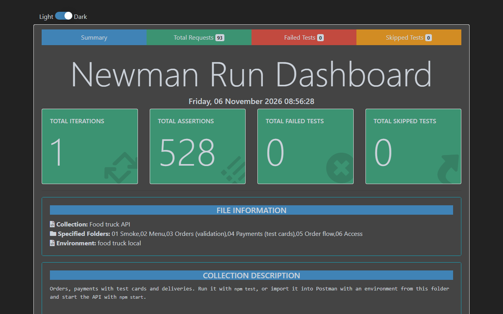
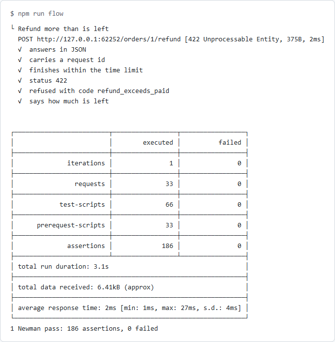
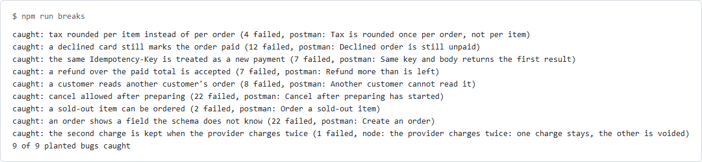

[](docs/banner.svg)

# food-truck-postman

A food truck API and the Postman collection that tests it, in one package: menu, orders, card payments, kitchen and driver steps, tracking and refunds. It is built for a QA automation reader who wants to see Postman used as a real test tool: environments, a chained flow, data-driven runs, JSON schema checks, and Newman in CI with HTML and JUnit reports. The bugs that matter in a payment API are the point: a card declined but the order marked paid, a retry that charges twice, a refund bigger than the payment. Each one was planted on purpose, and a Postman test was seen to catch it.

**In plain English:** Postman is a popular tool for trying out an API by hand. Here, those tries are saved as tests, and Newman (Postman's command-line runner) replays them all on every change. The food truck is pretend, and so is its card company, so the tests can ask for a declined card or a timeout whenever they like, with no real money and no accounts.

**[Technical guide →](TECHNICAL.md)**

[](docs/report.png)

*The HTML report from a local run of folders 01 to 06: 93 requests and 528 assertions, no failures. CI builds the same report on every run and [publishes it](https://rizvihiqrar.github.io/qa-automation-platform/reports/) next to the dashboard.*

## Installation

```bash
cd packages/food-truck-postman && npm ci
```

Node 24 or later. The API has no runtime dependencies: it is `node:http`, in memory, and Node runs the TypeScript directly. Newman and its report are for the tests only.

## Quick start

One command starts the API on a free port, runs every folder and stops the API.

```bash
npm test
```

```text
3 Newman passes: 814 assertions, 0 failed
```

To use it in Postman: run `npm start` (the API stays up on port 4400), import `postman/food-truck.postman_collection.json` and `postman/local.postman_environment.json`, pick the **food truck local** environment and run the collection. The two data folders need a data file: pick `data/orders.csv` or `data/cards.json` in the Collection Runner. Without one, they stand aside.

[](docs/flow.png)

*`npm run flow`: the chained order, from login to the last refund. Here a refund bigger than what is left is refused, and the reply says how much is left.*

## At a glance

- **99 requests** in seven folders, **266 Postman tests** of their own, plus three that run on every response
- **814 assertions** in a full run, across three Newman passes
- **39 `node --test` tests** for what Postman can't see, such as the pretend card company's own books and requests that overlap
- **9 planted bugs**, each put back by `npm run breaks` on every CI run, and each caught by the test named for it
- **One chained flow**: login, menu, order, pay, prepare, ready, out for delivery, track, delivered, refund, with ids passed along in variables
- **Data-driven runs**: 12 orders from a CSV file and 7 cards from a JSON file, each row with its expected result
- **JSON schema checks** for menu items, orders and payments, which refuse any field they don't know
- **Test cards** for approved, declined, a provider timeout and a provider that charges twice
- **Idempotency keys** on payments: a repeated request gets the first answer and never a second charge
- **A guard test** that fails if a request has no `pm.test`, or a `pm.test` asserts nothing
- **No tokens in files**: environments hold only the base URL, a test checks that, and a report holding a token fails the run
- **Five full rounds** of Newman in every CI run, so a test that passes only sometimes shows up

### Postman features used

| Feature | Where |
|---|---|
| Environments and variables | `postman/*.postman_environment.json`, collection variables for ids, tokens and schemas |
| Pre-request scripts | A fresh `Idempotency-Key` for every request, set at collection level; CSV rows turned into a JSON body |
| Test scripts | `pm.test` on every request, and three collection-level tests on every response |
| Chained requests | `05 Order flow` passes ids and totals from one request to the next |
| Data-driven runs | `07 Data-driven`, with `data/orders.csv` and `data/cards.json` |
| JSON schema | `pm.response.to.have.jsonSchema` for menu item, order and payment |
| Newman | `scripts/run.ts` runs the collection in CI, with HTML and JUnit reports |

The Postman API Fundamentals badge is already earned, so this project covers what a QA job needs and doesn't chase badge tasks. A Postman cloud mock server and a monitor are a later step, done by hand, because they need a Postman account. They will never run in CI.

## Results

| What | Result | Source |
|---|---|---|
| Newman, full run | 99 requests in the collection, 814 assertions, 0 failed | `npm test`, [CI](../../.github/workflows/ci.yml) |
| Repeat runs | 5 rounds in a row, 814 of 814 each time, locally and in every CI run | `npm run burn-in` |
| Node tests | 39 of 39 | `npm run test:unit` |
| Planted bugs | 9 of 9 caught, 8 by Postman and 1 by the node tests | `npm run breaks` |

[](docs/breaks.png)

*`npm run breaks`: each bug goes into a throwaway copy of the code, and the test named in brackets must go red. The last one is the case Postman can't see: the API says the right thing while the card company's books show two charges.*

## License

MIT
