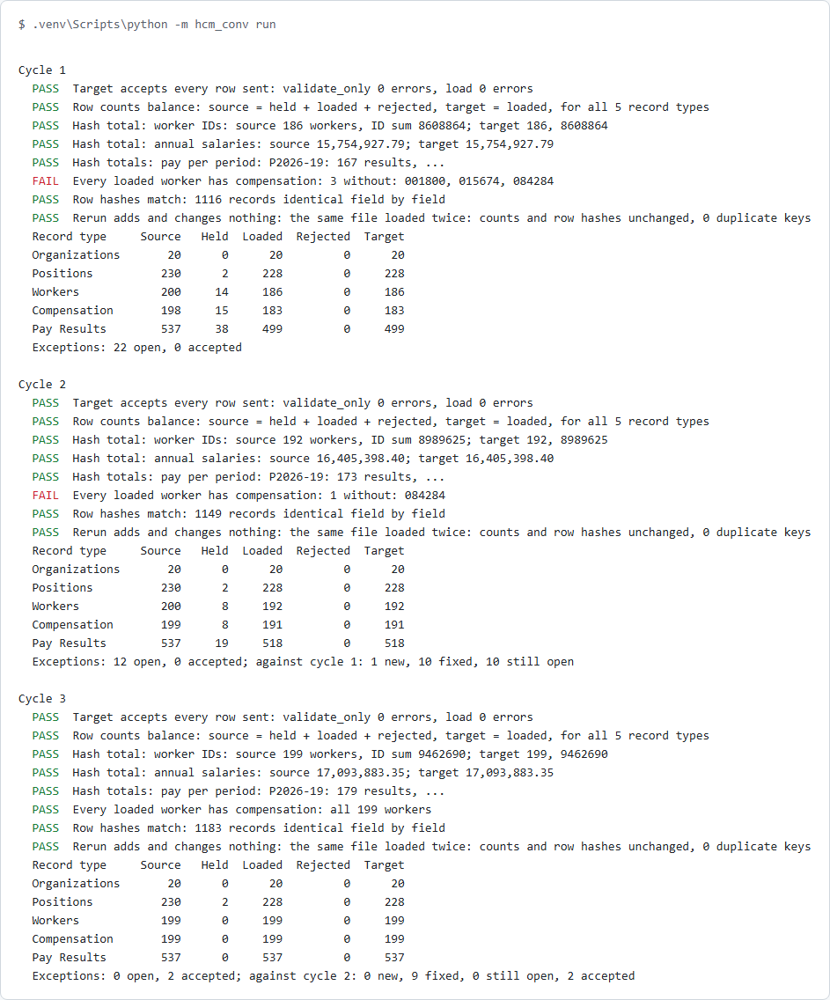
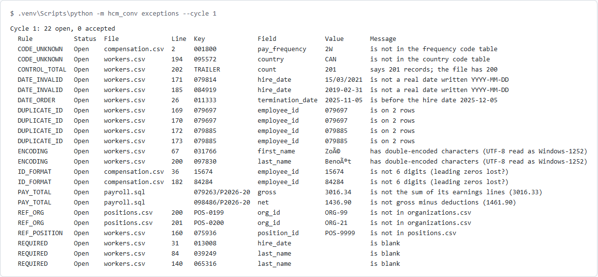

[](docs/banner.svg)

# hcm-conversion-validation

A data conversion test kit for HR and payroll, in Python. A generated legacy extract (CSV files plus a SQLite payroll history, 200 workers, 20 seeded defects of 8 kinds) is mapped, validated, loaded through a Workday-style mock API's bulk load, and read back through its report export. Then the target is reconciled with the source by row counts, hash totals and a hash of every record. Three mock cycles show the exceptions going from 22 to 0 as the data is cleaned, with the deltas between cycles in an Excel exception report. Fake data only. Not affiliated with any HR vendor.

**In plain English:** moving a company's people and pay from an old system to a new one is like moving house. This kit counts the boxes before and after, adds up the numbers on them, opens every box to compare it with a photo taken before it left, and drives the truck a second time to make sure nothing gets delivered twice. Anything that can't move yet (a missing hire date, a duplicated employee ID, a name garbled by the wrong file encoding) goes on a list with the reason, and the list gets shorter each cycle.

**[Technical guide →](TECHNICAL.md)**

[](docs/cycles.png)

*`python -m hcm_conv run`: cycles 1 to 3. The one check that fails in cycles 1 and 2 is real: three workers would have arrived with no pay, because their compensation rows were held back. ([dark version](docs/cycles-dark.png))*

## Installation

```bash
cd packages/hcm-conversion-validation
python -m venv .venv
.venv/bin/pip install -r requirements.txt      # Windows: .venv\Scripts\pip
```

Python 3.12. Nothing else: the mock API runs inside the same process.

## Quick start

```bash
.venv/bin/python -m pytest                     # 93 tests
.venv/bin/python -m hcm_conv run               # cycles 1 to 3, writes reports/exceptions_cycleN.xlsx
.venv/bin/python -m hcm_conv exceptions --cycle 1
```

`run` exits with 1 while any check fails or any exception is open, so a pipeline can stop on it.

## At a glance

- A legacy extract with 20 seeded defects: missing required fields, bad dates, duplicate employee IDs, mismatched totals, orphaned positions, lost leading zeros, garbled accented names and invalid codes. [defects.json](legacy/defects.json) is the answer key
- Every seeded defect is found by its own rule, and no row outside the answer key is flagged (both are tests)
- A Workday-style mock API: paged workers, organizations, positions, compensation and pay results; a bulk load that takes a spreadsheet template in validate-only or load mode and returns a per-row error report (JSON or .xlsx); reports as JSON or CSV
- The bulk load saves the good rows and reports the bad ones, and updates rows by key, so loading the same file twice adds nothing
- Field mapping in one [mapping.yaml](mapping.yaml): legacy column to target field, code tables (`B` to `Biweekly`, `CA` to `CAN`), strict dates and IDs
- Payroll totals are checked in SQL against the legacy database, in whole cents
- Reconciliation: source = held back + loaded + rejected for all 5 record types; hash totals of worker IDs, salaries, and gross and net per pay period; a SHA-256 hash of every record against the target
- Three mock cycles with the data team's fixes in between ([fixes/](fixes)), two exceptions signed off as accepted, and new, fixed and still-open deltas
- The exception report is a workbook: Summary, Exceptions and Deltas sheets
- Rows that need a held row (the pay of a held worker) are held too, so the load never fails on something the checks already knew
- Five ways a target can quietly go wrong (stripped accents, rounded salaries, a dropped row, duplicates on a rerun, refused rows) are each caught by a test
- The extract is regenerated byte for byte from a fixed seed in every test run
- Real accents (René Laliberté) are kept; only the double-encoded ones (Zoé) are flagged
- 22 bugs were put back on purpose, one at a time, and the right tests failed each time (see [Results](#results))

## Results

| Cycle | Open exceptions | Accepted | Against the cycle before | Checks |
|---|---:|---:|---|---|
| 1 | 22 | 0 | baseline | 7 of 8 pass: 3 loaded workers have no compensation |
| 2 | 12 | 0 | 1 new (a late new hire with no position), 10 fixed, 10 still open | 7 of 8 pass: 1 worker has no compensation |
| 3 | 0 | 2 | 0 new, 9 fixed, 0 still open, 2 accepted | 8 of 8 pass; 1,183 records identical field by field |

[](docs/exceptions.png)

*`python -m hcm_conv exceptions --cycle 1`: the 20 seeded defects (the two duplicate pairs are two rows each). ([dark version](docs/exceptions-dark.png))*

| Bug put back on purpose | Tests that failed |
|---|---:|
| A blank required field passes | 16 |
| A 4 or 5 digit employee ID passes | 5 |
| A date that does not exist passes | 13 |
| Termination before hire passes | 12 |
| Duplicate IDs flagged only on 3 or more rows | 12 |
| An unknown code passes through unmapped | 15 |
| Double-encoded names pass | 14 |
| A position in a missing organization passes | 8 |
| A worker on a missing position passes | 12 |
| The trailer record count is not compared | 8 |
| Gross not compared with its earnings lines (SQL) | 10 |
| Net not compared with gross minus deductions (SQL) | 7 |
| Rows of a held worker are still sent | 13 |
| The template writes IDs as numbers, so the zeros are lost | 13 |
| The bulk load adds rows instead of updating them | 6 |
| Signed-off exceptions are not marked accepted | 4 |
| Deltas matched by line number, so a moved row looks new | 3 |
| An organization under a held organization is still sent (code review) | 1 |
| A salary that is not a number crashes the control total (code review) | 1 |
| Payroll keys with a space are not trimmed in pay_totals.sql (code review) | 2 |
| Payroll keys with a space are not trimmed in the hash totals SQL (code review) | 1 |
| The mock API takes week dates such as 2026-W45-3 (code review) | 2 |

The suite passed 10 runs in a row with no retries (5 before the code review fixes, 5 after).

## License

MIT, see the [root LICENSE](../../LICENSE). The data is generated and fake. Workday is a trademark of Workday, Inc.; this project is not affiliated with, endorsed by or connected to Workday or any other HR vendor, and uses none of its code or data.
