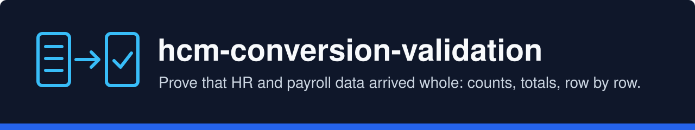
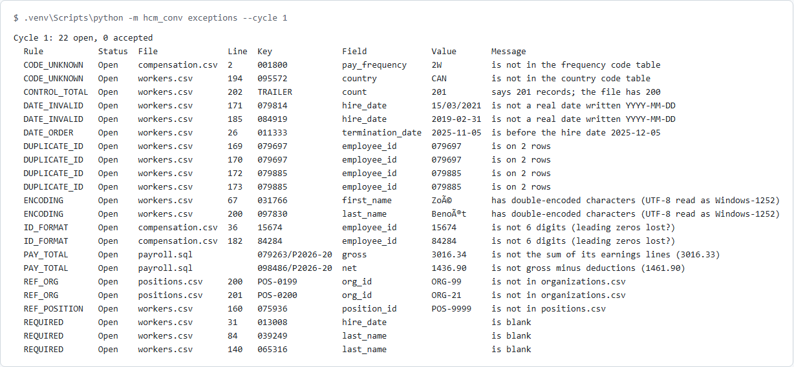

[](docs/banner.svg)

# hcm-conversion-validation

A data conversion test kit for HR and payroll, in Python. A generated legacy extract (CSV files plus a SQLite payroll history, 200 workers, 20 seeded defects of 8 kinds) is mapped, validated, loaded through a Workday-style mock API's bulk load, and read back through its report export. Then the target is reconciled with the source by row counts, hash totals and a hash of every record. Three mock cycles show the exceptions going from 22 to 0 as the data is cleaned, with the deltas between cycles in an Excel exception report. Then a payroll parallel pays the last three pay periods again in the new system and proves every cent of difference, and a masked copy of the extract hides every person while still breaking the same rules. Finally the load goes through a bad network line (Toxiproxy in Docker): a slow reply, a reset mid-upload, a silent line and a reply lost after the save, and it still ends reconciled. A [test plan](docs/test-plan.md) gives each of 63 requirements an ID, every test names the requirements it checks, and a [traceability matrix](docs/traceability.md) lists each requirement's tests; CI builds it again with every test's latest result. A [defect log](docs/defect-log.md) is worked out from the cycles and the parallel runs, and a [readiness report](docs/readiness-go.md) checks the plan's 7 exit criteria and says go or no-go ([the NO-GO after cycle 2](docs/readiness-no-go.md)). Fake data only. Not affiliated with any HR vendor.

**In plain English:** moving a company's people and pay from an old system to a new one is like moving house. This kit counts the boxes before and after, adds up the numbers on them, opens every box to compare it with a photo taken before it left, and drives the truck a second time to make sure nothing gets delivered twice. Anything that can't move yet (a missing hire date, a duplicated employee ID, a name garbled by the wrong file encoding) goes on a list with the reason, and the list gets shorter each cycle. After the move, the new system pays three old pay runs again, and every cent that comes out different needs a signed-off reason that the kit checks by working the pay out again. The copy given to testers has made-up names, birth dates and ID numbers, so nobody real is in it. And when the truck breaks down halfway (the phone line drops, or the new office says nothing back), the kit sends the boxes again and proves nothing arrived twice. At the end there is a checklist for moving day: every item has a tick or a cross with its proof next to it, and the move goes ahead only when every item is ticked.

**[Technical guide →](TECHNICAL.md)**

[](docs/cycles.png)

*`python -m hcm_conv run`: cycles 1 to 3. The one check that fails in cycles 1 and 2 is real: three workers would have arrived with no pay, because their compensation rows were held back. ([dark version](docs/cycles-dark.png))*

## Installation

```bash
cd packages/hcm-conversion-validation
python -m venv .venv
.venv/bin/pip install -r requirements.txt      # Windows: .venv\Scripts\pip
```

Python 3.12. Nothing else for the main tests: the mock API runs inside the same process. The fault tests also need Docker.

## Quick start

```bash
.venv/bin/python -m pytest                     # 194 tests
.venv/bin/python -m pytest tests_faults        # 6 fault tests (Docker must be running)
.venv/bin/python -m hcm_conv run               # cycles 1 to 3, writes reports/exceptions_cycleN.xlsx
.venv/bin/python -m hcm_conv exceptions --cycle 1
.venv/bin/python -m hcm_conv parallel          # payroll parallel runs 1 and 2, writes reports/parallel_runN.xlsx
HCM_MASK_KEY=any-secret .venv/bin/python -m hcm_conv mask    # writes and checks reports/masked/
.venv/bin/python -m hcm_conv trace --junit reports/junit.xml --junit reports/junit-faults.xml   # the matrix with results
.venv/bin/python -m hcm_conv readiness --junit reports/junit.xml --junit reports/junit-faults.xml   # go or no-go, and the defect log
```

`run` exits with 1 while any check fails or any exception is open, `parallel` while run 2 has an unexplained difference, `mask` when its copy fails a check, `trace` while a requirement has no tests or a test that did not pass, and `readiness` on NO-GO, so a pipeline can stop on any of them.

## At a glance

- A legacy extract with 20 seeded defects: missing required fields, bad dates, duplicate employee IDs, mismatched totals, orphaned positions, lost leading zeros, garbled accented names and invalid codes. [defects.json](legacy/defects.json) is the answer key
- Every seeded defect is found by its own rule, and no row outside the answer key is flagged (both are tests)
- A Workday-style mock API: paged workers, organizations, positions, compensation and pay results; a bulk load that takes a spreadsheet template in validate-only or load mode and returns a per-row error report (JSON or .xlsx); reports as JSON or CSV
- The bulk load saves the good rows and reports the bad ones, and updates rows by key, so loading the same file twice adds nothing
- Field mapping in one [mapping.yaml](mapping.yaml): legacy column to target field, code tables (`B` to `Biweekly`, `CA` to `CAN`), strict dates and IDs
- Payroll totals are checked in SQL against the legacy database, in whole cents
- Reconciliation: source = held back + loaded + rejected for all 5 record types; hash totals of worker IDs, salaries, and gross and net per pay period; a SHA-256 hash of every record against the target
- Three mock cycles with the data team's fixes in between ([fixes/](fixes)), two exceptions signed off as accepted, and new, fixed and still-open deltas
- The exception report is a workbook: Summary, Exceptions and Deltas sheets
- Rows that need a held row (the pay of a held worker) are held too, so the load never fails on something the checks already knew
- Five ways a target can quietly go wrong (stripped accents, rounded salaries, a dropped row, duplicates on a rerun, refused rows) are each caught by a test
- The extract is regenerated byte for byte from a fixed seed in every test run
- Real accents (René Laliberté) are kept; only the double-encoded ones (Zoé) are flagged
- A payroll parallel: the new engine pays 537 old payslips again from the converted pay, and every line is compared to the cent. A difference counts as explained only if replaying the payslip with the signed-off setting gives the legacy amount exactly
- Run 1 finds the two seeded setup mistakes (semimonthly pay divided by 26, overtime missing from the weekly pay group) and nothing else; run 2 passes with 118 rounding differences, each one proven
- Masking with a keyed hash (HMAC-SHA256): names, birth dates, emails and national IDs change, the same key gives the same copy, and blanks, accents and garbled names keep their shape
- The masked copy is checked: nobody keeps their own value, no real national ID or email is anywhere in it, and the checks find the same 68 problems as in the original
- Integration faults on a real line: Toxiproxy (in Docker, started by testcontainers) between the loader and the mock API puts one fault on one call, and cycle 3 must still pass every check
- The loader times out every call and retries only what is safe to send twice (reads, the bulk load, the reset), up to 3 tries with a growing backoff; an error status is never retried
- The dangerous case is tested: the API saves the load and the reply is lost, so the loader loads again, and the reconciliation proves nothing was duplicated or changed
- A test plan with scope, approach, schedule, roles, entry and exit criteria, defect management and 63 numbered requirements in 10 groups; each rule and check is named exactly as the code reports it, and a test fails if the two drift apart
- Every test carries a `req` marker: the run stops before any test starts if a test has none or names an ID that is not in the plan, and each ID is written into the JUnit XML
- The traceability matrix (Markdown and .xlsx) shows each requirement, its tests and their latest results from both suites; a requirement passes only when it has tests and all of them passed
- Building the matrix found two gaps, now closed: no test had ever made the worker ID hash total fail, and an accepted exception could be signed off by nobody
- A defect log of 24 defects (the 20 seeded, the late new hire, the 2 payroll setup mistakes and the signed-off rounding), each with where it was found, the rule or check that found it, its owner, what closed it and its status, worked out from the evidence at any checkpoint
- A go or no-go readiness report on the test plan's 7 exit criteria, each checked against evidence worked out again (the cycles, the parallel, a masked copy, the JUnit results); every one must pass, and the result is also JSON in release-gate's check shape
- 89 bugs were put back on purpose, one at a time, and the right tests failed each time (see [Results](#results))

## Results

| Cycle | Open exceptions | Accepted | Against the cycle before | Checks |
|---|---:|---:|---|---|
| 1 | 22 | 0 | baseline | 7 of 8 pass: 3 loaded workers have no compensation |
| 2 | 12 | 0 | 1 new (a late new hire with no position), 10 fixed, 10 still open | 7 of 8 pass: 1 worker has no compensation |
| 3 | 0 | 2 | 0 new, 9 fixed, 0 still open, 2 accepted | 8 of 8 pass; 1,183 records identical field by field |

[](docs/exceptions.png)

*`python -m hcm_conv exceptions --cycle 1`: the 20 seeded defects (the two duplicate pairs are two rows each). ([dark version](docs/exceptions-dark.png))*

| Payroll parallel | Unexplained differences | Explained (rounding, proven) | Net pay against legacy | Result |
|---|---:|---:|---|---|
| Run 1, setup as built | 690, on 44 workers | 94 | about 8,000 short each period | FAIL |
| Run 2, two setup changes | 0 | 118 | 0.00, 0.04 and 0.03 short | PASS |

The masked copy passes all 5 of its checks with any key: CI uses a new key, made from the run ID, on every run.

| Readiness checkpoint | Exit criteria passed | Open defects | Decision |
|---|---:|---:|---|
| [Mock cycle 2 and parallel run 1](docs/readiness-no-go.md) | 3 of 7 | 13 | NO-GO |
| [Mock cycle 3 and parallel run 2](docs/readiness-go.md) | 7 of 7 | 0 (21 closed, 3 accepted) | GO |

The traceability matrix: 63 requirements, all passing, from 194 + 6 test results.

| Fault on the line | Aimed at | Retries | Cycle 3 |
|---|---|---|---|
| Slow reply (3 s, timeout 1.5 s) | a load's error report | 1 (ReadTimeout) | passes |
| Reset in the middle of the upload | the bulk load | 1; the API never saw the first try | passes |
| Silent line (no reply, no hang-up) | the pay results report | 1 (ReadTimeout), no hang | passes |
| Reply lost after the save | the bulk load | 1; the file is loaded 3 times in all, no duplicates | passes |
| A fault that never clears | a report read | 3 tries, then a clear error | stops |

| Bug put back on purpose | Tests that failed |
|---|---:|
| A blank required field passes | 16 |
| A 4 or 5 digit employee ID passes | 5 |
| A date that does not exist passes | 13 |
| Termination before hire passes | 12 |
| Duplicate IDs flagged only on 3 or more rows | 12 |
| An unknown code passes through unmapped | 15 |
| Double-encoded names pass | 14 |
| A position in a missing organization passes | 8 |
| A worker on a missing position passes | 12 |
| The trailer record count is not compared | 8 |
| Gross not compared with its earnings lines (SQL) | 10 |
| Net not compared with gross minus deductions (SQL) | 7 |
| Rows of a held worker are still sent | 13 |
| The template writes IDs as numbers, so the zeros are lost | 13 |
| The bulk load adds rows instead of updating them | 6 |
| Signed-off exceptions are not marked accepted | 4 |
| Deltas matched by line number, so a moved row looks new | 3 |
| An organization under a held organization is still sent (code review) | 1 |
| A salary that is not a number crashes the control total (code review) | 1 |
| Payroll keys with a space are not trimmed in pay_totals.sql (code review) | 2 |
| Payroll keys with a space are not trimmed in the hash totals SQL (code review) | 1 |
| The mock API takes week dates such as 2026-W45-3 (code review) | 2 |
| Parallel: regular pay not rounded to the cent | 5 |
| Parallel: overtime paid in every pay group | 3 |
| Parallel: an explanation is trusted without the replay | 4 |
| Parallel: no limit on the size of an explained gap | 1 |
| Parallel: a pay result with no compensation is skipped quietly | 1 |
| Parallel: a setup change may name a setting that does not exist | 1 |
| Parallel: the new engine rounds like the legacy one | 4 |
| Masking: garbled names come out clean (a defect disappears) | 5 |
| Masking: an accented name gets a plain one | 1 |
| Masking: a birth date can move into another year | 1 |
| Masking: the email is not masked | 4 |
| Masking: the leak scan skips national IDs and emails | 1 |
| Masking: the same-problems check is skipped | 1 |
| Masking: two workers may share a masked national ID | 1 |
| Masking: runs with an empty key | 1 |
| Masking: a masked national ID can be someone else's real one, or shared (code review) | 1 |
| Masking: a blank made of spaces gets a fake value, so REQUIRED is lost (code review) | 1 |
| Masking: an invalid birth date can come out as a valid one (code review) | 1 |
| Masking: leftover files in the output folder fail the leak scan (code review) | 1 |
| Parallel: a pay result the legacy system never paid crashes the run (code review) | 1 |
| Parallel: a run listed twice in the plan is done twice (code review) | 1 |
| Loader: no retries at all | 11 |
| Loader: every POST is retried, not only the safe ones | 1 |
| Loader: an error status is retried as if the line failed | 1 |
| Loader: the backoff does not grow | 1 |
| Loader: retries are not recorded | 7 |
| Loader: the fault hook is not called on a retry | 7 |
| Mock API: a second bulk load adds rows instead of updating them | 21 |
| CI pulls another Toxiproxy tag than the tests start | 1 |
| An accepted exception with no reason or no sign-off is let through | 2 |
| The worker ID hash total always passes | 1 |
| Traceability: a test with no `req` marker runs anyway | 1 |
| Traceability: a test naming an ID the plan does not have runs anyway | 1 |
| Traceability: the IDs never reach the JUnit file | 1 |
| Traceability: a skipped test counts as passed | 1 |
| Traceability: a test that errors reads as passed | 1 |
| Traceability: a test with no requirement does not fail the matrix | 1 |
| Traceability: the plan renames a check the code reports | 2 |
| Traceability: a requirement that no test names | 2 |
| Traceability: the plan uses an ID twice | 1 |
| Traceability: a new test the committed matrix does not list | 1 |
| Traceability: the nested collect run passes PYTEST_ADDOPTS on (code review) | 1 |
| Traceability: a test in a class gets a folder for a file name (code review) | 1 |
| Traceability: an escaped pipe in the plan splits its cell (code review) | 1 |
| Traceability: an option for the other mode is ignored quietly (code review) | 1 |
| Readiness: an open exception does not block go | 2 |
| Readiness: a failing reconciliation check does not block go | 2 |
| Readiness: an unexplained pay difference does not block go | 2 |
| Readiness: no masking checks at all counts as a pass | 1 |
| Readiness: a failing fault scenario passes its criterion | 2 |
| Readiness: a test result outside the plan does not block go | 1 |
| Readiness: an open defect does not block go | 2 |
| Readiness: go when any criterion passes | 4 |
| Readiness: an accepted exception nobody signed off is not noticed | 1 |
| Defect log: an accepted defect shows as closed | 14 |
| Defect log: a defect that arrives in a later cycle is left out | 6 |
| Defect log: a setup mistake closes without a run that explains everything | 1 |
| Defect log: a defect the rule never reports shows as closed | 1 |
| Defect log: a fix is dated in the cycle the defect was found | 2 |
| The committed GO example is edited by hand | 1 |
| Defect log: an accepted entry is looked up by a defect ID it may not have (code review) | 1 |
| Defect log: a second late defect on a row takes a name already used (code review) | 1 |
| Defect log: a finding on another field of the row counts as the defect (code review) | 1 |
| Readiness: no reconciliation checks at all counts as a pass (code review) | 1 |
| Defect log: the rounding explanation stays accepted when its guard fails (code review) | 1 |
| Defect log: a setup mistake is always said to be found in run 1 (code review) | 1 |
| Readiness: the CI defect log links to the committed GO example (code review) | 1 |

The stage 1 suite passed 10 runs in a row with no retries (5 before the code review fixes, 5 after); the stage 2 suite passed 3 in a row before the code review fixes and 5 after; with the stage 3 markers, the main suite passed 3 in a row and the fault suite 2 before the review fixes.

## License

MIT, see the [root LICENSE](../../LICENSE). The data is generated and fake. Workday is a trademark of Workday, Inc.; this project is not affiliated with, endorsed by or connected to Workday or any other HR vendor, and uses none of its code or data.
