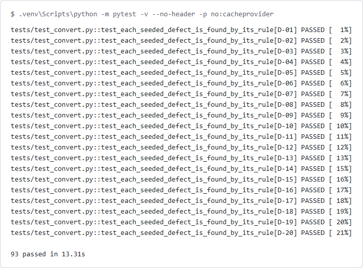

# hcm-conversion-validation: technical guide

[← Back to overview](README.md)

**Contents:** [Features](#features) · [Configuration](#configuration) · [CI integration](#ci-integration) · [FAQ](#faq) · [Troubleshooting](#troubleshooting) · [Development](#development)

This is stage 1 of three (see the [ROADMAP](../../ROADMAP.md) row HCM). Stage 2 adds integration faults (reusing the Toxiproxy setup from qa-practice-api), a payroll parallel and data masking. Stage 3 adds the test plan, a traceability matrix, a defect log and a go or no-go readiness report.

## Features

### The flow

```text
legacy/ (CSV + payroll.sql) ─ fixes/cycleN.yaml ─▶ extract ─▶ mapping.yaml + rules ─▶ held back (exceptions)
                                                                     │
                                                                     ▼ the rest
             reports/exceptions_cycleN.xlsx ◀─ reconcile ◀─ GET /reports/* ◀─ POST /bulk-loads (.xlsx template)
```

| Module | What it does |
|---|---|
| [legacy.py](hcm_conv/legacy.py) | Generates the extract from seed 51 and seeds the 20 defects |
| [extract.py](hcm_conv/extract.py) | Reads the extract and applies the fixes of cycles 2 to N |
| [target.py](hcm_conv/target.py) | The target's record types, template columns, keys and code lists, shared by the API and the converter |
| [mock_api.py](hcm_conv/mock_api.py) | The Workday-style mock API (FastAPI, in memory) |
| [template.py](hcm_conv/template.py) | Builds the bulk load template, every cell as text |
| [convert.py](hcm_conv/convert.py) | Mapping, the validation rules, held rows and accepted exceptions |
| [reconcile.py](hcm_conv/reconcile.py) | Loads a cycle and reconciles the target with the source |
| [cycles.py](hcm_conv/cycles.py) | Runs cycles 1 to 3 and works out the deltas |
| [report.py](hcm_conv/report.py) | Writes the exception workbook |

### The legacy extract

| File | Rows | What it holds |
|---|---:|---|
| [organizations.csv](legacy/organizations.csv) | 20 | Organizations and their parent |
| [positions.csv](legacy/positions.csv) | 230 | 198 filled, 32 vacant |
| [workers.csv](legacy/workers.csv) | 200 + trailer | 198 people and 2 rehires entered twice; the trailer has a record count and a hash total of the IDs |
| [compensation.csv](legacy/compensation.csv) | 198 + trailer | Salary, currency, pay frequency code; the trailer has a count and the salary total |
| [payroll.sql](legacy/payroll.sql) | 3 periods, 537 results, 2,254 lines | The last three pay runs: results (gross, deductions, net) and their earnings and deduction lines |

Names come from Faker's fr_CA and en_CA locales, emails are `@example.com`, and national IDs start with 0 (no real SIN does). The payroll database is committed as a SQL dump and built into SQLite in memory when it is read: a `.db` file's bytes change with the SQLite version, and the extract is compared byte for byte with a fresh run of the generator in every test run. [.gitattributes](.gitattributes) keeps git from changing its line endings.

### The seeded defects

| ID | Kind | Rule | Where |
|---|---|---|---|
| D-01, D-02 | Missing required field | REQUIRED | Blank last name |
| D-03 | Missing required field | REQUIRED | Blank hire date |
| D-04 | Bad date | DATE_INVALID | 2019-02-31 |
| D-05 | Bad date | DATE_INVALID | 15/03/2021 (day first) |
| D-06 | Bad date | DATE_ORDER | Terminated 30 days before the hire date |
| D-07, D-08 | Duplicate ID | DUPLICATE_ID | A rehire entered as a second row with the same ID |
| D-09 | Mismatched totals | CONTROL_TOTAL | The workers trailer says 201 records; there are 200 |
| D-10 | Mismatched totals | PAY_TOTAL | Gross is 0.01 more than its earnings lines |
| D-11 | Mismatched totals | PAY_TOTAL | Net is 25.00 less than gross minus deductions |
| D-12, D-13 | Orphaned position | REF_ORG | A vacant position in an organization that does not exist |
| D-14 | Orphaned position | REF_POSITION | A worker on position POS-9999 |
| D-15, D-16 | Lost leading zeros | ID_FORMAT | 084284 saved as 84284 in compensation.csv |
| D-17, D-18 | Garbled accented name | ENCODING | Zoé saved as Zoé (UTF-8 read as Windows-1252) |
| D-19 | Invalid code | CODE_UNKNOWN | Pay frequency 2W |
| D-20 | Invalid code | CODE_UNKNOWN | Country CAN in a column of 2-letter codes |

[](docs/hcm-tests.png)

*Each seeded defect is a test case of its own. ([dark version](docs/hcm-tests-dark.png))*

### The Workday-style mock API

Loosely modelled on how Workday's interfaces are publicly described: a worker API paged by `limit` and `offset`, a spreadsheet bulk load template with a key per row and a validate-only first run, and custom reports served as JSON or CSV. The names and shapes are this project's own.

| Call | What it does |
|---|---|
| `GET /workers?limit=20&offset=0` | Paged list (`limit` 1 to 100); `{"total": n, "data": [...]}` |
| `GET /workers/{id}`, `GET /workers/{id}/compensation` | One record; 404 when there is none |
| `GET /organizations`, `GET /positions` | Paged lists |
| `GET /pay-results?period=&worker=` | Paged, filtered |
| `POST /bulk-loads` | Multipart: `file` (.xlsx template) and `mode` (`validate_only` or `load`). Returns the load's status, counts and `errors_url` |
| `GET /bulk-loads/{id}/errors?format=json\|xlsx` | One row per refused row: sheet, row, spreadsheet key, field, message |
| `GET /reports/{name}?format=json\|csv&bom=true` | `workers`, `organizations`, `positions`, `compensation`, `pay_results`. JSON is `{"Report_Entry": [...]}`; the BOM makes Excel read accents right |
| `POST /tenant/reset` | Test only: an empty tenant, as each mock cycle gets |

The template has one sheet per record type, loaded in this order: Organizations, Positions, Workers, Compensation, Pay Results. The first column of each sheet is `Spreadsheet Key`. The target's own rules refuse a row with a blank required field, a date that is not YYYY-MM-DD, an amount with more than 2 decimals, a code that is not in its list, a reference to a record that is not there (in the tenant or earlier in the same file), a termination before the hire date, and a pay result whose net is not gross minus deductions. A refused row doesn't stop the rest. Status is `Completed`, `Completed with errors` or `Failed` (nothing loaded).

```python
from hcm_conv import template
content = template.build({"Workers": [("workers.csv:2", {"id": "001234", "given_name": "Zoé", ...})]})
client.post("/bulk-loads", files={"file": ("load.xlsx", content)}, data={"mode": "validate_only"})
```

### Mapping and rules

[mapping.yaml](mapping.yaml) maps every target field to a legacy column and says what the value goes through. Every value is trimmed first. A field fails on the first step it breaks:

| Step | Rule | Example |
|---|---|---|
| `required` | REQUIRED | A blank last name |
| `id` | ID_FORMAT | `84284` is not 6 digits |
| `date` | DATE_INVALID | `2019-02-31`, `15/03/2021`, `20190228` |
| `money` | MONEY_INVALID | `100.005` |
| `code` | CODE_UNKNOWN | `2W` is not in `frequency: {W: Weekly, B: Biweekly, S: Semimonthly, M: Monthly}` |
| `name` | ENCODING | `Ã` or `Â` followed by a non-ASCII character, or U+FFFD |

Rules across fields and files are in [convert.py](hcm_conv/convert.py): DUPLICATE_ID (every sheet, on its key), DATE_ORDER, REF_ORG, REF_POSITION, REF_WORKER (compensation or pay for a worker not in the extract), CONTROL_TOTAL (trailer count and hash total), and PAY_TOTAL in SQL ([sql/pay_totals.sql](sql/pay_totals.sql)), which compares gross with the earnings lines, deductions with the deduction lines, net with gross minus deductions, and finds results with no lines. Money is text in the legacy database, so it is compared in whole cents, and keys are trimmed in SQL the way the converter trims them.

An error holds its row back. A row that needs a held row (an organization under a held organization, a position in a held organization, a worker on a held position, the compensation and pay of a held worker) is held too, with an info finding, HELD_PARENT, that names the row it waits for. In cycle 1 that is 48 rows.

### Reconciliation

| Check | Passes when |
|---|---|
| Target accepts every row sent | Validate-only and load both return no errors |
| Row counts balance | For each record type, source = held + loaded + rejected, and the target holds what loaded |
| Hash total: worker IDs | Count and sum of the IDs sent equal the same from the target's workers report |
| Hash total: annual salaries | The salary totals match |
| Hash totals: pay per period | Per period: count, gross and net in cents. The source side is [sql/pay_hash_totals.sql](sql/pay_hash_totals.sql) over the legacy database |
| Every loaded worker has compensation | No worker arrived without pay |
| Row hashes match | SHA-256 of every record's mapped fields equals the same record read back. A mismatch is a RECON_MISMATCH per field; a record that loaded but is not in the report is RECON_MISSING |
| Rerun adds and changes nothing | The same file loaded again: the same row hashes, 0 duplicate keys |

Counts and sums can't see a changed name, which is why the row hashes exist: when the target strips accents, the worker ID hash total still passes and the row hash check fails with each changed field named (a test shows both).

### Cycles, fixes and accepted exceptions

Each cycle loads into an empty tenant. Cycle N starts from the raw extract and applies [fixes/cycle2.yaml](fixes/cycle2.yaml) to cycleN.yaml in order. A fix names its defect, and its `match` must hit exactly one row, or the run stops.

```yaml
- {defect: D-05, file: workers.csv, match: {employee_id: "079814"}, set: {hire_date: "2021-03-15"}}
- {defect: D-07, file: workers.csv, match: {employee_id: "079697", hire_date: "2012-10-25"}, delete: true}
- defect: D-10
  sql: UPDATE pay_results SET gross = '3016.33', net = '2159.42' WHERE employee_id = '079263' AND period_id = 'P2026-20'
```

Cycle 2 also brings a late change: a new hire keyed in without a position (N-01, a new exception), and new trailers. [fixes/accepted.yaml](fixes/accepted.yaml) lists the two exceptions the business signed off from cycle 3 (vacant positions in closed organizations, not converted). They stay held back, are marked Accepted, and no longer count as open: the Deltas list them as accepted, not still open. Deltas match exceptions by rule, file, key and field, not by line, so a row that moved is not reported as new.

### The exception report

`reports/exceptions_cycleN.xlsx`:

| Sheet | Holds |
|---|---|
| Summary | Each check with PASS or FAIL and its detail, the row counts per record type, and the exceptions by rule, severity and status |
| Exceptions | One row per finding: rule, severity, status, file, line, key, field, value, message (filtered and frozen header) |
| Deltas | New, fixed, still open and accepted against the cycle before |

## Configuration

| Command | Option | Default | What it does |
|---|---|---|---|
| `python -m hcm_conv run` | `--cycle N` | 1 to 3 | Run cycles 1 to N and show cycle N (its deltas still compare with N-1) |
| | `--api-url URL` | in-process | Use a mock API that is already running (`serve`) |
| | `--out DIR` | `reports/` | Where the workbooks go |
| `python -m hcm_conv exceptions` | `--cycle N`, `--all` | 1, errors only | Print a cycle's exceptions; `--all` adds the info rows |
| `python -m hcm_conv serve` | `--port` | 8051 | Start the mock API on 127.0.0.1 |
| `python -m hcm_conv generate` | | | Rewrite `legacy/` from seed 51 |

## CI integration

The `hcm-conversion-validation` job in [ci.yml](../../.github/workflows/ci.yml) installs the pinned requirements, runs `pip-audit`, runs pytest, then runs the three cycles for real (which must end with exit code 0), and keeps `reports/` (JUnit XML and the three workbooks) for 7 days. Dependabot watches `requirements.txt` ([scripts/dependabot.test.mjs](../../scripts/dependabot.test.mjs) fails if any package with a `requirements.txt` is left out).

```yaml
- uses: actions/setup-python@v5
  with: { python-version: '3.12', cache: pip, cache-dependency-path: packages/hcm-conversion-validation/requirements.txt }
- run: pip install -r requirements.txt pip-audit
- run: pip-audit -r requirements.txt
- run: pytest
- run: python -m hcm_conv run
```

## FAQ

### Why hold rows back instead of letting the target refuse them?
Because the checks already know those rows are wrong, and a load full of refusals hides the one refusal nobody expected. The target's rules are a second line: in all three cycles they refuse nothing, and a test shows that when they do, the refused rows are counted and the counts still balance.

### Why are IDs text everywhere?
`001234` is an ID, not a number. A spreadsheet that stores it as a number drops the zeros (defect D-15), and the template writes every cell as text so the load never does that. Putting that bug back failed 12 tests.

### Why a hash of every row when the totals already match?
Totals catch missing and extra rows and changed amounts. They can't catch a changed name or a swapped code. The row hash catches any changed field and names it.

### Is this the real Workday API?
No. It is a small mock shaped after public descriptions of such interfaces, with its own names. No vendor code, documents or data are used.

## Troubleshooting

| Problem | Cause | Fix |
|---|---|---|
| `test_the_committed_extract_is_exactly_what_the_generator_writes` fails | `legacy/` was edited by hand, or Faker was upgraded and makes different names | Run `python -m hcm_conv generate`, then update the expected counts and fix files, or pin Faker back |
| `fix for D-xx matched 0 rows` | The extract changed and a fix no longer finds its row | Update the fix's `match` |
| Accented names look wrong in the console | The Windows console is not UTF-8 | The command line switches its output to UTF-8; in other scripts set `PYTHONIOENCODING=utf-8` |
| CSV from `/reports` shows `é` in Excel | Excel guessed the encoding | Add `bom=true` to the report URL |

## Development

```bash
cd packages/hcm-conversion-validation
python -m venv .venv && .venv/bin/pip install -r requirements.txt
.venv/bin/python -m pytest
.venv/bin/python -m hcm_conv run
```
