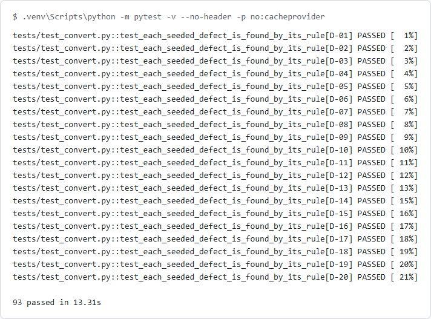

# hcm-conversion-validation: technical guide

[← Back to overview](README.md)

**Contents:** [Features](#features) · [Configuration](#configuration) · [CI integration](#ci-integration) · [FAQ](#faq) · [Troubleshooting](#troubleshooting) · [Development](#development)

Stage 1 of three is the conversion itself (see the [ROADMAP](../../ROADMAP.md) row HCM). Stage 2 adds the [payroll parallel](#the-payroll-parallel), [masking](#masking) and [integration faults](#integration-faults) that reuse the Toxiproxy setup from qa-practice-api. Stage 3 adds the [test plan and the traceability matrix](#test-plan-and-traceability), the [defect log](#the-defect-log) and the [go or no-go readiness report](#the-readiness-report).

## Features

### The flow

```text
legacy/ (CSV + payroll.sql) ─ fixes/cycleN.yaml ─▶ extract ─▶ mapping.yaml + rules ─▶ held back (exceptions)
                                                                     │
                                                                     ▼ the rest
             reports/exceptions_cycleN.xlsx ◀─ reconcile ◀─ GET /reports/* ◀─ POST /bulk-loads (.xlsx template)
```

| Module | What it does |
|---|---|
| [legacy.py](hcm_conv/legacy.py) | Generates the extract from seed 51 and seeds the 20 defects |
| [extract.py](hcm_conv/extract.py) | Reads the extract and applies the fixes of cycles 2 to N |
| [target.py](hcm_conv/target.py) | The target's record types, template columns, keys and code lists, shared by the API and the converter |
| [mock_api.py](hcm_conv/mock_api.py) | The Workday-style mock API (FastAPI, in memory) |
| [template.py](hcm_conv/template.py) | Builds the bulk load template, every cell as text |
| [convert.py](hcm_conv/convert.py) | Mapping, the validation rules, held rows and accepted exceptions |
| [reconcile.py](hcm_conv/reconcile.py) | Loads a cycle and reconciles the target with the source |
| [cycles.py](hcm_conv/cycles.py) | Runs cycles 1 to 3 and works out the deltas |
| [report.py](hcm_conv/report.py) | Writes the exception workbook |
| [parallel.py](hcm_conv/parallel.py) | The new payroll engine, the payroll parallel runs and their workbook |
| [client.py](hcm_conv/client.py) | The loader's HTTP client: a timeout on every call, retries for the calls that are safe to repeat |
| [tests_faults/](tests_faults) | The fault tests: the mock API on a real port, Toxiproxy in Docker in front of it |
| [mask.py](hcm_conv/mask.py) | Writes a masked copy of the extract and checks it |
| [trace.py](hcm_conv/trace.py) | Reads the test plan's requirements and the JUnit files, and builds the traceability matrix |
| [conftest.py](conftest.py) | For both suites: every test names its requirements, and the IDs go into the JUnit XML |
| [defects.py](hcm_conv/defects.py) | The defect log, worked out from the cycles and the parallel runs at a checkpoint |
| [readiness.py](hcm_conv/readiness.py) | The go or no-go report on the test plan's exit criteria |

### The legacy extract

| File | Rows | What it holds |
|---|---:|---|
| [organizations.csv](legacy/organizations.csv) | 20 | Organizations and their parent |
| [positions.csv](legacy/positions.csv) | 230 | 198 filled, 32 vacant |
| [workers.csv](legacy/workers.csv) | 200 + trailer | 198 people and 2 rehires entered twice; the trailer has a record count and a hash total of the IDs |
| [compensation.csv](legacy/compensation.csv) | 198 + trailer | Salary, currency, pay frequency code; the trailer has a count and the salary total |
| [payroll.sql](legacy/payroll.sql) | 3 periods, 537 results, 2,254 lines | The last three pay runs: results (gross, deductions, net) and their earnings and deduction lines |

Names come from Faker's fr_CA and en_CA locales, emails are `@example.com`, and national IDs start with 0 (no real SIN does). The payroll database is committed as a SQL dump and built into SQLite in memory when it is read: a `.db` file's bytes change with the SQLite version, and the extract is compared byte for byte with a fresh run of the generator in every test run. [.gitattributes](.gitattributes) keeps git from changing its line endings.

### The seeded defects

| ID | Kind | Rule | Where |
|---|---|---|---|
| D-01, D-02 | Missing required field | REQUIRED | Blank last name |
| D-03 | Missing required field | REQUIRED | Blank hire date |
| D-04 | Bad date | DATE_INVALID | 2019-02-31 |
| D-05 | Bad date | DATE_INVALID | 15/03/2021 (day first) |
| D-06 | Bad date | DATE_ORDER | Terminated 30 days before the hire date |
| D-07, D-08 | Duplicate ID | DUPLICATE_ID | A rehire entered as a second row with the same ID |
| D-09 | Mismatched totals | CONTROL_TOTAL | The workers trailer says 201 records; there are 200 |
| D-10 | Mismatched totals | PAY_TOTAL | Gross is 0.01 more than its earnings lines |
| D-11 | Mismatched totals | PAY_TOTAL | Net is 25.00 less than gross minus deductions |
| D-12, D-13 | Orphaned position | REF_ORG | A vacant position in an organization that does not exist |
| D-14 | Orphaned position | REF_POSITION | A worker on position POS-9999 |
| D-15, D-16 | Lost leading zeros | ID_FORMAT | 084284 saved as 84284 in compensation.csv |
| D-17, D-18 | Garbled accented name | ENCODING | Zoé saved as Zoé (UTF-8 read as Windows-1252) |
| D-19 | Invalid code | CODE_UNKNOWN | Pay frequency 2W |
| D-20 | Invalid code | CODE_UNKNOWN | Country CAN in a column of 2-letter codes |

[](docs/hcm-tests.png)

*Each seeded defect is a test case of its own. ([dark version](docs/hcm-tests-dark.png))*

### The Workday-style mock API

Loosely modelled on how Workday's interfaces are publicly described: a worker API paged by `limit` and `offset`, a spreadsheet bulk load template with a key per row and a validate-only first run, and custom reports served as JSON or CSV. The names and shapes are this project's own.

| Call | What it does |
|---|---|
| `GET /workers?limit=20&offset=0` | Paged list (`limit` 1 to 100); `{"total": n, "data": [...]}` |
| `GET /workers/{id}`, `GET /workers/{id}/compensation` | One record; 404 when there is none |
| `GET /organizations`, `GET /positions` | Paged lists |
| `GET /pay-results?period=&worker=` | Paged, filtered |
| `POST /bulk-loads` | Multipart: `file` (.xlsx template) and `mode` (`validate_only` or `load`). Returns the load's status, counts and `errors_url` |
| `GET /bulk-loads/{id}/errors?format=json\|xlsx` | One row per refused row: sheet, row, spreadsheet key, field, message |
| `GET /reports/{name}?format=json\|csv&bom=true` | `workers`, `organizations`, `positions`, `compensation`, `pay_results`. JSON is `{"Report_Entry": [...]}`; the BOM makes Excel read accents right |
| `POST /tenant/reset` | Test only: an empty tenant, as each mock cycle gets |

The template has one sheet per record type, loaded in this order: Organizations, Positions, Workers, Compensation, Pay Results. The first column of each sheet is `Spreadsheet Key`. The target's own rules refuse a row with a blank required field, a date that is not YYYY-MM-DD, an amount with more than 2 decimals, a code that is not in its list, a reference to a record that is not there (in the tenant or earlier in the same file), a termination before the hire date, and a pay result whose net is not gross minus deductions. A refused row doesn't stop the rest. Status is `Completed`, `Completed with errors` or `Failed` (nothing loaded).

```python
from hcm_conv import template
content = template.build({"Workers": [("workers.csv:2", {"id": "001234", "given_name": "Zoé", ...})]})
client.post("/bulk-loads", files={"file": ("load.xlsx", content)}, data={"mode": "validate_only"})
```

### Mapping and rules

[mapping.yaml](mapping.yaml) maps every target field to a legacy column and says what the value goes through. Every value is trimmed first. A field fails on the first step it breaks:

| Step | Rule | Example |
|---|---|---|
| `required` | REQUIRED | A blank last name |
| `id` | ID_FORMAT | `84284` is not 6 digits |
| `date` | DATE_INVALID | `2019-02-31`, `15/03/2021`, `20190228` |
| `money` | MONEY_INVALID | `100.005` |
| `code` | CODE_UNKNOWN | `2W` is not in `frequency: {W: Weekly, B: Biweekly, S: Semimonthly, M: Monthly}` |
| `name` | ENCODING | `Ã` or `Â` followed by a non-ASCII character, or U+FFFD |

Rules across fields and files are in [convert.py](hcm_conv/convert.py): DUPLICATE_ID (every sheet, on its key), DATE_ORDER, REF_ORG, REF_POSITION, REF_WORKER (compensation or pay for a worker not in the extract), CONTROL_TOTAL (trailer count and hash total), and PAY_TOTAL in SQL ([sql/pay_totals.sql](sql/pay_totals.sql)), which compares gross with the earnings lines, deductions with the deduction lines, net with gross minus deductions, and finds results with no lines. Money is text in the legacy database, so it is compared in whole cents, and keys are trimmed in SQL the way the converter trims them.

An error holds its row back. A row that needs a held row (an organization under a held organization, a position in a held organization, a worker on a held position, the compensation and pay of a held worker) is held too, with an info finding, HELD_PARENT, that names the row it waits for. In cycle 1 that is 48 rows.

### Reconciliation

| Check | Passes when |
|---|---|
| Target accepts every row sent | Validate-only and load both return no errors |
| Row counts balance | For each record type, source = held + loaded + rejected, and the target holds what loaded |
| Hash total: worker IDs | Count and sum of the IDs sent equal the same from the target's workers report |
| Hash total: annual salaries | The salary totals match |
| Hash totals: pay per period | Per period: count, gross and net in cents. The source side is [sql/pay_hash_totals.sql](sql/pay_hash_totals.sql) over the legacy database |
| Every loaded worker has compensation | No worker arrived without pay |
| Row hashes match | SHA-256 of every record's mapped fields equals the same record read back. A mismatch is a RECON_MISMATCH per field; a record that loaded but is not in the report is RECON_MISSING |
| Rerun adds and changes nothing | The same file loaded again: the same row hashes, 0 duplicate keys |

Counts and sums can't see a changed name, which is why the row hashes exist: when the target strips accents, the worker ID hash total still passes and the row hash check fails with each changed field named (a test shows both).

### Cycles, fixes and accepted exceptions

Each cycle loads into an empty tenant. Cycle N starts from the raw extract and applies [fixes/cycle2.yaml](fixes/cycle2.yaml) to cycleN.yaml in order. A fix names its defect, and its `match` must hit exactly one row, or the run stops.

```yaml
- {defect: D-05, file: workers.csv, match: {employee_id: "079814"}, set: {hire_date: "2021-03-15"}}
- {defect: D-07, file: workers.csv, match: {employee_id: "079697", hire_date: "2012-10-25"}, delete: true}
- defect: D-10
  sql: UPDATE pay_results SET gross = '3016.33', net = '2159.42' WHERE employee_id = '079263' AND period_id = 'P2026-20'
```

Cycle 2 also brings a late change: a new hire keyed in without a position (N-01, a new exception), and new trailers. [fixes/accepted.yaml](fixes/accepted.yaml) lists the two exceptions the business signed off from cycle 3 (vacant positions in closed organizations, not converted). They stay held back, are marked Accepted, and no longer count as open: the Deltas list them as accepted, not still open. Deltas match exceptions by rule, file, key and field, not by line, so a row that moved is not reported as new.

### The exception report

`reports/exceptions_cycleN.xlsx`:

| Sheet | Holds |
|---|---|
| Summary | Each check with PASS or FAIL and its detail, the row counts per record type, and the exceptions by rule, severity and status |
| Exceptions | One row per finding: rule, severity, status, file, line, key, field, value, message (filtered and frozen header) |
| Deltas | New, fixed, still open and accepted against the cycle before |

### The payroll parallel

After cycle 3, the new system pays the last three legacy pay periods again (P2026-19 to P2026-21), and each pay line is compared with what the legacy system paid. The new engine in [parallel.py](hcm_conv/parallel.py) reads the converted compensation from the target's compensation report, plus the overtime entered for each period (the time entries both systems got). It works out each payslip with its own setup in [payroll.yaml](payroll.yaml):

| Item | New engine |
|---|---|
| REG | annual amount / pay periods in the year of the worker's pay group, rounded to the cent |
| OT | the overtime entered, if OT is attached to the pay group |
| TAX, PEN | 22% and 5% of gross, rounded to the cent |
| BEN | 42.50 |
| gross, deductions, net | sums of the lines |

Each of the 537 loaded pay results gets a payslip, and every item (5 lines and 3 totals) is compared with the legacy pay lines and pay results, to the cent. A line on one side only (overtime the new engine did not pay) is a difference too.

**Every difference must be explained.** An explanation in [fixes/parallel.yaml](fixes/parallel.yaml) is a setting the payroll manager signed off. It explains a difference only if the engine, run again with that setting, gives exactly the legacy amount. So each explained difference is proven by a replay, never assumed. EX-01 is the one explanation: the new engine rounds half a cent up, while the legacy one rounded to the even cent (Python's `Decimal` default). As a second guard, an explained difference may not be larger than a cent per rounded line in the item (REG, TAX, PEN and gross 0.01, deductions 0.02, net 0.03). So a setting that happens to replay a real gap still fails the run (a test signs off the semimonthly mistake as an "explanation" to show it).

```yaml
runs:
  2:
    - {issue: PP-01, setting: pay_groups.Semimonthly.periods_per_year, value: 24, reason: ...}
    - {issue: PP-02, setting: pay_groups.Weekly.earnings, value: [REG, OT], reason: ...}
explained:
  - {id: EX-01, setting: rounding, value: half_even, signed_off_by: Payroll manager, reason: ...}
```

| Run | Setup | Unexplained | Explained (EX-01) | Net pay against legacy, per period | Result |
|---|---|---:|---:|---|---|
| 1 | as built | 690, on 44 workers | 94 | 8,007.26 to 8,066.48 short | FAIL |
| 2 | PP-01 and PP-02 changed | 0 | 118 | 0.00, 0.04 and 0.03 short | PASS |

Run 1 finds the two seeded setup mistakes and nothing else (a test works out the expected workers straight from the data): PP-01 pays every semimonthly worker 24/26 of their regular pay, and PP-02 drops the overtime of every weekly worker who had some. `reports/parallel_runN.xlsx` has a Summary sheet (the checks, net pay per period, the setup changes) and a Differences sheet (worker, period, item, legacy, new, gap, and the explanation or UNEXPLAINED, unexplained first).

### Masking

`python -m hcm_conv mask` writes a copy of `legacy/` for a test tenant that must not hold real people. In workers.csv, five columns are masked: first name, last name, birth date, personal email and national ID. Every other file is copied byte for byte. Each masked value comes from an HMAC-SHA256 of the employee ID and the column, under a key in `HCM_MASK_KEY`:

- the same key gives the same bytes on every run, and both rows of a worker entered twice (D-07, D-08) still agree
- another key gives other values, and without the key a value can't be traced back
- employee IDs, dates of hire and termination, positions and pay are kept, because the conversion and the parallel need them

The shape of every value is kept, so the checks still find the same problems: a blank stays blank (D-01, D-02), a name with accents gets a fake name with accents, a name garbled by the wrong encoding gets a fake name garbled the same way (D-17, D-18), a national ID stays 9 digits starting with 0, and a birth date moves 1 to 180 days inside the same year. A birth date the conversion would refuse (not YYYY-MM-DD, or a day that does not exist) gets other digits and stays invalid, so DATE_INVALID still fires on it. A blank made of spaces is kept as it is, because the conversion strips it and reports REQUIRED. Masked national IDs and emails are never anyone's real value and never shared: a worker whose hash lands on a taken value moves to the next one.

The command then checks its own copy, and exits with 1 if any check fails:

| Check | What it proves |
|---|---|
| Only the personal columns changed | Every other column of every row is as it was |
| No personal value is kept on its row | All 5 columns changed on each row that had a value |
| No national ID or email appears anywhere in the masked files | A scan of every file, not only workers.csv |
| Masked national IDs stay unique | One worker per masked ID |
| The checks find the same problems in the masked copy | Cycle 1's 68 findings (rule, file, key, field) on both sides |

Only cycle 1 is compared: the fixes for cycles 2 and 3 hold the corrected real values (a last name, a first name), so applying them to a masked copy would put real data back. Names come from fixed pools of fake fr_CA and en_CA names, so a common surname can show up again on another person; what the checks rule out is any worker keeping their own value.

### Integration faults

A real load crosses a network. The fault tests put [Toxiproxy](https://github.com/Shopify/toxiproxy) (the same pinned image as qa-practice-api, `ghcr.io/shopify/toxiproxy:2.12.0`, started by testcontainers) between the loader and the mock API. The API runs on a real port in the test process, and the container reaches it through `host.docker.internal` (on Linux, `extra_hosts` maps that to the host gateway). The loader talks only to Toxiproxy.

The loader uses [client.py](hcm_conv/client.py):

- every call has a timeout, so a silent line ends in a timeout instead of a hang
- a call that got no answer at all (a connect error, a reset, a timeout, a cut reply) is tried up to 3 times, with a backoff that doubles (0.2 s, then 0.4 s)
- an answer with an error status is an answer: it is never retried
- only calls that are safe to send twice are retried: every read, the bulk load and the tenant reset. The bulk load updates rows by key, so the same file again adds and changes nothing. Any other call fails at its first error
- each retry is recorded (call, try, error), and when the last try fails, `LoadError` names the call and every error

Each test switches one fault on just before one chosen call, and off when the loader retries it. So each run has exactly one retry, on the call it was aimed at, and then the whole of cycle 3 must pass every check with no open exception:

| Fault | Toxic | Aimed at | What has to happen |
|---|---|---|---|
| Slow reply | `latency` 3 s downstream, against a 1.5 s timeout | the error report of the first load (a small reply) | ReadTimeout, one retry, the report read again |
| Reset mid-upload | `reset_peer` upstream | the bulk load | the file is sent again; the API never saw the first try, so it loads once |
| Silent line | `timeout` 0 upstream (nothing through, no hang-up) | the pay results report | ReadTimeout, not a hang; the whole cycle well under 30 s |
| Reply lost after the save | `limit_data` 1 byte downstream | the bulk load | the API saved the load and only its reply was cut; the retry loads the same file again (3 loads in all) and the counts, hash totals, row hashes and rerun check all still pass |
| A fault that never clears | `timeout` 0 upstream, left on | a report read | `LoadError` after 3 tries, in about 3 timeouts |

The reply lost after the save is the case that breaks naive loaders: the client can't tell whether the work was done. The test reads the API's own load list to prove the first try was saved, and the reconciliation proves the second one changed nothing. A test with no fault shows the clean line first: validate once, load once, and the reconciliation's own rerun.

Why a small reply for the slow one: Toxiproxy cannot remove a latency toxic while a large reply is queued in it, and answers 503. Aimed at the 40 KB workers report, the slow-reply test failed 4 runs in 9 (found before the first push, 2026-11-24). The test helper now retries a 503 a few times and then names this cause.

The loader's bulk load retry assumes the target handles loads of the same keys one after another. The mock API does; a real target that runs two loads of the same rows at once could clash when a timeout hits a load that is still running.

`python -m hcm_conv run --api-url URL` uses the same client, and prints each retry.

### Test plan and traceability

[docs/test-plan.md](docs/test-plan.md) is the test plan: scope, approach, environments, schedule, roles, entry and exit criteria, risks, defect management, and 63 requirements in 10 groups, each with an ID. Its third column names the rule or the check exactly as the code reports it (`REQUIRED`, `Row hashes match`).

| Group | IDs | What they cover |
|---|---|---|
| Legacy extract | LX-01 to LX-03 | The generator, the answer key, fake data |
| Mapping and validation rules | MR-01 to MR-16 | One per rule, plus the code mapping and nothing outside the key |
| Target load rules | TR-01 to TR-04 | The mock API's bulk load and reports |
| Reconciliation | RC-01 to RC-08 | One per check |
| Cycles and exceptions | CY-01 to CY-05 | The three cycles, deltas, fixes and sign-offs |
| Payroll parallel | PA-01 to PA-06 | The engine and its 4 checks |
| Masking | MK-01 to MK-07 | Its 5 checks, the shapes and the key |
| Loader | LD-01 to LD-03 | Timeouts and retries |
| Integration faults | FS-01 to FS-06 | One per fault, plus the clean line |
| Quality records | QR-01 to QR-05 | The plan, the matrix, the defect log and the readiness report themselves |

Each test names its requirements with a marker. A parametrized test can mark each case: the seeded defect cases take the requirement of the rule in the answer key, so D-04 is MR-03.

```python
@pytest.mark.req("RC-04", "RC-07")
def test_a_target_that_rounds_salaries_fails_the_hash_total(api, monkeypatch): ...

@pytest.mark.parametrize("defect", [pytest.param(d, id=d["id"], marks=pytest.mark.req(trace.requirement_for(d["rule"])))
                                    for d in KEY])
```

[conftest.py](conftest.py) (in the package folder, so both suites use it) reads the plan at collection. A test with no marker, or with an ID the plan does not have, stops the run before any test starts (pytest exit code 4), naming each one. Each ID is added to the test's `user_properties`, so pytest writes it into the JUnit XML:

```xml
<testcase classname="tests.test_reconcile" name="test_a_target_that_rounds_salaries_fails_the_hash_total" time="0.9">
  <properties><property name="req" value="RC-04"/><property name="req" value="RC-07"/></properties>
</testcase>
```

[trace.py](hcm_conv/trace.py) then builds the matrix from the JUnit files alone. A requirement is:

| Result | When |
|---|---|
| passing | It has tests and every one passed |
| failing | One of its tests failed or errored |
| incomplete | One of its tests was skipped |
| no tests | No test names it |

The matrix as a whole passes only when every requirement is passing, no result lacks a requirement and none names an ID outside the plan. `reports/traceability.md` and `reports/traceability.xlsx` (Summary, Matrix and Tests sheets) are written each time.

[docs/traceability.md](docs/traceability.md) is the committed matrix: the requirements and their tests, with no results (results change with each run; the committed file should change only when the tests do). It is built from a collect-only run of both suites, so it needs no Docker, and a test fails when it is not what the suites collect.

Four tests keep the plan honest: every requirement has a test; the check names in the RC, PA and MK groups are exactly the `Check(...)` names in reconcile.py, parallel.py and mask.py; the rule names in the MR group are exactly the rule names in convert.py; and the reconciliation's own findings (`TARGET_REJECTED`, `RECON_MISMATCH`, `RECON_MISSING`) are named in the text of their requirement.

Building the matrix found two gaps. RC-03 (`Hash total: worker IDs`) was only ever seen passing: no test made it fail, so a break that made it always pass went unnoticed. A test now drops a worker in the target. And CY-04 asks that every accepted exception names its reason and who signed it off, which nothing checked: `convert.accept` now refuses one without either.

### The defect log

[defects.py](hcm_conv/defects.py) works the log out from the evidence at a checkpoint (the last cycle and the last parallel run given); nothing in it is typed by hand. [docs/defect-log.md](docs/defect-log.md) is the log after cycle 3 and run 2.

| ID | Where it comes from | Found in | Closed by |
|---|---|---|---|
| D-01 to D-20 | The answer key, matched to the cycle's findings by rule, file and key | The first cycle whose findings have it | The first later cycle that no longer has it; the fix is the cycle file that names the defect |
| N-01 | A new exception in a later cycle's deltas that is not in the answer key | That cycle | Named by the later fix whose `match` holds its key |
| PP-01, PP-02 | The setup changes in fixes/parallel.yaml | Parallel run 1 (it has unexplained differences) | A later run, with the change, whose `Every difference is explained` passes |
| EX-01 | The signed-off explanations | Parallel run 1 | Accepted: the count of differences it explains in the last run |

Status is Open, Closed or Accepted. A seeded defect that no cycle ever reports is Open with "the rule never reported it", so a rule that goes quiet fails go. `python -m hcm_conv readiness` also writes `reports/defect-log.xlsx`.

| Checkpoint | Defects | Open | Closed | Accepted |
|---|---:|---:|---:|---:|
| Cycle 1, before the parallel | 20 | 20 | 0 | 0 |
| Cycle 2 and run 1 | 24 | 13 | 10 | 1 |
| Cycle 3 and run 2 | 24 | 0 | 21 | 3 |

### The readiness report

[readiness.py](hcm_conv/readiness.py) checks the test plan's 7 exit criteria. The evidence is worked out again, not read from earlier reports: cycles 1 to 3 run into a fresh tenant, the parallel pays from cycle 3's target, a masked copy is made in a temporary folder and checked, and the test results come from the JUnit files through the traceability matrix.

| # | Exit criterion | Passes when |
|---|---|---|
| 1 | No open exception, and every accepted one signed off | The last cycle has 0 open; every accepted entry has `signed_off_by` |
| 2 | Every reconciliation check passes | All 8 checks of the last cycle |
| 3 | The payroll parallel explains every difference | The last run passes its 4 checks (no parallel run is a fail) |
| 4 | Every masking check passes | All 5, and at least one ran |
| 5 | Every fault scenario passes | FS-01 to FS-06 passing in the matrix |
| 6 | Every requirement has tests, and all of them passed | The matrix passes: no requirement without tests, no result outside the plan |
| 7 | Every logged defect is closed or accepted | The log has no Open defect |

Go needs all 7; there is no tolerance. The report lists what blocks go and what was signed off. `reports/readiness.json` holds the same in release-gate's result shape, one check per criterion:

```json
{"decision": "go", "checkpoint": "mock cycle 3 and payroll parallel run 2",
 "checks": [{"name": "Every reconciliation check passes", "kind": "check", "passed": true, "detail": "cycle 3: 8 of 8 pass"}]}
```

The committed [GO](docs/readiness-go.md) and [NO-GO](docs/readiness-no-go.md) examples are the checkpoints after cycle 3 and run 2, and after cycle 2 and run 1 (that one fails criteria 1, 2, 3 and 7). Their criteria 5 and 6 come from a matrix with every requirement passing, so they change only when the evidence does; a test fails when they differ from what the code builds (`python -m hcm_conv readiness --examples` rebuilds them). CI makes the real decision from both suites' JUnit files on every run.

## Configuration

| Command | Option | Default | What it does |
|---|---|---|---|
| `python -m hcm_conv run` | `--cycle N` | 1 to 3 | Run cycles 1 to N and show cycle N (its deltas still compare with N-1) |
| | `--api-url URL` | in-process | Use a mock API that is already running (`serve`), through the retrying client |
| | `--out DIR` | `reports/` | Where the workbooks go |
| `python -m hcm_conv exceptions` | `--cycle N`, `--all` | 1, errors only | Print a cycle's exceptions; `--all` adds the info rows |
| `python -m hcm_conv parallel` | `--api-url URL`, `--out DIR` | in-process, `reports/` | Load cycles 1 to 3, then payroll parallel runs 1 and 2; exit 1 if run 2 has an unexplained difference |
| `python -m hcm_conv mask` | `--out DIR` | `reports/masked/` | Write and check a masked copy; needs `HCM_MASK_KEY` (exit 2 without it) |
| `python -m hcm_conv trace` | `--junit FILE` (once per suite) | none | Build the matrix with results; exit 1 unless every requirement is passing |
| | `--out DIR` | `reports/` | Where traceability.md and traceability.xlsx go |
| | `--md FILE` | `docs/traceability.md` | Without `--junit`: the committed matrix, from a collect-only run |
| `python -m hcm_conv readiness` | `--junit FILE` (once per suite) | none | Decide go or no-go at cycle 3 and run 2; exit 1 on NO-GO. Writes readiness.md, readiness.json, defect-log.md and defect-log.xlsx |
| | `--out DIR` | `reports/` (`docs/` with `--examples`) | Where they go |
| | `--examples` | | Rebuild the committed GO and NO-GO examples and the defect log (no `--junit`) |
| `python -m hcm_conv serve` | `--port` | 8051 | Start the mock API on 127.0.0.1 |
| `python -m hcm_conv generate` | | | Rewrite `legacy/` from seed 51 |

## CI integration

The fault tests run in their own job, `hcm-conversion-validation-faults`: it pulls the Toxiproxy image through [scripts/retry.sh](../../scripts/retry.sh) (registries answer 502 now and then), then runs `pytest tests_faults`. Their own job keeps the main job Python only and quick. A third job, `hcm-conversion-validation-traceability`, runs after both, whatever they ended with (`if: always()`), downloads their JUnit files, builds the matrix with results, then makes the go or no-go decision and writes the defect log; it fails unless every requirement is passing and the decision is GO, and a suite that never uploaded makes it exit 2 naming the missing file. So neither suite waits for the other, and a red run still gets a matrix that shows which requirement it broke. A test in [tests/test_client.py](tests/test_client.py) fails if the tag CI pulls is not the one the tests start.

The `hcm-conversion-validation` job in [ci.yml](../../.github/workflows/ci.yml) installs the pinned requirements, runs `pip-audit`, runs pytest, then runs the three cycles, the payroll parallel and the masking for real (each must end with exit code 0), and keeps `reports/` (JUnit XML, the exception and parallel workbooks, the masked copy) for 7 days. The masking step uses a new key on every run, made from the run ID (`ci-run-<run id>`), so its checks must pass whatever the key is, and a failure can be rebuilt locally with the same key (the data is fake, so the key is no secret). Dependabot watches `requirements.txt` ([scripts/dependabot.test.mjs](../../scripts/dependabot.test.mjs) fails if any package with a `requirements.txt` is left out).

```yaml
- uses: actions/setup-python@v5
  with: { python-version: '3.12', cache: pip, cache-dependency-path: packages/hcm-conversion-validation/requirements.txt }
- run: pip install -r requirements.txt pip-audit
- run: pip-audit -r requirements.txt
- run: pytest
- run: python -m hcm_conv run
- run: python -m hcm_conv parallel
- run: HCM_MASK_KEY="ci-run-${{ github.run_id }}" python -m hcm_conv mask
```

## FAQ

### Why hold rows back instead of letting the target refuse them?
Because the checks already know those rows are wrong, and a load full of refusals hides the one refusal nobody expected. The target's rules are a second line: in all three cycles they refuse nothing, and a test shows that when they do, the refused rows are counted and the counts still balance.

### Why are IDs text everywhere?
`001234` is an ID, not a number. A spreadsheet that stores it as a number drops the zeros (defect D-15), and the template writes every cell as text so the load never does that. Putting that bug back failed 12 tests.

### Why a hash of every row when the totals already match?
Totals catch missing and extra rows and changed amounts. They can't catch a changed name or a swapped code. The row hash catches any changed field and names it.

### Why not pass the parallel within a dollar a worker?
A tolerance hides the mistakes a parallel is there to find: a setup error of a few cents on every payslip passes it, and adds up over a year. Matching to the cent and proving each gap by a replay means the sign-off lists exactly why each cent differs.

### Why retry a bulk load at all, when a POST is usually not safe to repeat?
Because this one is: the target updates each row by its key, so sending the same file twice leaves the same records. The lost-reply test proves it on a real broken line. A call without that property is not retried, and a test shows it fails at its first error.

### Why keep the employee IDs when masking?
They are the keys every file joins on, and on their own they name no one. Masking them too would mean masking the pay history and the fixes the same way; the five masked columns are the ones that say who a person is.

### Why markers in the tests, and not a list of tests in the plan?
A list in the plan goes stale the day someone adds a test. A marker lives on the test, the run refuses a test without one, and the matrix is built from what really ran. The plan keeps what people decide (the requirements); the tests say what checks them.

### Why is the committed matrix without results?
Results change with every run, and a committed file with results can only be checked by a run that already passed. So the committed file holds what changes with the code (the requirements and their tests) and a test keeps it current; the results go into the CI report.

### Why work the defect log out instead of keeping it by hand?
A hand-kept log says what someone remembered to write. This one is worked out from what the rules and checks report at each checkpoint, so a defect cannot be marked closed while a rule still finds it, and a seeded defect the rules stop finding shows up as open.

### Is this the real Workday API?
No. It is a small mock shaped after public descriptions of such interfaces, with its own names. No vendor code, documents or data are used.

## Troubleshooting

| Problem | Cause | Fix |
|---|---|---|
| `test_the_committed_extract_is_exactly_what_the_generator_writes` fails | `legacy/` was edited by hand, or Faker was upgraded and makes different names | Run `python -m hcm_conv generate`, then update the expected counts and fix files, or pin Faker back |
| `fix for D-xx matched 0 rows` | The extract changed and a fix no longer finds its row | Update the fix's `match` |
| Accented names look wrong in the console | The Windows console is not UTF-8 | The command line switches its output to UTF-8; in other scripts set `PYTHONIOENCODING=utf-8` |
| CSV from `/reports` shows `é` in Excel | Excel guessed the encoding | Add `bom=true` to the report URL |
| `pytest tests_faults` errors at setup with a Docker error | Docker is not running | Start Docker Desktop (or the Docker service), then run again |
| The fault tests time out at the first call on Linux | The container can't reach the host | The fixture maps `host.docker.internal` to `host-gateway`; check a firewall is not blocking the test port |
| `mask` prints `Set HCM_MASK_KEY` and exits 2 | No key in the environment | Set `HCM_MASK_KEY` to any secret; keep it to get the same copy again |
| `payroll.yaml has no setting ...` | A setup change or explanation in fixes/parallel.yaml names a setting that does not exist | Fix the dotted path (for example `pay_groups.Weekly.earnings`) |
| `Every test must name its test plan requirements` and exit code 4 | A test has no `req` marker, or names an ID that is not in docs/test-plan.md | Add the marker, or the requirement to the plan |
| `docs/traceability.md is stale` | A test or a requirement was added, renamed or moved | Run `python -m hcm_conv trace` and commit the file |
| The plan check names a check that is not in the code | A `Check(...)` name or a rule changed | Change the plan's third column to the name the code reports |
| `docs/readiness-go.md is stale` (or no-go, or defect-log) | The evidence or the report changed | Run `python -m hcm_conv readiness --examples` and commit the files |
| `readiness` says NO-GO | An exit criterion failed | The report's What blocks go section names each criterion and its evidence |
| Run 2 shows an unexplained difference | A real pay gap, or a new explanation that does not replay | Read the Differences sheet of `reports/parallel_run2.xlsx`: each row names the worker, period and item |

## Development

```bash
cd packages/hcm-conversion-validation
python -m venv .venv && .venv/bin/pip install -r requirements.txt
.venv/bin/python -m pytest
.venv/bin/python -m hcm_conv run
.venv/bin/python -m hcm_conv parallel
HCM_MASK_KEY=dev-key .venv/bin/python -m hcm_conv mask
.venv/bin/python -m pytest tests_faults --junitxml=reports/junit-faults.xml   # needs Docker
.venv/bin/python -m hcm_conv trace --junit reports/junit.xml --junit reports/junit-faults.xml
.venv/bin/python -m hcm_conv trace               # after adding a test: rebuild docs/traceability.md
.venv/bin/python -m hcm_conv readiness --junit reports/junit.xml --junit reports/junit-faults.xml
.venv/bin/python -m hcm_conv readiness --examples   # after changing the evidence: rebuild the docs examples
```
