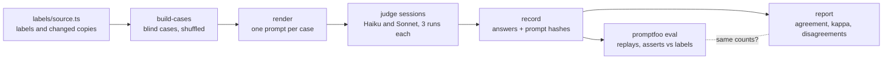

# llm-judge-check

Checks an LLM-as-judge against human labels. The judge reads an acceptance criterion and the AI-written Playwright tests for it, and answers whether the tests really check it: **covered**, **partial** or **missing**. Its answers are compared with labels a person decided, case by case, and the report gives agreement, Cohen's kappa, which weak tests the judge caught, and every case where it disagreed.

**In plain English:** people are starting to let one AI grade another AI's work. Before trusting the grader, you check it against a person's answers on the same questions. This package does that check, and its main finding is about the grading instructions, not the AI.

Written in TypeScript (Node 24 runs the `.ts` files directly). [promptfoo](https://www.promptfoo.dev/) runs the eval; the browser checks use Playwright.

---

## Results

67 cases: the 43 acceptance criteria of the ten Day 4 feature files, judged against the AI-written specs exactly as generated, plus 24 copies with one test changed on purpose (16 plain, 8 subtler). The human labels: 43 covered, 15 partial, 9 missing.

Two judges (Claude Haiku 5.5 and Claude Sonnet 5.5), three runs each, with two versions of the grading instructions (the rubric). A judge's verdict is the majority of its three runs.

| Judge | Rubric | Agreement | Kappa | Weak real tests caught | Subtler variants right |
|---|---|---:|---:|---:|---:|
| Haiku | v1 | 57/67 (85%) | 0.71 | 1 of 6 | 5 of 8 |
| Haiku | v2 | 61/67 (91%) | 0.82 | 2 of 6 | 6 of 8 |
| Sonnet | v1 | 56/67 (84%) | 0.67 | 1 of 6 | 4 of 8 |
| Sonnet | v2 | 61/67 (91%) | 0.82 | 2 of 6 | 7 of 8 |

Full tables, confidence intervals, confusion matrices and every disagreement: [REPORT.md](REPORT.md).

### What it found

- **The judges agreed with whoever wrote the rubric, not with the reviewer.** Under v1, both judges matched the first-draft labels on 61–64 of 67 cases, and the human labels on 56–57. The reviewer went through all 67 drafts and changed 7. On the six real tests the reviewer called partial, the v1 judges caught one. The rubric had told them "one example is enough", which is looser than the reviewer's rule.
- **Rewriting the rubric from the reviewer's rules helped, but only so far.** Rubric v2 ([`judge/prompt-v2.md`](judge/prompt-v2.md)) states the rules as general principles. Agreement went from 84–85% to 91%, and kappa from about 0.7 to 0.82. Five of the six v2 runs beat every v1 run; the sixth equalled them. But four real cases stayed wrong in all twelve runs, even with the rule written out: a details-page test that checks only the address (J07), two cart tests that compare only names (J40, J57), and a race where the test doesn't wait for the page (J11).
- **More rules made the judges less consistent.** All three Sonnet runs gave the same verdict on 65 of 67 cases under v1 and on 58 under v2. With v2, a single run scored anywhere from 56 to 62; with v1, 56 or 57. One run is not a measurement: the report uses the majority of three.
- **All six v1 runs were wrong the same way on an unawaited `expect`.** They called it "missing", the common belief. Playwright 1.64 actually fails the test when an unawaited assertion is still pending at the end: a wrong value fails, the right value passes 20 of 20 ([evidence](evidence/label-evidence.spec.ts)). Under v2, which tells the judge to go by what happens at runtime, five of six still said missing.
- **A judge found a mistake in the human labels.** The reviewer changed J29 ("adding a product increments the badge by 1", tested only from an empty cart) to partial. The v2 judges answered covered, because another test in the same file adds two products and expects 2, which catches the bug the reviewer had in mind. Under the reviewer's own rule (any test in the suite counts), they were right, and the label went back to covered (J27 likewise). A disagreement can be a label error, not a judge error.
- **My own draft label was wrong once, and the evidence suite caught it.** J65 (`not.toHaveText` on an error message) was drafted "missing" on the belief that it passes when no error is shown. It doesn't: Playwright fails a negative check on an element that isn't there. It is partial, and all six v1 runs made the same mistake I had.
- **A real weak test in the regression suite.** Checking J11 at runtime showed the AI-written cart test clicked the cart before the details page had rendered in 5 of 20 runs, so it didn't always test what its title says. Fixed in [`ai-test-generator/tests/regression`](../ai-test-generator/tests/regression/cart-persistence.spec.js) and recorded in that run's [FIXES.md](../ai-test-generator/eval/runs/claude-code-2026-10-16/FIXES.md) as the second human fix (60 of 60 after).
- **Round 1 was too easy.** Against the first-draft labels, all three Haiku runs agreed on all of the first 59 cases, and Sonnet on 57–59. The deliberately weakened copies were obvious. Round 2 added 8 subtler ones (a selector that doesn't exist, a swallowed failure, a check inside `if (isVisible)`, a negative check, the wrong sort option, a loose pattern, an unawaited `expect`, and a harmless rewrite), where the v1 judges got 4–5 of 8.
- **Haiku did as well as Sonnet.** On this task the smaller model matched or beat the larger one, and was the only one to spot the nonexistent selector under v1 (3 of 3, Sonnet 0 of 3).

## How it works



1. **Cases** ([`labels/source.ts`](labels/source.ts) → [`src/build-cases.ts`](src/build-cases.ts)). The real cases use the unedited specs from the Day 4 eval run. The changed copies are written as exact find-and-replace edits on those specs. Case IDs and file names are shuffled with a fixed seed, so a judge can't tell a copy from an original by its name, and the labels live in a separate folder the judges never see. Round 2 was added after round 1 had been judged, without renumbering it.
2. **Human labels.** I drafted a label and a reason for every case. The reviewer went through all 67 in [`labels/review-sheet.md`](labels/review-sheet.md), changing 7 and giving reasons. The rules they used are in [`labels/GUIDE.md`](labels/GUIDE.md). A test fails if the sheet and the labels ever disagree.
3. **Evidence for labels that depend on Playwright** ([`evidence/label-evidence.spec.ts`](evidence/label-evidence.spec.ts), 10 tests against the live site). For each "missing" label that rests on how Playwright behaves, it puts the site in a state where the outcome did *not* happen and shows the weak check passing anyway. For the unawaited `expect`, it shows the reverse.
4. **Judges.** No API key: each run is a fresh Claude Code subagent (as on Day 4) that may read only the rendered prompts, one file per case, and writes its answers to a file. Its transcript was checked afterwards: every session read only its prompt files. One v2 session (sonnet-v2-1) wrote its answer file with a shell command, against its instructions; it read nothing else.
5. **Record** ([`src/record.ts`](src/record.ts)). Refuses missing, duplicate or unknown answers and stores the SHA-256 of every prompt the run answered.
6. **promptfoo** ([`promptfooconfig.yaml`](promptfooconfig.yaml)). A replay provider ([`promptfoo/replay-provider.mjs`](promptfoo/replay-provider.mjs)) returns the recorded answer, but only if the prompt promptfoo rendered has the recorded hash. Each answer is asserted against the human label. [`src/eval.ts`](src/eval.ts) runs it and checks, independently of the provider, that every rendered prompt matches and that promptfoo's pass count equals this package's own count for every run. To run a live judge instead, add a provider such as `anthropic:messages:<model>` (needs `ANTHROPIC_API_KEY`).
7. **Report** ([`src/report.ts`](src/report.ts), [`src/stats.ts`](src/stats.ts)). Kappa corrects agreement for chance: a judge that always said "covered" would agree on 43 of 67 cases (64%) and score a kappa of 0. Weighted kappa counts "partial" for "missing" as half wrong. Intervals: Wilson for agreement (shared with flaky-test-analyzer), a seeded bootstrap for kappa.

## Usage

```bash
npm ci
npm test            # 19 unit tests: statistics, cases, labels, runs
npm run check       # cases and report up to date; promptfoo replay matches the report
npm run evidence    # the 10 label-evidence tests in a browser
npm run report      # rewrite REPORT.md and results/summary.json
```

To judge again: `node src/render.ts <folder> v2`, have a fresh session answer the prompts, then `node src/record.ts <answers.json> <name> <model> v2 all`, add the run to `promptfooconfig.yaml`, and `npm run report`.

## Kept honest

- The cases are rebuilt in CI and must match the committed files byte for byte.
- Every recorded run must have answered every case, and every prompt's hash must match the prompt rendered today from the committed rubric and cases; editing a case or a rubric after judging fails the build.
- The judge-facing files may not contain a label, a verdict word or a variant key.
- promptfoo and the report must reach the same count on every run.
- 11 deliberate breaks, each caught: a label changed without rebuilding, a case edited after judging, the rubric edited after judging, a label word leaked into the cases, a recorded verdict changed, a run left out of the promptfoo config, a wrong chance term in kappa, a lenient tie-break, the review sheet and labels disagreeing, a variant whose edit no longer applies, and the replay provider skipping its hash check. The last one first went unnoticed by `npm run eval`; the eval now hashes promptfoo's rendered prompts itself.

## Limits

- **The human labels are one person's**, confirmed against my drafts rather than written blind, so they may lean toward the drafts. A second reviewer would show how much two people agree before asking how much a judge agrees with one.
- **Rubric v2 was written after seeing these cases.** Its score is optimistic: the rules came from reviewing these exact tests. A fresh set of cases, labelled before the rubric is changed again, is the fair test.
- **The judges are Claude models running as Claude Code subagents**, not raw API calls, so their system context differs from a production judge's. Each session answered its cases in order in one context, so earlier answers could influence later ones.
- **67 cases is a small set.** The intervals in the report are wide, and the subtler-variant results rest on 8 cases.
- **The tests are judged against a third-party demo site**, as it behaved on 2026-10-19.
