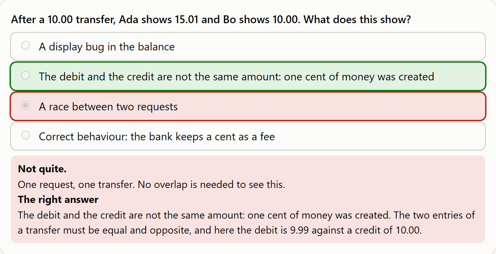

[](docs/banner.svg)

# money-course

**Testing money in software** is a short course for testers, built on this repository's banking API. It takes about two hours: three modules with hands-on labs, a quiz for each of six objectives, and an ungraded practical in which a copy of the banking API has six bugs planted for you to find. A retention check two weeks later shows what stuck. The content was drafted with AI and reviewed by the author, and it is being run as a **pilot** with a few people. The first run has not happened yet.

**In plain English:** money software fails in small, quiet ways: a cent created by a transfer, a retry that pays twice, twenty requests at once that spend the same hundred dollars. A tester who has seen these once finds them. This course shows them on a real API and lets you hunt them, with answers you can check yourself and no score.

**[Technical guide →](TECHNICAL.md)**

[](docs/quiz-feedback.png)

*One quiz question. A wrong answer is marked, its own explanation is shown, and so is the right answer with the reason. Nothing is graded. ([dark version](docs/quiz-feedback-dark.png))*

## Installation

```bash
cd packages/money-course && npm ci
```

Node 24 or later. The course needs no other software: the practical runs a copy of the [banking API](../banking-api) that ships in this repository, and the labs use curl or a few lines of Node.

## Quick start

```bash
npm run quiz        # the quiz on http://127.0.0.1:4300/ (also published on the dashboard site under /course/)
npm run practical   # the banking API with six planted bugs on http://localhost:4200
```

Then start with [the objectives](content/objectives.md) and the three modules.

## The course at a glance

| Part | What | About |
|---|---|---|
| [Objectives](content/objectives.md) | Six, each written as something a person does that someone else can watch | |
| [Module 1](content/module-1-exact-money.md) | Exact amounts and currencies (O1, O2) | 20 min |
| [Module 2](content/module-2-ledger-and-retries.md) | The ledger and retried requests (O3, O4) | 20 min |
| [Module 3](content/module-3-overlap-and-refusals.md) | Requests at the same time, and refusals (O5, O6) | 20 min |
| [Quiz](quiz/index.html) | 18 questions, three for each objective, feedback on every answer, before and after | 10 min each |
| [Practical](practical/brief.md) | Find six planted bugs, check yourself with a [checklist](practical/checklist.md) and a [model answer](practical/model-answer.md) | 45 min |
| [Retention check](pilot/pilot.md#the-retention-check-and-when-it-is-due) | Six new questions, two weeks later | 5 min |

## At a glance

- Six objectives, each worded as observable behaviour: the learner can send, list, add, predict, show or tell
- A quiz page with 18 questions and feedback on every answer, and six more questions for the retention check
- A practical with six bugs planted in a copy of the real banking API, one for each objective
- A model answer that is also code: it passes on the real API and fails on each planted bug, and only that one
- Nothing is graded: the practical is self-checked, and the quiz shows where to look again
- The quiz stores and sends nothing: at the end it gives one line to copy
- A test fails if an objective has no quiz question, no planted bug or no checklist row
- A pilot plan with anonymous codes, a record table and a five-question survey; the pilot is not run yet
- 30 checks in CI, and the quiz page is tested in Chromium and Firefox

## Results

| Result | Number | Source |
|---|---|---|
| Planted bugs caught by the model answer, each by its own check only | 6 of 6 | [Proof](TECHNICAL.md#the-model-answer-is-proven-against-each-bug) |
| Model-answer checks that pass on the real API | 6 of 6 | [Proof](TECHNICAL.md#the-model-answer-is-proven-against-each-bug) |
| Tests | 10 model-answer, 10 course rules, 10 quiz page (in two browsers) | [Results](TECHNICAL.md#results) |
| Deliberate breaks caught | 14 of 14 (one was missed at first, and a test was added) | [Deliberate breaks](TECHNICAL.md#deliberate-breaks) |
| Pilot | Not run yet | [Pilot plan](pilot/pilot.md) |

## License

MIT
