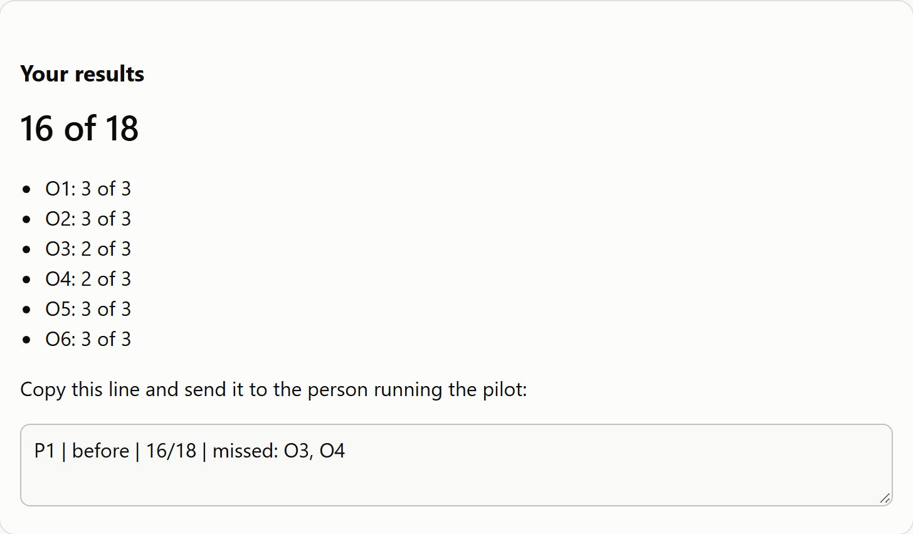

[← Back to overview](README.md)

# money-course: technical guide

## Contents

- [How it is built](#how-it-is-built)
- [The objectives, the quiz and the planted bugs](#the-objectives-the-quiz-and-the-planted-bugs)
- [The model answer is proven against each bug](#the-model-answer-is-proven-against-each-bug)
- [The quiz page](#the-quiz-page)
- [The pilot and the retention check](#the-pilot-and-the-retention-check)
- [Configuration](#configuration)
- [CI integration](#ci-integration)
- [Results](#results)
- [Deliberate breaks](#deliberate-breaks)
- [FAQ](#faq)
- [Troubleshooting](#troubleshooting)
- [Development](#development)

## How it is built

```text
packages/money-course
  content/     objectives.md and three modules with labs (markdown)
  quiz/        index.html, quiz.js, quiz.css, questions.json: the whole quiz, static files
  practical/   brief.md, checklist.md, model-answer.md
  pilot/       pilot.md: plan, record table, survey, how the pilot is reported
  src/         plant.ts (the bugs), model-answer.ts (the checks), practical.ts, serve-quiz.ts, proof.ts, screenshots.ts
  test/        model-answer.test.ts and course.test.ts (node:test)
  tests/       quiz.spec.ts (Playwright, Chromium and Firefox)
```

Everything runs on Node 24 with no runtime dependencies: the quiz is three static files, the practical server is the banking API itself, and Playwright is only used to test the quiz page.

## The objectives, the quiz and the planted bugs

One thread runs through the package: **objective, quiz questions, planted bug, checklist row, model-answer section.** [questions.json](quiz/questions.json) holds the objectives and every question, and [test/course.test.ts](test/course.test.ts) fails if any link in the thread is missing.

| # | The learner can | Quiz | Planted bug | Where it is planted |
|---|---|---|---|---|
| O1 | send an amount as a string, as a JSON number and with one decimal too many, and name the answer each must get | Q01 to Q03 | One decimal too many is accepted | `src/money.ts`, the decimals pattern |
| O2 | list the decimals of CAD, USD, JPY and KWD, and write one deposit for each | Q04 to Q06 | Yen is given two decimals | `src/money.ts`, `JPY: 0` |
| O3 | add up the balances before and after a transfer and show no money was created or lost | Q07 to Q09 | The debit is one minor unit short of the credit | `src/ledger.ts`, the debit entry |
| O4 | send a request twice with one Idempotency-Key and predict replay or refusal | Q10 to Q12 | The amount is left out of the key's fingerprint | `src/app.ts`, `fingerprint()` |
| O5 | send twenty overlapping transfers and show it was not overdrawn | Q13 to Q15 | Funds are not checked again when the money is written | `src/ledger.ts`, `apply()` |
| O6 | send a refused request and tell a refusal from a server fault | Q16 to Q18 | A transfer to the same account fails with a 500 | `src/ledger.ts`, `check()` |

The objectives are checked for the words that make them observable. A test fails unless each begins "The learner can" followed by one of `send, list, add, predict, write, show, run, compare, tell`, and fails on `know`, `understand`, `learn`, `appreciate` and the like, which no one can watch.

### Planting the bugs

[src/plant.ts](src/plant.ts) copies the banking API's `src/`, `sql/` and `public/` into a temporary folder and changes one piece of text per bug. Nothing in `packages/banking-api` is touched. Each change must match **exactly once**, or the copy is refused:

```ts
export function replaceOnce(text: string, find: string, replace: string): string {
  const parts = text.split(find);
  if (parts.length !== 2) throw new Error(`expected exactly one match of ${JSON.stringify(find)}, found ${parts.length - 1}`);
  return parts.join(replace);
}
```

So a later change to the banking API that moves one of these lines fails a test here ("found 0") instead of leaving a practical with a bug missing.

## The model answer is proven against each bug

[practical/model-answer.md](practical/model-answer.md) tells the six checks in words. [src/model-answer.ts](src/model-answer.ts) is the same six checks as code: each sends real requests to a banking API and reports what it saw. The test starts the real API and then a copy with each bug planted alone, and asserts which checks fail. `npm run proof` prints it:

| Banking API | O1 | O2 | O3 | O4 | O5 | O6 |
|---|---|---|---|---|---|---|
| unchanged | pass | pass | pass | pass | pass | pass |
| bug O1 planted | **FAIL** | pass | pass | pass | pass | pass |
| bug O2 planted | pass | **FAIL** | pass | pass | pass | pass |
| bug O3 planted | pass | pass | **FAIL** | pass | pass | pass |
| bug O4 planted | pass | pass | pass | **FAIL** | pass | pass |
| bug O5 planted | pass | pass | pass | pass | **FAIL** | pass |
| bug O6 planted | pass | pass | pass | pass | pass | **FAIL** |
| all six planted | **FAIL** | **FAIL** | **FAIL** | **FAIL** | **FAIL** | **FAIL** |

What each check saw against its planted bug:

| Bug | What the API did |
|---|---|
| O1 | `"1.005"` CAD answered `201`, balance `10.05` |
| O2 | `"1250"` JPY answered `"1250.00"`, and `"100.50"` JPY answered `201` |
| O3 | After sending 10.00 from 25.00: sender `15.01`, receiver `10.00` |
| O4 | Same key, 5.00 then 6.00: second answer `201`, replayed |
| O5 | 20 of 20 went through, sender balance `-100.00` |
| O6 | A transfer to the same account answered `500 internal` |

Making each check judge only its own bug took one fix: the first O5 check also failed when the O3 bug was planted, because the short debit leaves 0.10 behind. O5 now counts the transfers that went through (exactly 10 of 20) and tests that the balance is not negative, which the O3 bug does not change.

## The quiz page

Three static files and `questions.json`, no build and no server logic. [quiz/quiz.js](quiz/quiz.js) draws one `<fieldset>` for each question, with a `<legend>` and radio buttons, so a keyboard or a screen reader can use it. A chosen answer is locked at once, marked right or wrong, and followed by the feedback written for that option; a wrong answer also shows the right one with its reason. The results button is disabled until every question is answered.

| URL | Questions |
|---|---|
| `/` or `/?mode=before` | the 18, before the course |
| `/?mode=after` | the same 18, after it |
| `/?mode=retention` | six new ones, one for each objective, two weeks later |

At the end the page shows the score for each objective and one line to copy, such as `P1 | before | 16/18 | missed: O3, O4`. The page stores nothing and sends nothing, so there is no personal data to protect.

[](docs/quiz-results.png)

*The results panel ([dark version](docs/quiz-results-dark.png)).*

It uses the dashboard's light and dark colours (`prefers-color-scheme`), and fits a 375 px phone screen without sideways scrolling. The published copy is at `https://rizvihiqrar.github.io/qa-automation-platform/course/`: the Dashboard workflow copies `quiz/` into the site.

## The pilot and the retention check

[pilot/pilot.md](pilot/pilot.md) holds the plan and an empty record table. It is a pilot of the author and two or three other people, identified by codes (P1 to P4), with no names. The steps are the before quiz, the modules, the after quiz, the practical, a five-question survey, and the retention quiz **14 days after the after quiz**. For the earliest possible start, Friday 2026-10-23, the first retention check is due Friday 2026-11-06. A test checks that the due-date rule is written down.

It is reported as a pilot, with counts and not percentages, and it says what it does not show: Kirkpatrick levels 1 and 2 are measured (the survey, the quiz and the practical), level 3, whether anyone's test code changes at work, is not.

## Configuration

| Setting | Default | What it does |
|---|---|---|
| `PORT` for `npm run quiz` | `4300` | Port the quiz is served on |
| `PORT` for `npm run practical` | `4200` | Port the practical API listens on |
| `QUIZ_URL` for `npm run screenshots` | `http://127.0.0.1:4300/` | Page the images are taken from |
| `?mode=` | `before` | `before`, `after` or `retention` |

The practical API makes each request wait 150 ms in a pretend outside check (the banking API's own `SCREENING_DELAY_MS`), so overlapping requests overlap. `startVariant(ids, { screeningMs })` in `src/plant.ts` sets it.

## CI integration

One job, `money-course`, in [ci.yml](../../.github/workflows/ci.yml). It installs Chromium and Firefox through the repository's install script, which retries and waits for a running apt:

```yaml
- { package: money-course, browsers: true, browserList: chromium firefox, command: npm test }
```

`npm test` runs the Node tests (the model answer against the real API and each planted copy, and the course rules) and then the quiz page in both browsers. Pull requests that change `tests/` also go through the burn-in job: three runs, no retries, in both browsers. The Dashboard workflow publishes the quiz at `/course/`.

## Results

| Suite | Tests | Time |
|---|---:|---|
| `test/model-answer.test.ts` | 10 | about 2 s |
| `test/course.test.ts` | 10 | under 1 s |
| `tests/quiz.spec.ts`, each of Chromium and Firefox | 10 | about 15 s together |

Run three times in a row before the pull request, the quiz tests passed 20 of 20 each time (10 tests, two browsers), and the Node tests 20 of 20.

## Deliberate breaks

Each mistake was put in, the tests run, and the code put back.

| # | Mistake | Caught by |
|---|---|---|
| D01 to D06 | The model-answer check for O1, O2, O3, O4, O5 or O6 always passes (one at a time) | The test for that bug, and the all-six test |
| D07 | A wrong answer shows the right option's feedback | Wrong-answer test |
| D08 | Questions stay open after an answer | Wrong-answer test |
| D09 | The list of missed objectives is never filled | Two result tests |
| D10 | The results button is enabled with 5 questions left | **Not caught** at first |
| D10 again | The results button is enabled with 1 question left | The new button test (added after D10 was missed) |
| D11 | An objective says "know" | Observable-behaviour test |
| D12 | One answer option has no feedback | Feedback test |
| D13 | An objective loses a question | Question-count test |
| D14 | The banking API line that bug O3 changes is edited | The O3 test and the all-six test (found 0 matches) |

## FAQ

### Why a copy of the banking API and not a flag in it?

A flag would put six bugs into the package the rest of the repository tests, and a learner reading the code would find them. The copy is made when the practical starts, in a temporary folder.

### Why does the quiz not save scores?

So there is nothing to protect and nothing to host. The page gives a line; the person running the pilot records it.

### Why are the questions the same before and after?

So the difference is the course. The retention check uses new questions so a good score cannot be memory of the quiz.

### Is the practical really ungraded?

Yes. It has a checklist and a model answer, and the feedback is the comparison. There is no score, and nobody sees the learner's answers.

### Why six objectives?

Each is a mistake this repository's banking API collected on the way to its 78 deliberate breaks, and each can be checked from outside with requests and answers, so the learner needs no source code.

## Troubleshooting

| Problem | Cause | Fix |
|---|---|---|
| The quiz says the questions could not be loaded | The page was opened as a file | Run `npm run quiz` and open http://127.0.0.1:4300/ |
| `npm run practical`: address in use | Something is on port 4200 | Set `PORT` to another port |
| A test says `expected exactly one match ... found 0` | The banking API changed a line a planted bug depends on | Update that bug's `find` text in `src/plant.ts` |
| `npm run proof` prints a stack trace | The planted O6 bug makes the API log its 500 | Expected; the table is printed after it |
| Playwright: browser not found | The browsers are not installed | `npx playwright install chromium firefox` |

## Development

```bash
npm ci
npm test               # model answer, course rules, quiz page in two browsers
npm run test:course    # the Node tests only
npm run test:quiz      # the quiz page only
npm run proof          # the table above
npm run screenshots    # redo docs/*.png (start npm run quiz first)
```
