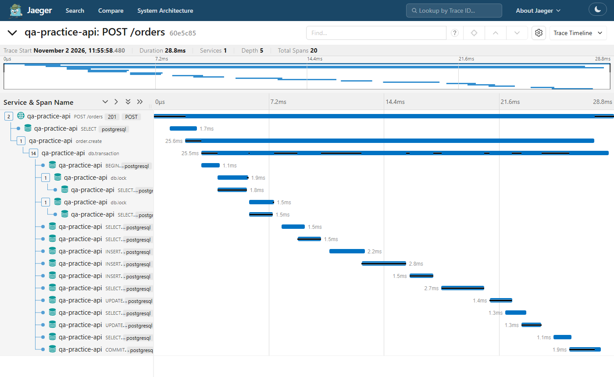

# qa-practice-api

A purpose-built REST API for QA automation practice. Unlike third-party public APIs, this one is fully under your control — you can read the source, add edge cases, break things intentionally, and write tests against known behaviour.

**In plain English:** A small online-shop backend (users, products, orders) built for practising testing. Other packages in this repo test it, and they have found and fixed real bugs in it.

Built with Node.js and Express, in strict TypeScript that Node 24 runs directly (no build step). Keeps its data in memory by default, so it needs nothing else and starts in seconds; set `DATABASE_URL` and it uses Postgres instead. The same tests run on both ([how the store works](TECHNICAL.md)). It also reports what it does with OpenTelemetry, and the tests check those reports too ([traces and metrics](#traces-and-metrics)). On Postgres, Toxiproxy slows down, cuts and silences the line to the database, and the tests check what the API does then ([when the database misbehaves](#when-the-database-misbehaves)).

## Stack

- **Runtime:** Node.js 24 + Express, TypeScript run by Node's type stripping
- **Data:** an in-memory store (`src/db/memory.ts`), reset on every restart, or Postgres (`src/db/postgres.ts`) when `DATABASE_URL` is set; Testcontainers starts a throwaway Postgres in Docker for the tests
- **Auth:** JWT (`jsonwebtoken`, HS256, checked against the account on every request) + scrypt password hashing (Node's built-in `crypto.scrypt`, which runs off the event loop; see [k6-performance](../k6-performance) for why it replaced bcryptjs)
- **Observability:** OpenTelemetry traces and metrics, sent over OTLP to a small receiver in the tests or to a local Jaeger
- **Resilience:** Toxiproxy (in Docker, started by Testcontainers) between a test server and Postgres; connect and query timeouts, one safe retry, and a 503 when the database is down
- **Tests:** Playwright API mode (no browser)
- **CI:** GitHub Actions, as one job in the monorepo pipeline

## Quick Start

```bash
npm install
npm start              # http://localhost:4000
npm run dev            # with --watch restart
```

## Running Tests

```bash
npm test               # full suite (starts server automatically)
npm run test:smoke     # @smoke tagged tests only
npm run test:properties  # 17 fast-check properties, about 10 seconds
npm run test:postgres  # the suite on a fresh Postgres in Docker (needs Docker running)
npm run scoreboard     # put each of the AI's mistakes back, record what catches it
npm run test:mutation  # Stryker; MUTATION_TESTS=designed or properties (see stryker.config.mjs)
npm run jaeger         # a local Jaeger in Docker; then npm run start:jaeger and open http://localhost:16686
```

`npm test` uses the in-memory store, so each run starts empty and no state leaks between runs. `npm run test:postgres` starts a fresh Postgres 17 container and a Toxiproxy container with Testcontainers, runs the same suite against it plus 19 Postgres-only checks, and removes the containers; CI runs both (`qa-practice-api` and `qa-practice-api-postgres`). The test server is seeded with an admin (`ADMIN_EMAIL` and `ADMIN_PASSWORD`, which `playwright.config.ts` passes from `tests/admin.ts`), and `tests/global-setup.ts` signs it in once for every test that needs it.

309 tests: 38 written first, one or a few per route; 119 in `tests/design` that come from a written [test strategy and test plan](../../docs/test-strategy/README.md); 126 in `tests/discounts` for the AI-written discount codes; 4 header checks, 5 unit tests of the sign-in limiter, 1 keep-alive check, 8 [concurrency tests](tests/concurrency.spec.ts) (many orders, sign-ups or cancels at the same moment) and 8 trace tests ([telemetry.spec.ts](tests/telemetry.spec.ts), [tracing.spec.ts](tests/tracing.spec.ts)). On Postgres, 19 more in [tests/postgres](tests/postgres) (328 in all): the data is really in the tables, the schema refuses negative stock and repeated emails by itself, a second server sees the same data, a failed transaction leaves nothing, a locked row makes the next transaction wait, money comes back exact, an id too big for the column is a 404, the traces show each SQL statement and how long an order waited for a locked row, and 9 [resilience tests](tests/postgres/resilience.spec.ts) put faults on the line to the database ([below](#when-the-database-misbehaves)). With the row locks removed, 6 of the 8 concurrency tests fail on Postgres (ten buyers all got the last item). The 119 were designed with named techniques: equivalence partitioning (20), boundary value analysis (25), decision tables (23), state transitions (29) and an access-control matrix (22). Each test's title starts with its case ID from the plan. The first 85 found 9 defects the first 38 had missed; the access-control and sign-in cases found 8 security defects ([below](#security)). All are fixed.

The 126 discount cases each name the spec rule they check (`DC-BVA-14 [DC-R04] …`): boundary values (43), decision tables (21), equivalence partitioning (36), access control (14), state transitions of a code's uses (6) and the spec's worked examples (6). Run on the AI's code before any fix, 12 failed; the [code review](../../docs/ai-written-code/code-review.md) lists what each one found.

`tests/properties` holds 17 [property-based tests](../../docs/ai-written-code/properties-and-mutation.md) (fast-check, run by `node --test`, not Playwright). They import the app and serve it on a free port in their own process, so they make hundreds of requests a second and mutation testing can reach the route code through them. Expected amounts come from BigInt cents read from the amount's text, never from the code's own arithmetic. One found that an order had no upper limit and lost cents past 2^53 (orders above 999,999,999.99 are now refused); [`scoreboard/`](scoreboard) puts each mistake the AI made back and records which tests catch it.

`tests/rate-limit.spec.ts` tests the sign-in limiter's window with a fake clock, which the API tests can't wait 15 minutes for. `tests/password.spec.ts` holds two unit tests for password hashing. One checks that hashing eight passwords keeps the event loop free (0–11% busy measured, against 100% for hashing on the main thread), which guards the bug [k6 found](../../docs/rca/01-login-hashing-blocked-the-api.md) in about a second instead of a minute of load.

`tests/keep-alive.spec.ts` holds a raw connection idle for 7 seconds and checks that the server still answers on it. Playwright keeps every connection in one pool per worker and never closes an idle one itself. Node's default closed them after 6 seconds, so DC-ST-06, which signs up ten customers at once, sometimes reused a connection just as the server closed it and failed with "socket hang up" (Linux only). The server now keeps idle connections for 65 seconds (`src/server.ts`).

## Traces and metrics

The API reports each request as a **trace**: a tree of timed steps called spans. Placing an order makes a span for the request, one for the order, one for its database transaction and one for each product row it locks. On Postgres each SQL statement is a span too. It also keeps **metrics**: orders placed, orders refused by reason, and how long each route takes to answer.



*One order on Postgres in Jaeger (`npm run jaeger`, then `npm run start:jaeger`): 20 spans, 15 of them SQL statements (one, the sign-in check, before the transaction).*

The tests read the same data. `playwright.config.ts` starts a small [OTLP receiver](scripts/otlp-receiver.ts) next to the API and points the API at it. Each test sends its own trace id in a `traceparent` header and asks the receiver for that trace, so tests running at the same time never read each other's spans. They check:

- **The shape of an order's trace** (OT-01): every parent and child link, a commit, and the locks taken lowest id first.
- **A refused order** (OT-02): marked as failed on the order span with its reason (`out_of_stock`), while the request span stays unset, because a 4xx is the caller's mistake.
- **Route templates** (OT-03, OT-04): spans and timings use `/products/:id`, never `/products/17`, so a metric can't grow one series per product.
- **The counters** (OT-04): they go up by at least the test's own orders.
- **No secrets** (OT-05): no password, token or email in any span.
- **A crash and a hang-up** (OT-07, OT-08): a 500 thrown inside a router keeps its route, and a client that hangs up before the reply counts as aborted, not as a 200.
- **A real lock wait on Postgres** (PG-10): the test holds a product row itself and waits until Postgres reports the order is blocked. Once it lets go 400 ms later, the order's `db.lock` span must last at least 400 ms.

Eleven bugs were put back one at a time, and each was caught. Ignoring the caller's `traceparent` failed 5 of the 6 trace tests. The full list is in [TECHNICAL.md](TECHNICAL.md#traces-and-metrics).

## When the database misbehaves

A database usually sits across a network, and networks have bad moments: replies arrive late, a connection drops in the middle of a call, or the line goes quiet with no reply and no hang-up. [Toxiproxy](https://github.com/Shopify/toxiproxy) is a small proxy that does these things on purpose. The tests put it between a second API server and Postgres, then tell it what to break. The suite's own server keeps a direct line, so no other test sees a fault.

What the API does now:

- **Waits a set time, then answers 503.** 3 seconds to get a connection, 5 for a reply (settings `DB_CONNECT_TIMEOUT_MS` and `DB_QUERY_TIMEOUT_MS`). Postgres also stops the statement itself after 5 seconds, so a request the API gave up on can't keep a row locked. The 503 says `{ "error": "Database unavailable" }` with `Retry-After: 2`, never the driver's message. When a write was cut after it was sent, the API can't know whether it was saved, so that 503 has no `Retry-After` and says the change may have been saved: check before sending it again.
- **Tries again once, only when that is safe.** A failed connect, or a read whose connection dropped, is tried again after 200 ms. A write that was already sent is never sent again, because the database may have saved it before the line broke. A timeout isn't retried either, because the caller would wait twice as long.
- **Says when it can't serve.** `GET /health/ready` asks the database, and answers 503 while it is down. `GET /health` still answers 200 as long as the process runs.

| Test | Fault | What the test checks |
|---|---|---|
| RS-01 | none | the proxied server answers like the direct one |
| RS-02 | replies 400 ms late | slow but fine: 200, at least 400 ms |
| RS-03 | replies 5 s late | 503 at the 1.5 s query timeout, not after 5 s; not retried; the SQL span says `Query read timeout` |
| RS-04 | connection cut mid-read | tried once more, 200; the trace shows a `db.retry` event and two SELECT spans |
| RS-05 | connection cut after a sign-up's INSERT ran | exactly one account, and a 503 that says it may have been saved (no `Retry-After`). A retry would have answered "Email already in use" for the caller's own new account |
| RS-06 | connection cut while an order waits for a row lock | 503, no order, stock unchanged, transaction rolled back, no retry |
| RS-07 | line goes silent | 503s within the timeouts, `/health/ready` 503, then 200 again once the line is back |
| RS-08 | line down, back 250 ms into a request | the failed connect is tried again after the pause and succeeds |
| RS-09 | line down during six sign-ins | six 503s, and the owner can sign in once it is back: an outage doesn't use up the 5 attempts |

The tests use shorter timeouts (1 s, 1.5 s and 500 ms) so they finish quickly. The first run found a real crash: when a connection broke in the middle of a query, the whole API process stopped. Now it answers 503 and keeps running ([details](TECHNICAL.md#resilience-toxiproxy)).

## API Reference

### Health
| Method | Route | Auth | Notes |
|---|---|---|---|
| GET | `/health` | No | Returns `{ status: "ok", timestamp }` while the process runs |
| GET | `/health/ready` | No | Returns `{ status: "ready" }` when the database answers, otherwise 503 |

### Auth
| Method | Route | Auth | Notes |
|---|---|---|---|
| POST | `/auth/register` | No | Returns `{ user, token }` |
| POST | `/auth/login` | No | Returns `{ user, token }`. 5 attempts per email and client in 15 minutes without a success, then `429` with `Retry-After`. An attempt the database was down for doesn't count |
| GET | `/auth/me` | Yes | Returns current user |

### Users
| Method | Route | Auth | Notes |
|---|---|---|---|
| GET | `/users` | Admin | Paginated. `?page=&limit=` |
| GET | `/users/:id` | Yes | Own account only (or admin) |
| PUT | `/users/:id` | Yes | Own account only (or admin) |
| DELETE | `/users/:id` | Yes | Own account only (or admin) |

### Products
| Method | Route | Auth | Notes |
|---|---|---|---|
| GET | `/products` | No | Paginated. `?category=&page=&limit=` |
| GET | `/products/:id` | No | |
| POST | `/products` | Admin | |
| PUT | `/products/:id` | Admin | |
| DELETE | `/products/:id` | Admin | |

### Orders
| Method | Route | Auth | Notes |
|---|---|---|---|
| GET | `/orders` | Yes | Current user's orders (admin: all) |
| GET | `/orders/:id` | Yes | Own order only (admin: any); another customer's is `404` |
| POST | `/orders` | Yes | `{ items: [{ product_id, quantity }] }` |
| PATCH | `/orders/:id/status` | Yes | `{ status: "pending\|processing\|shipped\|delivered\|cancelled" }`. Allowed moves: pending → processing or cancelled, processing → shipped or cancelled, shipped → delivered. A customer may only cancel their own order; every other move is the admin's |

`POST /orders` also takes an optional `discount_code`, and orders carry `subtotal`, `discount_code` and `discount` beside `total` (the amount to pay).

### Discount codes
| Method | Route | Auth | Notes |
|---|---|---|---|
| GET | `/discounts` | Admin | Every code |
| GET | `/discounts/:code` | Admin | Code ignores case |
| POST | `/discounts` | Admin | `{ code, type: "percent\|fixed", value, expires_at?, max_uses?, min_subtotal?, active? }` |
| PATCH | `/discounts/:code` | Admin | Only `active`, `expires_at`, `max_uses` |

Discount codes were written by an AI from a [reviewed spec](../../docs/ai-written-code/spec.md) and committed unedited, as a case study in [validating AI-written code](../../docs/ai-written-code/README.md). The [code review](../../docs/ai-written-code/code-review.md) and the 126 cases in `tests/discounts` found four defects in it, all now fixed. Property-based tests then found two more problems (a missing order limit, and valid amounts the AI's decimal check refused), and mutation testing showed where the tests checked a status but not the message; the [scoreboard](../../docs/ai-written-code/scoreboard.md) shows which technique caught what.

## Documented Edge Cases

These are intentional behaviours worth writing tests for:

| Scenario | Expected |
|---|---|
| `GET /users/999999` | `404 { error: "User 999999 not found" }` |
| `POST /auth/login` wrong password | `401` — does not distinguish wrong email vs wrong password (security best practice) |
| `POST /auth/register` duplicate email | `409 { error: "Email already in use" }` |
| `POST /products` with `price: -5` | `400 { error: "price must be a non-negative number" }` |
| `POST /products` with `price: "abc"` | `400`, same message. Found by [api-drift-checker](../api-drift-checker): this used to return `201` with `price: null`. |
| `POST /products` with `stock: -3` | `400 { error: "stock must be a non-negative whole number" }`. Also found by the drift checker; it used to return `201`. |
| `POST /orders` with quantity > stock | `400 { error: "Insufficient stock for product X (available: Y)" }` |
| `POST /orders` with two lines for the same product | Stock is checked against the combined quantity. It used to be checked line by line, so two lines of 6 against a stock of 10 were accepted and left stock at -2. |
| `PUT /products/:id` with `price: "abc"` or `stock: -7` | `400`, with the same messages as `POST`. Update used to skip these checks and store `price: null` and negative stock. |
| `POST /products` with `price: ""`, `true` or `"12.5"` | `400`. Prices, stock and quantities must be JSON numbers. `""` used to be stored as 0 and `true` as 1. |
| `POST /products` or `PUT /products/:id` with `price: 19.999` | `400 { error: "price must be in whole cents (at most two decimals)" }`. Orders add prices up in whole cents; three at 0.333 used to come to 0.99. |
| `POST /orders` with a subtotal above 999,999,999.99 | `400 { error: "Order subtotal must be at most 999999999.99" }`. There was no limit, and past 2^53 cents the subtotal lost cents (141,669,743,892,942.18 came back as …942.2). Found by a property-based test. |
| `POST /orders` with an unknown product and `discount_code: 5` | `404`, as without a code: item and stock errors come before discount code errors. |
| `POST /orders` with `quantity: 1.5` or `"2"` | `400`. A fraction used to be accepted (leaving stock at 8.5), and text quantities were joined, so `"2"` + `"3"` was checked as 23. |
| `POST /orders` with `items: [null]` | `400`. It used to crash the route with a 500 HTML page. |
| Any request with a malformed JSON body | `400 { error: "Request body is not valid JSON" }`. It used to be an HTML error page. |
| `PATCH /orders/:id/status` unknown value | `400 { error: "status must be one of: pending, processing, ..." }` |
| `PATCH /orders/:id/status` with a move the lifecycle doesn't allow | `409 { error: "Cannot change order status from delivered to pending" }`. Any move used to be accepted. |
| `PATCH /orders/:id/status` to `cancelled` | The order's stock goes back to its products. It used to stay taken. |
| `PUT /users/:id` with another account's email | `409 { error: "Email already in use" }`. It used to be accepted, leaving two accounts with one email. |
| `PUT /users/:id` for another user | `403 { error: "Cannot modify another user's account" }` |
| JWT after user deletion | `401 { error: "Account no longer exists" }` on every route. Every request now looks the account up, so a deleted account's token stops working at once. It used to keep working for the rest of its hour. |
| `GET /products?page=0` | Page clamped to `1` — no error, consistent behaviour |
| `GET /products?limit=0` | Limit clamped to `1`, like `limit=-1`. It used to fall back to 10. |
| A customer on an admin route | `403 { error: "Admin role required" }`. Product changes and the user list used to be open to any signed-in customer. |
| `role: "admin"` sent at sign-up or on `PUT /users/:id` | Ignored; the account stays a customer. No route makes an admin: start the server with `ADMIN_EMAIL` and `ADMIN_PASSWORD`. |

## Environment Variables

| Variable | Default | Notes |
|---|---|---|
| `PORT` | `4000` | Server port |
| `DATABASE_URL` | none: data in memory | A Postgres connection string. The server creates its tables if they are missing, so a restart keeps the data; `npm run test:postgres` sets it for the tests |
| `DB_CONNECT_TIMEOUT_MS`, `DB_QUERY_TIMEOUT_MS`, `DB_RETRY_DELAY_MS` | 3000, 5000, 200 | Postgres only: how long to wait for a connection and for a reply before a 503, and the pause before the one retry. `0` turns a timeout off; anything but a whole number stops the server at start-up |
| `JWT_SECRET` | random, per start | Set it to keep tokens valid across restarts (worth it only with `DATABASE_URL`, where accounts survive one). It used to default to a fixed string written in this file, so anyone could sign a token |
| `ADMIN_EMAIL`, `ADMIN_PASSWORD` | none | Both set: the server creates this admin at start-up. Neither set: there is no admin |
| `OTEL_EXPORTER_OTLP_ENDPOINT` | none: no traces or metrics are sent | Where to send them over OTLP/HTTP (JSON). The tests set their receiver; `jaeger.env` sets a local Jaeger |
| `OTEL_SERVICE_NAME`, `OTEL_BSP_SCHEDULE_DELAY`, `OTEL_METRIC_EXPORT_INTERVAL`, `OTEL_METRICS_EXPORTER` | `qa-practice-api`, 5000 ms, 60000 ms, on | The standard OpenTelemetry settings. The tests send every 50 ms and 200 ms; `none` turns metrics off (Jaeger takes traces only) |

The tests read two more, both with throwaway test-only defaults in `tests/admin.ts` (see `.env.example`): `QA_PRACTICE_ADMIN_PASSWORD`, the admin password the test server is seeded with, and `QA_PRACTICE_PASSWORD`, for the customer accounts the tests register.

## Security

Who may call what is tested case by case in [tests/design/access-control.spec.ts](tests/design/access-control.spec.ts): every protected action against no token, a customer on their own data, a customer on someone else's, the admin, and a deleted account's token. The matrix and the reasons are in the [test plan](../../docs/test-strategy/test-plan.md#access-control). Writing it found 8 defects, listed with the cases that catch them in the [strategy's results](../../docs/test-strategy/README.md#day-36-security); each fix was checked by putting the bug back.

### Security scan

The `zap-baseline` job in CI scans this API with [OWASP ZAP](https://www.zaproxy.org/) 2.17.0, running passive rules only. ZAP's plain baseline scan crawls links from the home page, and a JSON API has none, so the job runs ZAP's API scan on the [OpenAPI spec](../api-drift-checker/spec/qa-practice-api.openapi.json) with `-S` (safe mode: the passive baseline rules, no active attacks). Every documented operation is requested once, signed in as the seeded admin, and ZAP's rules check each response. The report is published with the [other test reports](https://rizvihiqrar.github.io/qa-automation-platform/reports/).

How a finding is triaged, in [zap/rules.tsv](zap/rules.tsv):

- **Fixed:** set to `FAIL`, so the job fails if it ever comes back.
- **Accepted** or **False positive:** set to `IGNORE`, with the reason below.
- **Not triaged:** anything new stays a `WARN`, which also fails the job. Someone has to decide what it is before the change can merge.

| Rule | Alert | Risk | Where | Decision | Reason |
|---|---|---|---|---|---|
| 10021 | X-Content-Type-Options Header Missing | Low | 5 responses, all those that came back 200 | Fixed | Without `nosniff`, a browser may read a JSON body as HTML or script if a value in it looks like markup. Every response now sends it, including errors from the JSON error handler ([headers.spec.ts](tests/headers.spec.ts)) |
| 90004 | Insufficient Site Isolation Against Spectre Vulnerability | Low | the same 5 responses | Fixed | No `Cross-Origin-Resource-Policy`, so another site could load these responses into its own page. Now `same-origin`: the API is only called from code, never embedded |
| 10116 | ZAP is Out of Date | Low | the scanner | Accepted | The first run pinned 2.16.1, and ZAP said 2.17.0 was out. Updated. The version stays pinned, so a ZAP release can't change the results without a commit; the rule is ignored so a new release doesn't fail unrelated changes. Updating is a deliberate change |
| 10049 | Non-Storable Content | Informational | signed-in responses | False positive | ZAP points out that responses can't be cached. That is the right behaviour for per-user data such as orders and accounts |
| 100000 | A Client Error response code was returned by the server | Informational | 8 operations, first run | False positive | On the first run these were the API correctly refusing ZAP's requests (empty bodies, `{id}` left in the URL; see below). With request examples in the spec it no longer fires, but a refused request is still the expected answer, not a defect |
| 10111 | Authentication Request Identified | Informational | `POST /auth/login` | False positive | ZAP recognising the sign-in request. Nothing to fix |
| 10112 | Session Management Response Identified | Informational | sign-up and sign-in | False positive | ZAP recognising the token in the response. Nothing to fix |

**What the first scan showed about the scan.** ZAP reached only 5 of the 13 operations with a real request. The spec described responses but not request bodies or path parameters, so ZAP sent empty bodies and requested `/products/{id}` with the braces in the URL; those 8 operations only ever answered 400 or 404, and the scan was quietly checking error pages. The spec now has request bodies and parameters with examples, and on the second run the client-error alert was gone: all 13 operations were answered normally.

**What the scan doesn't cover.** It requests each operation once, with one set of example values, and judges the responses: headers, cookies, leaked data. It doesn't attack anything. ZAP's log lists active rules such as SQL Injection as `PASS` even in safe mode, but they never ran (the whole scan takes about 3 seconds). It also can't see authorization: a customer reading another customer's order looks like any other 404 to it. That is what the access-control cases are for.
