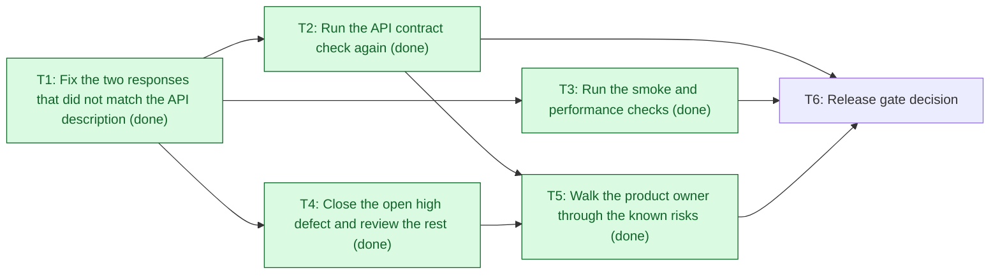

# Release plan status: 1.4.1

As of 2026-11-22.

**5 of 6 tasks done.** The plan has no problems.

## Late

- Nothing is late.

## Open risks

| Risk | Severity | Owner | Mitigation |
|---|---|---|---|
| K2: A partner integration goes live the same day, so there is no waiting period. | high | Release manager | Release it as an emergency change with a review owed within 5 days. |
| K1: The discount code path has only the smoke checks so far, not the full regression suite. | medium | QA lead | Run the discount tests again on staging after the release. |

## Problems in the plan

- None.

## Tests to rerun for this release

DS-01, DS-02, DS-03, PF-01, PF-02, PL-01, PL-02

## Dependency map

