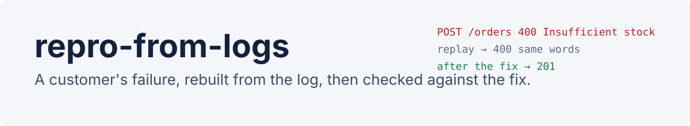

[](docs/banner.svg)

# repro-from-logs

A Python tool (pytest and requests) that takes a customer's request log, rebuilds what they did against [qa-practice-api](../qa-practice-api), and says whether the same failure came back. A case also names a fix, and the tool replays the log again with the fix in place to check that every request that failed now succeeds. Six cases are in the log set. Five failures reproduce, one honestly does not, and two fixes are verified.

**In plain English:** when a customer says "the checkout said no", support sends a log. A reproduction script turns that log back into the same requests and runs them, so an engineer sees the failure without guessing and can prove the fix. If the failure does not come back, the tool says so, because that case needs more information, not a guess.

**[Technical guide →](TECHNICAL.md)**

## Installation

```bash
cd packages/repro-from-logs
python -m venv .venv
.venv/bin/pip install -r requirements.txt      # Windows: .venv\Scripts\pip
npm ci --prefix ../qa-practice-api             # the API's own dependencies
```

Python 3.12 and Node 24 (the API runs on Node).

## Quick start

```bash
.venv/bin/python -m repro        # Windows: .venv\Scripts\python -m repro
```

It starts the API (once for each build a log came from), replays every case and prints what came back:

```text
RFL-01  reproduced      Order refused: not enough stock
        skipped lines: 1 (not JSON)
RFL-02  reproduced      Discount code refused: codes switched off
        fix: verified, the failed requests now succeed
RFL-03  reproduced      Sign-in refused after wrong passwords
RFL-04  reproduced      Discount code used up
        fix: verified, the failed requests now succeed
RFL-05  reproduced      Sign-up refused: email already in use
RFL-06  NOT reproduced  Sign-up fails with a server error
        line 1: the log has 500 'Registration failed', the replay gave 201

5 of 6 failures reproduced from the log set; 2 of 2 fixes verified
```

## At a glance

- The measure is the one in the title: failures reproduced from the log set (5 of 6), and fixes verified (2 of 2)
- A log is one JSON object per line. Start-up messages, blank lines and cut-off lines are skipped, and each skipped line is reported with its line number
- Two failures are the same only when the status and the error words match. Numbers are ignored, so product 3 on the customer's system and product 41 here are the same failure
- A case says which build its log came from. A log taken with discount codes switched off is replayed against a build with them off
- Each replay builds its own products, accounts and discount codes under names nobody used before, so cases never clash and can run in any order
- A fix is a different build or a change made as the admin, applied before the replay. It is verified only when every request that failed in the log now succeeds
- The one case that does not reproduce is kept on purpose: the log holds a 500 but not the database error behind it, so the request alone is fine
- 48 tests, 6 of them deliberate-break tests that replay against the wrong build, a changed log or a missing fix and show the check can fail

## Results

| Put back in the code, once, by hand | Tests that failed |
|---|---|
| Error text no longer compared | 3 tests |
| Numbers kept in the error text | 4 tests (the stock message names a product ID) |
| Log lines not put in time order | 1 test |
| Status no longer compared | 3 tests |
| Fix check always passes | 3 tests |
| Fix steps skipped | 2 tests |
| Same email on every run | 8 tests |
| Email mapped from the first name only | 2 tests |
| Log times compared as text | 2 tests |
| Fix check ignores a request that used to work | 2 tests |
| Masked password never replaced | 2 tests |
| One case that cannot run stops the whole run | 1 test |

All 48 tests passed in 4 runs in a row, with no retries.

## License

MIT, see the [root LICENSE](../../LICENSE).
