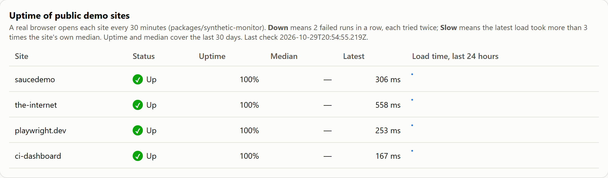

[](docs/banner.svg)

# synthetic-monitor

Scheduled browser checks on public sites, with a history. Every 30 minutes a real browser opens four sites (Sauce Demo, the-internet, playwright.dev and this repo's own dashboard), checks that each loads with the right title and shows the right element, and records how long it took. The history, the rule for when a site is down, the flag for when it is slow and the GitHub issue that opens and closes by itself are all tested, against a local site that can be made to misbehave. It is for anyone who wants to see how uptime monitoring is built from ordinary test tools, and where such a monitor can lie.

**In plain English:** a test run tells you the code was fine when someone last pushed it. A monitor tells you the site is fine right now, and keeps a record. This one never bothers anyone for a single hiccup: it tries twice, and only after two bad runs in a row does it open an issue.

**[Technical guide →](TECHNICAL.md)**

[](docs/uptime-section.png)

*The uptime section of the [CI dashboard](https://rizvihiqrar.github.io/qa-automation-platform/#monitoring), rebuilt every 3 hours from the data this package writes. Taken after the first live run, so medians and sparklines are still empty; they fill in as runs add up. The mock-ups of a slow and a down site are in the dashboard tests.*

## Installation

```bash
cd packages/synthetic-monitor && npm ci && npx playwright install chromium firefox
```

Node 24 or later.

## Quick start

```bash
npm run monitor -- --data data
```

One run: it checks the four sites, prints one line each, and adds the result to `data/history.json` and `data/summary.json`. In CI the same command runs from the [Monitor workflow](../../.github/workflows/monitor.yml) every 30 minutes, with the data kept on a `monitoring-data` branch.

## At a glance

- A real browser (Chromium) opens each page: status under 400, title matches, element visible
- The first failure is retried once inside the run, so a dropped connection does not count against a site
- Down means 2 failed runs in a row; one failed run is only "degraded"
- Slow means the latest load took more than 3 times the site's own median, and never alerts
- A GitHub issue (label `monitoring`) opens when a site is down and closes by itself when it passes
- 30 days of history in one JSON file; older runs are dropped
- A down site never fails the workflow: it fails only when the monitor itself breaks (no browser, no connection, an unreadable history file)
- If every site fails in one run, nothing is saved: the monitor has no connection, so nothing it saw can be trusted
- The dashboard shows each site's status, uptime, median and a 24-hour sparkline, and says so when the monitor has stopped reporting
- 56 checks, run in Chromium and Firefox, against a local site that behaves eight different ways

## Results

| Result | Number | Source |
|---|---|---|
| Checks in CI | 56 (32 unit, 24 browser) | [CI integration](TECHNICAL.md#ci-integration) |
| Ways a site can fail that the check tells apart | 8 (500, 404, wrong title, missing element, no answer, dropped connection, fail once then pass, fail every time) | [What a check sees](TECHNICAL.md#what-a-check-sees) |
| Deliberate breaks in the package, each caught by a test | 13 | [Deliberate breaks](TECHNICAL.md#deliberate-breaks) |
| Sites watched | 4, every 30 minutes | [Configuration](TECHNICAL.md#configuration) |

## License

MIT
