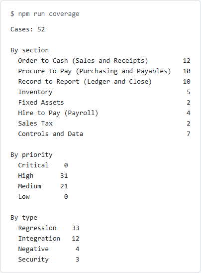
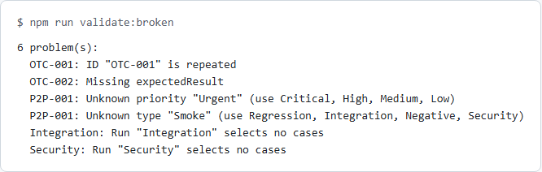
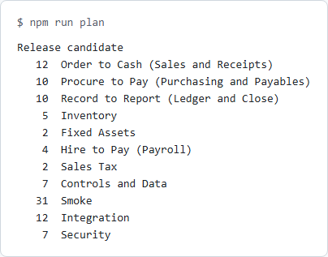
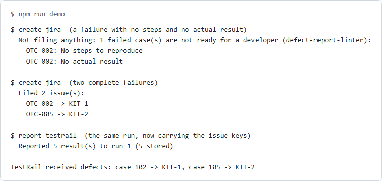
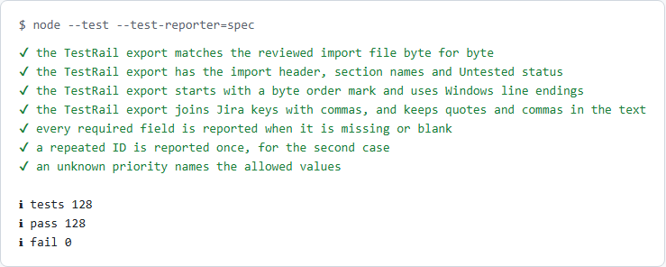

[](docs/banner.svg)

# test-management-kit

A kit for keeping test cases as plain data in a repository, instead of locked inside one tool. 52 original test cases for any business that keeps books sit in one JSON file, organised by the accounting cycles (order to cash, procure to pay, record to report, hire to pay) plus inventory, fixed assets, sales tax and controls. A validator fails on a missing field, a repeated ID or an unknown priority or type. Exporters then turn the same data into a TestRail import file, a generic CSV for any other tool, and a Markdown report that needs no tool at all. The kit also builds a test plan (a run for each cycle, plus smoke, integration and security runs) and counts the cases by section, priority and type. Stage 2 adds a reporter that sends a run's results to TestRail and a creator that files a Jira issue for each failed case, after the defect-report-linter has checked the report is good enough for a developer. Both are tested against a local mock of each tool's documented API.

**In plain English:** most teams keep their test cases in a tool such as TestRail or Jira, and moving to another tool means retyping them. Here the cases live in one file in the repository, where they are reviewed like code. The kit checks that nothing is missing or repeated, then writes out whichever format a tool wants. The cases are written for accounting in general. They are not copied from any company's checklist.

After a test run, the results can go back into the tool without retyping them: passed, failed and blocked cases are sent to TestRail, and each failed case becomes a Jira issue with its steps, expected and actual result. A failure report with no steps or no actual result is refused before anything is filed, so a developer never gets a ticket they cannot act on.

**[Technical guide →](TECHNICAL.md)**

[](docs/coverage.png)

*`npm run coverage`: 52 cases across eight accounting sections, 31 High and 21 Medium priority, and four case types. A known value with no cases, such as Critical, shows as 0 instead of disappearing. ([dark version](docs/coverage-dark.png))*

## Installation

```bash
cd packages/test-management-kit && npm ci
```

Node 24 or later. No dependencies: Node runs the TypeScript directly.

## Quick start

Check the cases, then write the file TestRail imports.

```bash
npm run validate
npm run export:testrail   # out/testrail-import.csv
```

## At a glance

- 52 original cases in 8 sections, kept as one JSON file that is the single source of truth
- A validator that fails on a missing or blank field, a repeated ID, an ID that doesn't match its section, an unknown priority, type or section, text a spreadsheet would read as a formula, and a data file with the wrong shape (it reports these, never crashes)
- A TestRail import CSV that matches the reviewed import file byte for byte
- A generic CSV for any other tool, and a Markdown report that needs no tool
- A test plan with a run for each accounting cycle, plus smoke (the 31 High cases), integration (12) and security (7) runs
- A coverage report: cases per section, priority and type
- Export, plan and coverage refuse to run on data that fails validation
- A TestRail result reporter: sends a run's results to the documented `add_results_for_cases` endpoint, with the Jira issue keys in the defects field
- A Jira issue creator for failed cases: the defect-report-linter checks each report first, one weak report stops the whole run, and a case that already has an issue key is skipped so a re-run cannot file duplicates
- Credentials only from environment variables, never options; plain http only for this machine; `--dry-run` shows the requests with the secret hidden
- 128 tests, each bug put back once to show a test catches it

[](docs/validate-broken.png)

*`npm run validate:broken` on a sample with a repeated ID, an empty expected result, an unknown priority and type, and two runs that select nothing. Every problem is listed with its case ID, and the command exits 1. ([dark version](docs/validate-broken-dark.png))*

[](docs/plan.png)

*`npm run plan`: one run for each accounting cycle, so one tester can own a cycle, then the smoke, integration and security runs. ([dark version](docs/plan-dark.png))*

[](docs/integration-demo.png)

*`npm run demo`, all against the local mock: the weak report is refused with the linter's reasons, two complete failures become issues KIT-1 and KIT-2, and those keys reach TestRail in the defects field. ([dark version](docs/integration-demo-dark.png))*

## What was checked against what

| Part | Checked how |
|---|---|
| The cases and plan | The validator, in CI on every run, and 128 tests |
| The TestRail CSV | Matches the reviewed import file byte for byte. It has **not** been imported into a live TestRail: no TestRail instance was used |
| The generic CSV and Markdown report | Checked by tests only |
| The TestRail result reporter | Tested against a local mock that follows TestRail's documented API: the request path, Basic sign-in, the status ids and the error answers. It has **not** been run against a live TestRail. No TestRail account was used |
| The Jira issue creator | Tested against a local mock that follows Atlassian's documented issue endpoint, including its refusal of a plain-text description. It has **not** been run against a live Jira. A live proof on a free Jira site is planned |
| The defect-report-linter check | Runs the real linter from `packages/defect-report-linter` on every failed case |

A mock proves the kit sends what the documentation says it should, and that it handles the documented errors. It cannot prove that the real service accepts it. The first real run is the proof, and this page will say so when it happens.

## Results

[](docs/kit-tests.png)

*A slice of `node --test`: the validator and exporter tests, and the totals. ([dark version](docs/kit-tests-dark.png))*

- 128 tests pass, run five times in a row
- 56 mistakes were put back on purpose, 30 in stage 1 and 26 in stage 2, one at a time (no required-field check, repeated IDs accepted, a filter ignored, the linter no longer blocking filing, a failed case sent with the wrong TestRail status, a re-run filing duplicates, the Jira document missing its version, and so on), and each made at least one test fail. [The list](TECHNICAL.md#proof-that-the-tests-catch-mistakes)
- CI runs the tests, validates the shipped cases, writes all three exports, and runs both dry runs and the mock demo on every run

## License

MIT
