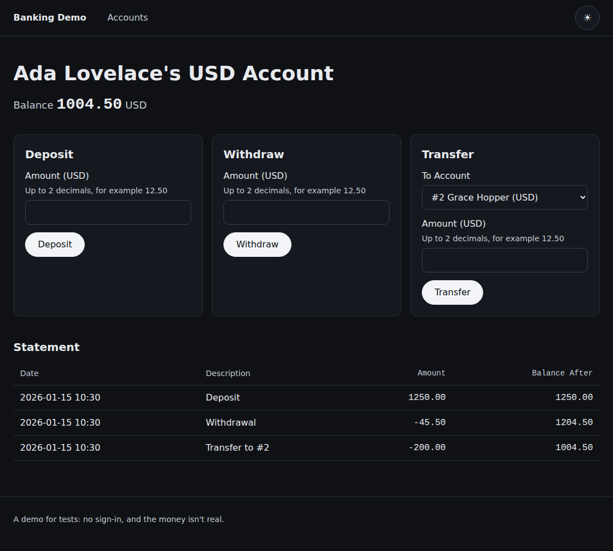
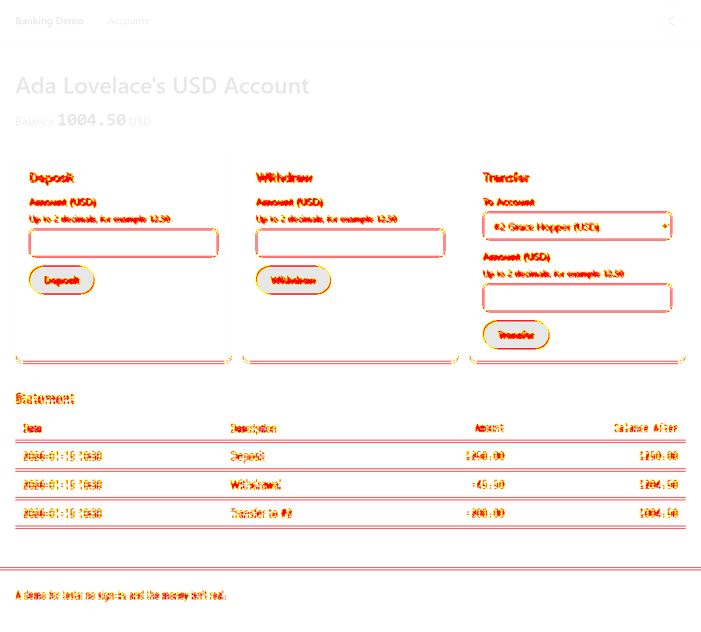

[](docs/banner.svg)

# visual-regression-demo

A visual regression suite for the [banking UI](../banking-api): it takes a screenshot of every page in light mode, dark mode and phone width, in Chromium and Firefox, and fails when a picture no longer matches its baseline. It is for anyone who wants to see how a screenshot check is made trustworthy: a frozen clock so nothing on the page changes by itself, baselines made on the same Linux machine that checks them, a tolerance tight enough to see a button a few shades off, and six planted visual bugs that the comparison must catch.

**In plain English:** a green test run does not mean the page still looks right. A button can turn the wrong colour or slide four pixels and every functional test still passes. This suite keeps a picture of how each page should look and tells you when a change alters it.

**[Technical guide →](TECHNICAL.md)**

[](baselines/linux/chromium/statement-dark.png)

*A baseline: Ada's account page, dark mode, Chromium on Linux. The suite keeps 32 baselines in all, and every run compares a fresh screenshot with each.*

## Installation

```bash
cd packages/visual-regression-demo && npm ci && npx playwright install chromium firefox
```

Node 24 or later.

## Quick start

```bash
npm test
```

The suite starts the banking UI itself, on a frozen clock, on port 4400. On Windows or macOS the first run makes its own baselines in a folder git ignores, and the next run compares against them. The committed baselines are Linux's, made by CI.

## At a glance

- 16 screenshots per browser: six pages in light and dark, plus two pages at phone width in both
- Fixed accounts and a frozen clock, so no date or id needs masking
- A tolerance of 0.05 instead of Playwright's 0.2, which would miss a button a few shades off
- Six planted visual bugs, each of which the comparison must see: a colour, a 4 px shift, a missing button, a clipped amount, unreadable dark mode, a wrapped column
- A test that proves the default tolerance misses the colour bug, so the setting is not guesswork
- Baselines made on the CI runner, with a manual workflow to remake them after a deliberate change
- 46 checks, run in Chromium and Firefox, with a failed comparison keeping the expected, actual and diff pictures

## What a failure looks like

[](docs/diff-example.png)

*The diff after a real change to the app's stylesheet (card padding 20 to 22 px, button colour a few shades lighter). Red marks every pixel that moved. 14 of 16 pages failed; the two that did not have no card or button.*

## Results

| Result | Number | Source |
|---|---|---|
| Visual bugs planted and caught by the comparison | 6 of 6 | [Planted visual bugs](TECHNICAL.md#planted-visual-bugs) |
| Pages that failed after one stylesheet change (Chromium, both themes) | 14 of 16 | [Deliberate breaks](TECHNICAL.md#deliberate-breaks) |
| Checks in CI | 46 | [CI integration](TECHNICAL.md#ci-integration) |

## License

MIT
